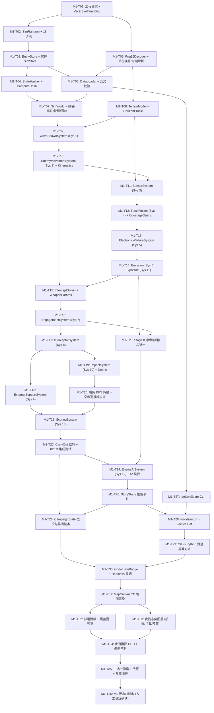

# M1 开发任务分解与执行路线图（`M1-T01` – `M1-T36`）

> **里程碑目标**：完成《守夜》Nightwatch 的 **M1 可玩灰盒原型**——C# 纯确定性模拟层（`sim/`，无 Godot 依赖）、完整单元测试套件（`sim.tests/`）、命令行校验与推演工具（`tools/validate`、`tools/simrun`），以及 Godot 4 .NET 灰盒客户端（`game/`，在 `test_01` 关卡上实现从简报 $\rightarrow$ 预部署 $\rightarrow$ 第 1 夜作战与二选一 $\rightarrow$ 夜末战报 $\rightarrow$ 跨夜整备与换防 $\rightarrow$ 第 2 夜作战的完整可玩闭环）。
> **执行粒度**：全部拆解为 **36 个原子任务（`M1-T01` – `M1-T36`）**。每个任务对应 **1 个专注的 AI 会话 + 1 次独立 Git 提交**，任何子代理无需阅读整套规格书即可凭本任务卡、所引用的 `docs/spec/00–07` 精确章节及 `tools/papersim/` 黄金参考实现完成开发与验收。

---

## 0. 总则与开工前自检（Pre-flight Checklist）

### 0.1 六条硬性铁律（违反任意一条不予合并）

1. **`sim/` 零 Godot 依赖**：`sim/` 下所有 `.cs` 与 `sim/Nightwatch.Sim.csproj` **严禁**出现 `using Godot;`、`Godot.Sdk` 或任何 Godot 程序集引用；目标框架固定为 `net8.0`，必须能通过命令行 `dotnet test sim.tests` 独立编译运行（由 `T-00-37` 自动扫描校验）。
2. **严格确定性**：
   - 模拟层只允许使用 `SimRandom`（PCG32 + SplitMix64 派生子流）；**严禁** `System.Random`、`DateTime.Now`、`Guid.NewGuid()`、`Environment.TickCount`、并行无序执行。
   - **严禁以 `Dictionary<K,V>` 或 `HashSet<T>` 的遍历顺序作为任何模拟逻辑、事件发射或状态哈希的依据**。所有实体遍历必须走 `EntityStore<T>` 的 `Id` 升序，所有字典写出哈希或参与遍历前必须按键排序（`OrderBy(kv => kv.Key, StringComparer.Ordinal)`）。
   - 禁止使用跨平台精度不一致的 `Math.Hypot` 或 `Math.FusedMultiplyAdd`；距离计算统一写 `Math.Sqrt(dx * dx + dy * dy)`。
3. **数据驱动 + 测试夹具隔离**：
   - 单位、武器、敌人、规则、关卡的一切参数从 `data/` JSON 读取，加载时完成单位换算（`Km → M`、`GameSec → Sec`、`Kmh → Mps`、`Cells → M`、`PerGameSec → PerSec`、`Pct → Frac`）。
   - 单元测试（除显式标注为正式数据集成测试的 `T-00-35`、`T-01-55`、`T-07-02` 外）一律使用各规格第 7 节定义的小型手写夹具（`Mini01`、`Mini02`、`Mini03`、`Mini04`、`Mini05`），不依赖正式平衡数值。
4. **`SimWorld.Step()` 顺序铁律**：
   - 每步固定推进 `1` 世界秒（`Tick++`），执行顺序严格固定为：**阶段 0（`CommandStage`：`ApplyDueCommands → DeploymentStage.Run → ChoiceStage.Run → StoryStage.Run`） $\rightarrow$ 系统 1 `WaveSpawnSystem` $\rightarrow$ 系统 2 `EnemyMovementSystem`（后重建 `ThreatGrid`） $\rightarrow$ 系统 3 `SensorSystem` $\rightarrow$ 系统 4 `TrackFusionSystem`（后重建 `TrackGrid`） $\rightarrow$ 系统 5 `ElectronicWarfareSystem` $\rightarrow$ 系统 6 `EmissionSystem` $\rightarrow$ 系统 7 `EngagementSystem` $\rightarrow$ 系统 8 `InterceptorSystem` $\rightarrow$ 系统 9 `ExternalSupportSystem` $\rightarrow$ 系统 10 `ImpactSystem` $\rightarrow$ 系统 11 `ExposureSystem` $\rightarrow$ 系统 12 `EnemyAiSystem` $\rightarrow$ 系统 13 `ScoringSystem` $\rightarrow$ 系统 14 `EventLog.SealStep()` $\rightarrow$ `CompactAllStores()`**。
5. **命名与本地化**：C# 标识符一律使用 `docs/spec/00_core.md` 登记的精确英文名（数据定义以 `Def` 结尾，运行时实体无后缀）；注释与文档用中文；显示文本用 `loc.xxx` 键引用。
6. **一任务一提交**：每个 `M1-Txx` 完成后必须运行本卡验收命令且 100% 通过，立即提交并推送，提交信息格式：`[M1-Txx] (WSxx-nnn) 简短中文说明`。

### 0.2 Python 黄金参考实现（Golden Oracle）使用指南

仓库中的 [`tools/papersim/`](../../tools/papersim/) 是与 `docs/spec/00–07` 100% 对齐并通过全部契约与双夜可玩性验证的纯 Python 确定性参考实现。实现任何 C# 任务时，若对边界条件或公式存疑，直接对照对应 Python 文件及行号，或运行以下命令获取基准输出：

```bash
# 1. 运行 Python 黄金参考实现的完整单元测试（13 个测试套件）
python3 -m tools.papersim test

# 2. 运行参考数值向量生成脚本（核对 PCG32、StateHasher、运动学、地形、探测、拦截、评分精确浮点值）
python3 tools/spec_calc/00/simrandom_vectors.py
python3 tools/spec_calc/00/hasher_vectors.py
python3 tools/spec_calc/01/01_movement_calc.py
python3 tools/spec_calc/01/01_terrain_calc.py

# 3. 运行 test_01 单夜无头黄金推演并输出 JSON 报告（用于 M1-T29 跨语言对齐）
python3 -m tools.papersim simrun --level test_01 --night 1 --seed 1 --json
```

---

## 1. 36 个原子任务总表与依赖图（DAG）

### 1.1 任务总表

| 任务 ID | 阶段 | WBS 编号 | 任务名称 | 规格书章节 | `papersim` 黄金参考 | 前置依赖 | 人工参与 |
|---|---|---|---|---|---|---|---|
| `M1-T01` | A | WS01-001 | 解决方案骨架、`Vec2`、`SimTime`、`Geo` 几何库与无 Godot 自检 | `00` §0.4–0.5 | `core.py:1–182` | 无 | 🟢 |
| `M1-T02` | A | WS01-002 | `SimRandom`（PCG32 + SplitMix64）与 18 个命名子流派生 | `00` §2.1, §3.1 | `core.py:185–318` | `M1-T01` | 🟢 |
| `M1-T03` | A | WS01-003a | `EntityIdGen`、`EntityStore<T>`、全部实体与 `SimState` 容器 | `00` §2.2–2.5 | `entities.py:1–540` | `M1-T02` | 🟢 |
| `M1-T04` | A | WS01-020a | `StateHasher`（FNV-1a 64 位规范编码）与 `SimState.ComputeHash()` | `00` §3.7 | `core.py:321–410`, `entities.py:541–620` | `M1-T03` | 🟢 |
| `M1-T05` | A | WS01-004a | 数据源抽象、`Png16Decoder`、单位换算器与时期解析器 | `00` §0.4.2, §1.1–1.5 | `loader.py:17–548` | `M1-T01` | 🟢 |
| `M1-T06` | A | WS01-004b | `DataLoader.LoadCatalog` / `LoadLevel`、交叉引用校验与 `DataHash` | `00` §1.2–1.6 | `loader.py:550–917` | `M1-T03`, `M1-T05` | 🟢 |
| `M1-T07` | A | WS01-003b | `SimWorld` 骨架、14 系统调度、命令队列、`EventLog`、`SimSnapshot` 与 `ReplayRunner` | `00` §2.6–2.7, §3.2–3.9 | `world.py:290–906` | `M1-T04`, `M1-T06` | 🟢 |
| `M1-T08` | A | WS01-006 | `TerrainModel`：双线性高程采样、地球曲率视线与 `HorizonProfile` 多山脊包络 | `01` §1.6, §3.3 | `terrain.py:1–252` | `M1-T05` | 🟢 |
| `M1-T09` | A | WS01-005a | `WaveSpawnSystem`（系统 1）：时间表、目标抽取、平台挂载与注入波次 | `01` §1.1–1.4, §3.1 | `movement.py:1–345` | `M1-T07`, `M1-T08` | 🟢 |
| `M1-T10` | A | WS01-005b | `EnemyMovementSystem`（系统 2）、12 种高度剖面、`ThreatRouting` 与 `ThreatKinematics` | `01` §1.5, §2, §3.2 | `movement.py:348–850` | `M1-T09` | 🟢 |
| `M1-T11` | B | WS01-007a | 环境修正 `EnvironmentResolver` 与 `SensorSystem`（系统 3：雷达/光学/声学探测与预警） | `02` §1.1–1.3, §3.1 | `sensing.py:35–305` | `M1-T08`, `M1-T10` | 🟢 |
| `M1-T12` | B | WS01-007b | `TrackFusionSystem`（系统 4）：航迹融合、火控指示 `Cueing`、诱饵甄别与 `CoverageQuery` | `02` §1.3, §3.2, §3.5 | `sensing.py:308–520` | `M1-T11` | 🟢 |
| `M1-T13` | B | WS01-016 | `ElectronicWarfareSystem`（系统 5）：导航欺骗、反无人机致盲、雷达压缩与友好误伤区 | `02` §1.4, §3.3 | `sensing.py:523–695` | `M1-T12` | 🟢 |
| `M1-T14` | B | WS01-008 | `EmissionSystem`（系统 6）：4 种辐射策略、反辐射锁定归航与 `ExposureSystem`（系统 11） | `02` §1.5, §3.4, §3.6 | `sensing.py:698–915` | `M1-T13` | 🟢 |
| `M1-T15` | B | WS01-010a | `InterceptSolver`（3D 步进包围 + 32 步二分）与 `WeaponParams` 命中率修正链 | `03` §1.1–1.2, §3.0 | `engagement.py:47–260` | `M1-T10`, `M1-T14` | 🟢 |
| `M1-T16` | B | WS01-009 | `EngagementSystem`（系统 7）：交战规则过滤、弹药保留、期望成本选优与装填冷却 | `03` §1.1, §3.1 | `engagement.py:262–572` | `M1-T15` | 🟢 |
| `M1-T17` | B | WS01-010b | `InterceptorSystem`（系统 8）：拦截弹飞行、半主动失锁、命中掷骰与杀伤结算 | `03` §3.2 | `engagement.py:573–710` | `M1-T16` | 🟢 |
| `M1-T18` | B | WS01-018 | `ExternalSupportSystem`（系统 9）：战斗机巡逻区、防空净空限制、国级干扰与邻州借调 | `03` §1.3, §3.3 | `engagement.py:712–835` | `M1-T17` | 🟢 |
| `M1-T19` | B | WS01-012 | `ImpactSystem`（系统 10）：精度档偏移、设施伤害、我方单位战损与城区拦截残骸 `Debris` | `03` §1.4, §3.4.1–3.4.4 | `engagement.py:838–1035` | `M1-T17` | 🟢 |
| `M1-T20` | B | WS01-013 | 电网连通性传播（BFS 供电判定）与 `CivilDefense` 空袭警报响应度演进 | `03` §1.5, §3.4.5, §3.5.3 | `engagement.py:1036–1110` | `M1-T19` | 🟢 |
| `M1-T21` | B | WS01-014 | `ScoringSystem`（系统 13）：交换比、挥霍质询、囤弹漏防、信任值奖惩与胜负评级 | `03` §1.6, §3.5 | `engagement.py:1112–1244` | `M1-T18`, `M1-T20` | 🟢 |
| `M1-T22` | B | WS01-014b | `CarryOut` 跨夜结转打包与 02+03 联合集成测试 | `03` §3.6, §7 | `world.py:770–855` | `M1-T21` | 🟢 |
| `M1-T23` | C | WS01-011 | 阶段 0 命令与部署系统：`DeploymentValidator`、`CommandStage`、`DeploymentStage` 与 `ChoiceStage` | `04` §1.1–1.2, §3.1–3.2 | `world.py:55–288`, `enemy_ai.py:30–310` | `M1-T14`, `M1-T16` | 🟢 |
| `M1-T24` | C | WS01-019 | `EnemyAiSystem`（系统 12）：试探目击、压制延后、猎杀索敌、饱和齐射与 A* 防空圈绕行 | `04` §1.3, §3.3 | `enemy_ai.py:312–660` | `M1-T22`, `M1-T23` | 🟢 |
| `M1-T25` | C | WS01-027 | `StoryStage` 剧情触发器与动作执行（`spawn_wave` / `grant_support` / `choice` / `ModifyRule`） | `04` §1.4, §3.4 | `enemy_ai.py:662–762` | `M1-T24` | 🟢 |
| `M1-T26` | C | WS01-021 | 战役与跨夜状态机 `CampaignState`：昼间修缮、换防槽位、紧急支援与补给窗口（M1 子集） | `05` §1–§3 | `campaign.py:1–498` | `M1-T22`, `M1-T25` | 🟢 |
| `M1-T27` | C | WS06-004 | `tools/validate` 数据校验 CLI 与 `DataValidator` 全量规则检查 | `07` §1 | `cli.py:20–85`, `loader.py` | `M1-T06` | 🟢 |
| `M1-T28` | C | WS06-006 | `tools/simrun` 无头推演 CLI、内置 `TacticalBot` 策略与回放校验命令 | `07` §2 | `cli.py:88–220`, `bots.py:1–320` | `M1-T25`, `M1-T27` | 🟢 |
| `M1-T29` | C | WS01-020b | C# `sim` 与 Python `papersim` 在 `test_01` 上的跨语言黄金基准对齐测试 | `00` §3.7, `07` §2.4 | `tests/test_contracts.py` | `M1-T28` | 🟢 |
| `M1-T30` | D | WS02-001 | Godot 4 .NET 项目配置（`game/`）、`SimBridge` 会话门面与 `Test01HeadlessSmoke` | `06` §1–§2 | `webproto/session.py:46–260` | `M1-T26`, `M1-T29` | 🟢 |
| `M1-T31` | D | WS02-002 | 2D 战术地图渲染器 `MapCanvas`（高程热力、河谷/城区/山脊、电网、保护目标与平移缩放） | `06` §3.1–3.2 | `webproto/static/app.js:240–520` | `M1-T30` | 🟢 |
| `M1-T32` | D | WS02-003 | 夜前部署与跨夜整备 UI：拖拽放置、`CoverageQuery` 覆盖圈预览、预设方案与暴露换防提醒 | `06` §3.3, §4.1 | `webproto/static/app.js:525–740` | `M1-T31` | 🟢 |
| `M1-T33` | D | WS02-005 | 夜间态势图层：航迹符号（模糊/大致/精确）、扇形预警、拦截线、辐射圈与暴露度色环 | `06` §3.4 | `webproto/static/app.js:380–515` | `M1-T31` | 🟢 |
| `M1-T34` | D | WS02-006 | 夜间指挥 HUD：倍速控制（暂停/1×/2×/4×/自动快进 8×）、雷达开关、交战规则与转移指令 | `06` §4.2–4.4 | `webproto/static/app.js:745–920` | `M1-T32`, `M1-T33` | 🟢 |
| `M1-T35` | D | WS02-008 | 二选一硬暂停弹窗 `ChoiceDialog`、多维度夜末战报 `ReportModal` 与双夜流程闭环 | `06` §4.5–4.7 | `webproto/static/app.js:925–1120` | `M1-T34` | 🟢 |
| `M1-T36` | D | WS02-010 | M1 灰盒集成验收、Godot `--headless` 冒烟脚本与人工试玩审核清单 | `06` §6–§7 | `run_d4_3_playtest.py` | `M1-T35` | 🔴 |

### 1.2 依赖拓扑图（DAG）与并发执行分层



- **拓扑并发分层（同一层内的任务互不依赖，可并行派发子代理）**：
  - **Layer 0**：`M1-T01`
  - **Layer 1**：`M1-T02`、`M1-T05`
  - **Layer 2**：`M1-T03`、`M1-T08`
  - **Layer 3**：`M1-T04`、`M1-T06`
  - **Layer 4**：`M1-T07`、`M1-T27`
  - **Layer 5**：`M1-T09` $\rightarrow$ `M1-T10` $\rightarrow$ `M1-T11` $\rightarrow$ `M1-T12` $\rightarrow$ `M1-T13` $\rightarrow$ `M1-T14` $\rightarrow$ `M1-T15` $\rightarrow$ `M1-T16`
  - **Layer 6**：`M1-T17` + `M1-T23`（并行） $\rightarrow$ `M1-T18` + `M1-T19`（并行） $\rightarrow$ `M1-T20` $\rightarrow$ `M1-T21` $\rightarrow$ `M1-T22`
  - **Layer 7**：`M1-T24` $\rightarrow$ `M1-T25` $\rightarrow$ `M1-T26` + `M1-T28`（并行） $\rightarrow$ `M1-T29`
  - **Layer 8**：`M1-T30` $\rightarrow$ `M1-T31` $\rightarrow$ `M1-T32` + `M1-T33`（并行） $\rightarrow$ `M1-T34` $\rightarrow$ `M1-T35` $\rightarrow$ `M1-T36`

### 1.3 WBS 条目 ↔ M1 原子任务双向映射表

| WBS 编号 | WBS 标题 | 对应 `M1-Txx` | 说明 |
|---|---|---|---|
| `WS01-001` | 创建解决方案与 `sim` / `sim.tests` 工程 | `M1-T01` | 含 `Vec2`、`SimTime`、`Geo` 及无 Godot 扫描测试 |
| `WS01-002` | `SimRandom` 确定性随机数与子流 | `M1-T02` | PCG32 + SplitMix64 + 18 子流向量 |
| `WS01-003` | 实体容器、`SimState`、`SimWorld.Step()`、命令与事件 | `M1-T03`, `M1-T07` | 拆分为状态容器（T03）与世界门面/调度（T07） |
| `WS01-004` | 数据加载器（JSON + 16 位 PNG 高程图 + 时期解析） | `M1-T05`, `M1-T06` | 拆分为底层解码换算（T05）与目录/关卡加载校验（T06） |
| `WS01-005` | 波次生成、敌方运动学与 12 种高度剖面 | `M1-T09`, `M1-T10` | 拆分为 `WaveSpawnSystem`（T09）与 `EnemyMovementSystem`（T10） |
| `WS01-006` | 地形高程双线性采样、地球曲率视线与山脊遮挡 | `M1-T08` | 含 `HorizonProfile` 720 方位桶加速包络 |
| `WS01-007` | 传感器探测、航迹融合、火控指示与诱饵甄别 | `M1-T11`, `M1-T12` | 拆分为 `SensorSystem`（T11）与 `TrackFusionSystem`（T12） |
| `WS01-008` | 雷达辐射策略、暴露度累积与反辐射导弹归航 | `M1-T14` | 同时实现系统 6 `EmissionSystem` 与系统 11 `ExposureSystem` |
| `WS01-009` | 交战规则、目标筛选、弹药保留与装填冷却 | `M1-T16` | 系统 7 `EngagementSystem` |
| `WS01-010` | 解析拦截求解器与拦截弹飞行/命中掷骰 | `M1-T15`, `M1-T17` | 拆分为 `InterceptSolver`（T15）与 `InterceptorSystem`（T17） |
| `WS01-011` | 玩家夜间指令、展开/撤收/转移状态机与二选一 | `M1-T23` | 阶段 0 `CommandStage` / `DeploymentStage` / `ChoiceStage` |
| `WS01-012` | 弹药落地、设施伤害、我方战损与城区碎片 | `M1-T19` | 系统 10 `ImpactSystem`（前半部分） |
| `WS01-013` | 电网节点破坏、连通性传播与空袭警报 | `M1-T20` | 系统 10 电网传播 + 系统 13 警报响应度 |
| `WS01-014` | 夜晚结算、交换比、信任值、胜负判定与跨夜结转 | `M1-T21`, `M1-T22` | 拆分为 `ScoringSystem`（T21）与 `CarryOut` 结转集成（T22） |
| `WS01-016` | 电子战系统（导航欺骗、反无人机、雷达压制） | `M1-T13` | 系统 5 `ElectronicWarfareSystem` |
| `WS01-018` | 外部支援系统（战斗机巡逻、国级干扰、邻州火力） | `M1-T18` | 系统 9 `ExternalSupportSystem` |
| `WS01-019` | 敌方 AI（试探、压制、猎杀、绕行、饱和） | `M1-T24` | 系统 12 `EnemyAiSystem` + A* 网格绕行 |
| `WS01-020` | 状态哈希、快照不可变性与回放检验 | `M1-T04`, `M1-T07`, `M1-T29` | 含 C# vs Python 黄金基准对齐（T29） |
| `WS01-021`–`026` | 战役流转、昼间整备、补给修缮与紧急支援（M1 子集） | `M1-T26` | 实现 `05_campaign_and_meta.md` 规定的全部状态转换与测试 |
| `WS01-027` | 剧情事件触发器与动作（`events.json`） | `M1-T25` | 阶段 0 `StoryStage` |
| `WS06-004` / `006` | `tools/validate` 与 `tools/simrun` 命令行工具 | `M1-T27`, `M1-T28` | 校验 `data/` 全量文件 + 无头跑完整夜 |
| `WS02-001`–`010` | Godot 4 .NET 灰盒客户端（地图、部署、作战、战报、双夜） | `M1-T30`–`M1-T36` | 在 `game/` 下交付可玩灰盒并通过人工试玩验收 |

---

## 2. 阶段 A：模拟层地基、数据加载、地形与敌方生成移动（`M1-T01` – `M1-T10`）

### `M1-T01`（WS01-001）：解决方案骨架、`Vec2`、`SimTime`、`Geo` 几何库与无 Godot 自检

1. **目标文件**
   - 创建：`Nightwatch.sln`、`sim/Nightwatch.Sim.csproj`、`sim.tests/Nightwatch.Sim.Tests.csproj`
   - 创建：`sim/Core/Vec2.cs`、`sim/Core/SimTime.cs`、`sim/Core/Geo.cs`、`sim/Core/SimError.cs`、`sim/Core/YearMonth.cs`、`sim/Core/MinMax.cs`
   - 创建：`sim.tests/Core/GeoAndTimeTests.cs`、`sim.tests/Core/NoGodotDependencyTests.cs`
2. **规格书与参考实现对照**
   - 规格书：[`docs/spec/00_core.md`](../spec/00_core.md) §0.4.3–0.4.6（`SimTime`、`Vec2`、`Azimuth`、`Geo`）、§0.5（工程结构与无 Godot 约束）、§7（`T-00-13`、`T-00-14`、`T-00-37`、`T-00-38`）。
   - Python 黄金参考：[`tools/papersim/core.py`](../../tools/papersim/core.py) 第 `1–182` 行。
3. **核心 C# 类型与方法签名**
   ```csharp
   namespace Nightwatch.Sim.Core;

   public readonly record struct Vec2(double X, double Y)
   {
       public static readonly Vec2 Zero = new(0.0, 0.0);
       public double Length => Math.Sqrt(X * X + Y * Y);
       public double LengthSquared => X * X + Y * Y;
       public double DistanceTo(Vec2 other) { double dx = other.X - X, dy = other.Y - Y; return Math.Sqrt(dx * dx + dy * dy); }
       public static Vec2 Lerp(Vec2 a, Vec2 b, double t) => new(a.X + (b.X - a.X) * t, a.Y + (b.Y - a.Y) * t);
       public static Vec2 operator +(Vec2 a, Vec2 b) => new(a.X + b.X, a.Y + b.Y);
       public static Vec2 operator -(Vec2 a, Vec2 b) => new(a.X - b.X, a.Y - b.Y);
       public static Vec2 operator *(Vec2 a, double s) => new(a.X * s, a.Y * s);
   }

   public static class SimTime
   {
       public const double TickEpsilon = 1e-9;
       public static int SecToTicksCeil(double sec, double stepSec = 1.0);
       public static int SecToTicksFloor(double sec, double stepSec = 1.0);
   }

   public static class Geo
   {
       public static double AzimuthRad(Vec2 from, Vec2 to);
       public static double NormalizeAzimuth(double rad);
       public static bool PointInPolygon(Vec2 pt, IReadOnlyList<Vec2> poly);
       public static Vec2? FirstEntryIntoCircle(Vec2 a, Vec2 b, Vec2 center, double radius);
       public static double DistancePointToSegment(Vec2 pt, Vec2 a, Vec2 b, out Vec2 closest);
   }
   ```
4. **核心算法步骤与易错点**
   - `SecToTicksCeil(sec, stepSec)`：当 `sec < -TickEpsilon` 或 `stepSec <= 0` 时抛 `ArgumentOutOfRangeException`；当 `sec <= 0` 时返回 `0`；否则返回 `(int)Math.Ceiling(sec / stepSec - TickEpsilon)`。
   - `AzimuthRad(from, to)`：正北（`+Y`）为 `0`，顺时针增加，范围 `[0, 2π)`，用 `Math.Atan2(dx, dy)` 实现（注意参数顺序是 `(dx, dy)` 而非 `(dy, dx)`！重合点返回 `0.0`）。
   - `PointInPolygon`：标准奇偶射线法（向 `+X` 射线），半开区间 `((vi.Y > pt.Y) != (vj.Y > pt.Y))` 且 `pt.X < (vj.X - vi.X) * (pt.Y - vi.Y) / (vj.Y - vi.Y) + vi.X`，左边界含、右边界不含；顶点数 `< 3` 返回 `false`。
   - `FirstEntryIntoCircle(a, b, c, r)`：若起点 `a` 已在圆内（`a.DistanceTo(c) <= r + 1e-9`）直接返回 `a`；否则求解二次方程 $t \in [0, 1]$ 的最小根。
5. **必写单元测试与精确断言值**
   - `T-00-13`：`SecToTicksCeil(6.000000000000001, 1) == 6`、`SecToTicksCeil(6.0000001, 1) == 7`、`SecToTicksFloor(5.999999999999999, 1) == 6`、`SecToTicksCeil(-1, 1)` 抛异常。
   - `T-00-14`：`AzimuthRad((0,0), (0,10)) == 0.0`、`(10,0) == π/2`、`(0,-10) == π`、`(-10,0) == 3π/2`、`NormalizeAzimuth(-π) == π`。
   - `T-00-37`：扫描 `sim/` 下 `.csproj` 与全部 `.cs` 不含 `Godot`，并对含 `"using Godot;"` 的测试字符串断言扫描器报错。
   - `T-00-38`：正方形 `[(0,0),(10,0),(10,10),(0,10)]` 内点 `(5,5) -> true`、`(0,5) -> true`、`(10,5) -> false`；`FirstEntryIntoCircle((-100,0), (100,0), (0,0), 50) == (-50.0, 0.0)`。
6. **验收命令**
   ```bash
   dotnet test sim.tests --filter "FullyQualifiedName~GeoAndTimeTests|FullyQualifiedName~NoGodotDependencyTests"
   ```

---

### `M1-T02`（WS01-002）：`SimRandom`（PCG32 + SplitMix64）与 18 个命名子流派生

1. **目标文件**
   - 创建：`sim/Core/IRandom.cs`、`sim/Core/SimRandom.cs`
   - 创建：`sim.tests/Core/SimRandomTests.cs`
2. **规格书与参考实现对照**
   - 规格书：[`docs/spec/00_core.md`](../spec/00_core.md) §2.1、§3.1.1–3.1.5、§7（`T-00-01` – `T-00-11`）。
   - Python 黄金参考：[`tools/papersim/core.py`](../../tools/papersim/core.py) 第 `185–318` 行；[`tools/spec_calc/00/simrandom_vectors.py`](../../tools/spec_calc/00/simrandom_vectors.py)。
3. **核心 C# 类型与方法签名**
   ```csharp
   namespace Nightwatch.Sim.Core;

   public readonly record struct RngState(ulong Seed, ulong State, ulong Inc);

   public interface IRandom
   {
       ulong Seed { get; }
       uint NextUInt32();
       ulong NextUInt64();
       int NextInt(int minInclusive, int maxExclusive);
       double NextDouble();
       double Range(double minInclusive, double maxInclusive);
       bool Chance(double probability);
       IRandom Derive(string streamName);
       RngState GetState();
       void SetState(RngState state);
   }

   public sealed class SimRandom : IRandom
   {
       public static readonly string[] AllStreamNames = [
           "setup", "command", "spawn", "movement", "sensor", "fusion", "ew", "emission",
           "engagement", "intercept", "support", "impact", "exposure", "enemy_ai", "scoring",
           "civil", "environment", "crew"
       ];
       public SimRandom(ulong seed);
       public static ulong SplitMix64(ref ulong x);
       public static ulong Fnv1a64(ReadOnlySpan<byte> utf8);
       public static ulong ChildSeed(ulong parentSeed, string streamName);
       public static ulong NightSeed(ulong runSeed, string levelId, int nightSeq);
       public static uint Bounded(uint range, Func<uint> next);
   }
   ```
4. **核心算法步骤与易错点**
   - **PCG32 (`pcg32_random_r`)**：常量 `Multiplier = 6364136223846793005UL`。构造时令 `sm = seed`：`initState = SplitMix64(ref sm)`、`initSeq = SplitMix64(ref sm)`，然后 `_state = 0UL; _inc = (initSeq << 1) | 1UL; NextUInt32(); _state += initState; NextUInt32();`。
   - **单步输出**：`ulong old = _state; _state = unchecked(old * Multiplier + _inc); uint xorshifted = (uint)(((old >> 18) ^ old) >> 27); int rot = (int)(old >> 59); return (xorshifted >> rot) | (xorshifted << ((-rot) & 31));`。
   - **`NextDouble()`**：调用两次 `NextUInt32()`：`hi = NextUInt32() >> 5`（27 位），`lo = NextUInt32() >> 6`（26 位），返回 `((ulong)hi * 67108864UL + lo) * (1.0 / (1UL << 53))`。
   - **`Chance(p)`**：`double.IsNaN(p)` 返回 `false` 且**不消耗**随机数；`p <= 0.0` 仍必须调用一次 `NextDouble()` 并返回 `false`；`p >= 1.0` 仍必须调用一次 `NextDouble()` 并返回 `true`（保证随机数消耗次数恒定！见 `T-00-07`）。
   - **`ChildSeed(parentSeed, name)`**：UTF-8 字节非空且纯 ASCII，算 `h = Fnv1a64(bytes)`，令 `x = parentSeed ^ h`，返回 `SplitMix64(ref x)`。`Derive(name)` **绝不推进**父流 `_state`。
5. **必写单元测试与精确断言值**
   - `T-00-01` – `T-00-05`：PCG32 官方向量 `(42, 54)` 首值 `0xA15C02B7`；`seed = 1` 首值 `0x5249C5DC`，首 `NextDouble` = `0.3214380736828547`，首 `NextUInt64` = `0x5249C5DC01959430`。
   - `T-00-06` – `T-00-07`：Lemire 无偏拒绝采样 `Bounded(3, [0, 1]) == 1`；`Chance(0)` 与 `Chance(1)` 各消耗 1 次 `NextDouble()`。
   - `T-00-08` – `T-00-11`：核对全部 18 个子流的 `ChildSeed(1, name)` 与前 3 个 `NextUInt32`（如 `spawn` = `0x247FD80E4FD86BD1` / `0x3F223FCE`）；`NightSeed(1, "test_01", 1) == 0x6DD180096484586D`；`GetState/SetState` 往返一致。
6. **验收命令**
   ```bash
   dotnet test sim.tests --filter "FullyQualifiedName~SimRandomTests"
   ```

---

### `M1-T03`（WS01-003a）：`EntityIdGen`、`EntityStore<T>`、全部实体与 `SimState` 容器

1. **目标文件**
   - 创建：`sim/State/Entity.cs`、`sim/State/EntityIdGen.cs`、`sim/State/EntityStore.cs`、`sim/State/Enums.cs`
   - 创建：`sim/State/Entities/Threat.cs`、`Track.cs`、`FireUnit.cs`、`SensorUnit.cs`、`EwUnit.cs`、`DeceptionUnit.cs`、`Interceptor.cs`、`SupportAsset.cs`、`Debris.cs`、`Structure.cs`、`GridNode.cs`、`ChoiceRequest.cs`
   - 创建：`sim/State/Singletons/WaveState.cs`、`TrackState.cs`、`EngagementState.cs`、`ExposureState.cs`、`EnemyIntelState.cs`、`ScoringState.cs`、`CivilDefenseState.cs`、`CommandState.cs`、`StoryState.cs`、`EnvironmentState.cs`、`SimState.cs`
   - 创建：`sim.tests/State/EntityStoreTests.cs`
2. **规格书与参考实现对照**
   - 规格书：[`docs/spec/00_core.md`](../spec/00_core.md) §2.2–2.5（`EntityStore<T>`、`EntityKind`、全部 11 类实体字段登记表、10 个单例组件登记表）、§7（`T-00-15` – `T-00-17`）。
   - Python 黄金参考：[`tools/papersim/entities.py`](../../tools/papersim/entities.py) 第 `1–540` 行。
3. **核心 C# 类型与方法签名**
   ```csharp
   namespace Nightwatch.Sim.State;

   public abstract class Entity
   {
       public int Id { get; internal set; }
       public bool Alive { get; internal set; }
       public int CreatedTick { get; internal set; }
       public int RemovedTick { get; internal set; } = -1;
       public string? DefId { get; set; }
       public Vec2 Pos { get; set; }
       public double AltM { get; set; }
   }

   public sealed class EntityStore<T> where T : Entity
   {
       public EntityKind Kind { get; }
       public int Count { get; } // Alive 实体数量
       public T Add(T entity);
       public bool Remove(int id);
       public bool TryGet(int id, out T? entity);
       public bool TryGetIncludingRemoved(int id, out T? entity);
       public ReadOnlySpan<T> AliveSnapshot(); // 遍历前拍快照，允许循环体内 Add/Remove
       public void Compact();
   }
   ```
4. **核心算法步骤与易错点**
   - `EntityIdGen` 全局单调递增，从 `1` 开始分配，跨所有 `EntityStore` 共享同一个 `EntityIdGen`，删除实体后**永不重用 ID**。
   - `Add(entity)`：分配 `Id = _idGen.Next()`，`Alive = true`，`CreatedTick = _tickProvider()`，`RemovedTick = -1`，追加到内部列表（保持 `Id` 严格升序）。
   - `Remove(id)`：惰性标记删除（`Alive = false; RemovedTick = _tickProvider(); _aliveCount--;`），当步内仍可通过 `TryGetIncludingRemoved(id)` 读取，步末由 `SimWorld.Step()` 统一调用 `Compact()` 物理移除 `!Alive` 项。
   - 遍历语义：`foreach` 或 `AliveSnapshot()` 在进入循环瞬间固定上界 `n = _items.Count`，循环体中新 `Add` 的实体在本轮循环中不可见，但循环结束后立即可被后续系统访问（`T-00-17`）。
5. **必写单元测试与精确断言值**
   - `T-00-15`：按序添加电网节点 `g1,g2`、保护目标 `s1,s2,s3`、我方单位 `f1,r1`，断言 ID 依次为 `1..7` 且 `Ids.NextId == 8`。
   - `T-00-16`：添加 3 个实体 `a<b<c` 后同一步删除 `b`，断言当步 `TryGet(b) == false`、`TryGetIncludingRemoved(b) == true` 且 `RemovedTick == 1`、`Count == 2`；`Compact()` 后新加实体 ID 为 `c + 1`。
   - `T-00-17`：已有 2 个实体时在遍历循环中各 `Add` 1 个新实体，断言循环体恰好执行 2 次，循环后 `Count == 4`。
6. **验收命令**
   ```bash
   dotnet test sim.tests --filter "FullyQualifiedName~EntityStoreTests"
   ```

---

### `M1-T04`（WS01-020a）：`StateHasher`（FNV-1a 64 位规范编码）与 `SimState.ComputeHash()`

1. **目标文件**
   - 创建：`sim/Core/StateHasher.cs`
   - 更新：`sim/State/SimState.cs` 及各实体 / 单例组件的 `WriteHash(ref StateHasher h)` 方法
   - 创建：`sim.tests/Core/StateHasherTests.cs`
2. **规格书与参考实现对照**
   - 规格书：[`docs/spec/00_core.md`](../spec/00_core.md) §3.7.1–3.7.3（`StateHasher` 字节编码规范与 `SimState` 哈希写入总顺序）、§7（`T-00-24`）。
   - Python 黄金参考：[`tools/papersim/core.py`](../../tools/papersim/core.py) 第 `321–410` 行；[`tools/papersim/entities.py`](../../tools/papersim/entities.py) 第 `541–620` 行；[`tools/spec_calc/00/hasher_vectors.py`](../../tools/spec_calc/00/hasher_vectors.py)。
3. **核心 C# 类型与方法签名**
   ```csharp
   namespace Nightwatch.Sim.Core;

   public struct StateHasher
   {
       public const ulong OffsetBasis = 0xCBF29CE484222325UL;
       public const ulong Prime = 0x00000100000001B3UL;
       public StateHasher();
       public readonly ulong Value { get; }
       public void WriteByte(byte b);
       public void WriteBool(bool v);
       public void WriteInt32(int v);
       public void WriteUInt32(uint v);
       public void WriteInt64(long v);
       public void WriteUInt64(ulong v);
       public void WriteDouble(double v);
       public void WriteString(string? s);
       public void WriteVec2(Vec2 v);
   }
   ```
4. **核心算法步骤与易错点**
   - 所有多字节整数按 **Little-Endian（小端序）** 逐字节执行 `h = (h ^ b) * Prime`。
   - `WriteDouble(double v)`：
     - 若 `v == 0.0`（含 `-0.0`！通过 `v == 0.0` 归零），统一写入 `0UL`（8 个 `0x00` 字节）；
     - 若 `double.IsNaN(v)` 写入固定位模式 `0x7FF8000000000000UL`；
     - 否则写入 `(ulong)BitConverter.DoubleToInt64Bits(v)` 的小端 8 字节。
   - `WriteString(string? s)`：`null` 写入 `WriteInt32(-1)`（即 `ffffffff`）；非空先写 UTF-8 字节长度 `WriteInt32(bytes.Length)`，再依次写 UTF-8 字节。
   - `SimState.ComputeHash()` 严格按 `00_core.md` §3.7.2 顺序写出：`Tick` $\rightarrow$ `Ids.NextId` $\rightarrow$ `EndRequest` $\rightarrow$ 18 个命名子流的 `GetState()`（按 `SimRandom.AllStreamNames` 固定顺序） $\rightarrow$ 11 个 `EntityStore` 的存活实体列表（先写 `Count`，再按 `Id` 升序调每个实体的 `WriteHash`） $\rightarrow$ 10 个单例组件状态 $\rightarrow$ `EventLog.Hash`。
5. **必写单元测试与精确断言值**
   - `T-00-24`：
     - 空 `StateHasher().Value == 0xCBF29CE484222325UL`
     - `WriteInt32(7) -> 0x6D3572669B2CDE42UL`
     - `WriteDouble(1.5) -> 0xAA95E93229A27C80UL`
     - `WriteDouble(-0.0) == WriteDouble(0.0) == 0xA8C7F832281A39C5UL`
     - `WriteString("ab") -> 0x9254FD600693E9A0UL`
     - `WriteString(null) -> 0x994F76653E2A3951UL`
     - 组合写入 `(7, 1.5, "ab", true, 0xDEADBEEFUL) -> 0x461DC66E88FEC47BUL`
6. **验收命令**
   ```bash
   dotnet test sim.tests --filter "FullyQualifiedName~StateHasherTests"
   ```

---

### `M1-T05`（WS01-004a）：数据源抽象、`Png16Decoder`、单位换算器与时期解析器

1. **目标文件**
   - 创建：`sim/Data/IDataSource.cs`、`sim/Data/DataError.cs`、`sim/Data/Png16Decoder.cs`、`sim/Data/UnitConverter.cs`、`sim/Data/PeriodResolver.cs`、`sim/Data/Heightmap.cs`
   - 创建：`sim.tests/Data/UnitAndPeriodTests.cs`、`sim.tests/Data/Png16DecoderTests.cs`
2. **规格书与参考实现对照**
   - 规格书：[`docs/spec/00_core.md`](../spec/00_core.md) §0.4.2（单位换算规则与 3 个特例）、§1.3–1.5（错误码、时期解析 3 种形态、16 位 PNG 解码器）、§7（`T-00-12`、`T-00-32` – `T-00-34`）。
   - Python 黄金参考：[`tools/papersim/loader.py`](../../tools/papersim/loader.py) 第 `17–548` 行。
3. **核心 C# 类型与方法签名**
   ```csharp
   namespace Nightwatch.Sim.Data;

   public interface IDataSource
   {
       bool Exists(string relativePath);
       byte[] ReadBytes(string relativePath);
   }

   public sealed record DataError(string Code, string File, string JsonPath, string Detail)
   {
       public override string ToString() => $"[{Code}] {File} {JsonPath}: {Detail}";
   }

   public sealed class DataLoadException(IReadOnlyList<DataError> errors) : Exception(string.Join("\n", errors))
   {
       public IReadOnlyList<DataError> Errors { get; } = errors;
   }

   public static class Png16Decoder
   {
       public static Heightmap Decode(ReadOnlySpan<byte> pngBytes, double metersPerPixel, double minElevationM, double maxElevationM, string filePath = "");
   }
   ```
4. **核心算法步骤与易错点**
   - **单位换算乘除顺序铁律**：必须严格按单次运算执行：`Km -> v * 1000.0`、`GameSec -> v * C.GameSecToWorldSec`、`Kmh -> v / 3.6`、`Cells -> (v * C.CellKm) * 1000.0`、`PerGameSec -> v / C.GameSecToWorldSec`、`Mach -> (v * C.MachKmh) / 3.6`、`Pct -> v / 100.0`。兼容 `00_core.md` §0.4.2 第 7 条的 3 个特例字段（`offsetCellsAdd`、`configurableOnOffGameSec`、`sensorExposureLevelRates` / `ewExposureLevelRates`）。
   - **时期解析 3 种形态**：
     - 形态 A（`periodValue` 标量或 `[{from, value}]`）：`from` 必须严格升序（否则报 `E_PERIOD_ORDER`）；取最后一个 `from <= levelDate` 的项；若所有 `from > levelDate`，除 `rules/intercept.json` 的未来解锁列允许返回 `0.0` 外，一律报 `E_PERIOD_BEFORE_FIRST`。
     - 形态 B（时期表 `effectivenessByPeriod` / `accuracyByPeriod`）：取最后一个 `from <= levelDate` 的行。
     - 形态 C（日期闸门 `from` / `until`）：满足 `(from == null || levelDate >= from) && (until == null || levelDate < until)`（注意 `until` 是**左闭右开** `< until`，如 `until: "2023-04"` 在 `2023-03-31` 为 `true`，在 `2023-04-01` 为 `false`！见 `T-00-33`）。
   - **`Png16Decoder`**：校验 PNG 签名与 `IHDR`（`bitDepth == 16 && colorType == 0 && interlace == 0`），拼接全部 `IDAT` 用 `ZLibStream` 解压，支持全部 5 种行滤波器（0 `None`、1 `Sub`、2 `Up`、3 `Average`、4 `Paeth`，步长 `bpp = 2` 字节），大端 `ushort` 转高程：`minElevationM + (sample / 65535.0) * (maxElevationM - minElevationM)`。
5. **必写单元测试与精确断言值**
   - `T-00-12`：`speedKmh: 500 -> 138.88888888888889`、`ratesPerGameSec: 1.5 -> 0.025`、`worldStepSec: 2` 报 `E_RANGE`。
   - `T-00-32` & `T-00-33`：`2025-07-31 -> 0.75`、`2025-08-01 -> 0.55`、`2022-01-15` 报 `E_PERIOD_BEFORE_FIRST`；逆序报 `E_PERIOD_ORDER`；`until: "2023-04"` 在 `2023-04-01` 为 `false`。
   - `T-00-34`：2×2 16-bit PNG `[0, 65535; 32768, 0]` 解码为 `[100.0, 300.0, 200.00152590218966, 100.0]`；8-bit PNG 报 `E_PNG_FORMAT`。
6. **验收命令**
   ```bash
   dotnet test sim.tests --filter "FullyQualifiedName~UnitAndPeriodTests|FullyQualifiedName~Png16DecoderTests"
   ```

---

### `M1-T06`（WS01-004b）：`DataLoader.LoadCatalog` / `LoadLevel`、交叉引用校验与 `DataHash`

1. **目标文件**
   - 创建：`sim/Data/Defs/*.cs`（或汇总于 `sim/Data/CatalogDefs.cs`、`sim/Data/LevelDefs.cs`、`sim/Data/RulesDefs.cs`）、`sim/Data/GameCatalog.cs`、`sim/Data/LevelData.cs`、`sim/Data/DataLoader.cs`
   - 创建：`sim.tests/Data/DataLoaderTests.cs`、`sim.tests/Data/MovementRulesLoadTests.cs`、`sim.tests/Helpers/MiniLevelBuilder.cs`
2. **规格书与参考实现对照**
   - 规格书：[`docs/spec/00_core.md`](../spec/00_core.md) §1.1–1.6（26 个全局文件 + 9 个关卡文件固定加载序、18 条校验规则、`DataHash` 计算）、§7（`T-00-29` – `T-00-31`、`T-00-35`、`T-00-39`）；[`docs/spec/01_spawn_movement_terrain.md`](../spec/01_spawn_movement_terrain.md) §1.1–1.6、§7.5（`T-01-60` – `T-01-62`）。
   - Python 黄金参考：[`tools/papersim/loader.py`](../../tools/papersim/loader.py) 第 `162–917` 行。
3. **核心 C# 类型与方法签名**
   ```csharp
   namespace Nightwatch.Sim.Data;

   public static class DataLoader
   {
       public static GameCatalog LoadCatalog(IDataSource source, string levelDate, List<DataError>? errorsOut = null, List<string>? loadedFilesOut = null);
       public static LevelData LoadLevel(IDataSource source, string levelId, int? nightIndex = null);
       public static string ComputeDataHash(IDataSource source, IReadOnlyList<string> loadedFiles);
   }
   ```
4. **核心算法步骤与易错点**
   - **严格未知字段检查（`E_UNKNOWN_FIELD`）**：除白名单忽略字段 `"$schema"`、`"_source"`、`"notes"`、`"provisional"` 外，任何不在 schema 定义中的 JSON 属性必须收集 `E_UNKNOWN_FIELD` 错误；所有错误收集到列表末尾一次性抛出 `DataLoadException`（除非某文件报 `E_JSON_SYNTAX`，此时跳过依赖该文件的交叉引用检查，见 `T-00-31`）。
   - **共享武器一致性（`E_SHARED_WEAPON_MISMATCH`）**：不同防空单位引用同一武器 `id`（如 `s300ps` 与 `s300pt` 共用 `s300_missile`）时，去掉忽略字段后的原始定义必须完全一致，否则在第二次出现处报 `E_SHARED_WEAPON_MISMATCH`。
   - **按夜日期解析（`B-T2-17` / `T-00-39`）**：若 `LoadLevel(source, levelId, nightIndex)` 传入了 `nightIndex`，先预读 `waves.json` 查找该夜的 `date`（若有则校验落在 `level.json` 的 `[dateRange.from, dateRange.to]` 内），用 `night.Date ?? meta.DateRange.From` 作为 `resolvedDate` 加载并解析 `GameCatalog`。
   - **`DataHash` 计算**：对 `LoadedFiles`（正式关卡共 35 个文件：26 全局 + 8 关卡 JSON + 1 PNG）按加载顺序依次写入：`UTF8(relPath) + 0x00 + LittleEndianInt64(rawBytes.Length) + rawBytes`，求 SHA-256，格式化为 `"sha256:" + lowerHex`（总长 71 字符）。
5. **必写单元测试与精确断言值**
   - `T-00-29` – `T-00-31`：缺 `rangeKm` 报 `[E_MISSING_FIELD] units/air_defense.json $.units[0].weapons[0].rangeKm: 缺少必填字段`；类型/枚举/未知字段同时收集 3 条错误；`waves.json` 引用不存在敌人报 `E_UNKNOWN_REF`；共享武器不一致报 `E_SHARED_WEAPON_MISMATCH`。
   - `T-00-35`：正式 `data/` 加载 `test_01` 成功，`LoadedFiles.Count == 35`，`DataHash` 以 `"sha256:"` 开头且长 71。
   - `T-00-39`：多夜日期解析与 `E_NIGHT_DATE_MISMATCH`。
   - `T-01-60` – `T-01-62`：`rules/movement.json` 8 个高度带键校验、`rules/terrain.json` 范围校验、平台挂载与 `carrier` 弹药交叉校验。
6. **验收命令**
   ```bash
   dotnet test sim.tests --filter "FullyQualifiedName~DataLoaderTests|FullyQualifiedName~MovementRulesLoadTests"
   ```

---

### `M1-T07`（WS01-003b / WS01-020）：`SimWorld` 骨架、14 系统调度、命令队列、`EventLog`、`SimSnapshot` 与 `ReplayRunner`

1. **目标文件**
   - 创建：`sim/World/ISimSystem.cs`、`sim/World/SimContext.cs`、`sim/World/SimConfig.cs`、`sim/World/SimCommand.cs`、`sim/World/SimEvent.cs`、`sim/World/EventLog.cs`、`sim/World/SpatialGrid.cs`、`sim/World/SimSnapshot.cs`、`sim/World/SimWorld.cs`、`sim/World/Replay.cs`
   - 创建：`sim.tests/World/SimWorldFrameworkTests.cs`、`sim.tests/World/DeterminismAndReplayTests.cs`
2. **规格书与参考实现对照**
   - 规格书：[`docs/spec/00_core.md`](../spec/00_core.md) §2.6–2.7、§3.2–3.9、§4（事件与命令总表）、§7（`T-00-18` – `T-00-23`、`T-00-25` – `T-00-28`、`T-00-36`）。
   - Python 黄金参考：[`tools/papersim/world.py`](../../tools/papersim/world.py) 第 `290–906` 行。
3. **核心 C# 类型与方法签名**
   ```csharp
   namespace Nightwatch.Sim.World;

   public interface ISimSystem
   {
       int Order { get; }
       string Name { get; }
       string? StreamName { get; }
       void Initialize(SimContext ctx);
       void Execute(SimContext ctx);
   }

   public sealed class SimWorld
   {
       public static SimWorld Create(LevelData level, SimConfig config, ulong seed);
       public int Tick => State.Tick;
       public int DurationTicks { get; }
       public bool IsFinished => State.EndRequest != null;
       public NightResult? Result { get; private set; }
       public SimSnapshot Snapshot { get; }
       public SimCommand EnqueueCommand(SimCommand cmd);
       public IReadOnlyList<SimEvent> Step();
       public IReadOnlyList<SimEvent> DrainEvents();
       public ulong ComputeStateHash() => State.ComputeHash();
       public Replay ExportReplay(int checkpointInterval = 300);
   }
   ```
4. **核心算法步骤与易错点**
   - **命令入队规范化**：`EnqueueCommand(cmd)` 若 `cmd.EffectiveTick <= State.Tick`，自动规范化为 `State.Tick + 1`；分配单调递增 `Seq = _nextCommandSeq++`；队列按 `(EffectiveTick, Seq)` 严格升序出队（`T-00-18`）。
   - **命令校验与拒绝**：阶段 0 对当步到期命令调用 `Validate`；若返回拒绝原因，发出 `CommandRejected(CommandSeq, Type, Reason)` 且**不改变任何业务状态**（注意：`CommandRejected` 事件本身进入 `EventLog`，推进 `EventLog.Hash`；测试 `T-00-19` 中若需对比无命令世界，注意 `00_core.md` §3.4.3 规定被拒绝命令不改变 `EventLog.Hash`，即 `EventLog.Emit` 对 `CommandRejected` 不混入 `EventLog.Hash`！务必对照 `world.py` 与 `00_core.md` §3.4.3 实现）。
   - **快照缓存与不可变性**：在两次 `Step()` 之间多次读取 `world.Snapshot` 返回同一引用（`ReferenceEquals`），且 `Step()` 推进后旧 `SimSnapshot` 实例的数组内容绝不改变（`T-00-27`）。只读访问 `Snapshot`、`DrainEvents()` 或开启 `CaptureDebug` 绝不影响 `ComputeStateHash()`（`T-00-26`）。
5. **必写单元测试与精确断言值**
   - `T-00-18` – `T-00-23`：命令生效步规范化与拒绝、空世界 600 步 `DurationElapsed`、14 系统 `Initialize` 与 `Execute` 顺序与子流种子校验、`EndWhenClear` 第 1 步提前结束、`DrainEvents` 连续序号 `1..7`。
   - `T-00-25` – `T-00-28`：同种子 1000 步哈希逐步一致、读取 `Snapshot`/`DrainEvents`/`CaptureDebug` 不影响哈希、快照不可变、`ReplayRunner` 往返及篡改 `dataHash` / `effectiveTick` 抛 `ReplayDataMismatchException` / `ReplayDivergedException`。
   - `T-00-36`：请求不存在的 `NightIndex = 2` 抛 `SimSetupException`（`E_NIGHT_NOT_FOUND`）。
6. **验收命令**
   ```bash
   dotnet test sim.tests --filter "FullyQualifiedName~SimWorldFrameworkTests|FullyQualifiedName~DeterminismAndReplayTests"
   ```

---

### `M1-T08`（WS01-006）：`TerrainModel`：双线性高程采样、地球曲率视线与 `HorizonProfile` 多山脊包络

1. **目标文件**
   - 创建：`sim/Terrain/TerrainModel.cs`、`sim/Terrain/HorizonProfile.cs`
   - 创建：`sim.tests/Terrain/TerrainModelTests.cs`
2. **规格书与参考实现对照**
   - 规格书：[`docs/spec/01_spawn_movement_terrain.md`](../spec/01_spawn_movement_terrain.md) §1.6、§3.3.1–3.3.5（像素中心坐标、双线性插值、地球曲率下沉、视线采样与快速接受、`HorizonProfile` 多山脊径向单调包络）、§7.4（`T-01-50` – `T-01-58`）。
   - Python 黄金参考：[`tools/papersim/terrain.py`](../../tools/papersim/terrain.py) 第 `1–252` 行；[`tools/spec_calc/01/01_terrain_calc.py`](../../tools/spec_calc/01/01_terrain_calc.py)。
3. **核心 C# 类型与方法签名**
   ```csharp
   namespace Nightwatch.Sim.Terrain;

   public sealed class TerrainModel
   {
       public TerrainModel(Heightmap heightmap, TerrainRulesDef rules);
       public double MaxElevationM { get; }
       public double? ReffM { get; }
       public double ElevationAt(double x, double y);
       public double ElevationAt(Vec2 pos) => ElevationAt(pos.X, pos.Y);
       public double CurvatureDropM(double sM, double dM);
       public bool HasLineOfSight(Vec2 a, double aMslM, Vec2 b, double bMslM);
       public bool HasLineOfSightAgl(Vec2 a, double aAglM, Vec2 b, double bAglM);
       public HorizonProfile BuildHorizonProfile(Vec2 observer, double observerAglM, double maxRangeM, int? azimuthBins = null);
   }
   ```
4. **核心算法步骤与易错点**
   - **像素中心与北行在前约定**：高程图第 `0` 行在北侧（$y$ 最大），第 `HeightPx - 1` 行在南侧（$y$ 最小）。連続像素坐标：$u = x / \text{mpp} - 0.5$，$v = (\text{HeightPx} \cdot \text{mpp} - y) / \text{mpp} - 0.5$；钳位到 $[0, W-1]$ 与 $[0, H-1]$ 后做标准双线性插值（地图外自动延伸边缘像素值）。
   - **地球曲率遮挡公式**：当 `ReffM = RefractionK * EarthRadiusM` 非空时，距离为 $d$ 的两点在中间弧长 $s \in (0, d)$ 处的地球曲率隆起量为 $\Delta h(s) = \frac{s(d - s)}{2 R_{\text{eff}}}$；视线高度 $z_{\text{ray}}(s) = a_{\text{msl}} + (b_{\text{msl}} - a_{\text{msl}}) \cdot (s / d) - \Delta h(s)$。当且仅当存在内部采样点满足 `ElevationAt(p_i) > z_ray(s_i) + 1e-9`（严格大于！）时判定为遮挡（返回 `false`）。
   - **快速接受优化**：若 $\min(a_{\text{msl}}, b_{\text{msl}}) - \frac{d^2}{8 R_{\text{eff}}} > \text{MaxElevationM} + 10^{-6}$，无需采样地形直接返回 `true`（`T-01-54`）。
   - **`HorizonProfile` 多山脊包络**：按 `HorizonAzimuthBins`（默认 720）个方位角、径向步长 `stepM = LosSampleStepPx * mpp` 向外采样，记录径向**单调非降**的累积最大仰角斜率包络 $S_{\max}[bin, k] = \max_{1 \le j \le k} \frac{E(r_j) + r_j^2 / (2 R_{\text{eff}}) - a_{\text{msl}}}{r_j}$。查询距离 $d$ 的目标时，只需取 $d$ 之前的包络值与目标斜率比较，既 $O(1)$ 查表又不会让远处高山脊遮挡两山脊之间的中空目标（`T-01-58`）。
5. **必写单元测试与精确断言值**
   - `T-01-50` – `T-01-51`：3×2 网格双线性采样 `(12, 7) -> 31.0`、`(0, 0) -> 30.0`、地图外 `(-100, 100) -> 0.0`。
   - `T-01-52` – `T-01-54`：单山脊临界高度 `bMsl = 190 -> true`、`189.99 -> false`；地球曲率 `50/50 -> true`、`49.99/49.99 -> false`；快速接受 `ElevationAt` 零调用。
   - `T-01-55` – `T-01-58`：`test_01` 正式高程图山脊遮挡（AGL 220 遮挡、228 可见）、2000 组随机视线一致性、双山脊 `HorizonProfile` 4 点精确验证。
6. **验收命令**
   ```bash
   dotnet test sim.tests --filter "FullyQualifiedName~TerrainModelTests"
   ```

---

### `M1-T09`（WS01-005a）：`WaveSpawnSystem`（系统 1）：时间表、目标抽取、平台挂载与注入波次

1. **目标文件**
   - 创建：`sim/Movement/IEnemyAiHooks.cs`、`sim/Movement/WaveSpawnSystem.cs`
   - 创建：`sim.tests/Spawn/WaveSpawnTests.cs`
2. **规格书与参考实现对照**
   - 规格书：[`docs/spec/01_spawn_movement_terrain.md`](../spec/01_spawn_movement_terrain.md) §3.1.1–3.1.9（时间表展开、注入波次、目标选择 5 种模式、`decoy_flight` 飞出边界、平台挂载与 `entersMap: false`、`IEnemyAiHooks` 钩子）、§7.1（`T-01-01` – `T-01-12`）。
   - Python 黄金参考：[`tools/papersim/movement.py`](../../tools/papersim/movement.py) 第 `1–345` 行。
3. **核心 C# 类型与方法签名**
   ```csharp
   namespace Nightwatch.Sim.Movement;

   public interface IEnemyAiHooks
   {
       bool DeferGroup(SimState state, LevelData level, WaveDef wave, int groupIndex);
       IReadOnlyList<double>? SaturationSpawnTimes(SimState state, LevelData level, WaveDef wave, int groupIndex, int count, double groupStartSec, double spacingSec);
       TargetChoice? SelectWeightedRandomOverride(SimState state, LevelData level, TargetRequest req, IRandom rng);
       TargetChoice SelectKnownTarget(SimState state, LevelData level, TargetRequest req, IRandom rng);
       TargetChoice SelectAirDefenseTarget(SimState state, LevelData level, TargetRequest req, IRandom rng);
       IReadOnlyList<Vec2> AdjustAvoidance(SimState state, LevelData level, AvoidanceRequest req);
   }

   public sealed class WaveSpawnSystem : ISimSystem
   {
       public int Order => 1;
       public string Name => "WaveSpawnSystem";
       public string StreamName => "spawn";
       public void Initialize(SimContext ctx);
       public void Execute(SimContext ctx);
   }
   ```
4. **核心算法步骤与易错点**
   - **故事专用波次过滤**：在 `Initialize` 中扫描 `level.StoryEvents` 中所有 `spawn_wave` 动作引用的 `waveId`（`IsStoryOnlyWave`），这些波次**不加入**初始 `WaveState.Pending` 队列，只有当 `State.Waves.Injections` 注入时才展开生成（`T-01-11`）。
   - **小数生成时刻与同一步立即移动**：若某目标的精确生成时刻 `SpawnAtSec` 落在 `((Tick - 1) * StepSec, Tick * StepSec]` 内（`Tick == 1` 时含 `0.0`），在第 `Tick` 步生成该 `Threat`；随后同一步的系统 2 `EnemyMovementSystem` 会将其推进 `dt = TimeSec - SpawnAtSec` 秒（例如 `SpawnAtSec = 60.6` 在第 61 步生成，第 61 步末已推进 `0.4` 秒！见 `T-01-02`）。
   - **`weighted_random` 抽签**：只从当前 `Hp > 0` 的存活保护目标中按 `Weight` 抽签（若全部 `Hp <= 0` 则回退到全部保护目标），每个生成个体独立调用一次 `rng.NextDouble() * totalWeight`，按定义顺序累加 `acc += s.Weight`，选第一个满足 `r < acc`（严格小于！）的目标（`T-01-05`、`T-01-06`）。
   - **诱饵 `decoy_flight` 航线延伸**：先按 `weighted_random` 选一个保护目标作为假目标点 `aimPos`（`TargetKind = AimPoint, TargetStructureId = 0`），然后沿末段方向单位向量 $\hat{d}$ 计算射线 $P(t) = \text{aimPos} + t \hat{d}$ 与地图边界矩形 $[0, W] \times [0, H]$ 的正向交点 `exitPt` 追加到 `Path` 末尾，设 `PathEnd = Exit`（`T-01-08`）。
5. **必写单元测试与精确断言值**
   - `T-01-01` – `T-01-04`：组内间隔生成、小数生成时刻 `60.6s -> PathArcM = 19.99999999999993`、`atGameSec = 0`、同时刻多波事件序。
   - `T-01-05` – `T-01-08`：`weighted_random` 边界 `r = 5.0 -> s2`、排除 `Hp == 0` 目标、`SelectKnownTarget` 钩子、`decoy_flight` 第 620 步 `DecoyPathEnd`。
   - `T-01-09` – `T-01-12`：`entersMap: false` 波次源、挂载 `Bounded` 抽签、`WaveInjection` 与 `GroupIndices` 压制波放行、`route.template` 报 `E_NOT_IMPLEMENTED`。
6. **验收命令**
   ```bash
   dotnet test sim.tests --filter "FullyQualifiedName~WaveSpawnTests"
   ```

---

### `M1-T10`（WS01-005b）：`EnemyMovementSystem`（系统 2）、12 种高度剖面、`ThreatRouting` 与 `ThreatKinematics`

1. **目标文件**
   - 创建：`sim/Movement/EnemyMovementSystem.cs`、`sim/Movement/ThreatRouting.cs`、`sim/Movement/ThreatKinematics.cs`
   - 创建：`sim.tests/Movement/EnemyMovementTests.cs`、`sim.tests/Movement/ThreatKinematicsTests.cs`
2. **规格书与参考实现对照**
   - 规格书：[`docs/spec/01_spawn_movement_terrain.md`](../spec/01_spawn_movement_terrain.md) §3.2.1–3.2.9（12 种 `AltitudeBand` 剖面参数初始化、分段弧长推进、平台防区外投放与返航、改航/返航/悬停/归航接口、`ThreatKinematics.Predict` / `Legs` / `MaxSpeed3DMps`）、§7.2–7.3（`T-01-20` – `T-01-43`, `T-01-63`）。
   - Python 黄金参考：[`tools/papersim/movement.py`](../../tools/papersim/movement.py) 第 `348–850` 行；[`tools/spec_calc/01/01_movement_calc.py`](../../tools/spec_calc/01/01_movement_calc.py)。
3. **核心 C# 类型与方法签名**
   ```csharp
   namespace Nightwatch.Sim.Movement;

   public readonly record struct PredictedPose(
       Vec2 Pos, double AltM, Vec2 VelMps, double VertSpeedMps, double PathArcM, bool AtPathEnd);

   public readonly record struct MotionLeg(
       double StartSec, double EndSec, Vec2 StartPos, Vec2 VelMps,
       double StartAltM, double VertSpeedMps, double VertAccelMps2);

   public static class ThreatRouting
   {
       public static bool Retarget(SimContext ctx, Threat th, Vec2 newTargetPos, ThreatTargetKind kind = ThreatTargetKind.AimPoint, int structureId = 0, int unitId = 0);
       public static bool BeginEgress(SimContext ctx, Threat th);
       public static bool Hover(SimContext ctx, Threat th);
   }

   public static class ThreatKinematics
   {
       public static PredictedPose Predict(Threat th, double atSec);
       public static IReadOnlyList<MotionLeg> Legs(Threat th, double fromSec);
       public static double? PredictArrivalSec(Threat th);
       public static double MaxSpeed3DMps(Threat th);
   }
   ```
4. **核心算法步骤与易错点**
   - **高度剖面初始化（`movement` 子流）**：
     - `VeryLow..High` 巡航弹药（`PathEnd == Arrive`）：用 `ctx.Rng.Range(minAlt, maxAlt)` 抽巡航高度 $A_0$（注意：哪怕 `minAlt == maxAlt` 也必须调用一次 `Range` 消耗随机数！见 `T-01-22`）；末段下降起点弧长 `TerminalStartArcM = Math.Max(0.0, L - A0 / Math.Tan(rules.CruiseDescentAngleRad))`。
     - `Ballistic` / `QuasiBallistic` / `TerminalManeuver`：**不消耗** `movement` 子流随机数！忽略航点直飞目标，采用抛物线剖面 `MotionProfile.Parabolic`：顶点高度 $A_0 = \frac{1}{2} L \tan(\theta_{\text{term}})$，随弧长 $s$ 的高度为 $z(s) = A_0 (1 - (s / L)^2)$，垂直速度 $\dot{z}(s) = -\frac{2 A_0 v}{L^2} s$（`T-01-24`）。
     - `Glide`：若由平台投放则继承平台投放瞬间高度 $A_0$（不消耗随机数），全程从 $s=0$ 到 $L$ 线性滑翔下降至 `0`。
   - **平台投放与返航（`StandoffReleaseAndReturn` / `B-T3-09`）**：每个挂载项的有效投放距离 `effReleaseM = munDef.ReleaseRangeM ?? platDef.ReleaseRangeM`（若平台 `StandoffActive == false` 则强制为 `0`）。投放弧长 `AtArcM = Math.Max(0.0, L_in - effReleaseM)`。平台进场路径在 `TurnArcM = max(AtArcM)` 处折返向进入点 `EntryPos`；当步内跨过 `AtArcM` 时在精确时刻 `releaseSec` 生成子弹药并立刻推进子弹药剩余时间 `TimeSec - releaseSec`（`T-01-26`、`T-01-28`）。
   - **解析预测逐位一致（`T-01-41`）**：`EnemyMovementSystem` 推进状态与 `ThreatKinematics.Predict(th, atSec)` 必须复用完全相同的弧长 $\leftrightarrow$ 时间换算与折线插值函数，保证预测值与未来实际推进值 `==` 逐位相等。
5. **必写单元测试与精确断言值**
   - `T-01-20` – `T-01-25`：折线转弯与悬停、巡航末段下降、高度掷骰次数、`diveFaster` 末段 2 倍速、弹道抛物线 `StartAltM == 4999.999999999999`、高空俯冲。
   - `T-01-26` – `T-01-34`：滑翔炸弹防区外投放（`AtSec ≈ 488.57142857142856`）、`standoffFrom` 未生效飞顶投弹、平台默认 `releaseRangeKm` 与投放前被击落、`carrier` 无制导炸弹、`Retarget`/`BeginEgress`/`Hover` 接口、反辐射 `HomingUnitId` 归航、`AdjustAvoidance` 绕行钩子。
   - `T-01-40` – `T-01-43` & `T-01-63`：`Predict` 与实际步进逐位 `==`、`Legs` 3 段分解、`MaxSpeed3DMps` 上界、双世界 1000 步哈希确定性。
6. **验收命令**
   ```bash
   dotnet test sim.tests --filter "FullyQualifiedName~EnemyMovementTests|FullyQualifiedName~ThreatKinematicsTests"
   ```

---

## 3. 阶段 B：探测、航迹融合、电子战、辐射暴露、交战拦截、落地电网与结算（`M1-T11` – `M1-T22`）

### `M1-T11`（WS01-007a）：环境修正 `EnvironmentResolver` 与 `SensorSystem`（系统 3：雷达/光学/声学探测与国家预警）

1. **目标文件**
   - 创建：`sim/Sensing/EnvironmentResolver.cs`、`sim/Sensing/SensorSystem.cs`
   - 创建：`sim.tests/Sensing/SensorDetectionTests.cs`
2. **规格书与参考实现对照**
   - 规格书：[`docs/spec/02_sensing_tracks_ew_emission.md`](../spec/02_sensing_tracks_ew_emission.md) §1.1–1.3、§3.1.1–3.1.9（自动覆盖型传感器创建、雷达/光学/声学/无线电有效距离计算、地平线包络视线、民众上报延迟与 B 线转发延迟、声学误报、国家预警 `EarlyWarning`）、§7.1（`T-02-01` – `T-02-15`）。
   - Python 黄金参考：[`tools/papersim/sensing.py`](../../tools/papersim/sensing.py) 第 `35–305` 行。
3. **核心 C# 类型与方法签名**
   ```csharp
   namespace Nightwatch.Sim.Sensing;

   public static class EnvironmentResolver
   {
       public static double SensorRangeMult(LevelData level, int nightIndex, SensorUnit sensor, SensorDef def);
       public static double FireControlRangeMult(LevelData level, int nightIndex, FireUnit unit, AirDefenseUnitDef def);
       public static double EwEffectMult(LevelData level, int nightIndex, EwUnit unit);
   }

   public sealed class SensorSystem : ISimSystem
   {
       public int Order => 3;
       public string Name => "SensorSystem";
       public string StreamName => "sensor";
       public void Initialize(SimContext ctx);
       public void Execute(SimContext ctx);
   }
   ```
4. **核心算法步骤与易错点**
   - **自动覆盖型传感器创建（`Initialize`）**：扫描 `Catalog.Sensors` 中 `Coverage != null` 的条目（如民众上报 `civilian_report`、国家空情网 `national_warning`），若满足 `firstAvailable.level` 闸门（`level.Meta.Number == null || level.Meta.Number >= minLevel`），按目录顺序创建 `Automatic = true` 的 `SensorUnit`（位置设在地图中心，不进入 `CarryOut`，见 `T-02-08`、`T-02-15`）。
   - **有效探测距离链式修正**：
     - 雷达/被动传感器：若目标 `AltM < rules.LowAltitudeThresholdM`（默认 100 m），乘 `lowAltitudeRangeMult[def.LowAltitude]`；若 `lowAltitudeBlindSpotLarge == true` 再乘 `blindSpotExtraMult`（`0.5`）。
     - 光学传感器（`s_obs` 或 `selfAcquisition: "optical"`）：夜晚（`TimeOfDay != "day"`）先查 `nightAids` 是否抵消天气（如 `thermal`），否则乘 `nightRangeMult` 与天气倍率（`moonlit` / `fog` / `rain`）。
     - 断电、新阵地首夜、冬季修正：依次检查 `!u.Powered`（乘 `radarRangeMultWhenUnpowered = 0.5`）、`u.NewPositionPenalty`（乘 `0.7`）、`season == "winter"`（乘 `0.9`）（`T-02-13`）。
   - **视线与延迟队列**：`lineOfSight == true` 的传感器调用缓存的 `HorizonProfile.HasLineOfSightAgl(target.Pos, target.AltM)`（单位完成转移 `CompletedRelocation` 时重建 `HorizonProfile`）。民众上报延迟 `reportDelaySec`（6s）与 B 线非本地传感器转发延迟 `relayDelaySec`（3s）推入 `Sensing.Delayed` 队列，到期步送达 `TrackFusionSystem`（`T-02-09`、`T-02-11`）。
5. **必写单元测试与精确断言值**
   - `T-02-01` – `T-02-07`：距离边界 `10000 -> true` / `10000.001 -> false`、低空倍率与盲区、`HorizonProfile` 雙山脊遮挡一致率 `< 1%`、光学昼夜天气 6 种情形、无线电链路型号升级、观察哨近距离升级。
   - `T-02-08` – `T-02-15`：自动单位民众 6s 延迟、声学误报 `PhantomKey == 1` 与 3s 超时、B 线 3s 空情转发、国家预警 `EarlyWarning` 方位角与弹道标记、断电/新阵地/冬季、火控雷达与自主光学捕获。
6. **验收命令**
   ```bash
   dotnet test sim.tests --filter "FullyQualifiedName~SensorDetectionTests"
   ```

---

### `M1-T12`（WS01-007b）：`TrackFusionSystem`（系统 4）：航迹融合、火控指示 `Cueing`、诱饵甄别与 `CoverageQuery`

1. **目标文件**
   - 创建：`sim/Sensing/TrackFusionSystem.cs`、`sim/Sensing/CoverageQuery.cs`
   - 创建：`sim.tests/Sensing/TrackFusionTests.cs`
2. **规格书与参考实现对照**
   - 规格书：[`docs/spec/02_sensing_tracks_ew_emission.md`](../spec/02_sensing_tracks_ew_emission.md) §1.3、§3.2.1–3.2.8（多传感器融合、本地多源交叉升级 `Vague -> Approximate`、外推与超时丢失、`Precise` 外推降级、诱饵两阶段条件概率甄别）、§3.5（`CoverageQuery` 覆盖查询接口）、§7.2（`T-02-20` – `T-02-27`）。
   - Python 黄金参考：[`tools/papersim/sensing.py`](../../tools/papersim/sensing.py) 第 `308–520` 行。
3. **核心 C# 类型与方法签名**
   ```csharp
   namespace Nightwatch.Sim.Sensing;

   public sealed class TrackFusionSystem : ISimSystem
   {
       public int Order => 4;
       public string Name => "TrackFusionSystem";
       public string StreamName => "fusion";
       public void Initialize(SimContext ctx);
       public void Execute(SimContext ctx);
   }

   public static class CoverageQuery
   {
       public static TrackQuality BestQualityAt(SimWorld world, Vec2 pos, double altM);
       public static TrackQuality PreviewBestQualityAt(LevelData level, TerrainModel terrain, IReadOnlyList<PlacedUnit> placements, Vec2 pos, double altM);
   }
   ```
4. **核心算法步骤与易错点**
   - **本地交叉升级（`T-02-20`）**：当同一目标在当步收到 `>= 2` 个**本地**（非国家层自动单位、非 B 线延迟转发）`Vague` 探测时，航迹质量升级为 `Approximate`，`ErrorRadiusM` 取 `rules.Tracks.ErrorRadiusM[Approximate]`（500 m）。
   - **精确持有者 `PreciseHolderIds` 与网络质量 `NetworkQuality`**：火控雷达或光电自主捕获产生的 `Precise` 探测写入 `track.PreciseHolderIds`（仅限该火力单元自身可用）；非火控传感器（加上火控指示网络）最高质量记为 `track.NetworkQuality`（只要 `NetworkQuality >= Approximate`，即可为同网火力单元提供火控指示 `Cued = true`）。
   - **外推与降级（`T-02-21`、`T-02-23`）**：当步无新探测但目标仍存活时，航迹位置按 `Pos += VelMps * StepSec` 线性外推；若原为 `Precise`，无火控探测的下一步立即降级为 `Approximate` 并清空 `PreciseHolderIds`；当 `TimeSec - LastObservedAtSec > TrackLostSec`（默认 3s）时发出 `TrackLost(Timeout)` 并移除航迹。
   - **诱饵两阶段条件概率甄别（`T-02-24`）**：对真实标签为 `DECOY` 的目标，首次达到 `Approximate` 时以概率 $p_{\text{approx}} = \min(1, p_0 + \Delta_{\text{dossier}})$ 掷骰；若未识破，后续首次升级到 `Precise` 时以**条件概率** $p_{\text{cond}} = \frac{p_{\text{precise}} - p_{\text{approx}}}{1 - p_{\text{approx}}}$ 补掷一次（保证两阶段总识破率恰好等于 $p_{\text{precise}}$！`Vague` 航迹绝不掷骰）。
5. **必写单元测试与精确断言值**
   - `T-02-20` – `T-02-23`：双声学哨交叉升级 `Approximate`、外推第 6 步 `Timeout`、目标移除当步 `ThreatGone`、`Precise` 关机次步降级 `Approximate`。
   - `T-02-24` – `T-02-27`：诱饵两次掷骰与 `Dossier` 加成条件概率 `0.75`、`Vague` 零消耗、同质量最小误差半径选择、`Precise + NetworkQuality` 并存。
6. **验收命令**
   ```bash
   dotnet test sim.tests --filter "FullyQualifiedName~TrackFusionTests"
   ```

---

### `M1-T13`（WS01-016）：`ElectronicWarfareSystem`（系统 5）：导航欺骗、反无人机致盲、雷达压制与友好误伤区

1. **目标文件**
   - 创建：`sim/Sensing/ElectronicWarfareSystem.cs`、`sim/Sensing/EwQueries.cs`
   - 创建：`sim.tests/Sensing/ElectronicWarfareTests.cs`
2. **规格书与参考实现对照**
   - 规格书：[`docs/spec/02_sensing_tracks_ew_emission.md`](../spec/02_sensing_tracks_ew_emission.md) §1.4、§3.3.1–3.3.7（导航干扰偏移、导航欺骗 `LurePoint` 改航、反无人机 `Crash / Hover / Return` 三态抽签与悬停坠毁、国家级导航欺骗不叠加裁决、城区导航干扰计时、`EwQueries` 友军误伤查询）、§7.3（`T-02-30` – `T-02-40`）。
   - Python 黄金参考：[`tools/papersim/sensing.py`](../../tools/papersim/sensing.py) 第 `523–695` 行。
3. **核心 C# 类型与方法签名**
   ```csharp
   namespace Nightwatch.Sim.Sensing;

   public static class EwQueries
   {
       public static bool IsInFriendlyEwZone(SimState state, GameCatalog catalog, Vec2 pos, double timeSec);
       public static double ShieldHitProbMult(SimState state, GameCatalog catalog, int unitId, string munitionDefId);
   }

   public sealed class ElectronicWarfareSystem : ISimSystem
   {
       public int Order => 5;
       public string Name => "ElectronicWarfareSystem";
       public string StreamName => "ew";
       public void Initialize(SimContext ctx);
       public void Execute(SimContext ctx);
   }
   ```
4. **核心算法步骤与易错点**
   - **每个目标每类效果只掷一次并锁存（`T-02-31`）**：目标进入有效 EW 半径时（排除 `ewImmune: true` 及 2025 年后 `aiVisionActive` 对纯导航干扰的免疫），`EwNav` 从 `None` 掷骰变为 `Applied` 或 `Resisted` 后终生锁存，后续步不再重复消耗 `ew` 子流随机数。
   - **导航欺骗诱导（`NavSpoofPull` / `T-02-33`）**：若单位配置了 `LurePoint` 且导航干扰成功，再掷一次诱导骰；成功则调用 `ThreatRouting.Retarget(ctx, th, lurePoint)` 将目标改航引向空地诱饵点，并发出 `EwDiverted(NavSpoofPull)`。
   - **反无人机链路中断（`CounterUas` / `T-02-35`、`T-02-36`）**：命中后按权重 `[crash: 1, hover: 1, return: 2]` 抽签：`Crash` 当步发 `EwLinkCut(Crash)` 并 `Remove`；`Return` 调 `ThreatRouting.BeginEgress`；`Hover` 调 `ThreatRouting.Hover` 并记录 `LinkCutAtTick`，悬停满 `HoverBeforeCrashSec`（3s）后自动坠毁（发 `EwLinkCut(SourceId: 0, Crash)` 并 `Remove`）。
   - **国家级欺骗与地面导航干扰不叠加（`A-2-21` / `T-02-38`）**：当 `NationalSpoof`（降 2 档精度）与地面 `NavJam`（加 `EwExtraOffsetM`）同时对同一目标生效时，比较两者期望偏移半径，只保留较大者（满足不变量 `!(AccuracyTierDrop > 0 && EwExtraOffsetM > 0)`）。
5. **必写单元测试与精确断言值**
   - `T-02-30` – `T-02-34`：导航干扰偏移 `1500m`、失败锁存零重掷、`ewImmune` 与 `aiVision` 免疫、欺骗诱导 `Retarget(6000,1000)`。
   - `T-02-35` – `T-02-40`：反无人机 `Return/Crash/Hover` 与 3s 后坠落、时期弱化/断电/冬季、国家级欺骗不叠加、城区干扰计时 `UrbanNavJamSec`、`IsInFriendlyEwZone` 与 `ShieldHitProbMult == 0.6`。
6. **验收命令**
   ```bash
   dotnet test sim.tests --filter "FullyQualifiedName~ElectronicWarfareTests"
   ```

---

### `M1-T14`（WS01-008）：`EmissionSystem`（系统 6）：4 种辐射策略、反辐射锁定归航与 `ExposureSystem`（系统 11）

1. **目标文件**
   - 创建：`sim/Sensing/EmissionSystem.cs`、`sim/Sensing/ExposureSystem.cs`、`sim/Sensing/FireControlQueries.cs`
   - 创建：`sim.tests/Sensing/EmissionAndExposureTests.cs`
2. **规格书与参考实现对照**
   - 规格书：[`docs/spec/02_sensing_tracks_ew_emission.md`](../spec/02_sensing_tracks_ew_emission.md) §1.5、§3.4.1–3.4.8（4 种辐射策略 `always_on / on_warning / intermittent / silent_standby`、`decoy_coordinated`、反辐射导弹锁定与 3 种关机触发规则、主雷达被毁邻近接替、开火后自动转移标记）、§3.6.1–3.6.5（暴露度速率、发射增量、侦察机目击、阈值跨越事件）、§7.4–7.5（`T-02-50` – `T-02-75`）。
   - Python 黄金参考：[`tools/papersim/sensing.py`](../../tools/papersim/sensing.py) 第 `698–915` 行。
3. **核心 C# 类型与方法签名**
   ```csharp
   namespace Nightwatch.Sim.Sensing;

   public sealed class EmissionSystem : ISimSystem
   {
       public int Order => 6;
       public string Name => "EmissionSystem";
       public string StreamName => "emission";
       public void Initialize(SimContext ctx);
       public void Execute(SimContext ctx);
   }

   public sealed class ExposureSystem : ISimSystem
   {
       public int Order => 11;
       public string Name => "ExposureSystem";
       public string StreamName => "exposure";
       public void Initialize(SimContext ctx);
       public void Execute(SimContext ctx);
   }
   ```
4. **核心算法步骤与易错点**
   - **`silent_standby` 火控指示窗口（`T-02-53`）**：平时火控雷达关机（`On = false, FcMode = Off`）；当同网存在 `NetworkQuality >= Approximate` 的航迹，且目标进入或将在 $\tau \le \text{CueLeadSec}$（6s）内进入本单位任一可用武器的有效射程时，自动开机（`On = true, FcMode = Cued`）。
   - **反辐射导弹归航与关机剩余距离分档（`T-02-56` – `T-02-58`）**：
     - 对 `tracksEmittingRadarOnly == true` 的弹药（Kh-31P），首次生成时记录初始距离 `ArmInitialDistM`；只要目标雷达 `On == true`，设 `th.HomingUnitId = unit.Id`。
     - 当该导弹首次被我方探测生成航迹时，发出 `ArmThreatDetected`；若触发规则为 `ShutdownImmediately`（或 `ShutdownAfterCurrentIntercept` 且当前无在飞本单位拦截弹，或玩家在二选一中选择关机规避），雷达立即关机（`EmitterSwitched(ArmShutdown)`），清空 `HomingUnitId = 0`，并按关机瞬间剩余距离比 $f = d_{\text{rem}} / d_{\text{init}}$ 锁存 `ArmHitProbMult`（$f > 0.5 \Rightarrow 0.2$；$0.2 < f \le 0.5 \Rightarrow 0.5$；$f \le 0.2 \Rightarrow 0.8$）。
   - **暴露度累积与阈值事件（`T-02-55`、`T-02-70` – `T-02-74`）**：
     - 开机辐射源每步增加速率 `rate`（火控雷达处于 `Cued` 状态时乘 `Cueing.Cued.ExposureMult = 0.3`；处于 `SelfSearch` 时按 `2.0/s`）；关机且当步未开火时每秒衰减 `SilentDecayPerSec`（`-0.5/s`）。
     - 导弹发射每枚增加 `+5.0`（`GunFired` 身管射击根据武器暴露等级增加，`0` 级不加）；在侦察平台 `p_recon` 半径内每秒 `+0.5`（多架不叠加）。
     - 跨越 `40 / 70 / 100` 阈值时按升序（下降时按降序）发出 `ExposureThresholdCrossed`。完成转移 `CompletedRelocation` 时：若目标备用阵地未被敌侦察（`!DestinationScouted`）则 `Exposure` 归 `0.0`；若已被侦察则减半 `Exposure *= 0.5`。
5. **必写单元测试与精确断言值**
   - `T-02-50` – `T-02-65`：4 种策略初始与切换、`silent_standby` 第 9 步开机、火控指示暴露比 `0.3`、反辐射关机时机与 `ArmHitProbMult`（`0.2 / 0.5 / 0.8`）、扇区静默/强开命令、主雷达被毁邻近接替、开火后自动设置 `PendingRelocationAltId`。
   - `T-02-70` – `T-02-75`：累积与静默衰减、发射增量 `+5/枚`、侦察机不叠加、阈值 `40/70/100` 升序与转移清零/减半。
6. **验收命令**
   ```bash
   dotnet test sim.tests --filter "FullyQualifiedName~EmissionAndExposureTests"
   ```

---

### `M1-T15`（WS01-010a）：`InterceptSolver`（3D 步进包围 + 32 步二分）与 `WeaponParams` 命中率修正链

1. **目标文件**
   - 创建：`sim/Engagement/InterceptSolver.cs`、`sim/Engagement/WeaponParams.cs`
   - 创建：`sim.tests/Engagement/InterceptSolverTests.cs`、`sim.tests/Engagement/HitProbabilityTests.cs`
2. **规格书与参考实现对照**
   - 规格书：[`docs/spec/03_engagement_impact_scoring.md`](../spec/03_engagement_impact_scoring.md) §1.1–1.2、§3.1.1–3.1.3（3D 距离追赶方程、$k_0$ 下界采样起点裁剪、落地时刻前包络抢救、32 步固定二分迭代）、§3.3.2（9 项命中率修正链 `m1..m9` 与反应时间倍率）、§7.1–7.2（`T-03-01` – `T-03-10`）。
   - Python 黄金参考：[`tools/papersim/engagement.py`](../../tools/papersim/engagement.py) 第 `47–260` 行；[`tools/spec_calc/03/calc_03.py`](../../tools/spec_calc/03/calc_03.py)。
3. **核心 C# 类型与方法签名**
   ```csharp
   namespace Nightwatch.Sim.Engagement;

   public readonly record struct InterceptSolution(double DtSec, Vec2 Pos, double AltM);

   public static class InterceptSolver
   {
       public const int BisectionIterations = 32;
       public static InterceptSolution? Solve(
           Vec2 origin, double speedMps, double rangeM, double ceilingM,
           Func<double, (Vec2 Pos, double AltM, bool Arrived)> predictFn,
           double sampleSec = 1.0, int iters = BisectionIterations, double? maxSpeed3DMps = null);
   }
   ```
4. **核心算法步骤与易错点**
   - **可达判据**：在 $\Delta t > 0$ 时，预测目标位置 $(P(\Delta t), z(\Delta t))$ 到发射点 $(O, 0)$ 的 3D 距离 $d_{3\text{D}}(\Delta t) = \sqrt{(P_x - O_x)^2 + (P_y - O_y)^2 + z^2}$；若 $v_{\text{ic}} \cdot \Delta t + 10^{-9} \ge d_{3\text{D}}(\Delta t)$ 则可达。
   - **$k_0$ 采样下界裁剪与落地前抢救**：
     - 最大探索步数 $k_{\max} = \max(1, \lceil \sqrt{R^2 + H^2} / (v_{\text{ic}} \cdot \Delta t_{\text{sample}}) - 10^{-9} \rceil)$；若已知目标 3D 最大速度上界 $v_{\max}$，则起始步 $k_0 = \max(1, \lfloor d_{3\text{D}}(0) / ((v_{\text{ic}} + v_{\max}) \cdot \Delta t_{\text{sample}}) \rfloor)$。
     - 步进扫描 $k = k_0 \dots k_{\max}$：若第 $k$ 步目标已 `Arrived`，在 $((k-1)\Delta t, k\Delta t)$ 内用 16 步二分定位精确到达前一瞬 $t_{\text{arr}}^{-}$，检查 `reach(t_arr^-)` 是否成立；若成立则以 $[lo, t_{\text{arr}}^{-}]$ 作为二分搜索区间（避免漏掉贴近目标点前的最后拦截机会）。
     - 找到 $[lo, hi]$ 后固定执行 **32 次二分迭代**；最后校验水平距离 $\le R + 10^{-9}$ 且 $0 \le z \le H + 10^{-9}$（`T-03-04`）。
   - **命中率 9 项修正链（从左到右严格顺序连乘）**：基础矩阵值（诱饵查 `decoyUsesColumn = UAV`） $\times m_1$（目标 `interceptProbMult`） $\times m_2$（航迹质量：身管对 `Vague` 乘 `0.5`） $\times m_3$（`newPositionFirstNight = 0.7`） $\times m_4$（疲劳 `crewFatigue = 0.85`） $\times m_5$（王牌 `aceCrew = 1.15`） $\times m_6$（拦截无人机在友军 EW 区内 `0.6`） $\times m_7$（2025-09 起规避型目标对拦截无人机 `0.6`） $\times m_8$（`CarryIn.AutoResolve`） $\times m_9$（单位战损 `DamageEfficiencyMult`），最终 `Math.Clamp(p, 0.0, 1.0)`（`T-03-08`）。
5. **必写单元测试与精确断言值**
   - `T-03-01` – `T-03-06`：迎头 `TimeSec = 10.055419054813683`、横穿 `8.613035562681034`、追不上 `null`、包络外 `null` / 进入包络 `5.600198804168031`、先落地/超射高 `null`、慢速拦截无人机 `33.582866332959384`。
   - `T-03-07` – `T-03-10`：基础概率与诱饵列、9 项修正链连乘 `0.1182384`（`==`）、截断 `1.0` 与弹道 `0.35`、反应时间连乘 `7.3125`。
6. **验收命令**
   ```bash
   dotnet test sim.tests --filter "FullyQualifiedName~InterceptSolverTests|FullyQualifiedName~HitProbabilityTests"
   ```

---

### `M1-T16`（WS01-009）：`EngagementSystem`（系统 7）：交战规则过滤、弹药保留、期望成本选优与装填冷却

1. **目标文件**
   - 创建：`sim/Engagement/EngagementSystem.cs`
   - 创建：`sim.tests/Engagement/EngagementSystemTests.cs`
2. **规格书与参考实现对照**
   - 规格书：[`docs/spec/03_engagement_impact_scoring.md`](../spec/03_engagement_impact_scoring.md) §3.2.1–3.2.6（发射架初始化、16 种 `HoldReason` 掩码记录、粘滞目标与反应计时、多火力单元按期望单发成本分配与反应期礼让、身管点射耗弹与换枪管冷却、禁止/限制交战区与战斗机专区）、§7.3–7.4（`T-03-11` – `T-03-27`、`T-03-56`）。
   - Python 黄金参考：[`tools/papersim/engagement.py`](../../tools/papersim/engagement.py) 第 `262–572` 行。
3. **核心 C# 类型与方法签名**
   ```csharp
   namespace Nightwatch.Sim.Engagement;

   public sealed class EngagementSystem : ISimSystem
   {
       public int Order => 7;
       public string Name => "EngagementSystem";
       public string StreamName => "engagement"; // 全夜 0 随机数消耗
       public void Initialize(SimContext ctx);
       public void Execute(SimContext ctx);
   }
   ```
4. **核心算法步骤与易错点**
   - **粘滞目标（Sticky Target / `T-03-23`）**：若武器通道已锁定 `TargetTrackId != 0` 且该航迹在本步依然满足所有可交战条件與包络，保持锁定该航迹且**不重置** `ReadyAtSec`（即使本步出现了优先级更高的新目标也不切换）。
   - **多火力单元期望单发成本排序与反应期礼让（`B-T3-02`、`C-T1-14` / `T-03-20`）**：
     - 各武器通道按期望单发成本 $\text{expectedCost} = \text{shotCostMusd} / \max(p_{\text{hit}}, 0.05)$ 升序（并列按 `FireUnit.Id`、武器下标升序）处理。
     - 当昂贵武器已到 `ReadyAtSec` 准备对某目标开火时，若已有**更低期望单发成本**的武器通道正锁定同一目标处于反应计时中（`ReadyAtSec > TimeSec`），预测该便宜武器在 `ReadyAtSec` 发射后的拦截时刻 $t_{\text{cheap}}$：若 $t_{\text{cheap}} + \text{cheap.ShotIntervalSec} \le t_{\text{arrive}} - 10^{-9}$（即便宜武器万一未命中仍留有补射时间），则昂贵武器本步**礼让不开火**；否则昂贵武器立即开火。
   - **`HoldReason` 掩码与去重事件**：当目标在武器射程内但因 `HoldFire / TagNotAllowedByRule / AmmoReserve / PerLevelLimitReached / TrackQualityTooLow / EmissionSilent / FireControlOff / NoEngagementZone / FighterExclusiveZone` 等原因未能交战时，将对应位写入 `threat.HeldMask |= (1 << (int)reason)`，且每个 `(FireUnitId, WeaponId, TrackId, Reason)` 组合全夜只发一次 `EngagementHeld` 事件（`T-03-13`）。
5. **必写单元测试与精确断言值**
   - `T-03-11` – `T-03-19`：反应 3s 后第 4 步发射、射击间隔 15s、标签白名单与 `EngagementHeld`、`Vague` 航迹身管射击、弹药保留 `AmmoReserve`、`perLevelLimit`、`restrictToEnemies`。
   - `T-03-20` – `T-03-27` & `T-03-56`：同成本按 ID 升序 / 异成本按期望成本优先 / 反应期礼让与来不及补射保护、齐射 `SalvoSize = 2`、目标排序与粘滞锁定、身管耗弹与换枪管 30s 冷却、行进间射击、禁射区与战斗机专区、下界优先队列加速与朴素遍历 100% 逐位一致。
6. **验收命令**
   ```bash
   dotnet test sim.tests --filter "FullyQualifiedName~EngagementSystemTests"
   ```

---

### `M1-T17`（WS01-010b）：`InterceptorSystem`（系统 8）：拦截弹飞行、半主动失锁、命中掷骰与杀伤结算

1. **目标文件**
   - 创建：`sim/Engagement/InterceptorSystem.cs`
   - 创建：`sim.tests/Engagement/InterceptorSystemTests.cs`
2. **规格书与参考实现对照**
   - 规格书：[`docs/spec/03_engagement_impact_scoring.md`](../spec/03_engagement_impact_scoring.md) §3.3.1–3.3.3（目标机动 `TargetManeuvered` 失效、到点拦截弹按 `(InterceptAtSec, Id)` 排序结算、与同一步落地 `ThreatArrived` 的时间比较、身管当步结算、位置线性插值）、§7.5（`T-03-28` – `T-03-30`、`T-03-57`）。
   - Python 黄金参考：[`tools/papersim/engagement.py`](../../tools/papersim/engagement.py) 第 `573–710` 行。
3. **核心 C# 类型与方法签名**
   ```csharp
   namespace Nightwatch.Sim.Engagement;

   public sealed class InterceptorSystem : ISimSystem
   {
       public int Order => 8;
       public string Name => "InterceptorSystem";
       public string StreamName => "intercept";
       public void Initialize(SimContext ctx);
       public void Execute(SimContext ctx);
   }
   ```
4. **核心算法步骤与易错点**
   - **目标改道失效（`A-2-09` / `T-03-57`）**：若在途拦截弹记录的 `TargetPathVersion != threat.PathVersion`（或本步收到该目标的 `ThreatManeuvered` 事件），按拦截弹 `Id` 升序发出 `InterceptorExpired(TargetManeuvered)` 并移除，**不消耗** `intercept` 子流随机数。
   - **同一步拦截与落地竞态（`A-4-02` / `T-03-57`）**：若目标在本步系统 2 已到达（`Phase == Arrived`），比较 `ic.InterceptAtSec` 与 `threat.ArrivedAtSec`：
     - 若 `ic.InterceptAtSec <= threat.ArrivedAtSec + 1e-9`，拦截弹先到，正常掷骰结算（若命中则 `Remove(threat.Id)`，系统 10 将因 `!threat.Alive` 跳过落地伤害！）；
     - 若 `ic.InterceptAtSec > threat.ArrivedAtSec + 1e-9`，目标已先落地，发出 `InterceptorExpired(TargetArrived)` 并移除拦截弹。
   - **结算顺序铁律（`T-03-28`、`T-03-29`）**：先结算所有本步到期（`InterceptAtSec <= TimeSec + 1e-9`）的飞行拦截弹，严格按 `(InterceptAtSec, Id)` 升序；随后再按 `GunFired` 事件顺序结算本步的身管射击。若目标已被前一枚拦截弹击落，后续指向同一目标的到期拦截弹发出 `InterceptorExpired(TargetGone)`（身管则直接跳过），均**不消耗**随机数。
5. **必写单元测试与精确断言值**
   - `T-03-28` – `T-03-30`：拦截弹先于身管结算、多枚拦截弹按 `InterceptAtSec` 升序掷骰、飞行途中线性位置插值 `(4500, 0), AltM = 500`。
   - `T-03-57`：目标机动触发 `TargetManeuvered` 失效并允许下一拍重锁；同一步 `10.1 <= 10.2` 拦截成功阻止落地 vs `10.6 > 10.2` `TargetArrived` 失效。
6. **验收命令**
   ```bash
   dotnet test sim.tests --filter "FullyQualifiedName~InterceptorSystemTests"
   ```

---

### `M1-T18`（WS01-018）：`ExternalSupportSystem`（系统 9）：战斗机巡逻区、防空净空限制、国级干扰与邻州借调

1. **目标文件**
   - 创建：`sim/Engagement/ExternalSupportSystem.cs`
   - 创建：`sim.tests/Support/ExternalSupportTests.cs`
2. **规格书与参考实现对照**
   - 规格书：[`docs/spec/03_engagement_impact_scoring.md`](../spec/03_engagement_impact_scoring.md) §1.3、§3.4.1–3.4.4（`CallSupport` 9 项校验、大空袭夜 `bigRaid` 拒绝掷骰与退还、到位延迟与持续时长、战斗机巡逻自动索敌交战与 `killsPerSortie` 上限返航）、§7.6（`T-03-31` – `T-03-34`）。
   - Python 黄金参考：[`tools/papersim/engagement.py`](../../tools/papersim/engagement.py) 第 `712–835` 行。
3. **核心 C# 类型与方法签名**
   ```csharp
   namespace Nightwatch.Sim.Engagement;

   public sealed class ExternalSupportSystem : ISimSystem
   {
       public int Order => 9;
       public string Name => "ExternalSupportSystem";
       public string StreamName => "support";
       public void Initialize(SimContext ctx);
       public void Execute(SimContext ctx);
   }
   ```
4. **核心算法步骤与易错点**
   - **呼叫校验与大空袭拒绝（`T-03-31`、`T-03-32`）**：阶段 0 校验支援是否存在、关卡闸门、`fighterMode`、本场跑道 `airbase_runway` 存活、目标点不在 `frontline_risk` 区、架次额度 `SortiesRemaining >= 1` 及指挥点。系统 9 执行时，若本夜 `bigRaid == true` 且支援含 `refusalChanceOnBigRaid`（`0.45`），用 `support` 子流掷骰；若被拒绝，发出 `SupportRefused(BigRaidDiverted)` 并**退还已扣的架次额度与指挥点**。
   - **战斗机巡逻交战（`T-03-34`）**：`State == Active` 的战斗机支援实体每步按 `fighterRule` 在其巡逻圆内索敌（航迹质量只需 `>= Approximate`），经历反应时间后发射 `SupportAssetId = asset.Id, FireUnitId = 0` 的 `Interceptor`；当累计击落数达到 `killsPerSortie` 或弹药打光或时间到期时，当步发出 `SupportEnded(KillsReached / AmmoOut / Duration)` 并移除。
5. **必写单元测试与精确断言值**
   - `T-03-31` – `T-03-34`：9 种 `CallSupport` 校验结果、`bigRaid: true` 拒绝退还架次与指挥点、场外 480s vs 本场跑道 180s 到位、猎杀无人机满 2 架当步 `SupportEnded(KillsReached)`。
6. **验收命令**
   ```bash
   dotnet test sim.tests --filter "FullyQualifiedName~ExternalSupportTests"
   ```

---

### `M1-T19`（WS01-012）：`ImpactSystem`（系统 10）：精度档偏移、设施伤害、我方单位战损与城区拦截残骸 `Debris`

1. **目标文件**
   - 创建：`sim/Engagement/ImpactSystem.cs`、`sim/Engagement/LeakAnalyzer.cs`
   - 创建：`sim.tests/Impact/ImpactAndDebrisTests.cs`
2. **规格书与参考实现对照**
   - 规格书：[`docs/spec/03_engagement_impact_scoring.md`](../spec/03_engagement_impact_scoring.md) §1.4、§3.5.1–3.5.8（精度档升/降档与极坐标偏移抽样、溅射线性衰减与 `AwayFromZero` 取整、保护目标 HP 扣减、我方单位战损与车载自卫干扰 `ShieldHitProbMult`、反辐射失锁坠毁、多子弹头 `submunitions`、城区拦截残骸 `Debris` 同格判定）、§7.7（`T-03-35` – `T-03-43`）。
   - Python 黄金参考：[`tools/papersim/engagement.py`](../../tools/papersim/engagement.py) 第 `838–1035` 行。
3. **核心 C# 类型与方法签名**
   ```csharp
   namespace Nightwatch.Sim.Engagement;

   public sealed class ImpactSystem : ISimSystem
   {
       public int Order => 10;
       public string Name => "ImpactSystem";
       public string StreamName => "impact";
       public void Initialize(SimContext ctx);
       public void Execute(SimContext ctx);
       public static int RoundDamageLevel(double rawLevel);
   }
   ```
4. **核心算法步骤与易错点**
   - **有效精度档与落点偏移（`T-03-35`、`T-03-40`）**：基准档 `A/B/C/D` 若场上有存活 `spotter` 平台（如 Orlan-10）则升 1 档（向 `A`），再减去 `AccuracyTierDrop`（向 `D`，截断在 `[A, D]`）。用 `impact` 子流连续取两个 `NextDouble()`：$u_1$ 在 `[minOffsetM, maxOffsetM]`（若 `EwNav == Applied` 且未降档则加上 `EwExtraOffsetM`）线性插值距离 $d$，$u_2$ 算方位角 $\theta = 2\pi u_2$（注意：哪怕 A 档偏移区间为 `[0, 0]`，也必须固定消耗 2 次 `NextDouble()`！）。
   - **溅射衰减与 `MidpointRounding.AwayFromZero`（`T-03-36`）**：距离目标边缘 $r = \max(0, \text{dist} - \text{radiusM})$；若 $r > R_{\text{splash}}$ 则等级为 `0`；否则 $\text{raw} = L_0 \cdot (1 - (1 - \text{edgeRatio}) \cdot (r / R_{\text{splash}}))$，用 `(int)Math.Round(raw, MidpointRounding.AwayFromZero)` 四舍五入（如 `1.5 -> 2`）。
   - **城区拦截残骸 `Debris`（`C-T2-05` / `T-03-43`）**：扫描本步系统 8 发出的 `InterceptResolved(Hit == true)`，若拦截点在城区多边形内（`OverUrban == true`）且被击落目标为弹药，残骸伤害等级 $L_{\text{debris}} = \text{RoundDamageLevel}(L_0 \times 0.3)$；当 `urbanInterceptRadiusCells == 0` 时按 **1 km 网格同格**（`(int)Math.Floor(x / 1000.0)` 與 `(int)Math.Floor(y / 1000.0)` 相同）判定受影响的保护目标与我方单位，并发出 `DebrisFell`。
5. **必写单元测试与精确断言值**
   - `T-03-35` – `T-03-39`：落点极坐标偏移、溅射衰减表、民用建筑 `NextInt` 掷骰与电厂百分比扣血、我方单位轻伤/重伤离线/毁雷达或发射架/自卫干扰偏转、柳叶刀对车辆 `3×` 加成。
   - `T-03-40` – `T-03-43`：Orlan 升档与 EW 降档、反辐射 `ArmMissed` 零伤害、Oreshnik 多子弹头 6 次随机数、城区拦截残骸同 1km 格判定。
6. **验收命令**
   ```bash
   dotnet test sim.tests --filter "FullyQualifiedName~ImpactAndDebrisTests"
   ```

---

### `M1-T20`（WS01-013）：电网连通性传播（BFS 供电判定）与 `CivilDefense` 空袭警报响应度演进

1. **目标文件**
   - 创建：`sim/Engagement/GridPowerPropagator.cs`、`sim/Engagement/CivilDefenseRules.cs`
   - 创建：`sim.tests/Civil/GridAndAlertTests.cs`
2. **规格书与参考实现对照**
   - 规格书：[`docs/spec/03_engagement_impact_scoring.md`](../spec/03_engagement_impact_scoring.md) §1.5、§3.6.1–3.6.4（电网节点与保护目标绑定、单位 1km 就近接入、无向图 BFS 供电传播、`GridPowerChanged` 事件与 `Collapsed` 判定）、§3.7.1–3.7.4（`SetAirRaidAlert` 疲劳扣减、避难进度 `ShelteredFrac` 演进、避难所断电折减与住宅 `LossHp` 保护）、§7.8–7.9（`T-03-44` – `T-03-48`）。
   - Python 黄金参考：[`tools/papersim/engagement.py`](../../tools/papersim/engagement.py) 第 `1036–1110` 行。
3. **核心 C# 类型与方法签名**
   ```csharp
   namespace Nightwatch.Sim.Engagement;

   public static class GridPowerPropagator
   {
       public static void ConnectUnitsAtStart(SimContext ctx);
       public static void RecomputeIfDirty(SimContext ctx);
   }

   public static class CivilDefenseRules
   {
       public static void ApplyAlertCommand(SimContext ctx, bool on, AlertCause cause);
       public static void StepCivilDefense(SimContext ctx);
       public static double ComputeResidentialLossHp(SimContext ctx, int hpLost);
   }
   ```
4. **核心算法步骤与易错点**
   - **电网无向图 BFS 传播（`T-03-44`、`T-03-45`）**：节点 `Operational` 当且仅当其绑定的全部保护目标 `Hp > 0`。以所有 `Operational && (Kind == Source || OffMapSupply == true)` 的节点为多源起点，沿无向连线 `links` 在 `Operational` 节点间做 BFS；所有可达节点 `Powered = true`，不可达节点 `Powered = false`。状态变化的节点按实体 `Id` 升序发出 `GridPowerChanged`，并同步更新接入该节点的传感器/电子战单位的 `u.Powered`。
   - **空袭警报疲劳与避难折减（`T-03-47`、`T-03-48`）**：每夜前 `freeRaisesPerNight`（2）次拉响不扣响应度；第 3 次起每次拉响令 `Responsiveness = Math.Max(MinResponsiveness, Responsiveness - 0.1)`。警报开启期间每步 `ShelteredFrac = Math.Min(Responsiveness, ShelteredFrac + Responsiveness / ShelterSec)`；解除警报瞬间 `ShelteredFrac = 0.0`。住宅受击损失 `hpLost` 时，计入加权损失的 `LossHp += hpLost * (1.0 - ShelteredFrac * ProtectionFrac * ShelterQuality)`。
5. **必写单元测试与精确断言值**
   - `T-03-44` – `T-03-46`：`sub` 被毁导致下游 4 节点断电并触发 `Collapsed = true`、无向连线与场外供电、探测单位 1km 内就近接入电网（火力单元不接入）。
   - `T-03-47` – `T-03-48`：连续 10 次拉响响应度递减至 `0.3`、第 60 步避难折减后 `LossHp += 1.1999999999999988`、断电避难所 `ShelterQuality == 0.75`。
6. **验收命令**
   ```bash
   dotnet test sim.tests --filter "FullyQualifiedName~GridAndAlertTests"
   ```

---

### `M1-T21`（WS01-014）：`ScoringSystem`（系统 13）：交换比、挥霍质询、囤弹漏防、信任值奖惩与胜负评级

1. **目标文件**
   - 创建：`sim/Engagement/ScoringSystem.cs`
   - 创建：`sim.tests/Scoring/ScoringSystemTests.cs`
2. **规格书与参考实现对照**
   - 规格书：[`docs/spec/03_engagement_impact_scoring.md`](../spec/03_engagement_impact_scoring.md) §1.6、§3.8.1–3.8.5（事件消费与威胁守恒统计、加权设施损失 `WeightedLossFrac`、混合潜在损失公式与单武器纯造价交换比 `RawCostRatio`、11 种突防原因 `LeakReason` 优先级、失败条件实时判定）、§7.10（`T-03-49` – `T-03-53`、`T-03-58`）。
   - Python 黄金参考：[`tools/papersim/engagement.py`](../../tools/papersim/engagement.py) 第 `1112–1244` 行。
3. **核心 C# 类型与方法签名**
   ```csharp
   namespace Nightwatch.Sim.Engagement;

   public sealed class ScoringSystem : ISimSystem
   {
       public int Order => 13;
       public string Name => "ScoringSystem";
       public string StreamName => "scoring"; // 全夜 0 随机数消耗
       public void Initialize(SimContext ctx);
       public void Execute(SimContext ctx);
       public static double ComputeWeightedLossFrac(SimState state);
       public static double ComputePotentialLossMusd(SimContext ctx, Threat threat);
       public static NightResult BuildResult(SimContext ctx, NightOutcome outcome, NightEndReason reason, string? detail = null);
   }
   ```
4. **核心算法步骤与易错点**
   - **潜在损失混合公式 vs 单武器挥霍判定（`B-T3-01`、`T-04` / `T-03-51`）**：
     - 宏观被拦截目标潜在损失：`DECOY` 为 `0.0`；`Platform` 为 `10.0 M$`；普通弹药为 $\max(\text{enemyCost}, 0.1 \times 2^{\text{damageLevel}-1} \times w_{\text{struct}})$（子母弹乘子弹头数）。
     - 单武器“好弹打烂靶”追责（`WastefulShots`）：仅看纯造价之比 `RawEnemyCostMusd / ShotCostMusd`；当单发造价 $\ge 0.80\text{ M\$}$ 且纯造价交换比 $< 0.20$（如用 `$0.85M` 的 AIM-120 打 `$0.05M` 的 Shahed）时计入 `WastefulShots`。
   - **囤弹漏防（`HighThreatLeaksWithReserve`）與全关配额上限修正**：当 `damageLevel >= 7` 的高威胁弹药突防且其 `LeakMask` 含 `HeldByRule`（或场上仍有昂贵防空弹可用）时计入囤弹漏防；计算场上剩余昂贵导弹数时，若某武器设有 `perLevelLimit`，该武器的有效可用余弹必须对剩余配额 `max(0, perLevelLimit - perLevelUsed)` 取 `min`（消除发射架上因配额耗尽而无法发射的“幽灵余弹”误判！）。
5. **必写单元测试与精确断言值**
   - `T-03-49` – `T-03-53`：`WeightedLossFrac = 0.55` 当步触发 `Defeated`、多失败条件按数据顺序取首个、`PotentialLoss = 2.0` 与 `ExchangeRatio = 2.4906600249066`、11 种 `LeakReason` 优先级掩码表、`UrbanInterceptRatio = 0.75`。
   - `T-03-58`：邻国越界 3 种类型记录、警报关卡闸门与每步威胁守恒不变量。
6. **验收命令**
   ```bash
   dotnet test sim.tests --filter "FullyQualifiedName~ScoringSystemTests"
   ```

---

### `M1-T22`（WS01-014b）：`CarryOut` 跨夜结转打包、`NightResult` JSON 序列化与 02+03 联合集成测试

1. **目标文件**
   - 创建：`sim/Engagement/NightResultSerializer.cs`
   - 更新：`sim/Engagement/ScoringSystem.cs`（完善 `BuildResult` 与 `CarryOut` 全部字段组装）
   - 创建：`sim.tests/Scoring/NightResultAndCarryOutTests.cs`
2. **规格书与参考实现对照**
   - 规格书：[`docs/spec/03_engagement_impact_scoring.md`](../spec/03_engagement_impact_scoring.md) §3.8.6（`NightResult` 8 大汇总块与 `CarryOut` 组装顺序、CamelCase 无缩进确定性 JSON 序列化规范）、§6（11 条运行时不变量）、§7.10（`T-03-54`、`T-03-55`）；[`docs/spec/02_sensing_tracks_ew_emission.md`](../spec/02_sensing_tracks_ew_emission.md) §7.6（`T-02-80` – `T-02-83`）。
   - Python 黄金参考：[`tools/papersim/world.py`](../../tools/papersim/world.py) 第 `770–855` 行。
3. **核心 C# 类型与方法签名**
   ```csharp
   namespace Nightwatch.Sim.Engagement;

   public static class NightResultSerializer
   {
       public static string ToJson(NightResult result);
       public static NightResult FromJson(string json);
   }
   ```
4. **核心算法步骤与易错点**
   - **排序铁律（决定 JSON 逐字节可复现）**：
     - `CarryOut.Units`：合并存活非虚拟单位与 `DestroyedUnitSnapshots`，严格按 `RosterId` 升序；
     - `CarryOut.Structures`：按结构实体 `Id` 升序；
     - `Ammo.Weapons`、`Ammo.PoolRemaining`、`Exchange.ByWeapon`、`CarryOut.KillsByEnemy`、`CarryOut.CustomMetrics`：全部按字符串键 `StringComparer.Ordinal` 升序！
   - **`urban_nav_jam_triggered` 指标（`B-T2-36`）**：当 `State.Ew.UrbanNavJamSec >= Rules.Ew.UrbanNavJamMinSec`（60s）时写入 `CarryOut.CustomMetrics["urban_nav_jam_triggered"] = 1.0`。
   - **JSON 序列化无 `NaN / Infinity`**：所有无定义的比值（如零开火时的 `ExchangeRatio`、零拦截时的 `UrbanInterceptRatio`）必须输出为 JSON `null`。
5. **必写单元测试与精确断言值**
   - `T-03-54` – `T-03-55`：`NightResult` 8 大字段非空、`ToJson -> FromJson -> ToJson` 两次 JSON 字符串逐字节相等、双世界 30 步 `ComputeStateHash()` 逐步相等且 `engagement`/`scoring` 子流 0 消耗。
   - `T-02-80` – `T-02-83`：02 规则文件加载校验與 `Mini02` 全系统跑满 600 步确定性哈希校验。
6. **验收命令**
   ```bash
   dotnet test sim.tests --filter "FullyQualifiedName~NightResultAndCarryOutTests"
   ```
## §4 阶段 C：敌方 AI、最小战役经济与 CLI 工具链（`M1-T23` – `M1-T29`）

### `M1-T23`（WS01-013a）：阶段 0 命令处理、战前部署校验（`DeploymentValidator`）与二选一弹窗队列（`ChoiceStage`）

1. **目标文件**
   - 创建：`sim/Commands/DeploymentValidator.cs`
   - 创建：`sim/Commands/CommandStage.cs`
   - 创建：`sim/Commands/ChoiceStage.cs`
   - 创建：`sim.tests/Commands/CommandAndDeploymentStageTests.cs`
2. **规格书与参考实现对照**
   - 规格书：[`docs/spec/04_enemy_ai_commands.md`](../spec/04_enemy_ai_commands.md) §2.1–2.3、§3.1（`DeploymentValidator.Validate` 8 条 `D_*` 规则 + `DeploymentStage.ApplyInitial`）、§3.2（`CommandStage.Step` 6 类命令校验与转移窗口）、§3.5（`ChoiceStage.TriggerOrQueue` / `StepAutoFallback` / `ResolveChoice`）、§7.1–7.3（`T-04-01` – `T-04-37`）；[`docs/spec/calc/04_enemy_ai_commands.py`](../../tools/spec_calc/04_enemy_ai_commands.py)（`test_deployment_validation`、`test_commands_and_choices`）。
   - Python 黄金参考：[`tools/papersim/world.py`](../../tools/papersim/world.py) 第 `182–360` 行（`_apply_initial_deployment`、`_step_commands`、`_resolve_choice`）。
3. **核心 C# 类型与方法签名**
   ```csharp
   namespace Nightwatch.Sim.Commands;

   public static class DeploymentValidator
   {
       public static DeployValidationResult Validate(
           InitialDeploymentPlan plan, LevelDef level,
           UnitRoster roster, GameDataCatalog catalog);
   }

   public static class DeploymentStage
   {
       public static void ApplyInitial(SimWorld world, InitialDeploymentPlan plan);
   }

   public static class CommandStage
   {
       public static void Step(SimWorld world);
       public static double ComputeRelocateWindowSec(UnitEntity unit, UnitDef def, RelocateRulesDef rules);
   }

   public static class ChoiceStage
   {
       public static void TriggerOrQueue(SimWorld world, ChoiceEventDef choiceDef);
       public static void StepAutoFallback(SimWorld world);
       public static bool ResolveChoice(SimWorld world, string choiceEventId, string optionKey, bool isAuto);
   }
   ```
4. **核心算法步骤与易错点**
   - **战前部署 8 条 `D_*` 错误码**：`D_DUPLICATE_ROSTER_ID`、`D_UNKNOWN_ROSTER_ID`、`D_UNIT_DESTROYED`、`D_OUT_OF_BOUNDS`、`D_WATER_FORBIDDEN`、`D_SITE_OCCUPIED`、`D_UNIT_SPACING_TOO_CLOSE`（`dist2D < minUnitSpacingM = 300m`）、`D_DECOY_TOO_CLOSE_TO_REAL_UNIT`（假目标与真单位 `< decoyMinDistToRealUnitM = 500m`，但两个假目标之间仅受 `300m` 约束！）。
   - **夜中转移（`StartRelocateCommand`）**：
     - 校验：`unit != null && Alive`、`def.Mobility.CanRelocateInNight`、非 `Relocating`、目标在地图内且非水域、与其他非 `Destroyed` 单位间距 $\ge 300\text{m}$。
     - 耗时：$\text{travelSec} = \text{dist2D} / (\text{roadSpeedKmh} \cdot 1000 / 3600)$；$\text{totalSec} = \max(\text{MinTotalWindowSec}, \lceil \text{teardownSec} + \text{travelSec} + \text{setupSec} \rceil)$。若处于 `ShootAndScootWindowUntilTick` 内且有 `"fast_scoot"` 词条，乘以 `FastScootMultiplier`（`0.65`）后再向上取整。
     - 立即将 `Pos` 置为目标坐标、`RadarState = Off`、`Moving = true`、`State = Relocating`、`RelocateUntilTick = tick + totalSec`。
   - **二选一弹窗队列与超时回退（`ChoiceStage`）**：
     - 同一时刻最多一个 `ActiveChoice`，新触发事件按 `EventId` 进 `PendingChoiceQueue` FIFO 排队；
     - 世界秒超时条件为 `world.CurrentTick >= active.TimeoutTick`（`TimeoutWorldSec = 480`），客户端真实时间 8.0 秒倒计时到点后由客户端下发 `ChooseOptionCommand(OptionKey: DefaultOption)`；
     - `AssignOrder` 将选中分支目标压入 `PriorityTargets` 列表首部（去重），未选中分支压入尾部，不丢失已有目标。
5. **必写单元测试与精确断言值**
   - `T-04-01` – `T-04-12`：战前部署 8 类 `D_*` 拒绝码、两个假目标间距 350m 合法（`T-04-09`）、`ApplyInitial` 稳定升序分配 ID（`T-04-10`）、预设结构与关联防空单位初始化（`T-04-11`、`T-04-12`）。
   - `T-04-13` – `T-04-37`：雷达开关与冷却、交战授权切换、夜中转移窗口计算（普通 `557s` vs 快撤 `362s` vs 最小窗口 `60s`）与到点恢复、`EmergencySupport` 减扣与防空走廊覆写、二选一排队/超时/各种 `ChoiceActionDef` 效果。
6. **验收命令**
   ```bash
   dotnet test sim.tests --filter "FullyQualifiedName~CommandAndDeploymentStageTests"
   ```

---

### `M1-T24`（WS01-013b）：阶段 4 敌方战术 AI（`EnemyAiSystem`）与绕行威胁区 $A^*$ 寻路

1. **目标文件**
   - 创建：`sim/Ai/EnemyAiSystem.cs`
   - 创建：`sim/Ai/BypassPathfinder.cs`
   - 创建：`sim.tests/Ai/EnemyAiSystemTests.cs`
2. **规格书与参考实现对照**
   - 规格书：[`docs/spec/04_enemy_ai_commands.md`](../spec/04_enemy_ai_commands.md) §3.3（阶段 4 `EnemyAiSystem.Step` 5 种战术角色状态机 + Exposure 100 动态重指派 + 饱和攻击集结释放）、§3.4（8 邻域 $A^*$ 绕行寻路、视距拉直与最大航点上限回退）、§7.4–7.5（`T-04-38` – `T-04-70`）；[`docs/spec/calc/04_enemy_ai_commands.py`](../../tools/spec_calc/04_enemy_ai_commands.py)（`test_bypass_astar`、`test_ai_roles_and_exposure`）。
   - Python 黄金参考：[`tools/papersim/world.py`](../../tools/papersim/world.py) 第 `450–615` 行（`_step_enemy_ai`、`_compute_bypass_waypoints`）。
3. **核心 C# 类型与方法签名**
   ```csharp
   namespace Nightwatch.Sim.Ai;

   public static class EnemyAiSystem
   {
       public static void Step(SimWorld world);
   }

   public static class BypassPathfinder
   {
       public static List<WaypointDef> ComputeBypassWaypoints(
           SimWorld world, Vec2 startPos, Vec2 goalPos, double cruiseAltM);
   }
   ```
4. **核心算法步骤与易错点**
   - **5 种战术角色（`TacticalRole`）**：
     - `probe`（试探）：不改航线；当自身处于存活且开机雷达 `DetectRangeM` 内时，令该雷达 `Exposure = min(100, Exposure + ProbeExposureBonusPerSec * 1.0)`（`+0.5/s`），且每架试探机每单位每夜最多触发一次 `ProbeSightingRecorded`。
     - `suppress`（压制/反辐射）：优先鎖定 `RadarState == On && Exposure >= ArmLockExposureMin (25.0)` 且距离 $\le \text{ArmAcquireRangeM}$ 的最近雷达（距离并列按 `Id` 升序）；若锁定的雷达关机且关机时长 $\ge \text{RadarOffBreakLockAfterSec} (3.0\text{s})$，若 `Exposure >= ArmMemoryStrikeExposureMin (50.0)` 则切换为 `LastKnownTargetPos` 记忆盲打，否则丢失锁定恢复原目标！
     - `hunt`（猎杀高价值）：按 `KnownExposedUnits` 中 `ValueScore` 最高（并列取距离最近、再并列取 `Id` 升序）重指派目标。
     - `bypass`（绕行威胁区）：生成首帧或 `KnownThreatZones` 版本号变化且 `ReplanCount < MaxReplansPerEnemy (2)` 时调用 `BypassPathfinder.ComputeBypassWaypoints`。
     - `saturate`（饱和齐射）：波次设置了 `SaturateHoldingPoint` 与 `SaturateReleaseTick` 时，在 `tick < SaturateReleaseTick` 且距集结点 $\le 600\text{m}$ 时盘旋等待（将速度置 0 或保持在集结点），到点同帧释放并发出 `SaturateReleased`。
   - **Exposure 100 动态重指派**：当某单位刚跨过 `Exposure == 100` 且 `WasEverFullyExposed` 首次置真时，将其实体 ID 加入 `KnownExposedUnits` 并将圆形威胁区 `(Pos, maxEngageRangeM)` 加入 `KnownThreatZones`（递增版本号），同时从当前存活、允许重指派的巡飞弹/巡航导弹中最多挑选 `RetargetMaxCountPerExpose (2)` 架改道猎杀该单位。
   - **8 邻域 $A^*$ 寻路确定性**：网格步长 `GridCellM = 1000m`，威胁区安全余量 `SafetyMarginM = 1000m`，威胁区内部格点代价乘以 `ThreatCostPenalty = 8.0`；优先队列平局决胜严格按 `(fScore, hScore, gx, gy)` 字典序，严禁依赖引用哈希！路径生成后执行 Bresenham 视距拉直，若航点数仍 $> \text{MaxBypassWaypoints} (12)$ 则回退为直线 `[goal]`。
5. **必写单元测试与精确断言值**
   - `T-04-38` – `T-04-59`：5 种战术角色状态机、反辐射锁定/关机 3s 脱锁/50 暴露度记忆盲打、假目标 `DecoyLureWeight` 诱骗、饱和集结同帧释放、暴露满 100 最多改道 2 架。
   - `T-04-60` – `T-04-70`：$A^*$ 无威胁直线、单圆威胁区绕行、重叠双圆绕行、视距拉直、超过 12 航点回退直线、`MaxReplansPerEnemy = 2` 上限。
6. **验收命令**
   ```bash
   dotnet test sim.tests --filter "FullyQualifiedName~EnemyAiSystemTests"
   ```

---

### `M1-T25`（WS01-013c）：阶段 12 剧情脚本评估器（`StoryStage`）与 `04_enemy_ai_commands` 确定性测试

1. **目标文件**
   - 创建：`sim/Story/StoryStage.cs`
   - 创建：`sim.tests/Story/StoryStageTests.cs`
2. **规格书与参考实现对照**
   - 规格书：[`docs/spec/04_enemy_ai_commands.md`](../spec/04_enemy_ai_commands.md) §2.4（`LevelEventsDef`、`StoryTriggerDef`、`StoryActionDef`）、§3.6（阶段 12 `StoryStage.Step` 6 种触发条件与 6 种动作执行）、§7.6–7.7（`T-04-71` – `T-04-81`）。
   - Python 黄金参考：[`tools/papersim/world.py`](../../tools/papersim/world.py) 第 `725–768` 行（`_step_story`）。
3. **核心 C# 类型与方法签名**
   ```csharp
   namespace Nightwatch.Sim.Story;

   public static class StoryStage
   {
       public static void Step(SimWorld world);
   }
   ```
4. **核心算法步骤与易错点**
   - **固定顺序遍历**：严格按 `LevelEvents.Triggers` 数组下标顺序检查未触发过（`!State.FiredTriggerIds.Contains(trigger.TriggerId)`）的触发器。
   - **6 类触发条件**：`at_tick`（`CurrentTick >= Tick`）、`wave_spawned`、`first_track_of_family`、`structure_hit`、`unit_exposure_ge`、`custom_flag`。
   - **6 类执行动作**：
     - `play_comms`：发出 `CommsPlayedEvent(LineKey, SpeakerKey, Priority)`；
     - `spawn_story_wave`：将剧情波次注入 `State.DynamicWaves`（若 `SpawnTick <= CurrentTick` 则设为 `CurrentTick + 1` 在下一帧阶段 1 生成）；
     - `trigger_choice`：调用 `ChoiceStage.TriggerOrQueue`；
     - `grant_emergency_corridor`：添加临时防空走廊；
     - `reveal_intel_hint`：发出 `IntelHintRevealedEvent`；
     - `set_custom_flag`：写入 `State.CustomFlags` 与 `CarryOut.CustomMetrics`。
   - **零 RNG 消耗不变量**：`CommandStage`、`EnemyAiSystem`、`ChoiceStage`、`StoryStage` 严禁推进任何 `SimRandom` 子流。
5. **必写单元测试与精确断言值**
   - `T-04-71` – `T-04-77`：6 类触发条件与动作单次触发幂等性、剧情波次在 `t+1` 生成验证、触发器激发顺序验证。
   - `T-04-80` – `T-04-81`：包含移动转移、二选一与全角色 AI 的 600 步双世界 `ComputeStateHash()` 完全一致，且阶段 0/4/12 的 RNG 调用次数为 `0`。
6. **验收命令**
   ```bash
   dotnet test sim.tests --filter "FullyQualifiedName~StoryStageTests"
   ```

---

### `M1-T26`（WS02-001 最小子集）：跨夜战役状态（`CampaignState`）与两夜白昼整备结算

1. **目标文件**
   - 创建：`sim/Campaign/CampaignState.cs`
   - 创建：`sim/Campaign/CampaignRules.cs`
   - 创建：`sim/Campaign/SaveCodec.cs`
   - 创建：`sim.tests/Campaign/CampaignEconomyTests.cs`
2. **规格书与参考实现对照**
   - 规格书：[`docs/spec/05_campaign_economy.md`](../spec/05_campaign_economy.md) §2–§3（`TrustRules`、`CampaignState`、国家库存 `NationalStock` 保底释放、城市资源 `CityResource` 与导航致盲惩罚、战前申请与紧急支援、时间结构 B/C/D/E 昼间动作预算、补给/抢修/转移/勘察、王牌车组 `campaign:crew:*`、自动托管 `AutoResolveNight` / `WatchAutoNight`、三选一奖励卡、跨关影响、存档编码 `SaveCodec`）、§7（`T-05-01` – `T-05-46`）；[`docs/spec/calc/05_campaign_economy.py`](../../tools/spec_calc/05_campaign_economy.py)。
   - Python 黄金参考：[`tools/papersim/campaign.py`](../../tools/papersim/campaign.py) 全文。
3. **核心 C# 类型与方法签名**
   ```csharp
   namespace Nightwatch.Sim.Campaign;

   public static class TrustRules
   {
       public static int ComputeDeltaTrust(string rating, bool keyTargetLost, bool zeroCasualties, TrustRulesDef rules);
       public static (int NewTrust, bool ReliefTriggered, bool IsGameOver) ApplyNightTrust(
           int currentTrust, int deltaTrust, bool reliefUsed, TrustRulesDef rules);
   }

   public sealed class CampaignManager
   {
       public void StartLevel(CampaignState state, string levelId, GameDataCatalog catalog);
       public void ApplyNightCarryOut(CampaignState state, NightResult nightResult, GameDataCatalog catalog);
       public CommandResult Resupply(CampaignState state, string poolId, int boxes, GameDataCatalog catalog);
       public CommandResult RepairUnit(CampaignState state, string rosterId, bool toFull, GameDataCatalog catalog);
       public CommandResult RelocateUnit(CampaignState state, string rosterId, Vec2 newPos, GameDataCatalog catalog);
       public CommandResult SurveyPosition(CampaignState state, Vec2 pos, GameDataCatalog catalog);
       public NightResult AutoResolveNight(CampaignState state, int nightIndex, GameDataCatalog catalog);
   }
   ```
4. **核心算法步骤与易错点**
   - **信任值与破釜沉舟救济（`TrustRules`）**：`S:+8, A:+4, B:0, C:-8, D:-18`，关键目标失守额外 `-10`，零伤亡 `+2`；首次跌破 `20` 且未用过救济时触发 `ReliefTriggered = true`，信任值拉回 `30` 并标记 `ReliefUsed = true`；再次跌破 `20` 则 `IsGameOver = true`。
   - **昼间整备预算（B 类时间结构，服务 `test_01` 第 1 夜→第 2 夜）**：
     - 白昼基础 `dayHoursAvailable = 6.0h`；若上一夜 `CarryOut.CustomMetrics["urban_nav_jam_triggered"] >= 1.0`，白昼可用工时扣减 `1.0h`（或城市抢修点 `-20`）；
     - 弹药补给按箱（`boxSize`）从国家可用库存划拨并消耗工时与补给点；
     - 轻伤修复（`Damaged -> Ok`）耗 `2.0h` + `25` 补给点，重伤最低可用修复（`HeavyDamaged -> Damaged`）耗 `3.5h` + `45` 补给点，阵地转移耗 `1.5h`。
   - **王牌车组与自动托管 RNG 隔离**：车组晋升抽签使用独立 `SimRandom` 子流 `"campaign:crew:{levelId}:{nightIndex}:{rosterId}"`，绝不污染夜间战斗 RNG；`WatchAutoNight(true)` 与 `AutoResolveNight(false)` 产出完全一致的 `NightResult`。
5. **必写单元测试与精确断言值**
   - `T-05-01` – `T-05-46`：覆盖信任值奖惩与救济（`T-05-01` – `T-05-05`）、国家库存保底释放（`T-05-06` – `T-05-10`）、城市产出与导航致盲惩罚（`T-05-11` – `T-05-15`）、战前申请与紧急支援（`T-05-16` – `T-05-21`）、时间结构 B/C/D/E 与昼间四大动作（`T-05-22` – `T-05-33`）、王牌车组晋升与负词条（`T-05-34` – `T-05-37`）、自动托管与观看模式等价性（`T-05-38` – `T-05-40`）、奖励卡与跨关影响及 `SaveCodec` 往返一致性（`T-05-41` – `T-05-46`）。
6. **验收命令**
   ```bash
   dotnet test sim.tests --filter "FullyQualifiedName~CampaignEconomyTests"
   ```

---

### `M1-T27`（WS06-004）：数据校验命令行工具 `tools/validate`

1. **目标文件**
   - 创建：`tools/validate/Nightwatch.Tools.Validate.csproj`
   - 创建：`tools/validate/Program.cs`
   - 创建：`tools/validate/ValidateRunner.cs`
   - 创建：`sim.tests/Tools/ValidateRunnerTests.cs`
2. **规格书与参考实现对照**
   - 规格书：[`docs/spec/07_tools.md`](../spec/07_tools.md) §2（CLI 退出码契约 `0/1/2`）、§3（`tools/validate` 四级流水线：JSON 语法与 Schema → 跨文件外键与本地化 → 规则不变量 → 关卡时间轴与静态可达性警告 `W_*`）、§7.1（`T-07-01` – `T-07-09`）；[`docs/spec/calc/07_tools.py`](../../tools/spec_calc/07_tools.py)。
3. **核心 C# 类型与方法签名**
   ```csharp
   namespace Nightwatch.Tools.Validate;

   public sealed record ValidationIssue(
       string Severity, string Code, string FilePath, string JsonPath, string Message);

   public sealed record ValidationReport(
       bool Ok, int FilesChecked, int SchemasChecked, int CrossRefsChecked,
       IReadOnlyList<ValidationIssue> Errors, IReadOnlyList<ValidationIssue> Warnings);

   public static class ValidateRunner
   {
       public static ValidationReport Run(string dataRoot, string? levelFilter = null);
   }
   ```
4. **核心算法步骤与易错点**
   - **复用 `CatalogLoader`**：第一~三级校验直接复用 `M1-T06` 的 `CatalogLoader` 并在其之上补充 `loc/zh-CN.json` 键完整性检查与关卡时间轴静态检查。
   - **8 类关卡静态警告码（`W_*`）与 `--strict` 模式**：
     - `W_IGNORED_WAYPOINTS`、`W_HUNT_NO_KNOWN_TARGETS_GROUP`、`W_SUPPRESS_NO_ARM_GROUP`、`W_ARM_STATIC_TARGET`、`W_STORY_ONLY_ENEMY_IN_NORMAL_WAVE`、`W_E_NO_SUPPLY_WINDOWS`、`W_EXPOSURE_MULT_DRIFT`、`W_BALLISTIC_WINDOW_TOO_SHORT`。
     - 默认情况下只有 `Errors.Count == 0` 时返回退出码 `0`；开启 `--strict` 时若 `Warnings.Count > 0` 也返回退出码 `1`。
   - **确定性排序**：`Errors` 与 `Warnings` 严格按 `(FilePath, JsonPath, Code)` 字典序排列。
5. **必写单元测试与精确断言值**
   - `T-07-01` – `T-07-09`：正式 `data/` 零错误零警告通过（`T-07-01`）、断链外键 `E_REF_NOT_FOUND`（`T-07-02`）、缺失本地化键 `E_LOC_KEY_MISSING`（`T-07-03`）、坐标越界 `E_POS_OUT_OF_BOUNDS`（`T-07-04`）、落入水域 `E_POS_IN_WATER`（`T-07-05`）、单位过近 `E_UNIT_SPACING_VIOLATION`（`T-07-06`）、弹道预警窗口过短 `W_BALLISTIC_WINDOW_TOO_SHORT` 与 `--strict` 退出码 `1`（`T-07-07`）、`exposureMultiplier` 漂移 `W_EXPOSURE_MULT_DRIFT`（`T-07-08`）、`story_only` 混入常规波次 `W_STORY_ONLY_ENEMY_IN_NORMAL_WAVE`（`T-07-09`）。
6. **验收命令**
   ```bash
   dotnet test sim.tests --filter "FullyQualifiedName~ValidateRunnerTests"
   dotnet run --project tools/validate
   ```

---

### `M1-T28`（WS06-006）：无头模拟运行器 `tools/simrun`（单局 / 批量 Type-7 分位数 / 回放校验 / 性能基准）

1. **目标文件**
   - 创建：`tools/simrun/Nightwatch.Tools.SimRun.csproj`
   - 创建：`tools/simrun/Program.cs`
   - 创建：`tools/simrun/SimRunner.cs`
   - 创建：`tools/simrun/TacticalBot.cs`
   - 创建：`sim.tests/Tools/SimRunTests.cs`
2. **规格书与参考实现对照**
   - 规格书：[`docs/spec/07_tools.md`](../spec/07_tools.md) §4（`tools/simrun` 四种运行模式：单局 `--seed`、批量 `--runs` + Type-7 线性插值分位数 `StatsCalculator`、确定性策略机器人 `TacticalBot` `idle/standard/Doctrines`、回放录制与逐帧状态哈希校验 `--record-replay`/`--verify-replay`、性能基准 `--bench`）、§7.2（`T-07-10` – `T-07-18`）；[`docs/spec/calc/07_tools.py`](../../tools/spec_calc/07_tools.py)。
3. **核心 C# 类型与方法签名**
   ```csharp
   namespace Nightwatch.Tools.SimRun;

   public static class StatsCalculator
   {
       public static MetricSummary Compute(IReadOnlyList<double> values);
       public static double QuantileType7(double[] sorted, double p);
   }

   public sealed class TacticalBot
   {
       public TacticalBot(string mode);
       public InitialDeploymentPlan BuildDeploymentPlan(LevelDef level, int nightIndex, GameDataCatalog catalog);
       public IReadOnlyList<SimCommand> DecideTickCommands(SimWorld world);
   }

   public static class SimRunner
   {
       public static SingleRunOutput RunSingle(SimRunOptions opts, GameDataCatalog catalog);
       public static BatchRunOutput RunBatch(SimRunOptions opts, GameDataCatalog catalog);
       public static int VerifyReplay(string replayPath, GameDataCatalog catalog);
       public static BenchOutput RunBench(SimRunOptions opts, GameDataCatalog catalog);
   }
   ```
4. **核心算法步骤与易错点**
   - **Type-7 分位数公式（与 NumPy / R 默认完全一致）**：已排序数组 $x_0 \le \dots \le x_{N-1}$，$h = (N - 1) p$，$lo = \lfloor h \rfloor$，$hi = \lceil h \rceil$，返回 $x_{lo} + (h - lo)(x_{hi} - x_{lo})$。
   - **批量模式确定性多线程调度**：第 $i$ 局固定使用种子 `seedStart + i`；无论 `--threads` 取 1 或 8，汇总前必须按 `runIndex` 升序归并后再送入 `StatsCalculator`！
   - **性能红线（`--bench`）**：单步平均耗时 $< 2.0\text{ ms}$、P99 $< 4.0\text{ ms}$、交战分配阶段 $\le 0.3\text{ ms}$。
5. **必写单元测试与精确断言值**
   - `T-07-10` – `T-07-18`：Type-7 分位数奇偶样本精确验算（`T-07-10`、`T-07-11`）、相同种子双次单局 `finalStateHash` 一致（`T-07-12`）、`--threads 1` 与 `--threads 4` 批量 JSON 逐字节一致（`T-07-13`）、回放录制与校验通过（`T-07-14`）、篡改回放 `expectedFinalStateHash` 返回退出码 `1` 与 `HASH_MISMATCH_FINAL`（`T-07-15`）、`TacticalBot` 零 RNG 消耗验证（`T-07-16`）、`--fail-below-rating` 门禁（`T-07-17`）、`--bench` 耗时红线断言（`T-07-18`）。
6. **验收命令**
   ```bash
   dotnet test sim.tests --filter "FullyQualifiedName~SimRunTests"
   dotnet run --project tools/simrun -- --level test_01 --night 1 --seed 20261015
   ```

---

### `M1-T29`（WS01-015）：`test_01` 两夜端到端模拟与 Python `papersim` 黄金结果逐项对拍测试

1. **目标文件**
   - 创建：`sim.tests/Integration/Test01GoldenParityTests.cs`
2. **规格书与参考实现对照**
   - 规格书：[`docs/spec/00_core.md`](../spec/00_core.md) §8、[`docs/spec/03_engagement_impact_scoring.md`](../spec/03_engagement_impact_scoring.md) §3.8、[`docs/spec/05_campaign_economy.md`](../spec/05_campaign_economy.md) §3.6、[`docs/spec/07_tools.md`](../spec/07_tools.md) §4。
   - Python 黄金参考：[`tools/papersim/cli.py`](../../tools/papersim/cli.py) 与 [`tools/papersim/tests/test_papersim.py`](../../tools/papersim/tests/test_papersim.py)。
3. **核心 C# 类型与方法签名**
   ```csharp
   namespace Nightwatch.Sim.Tests.Integration;

   public sealed class Test01GoldenParityTests
   {
       [Fact] public void Test01_Night1_And_Night2_Match_Papersim_Golden_Output();
       [Fact] public void Test01_FiveDoctrines_Hold_Balance_Invariants();
   }
   ```
4. **核心算法步骤与易错点**
   - **跨语言逐项对拍**：使用正式 `data/` 目录加载 `test_01` 第 1 夜（1260s）与第 2 夜（1380s），以固定种子 `20261015` 和默认部署运行 C# `SimWorld`，逐项比对：
     1. 每一波生成的敌机数量、ID 与初始坐标；
     2. 阶段 2/3/5/6/7 的探测航迹数、开火数、击杀数、漏防数与耗弹量；
     3. `NightResult` 的 `TotalScore`、`Rating`、`GridIntegrityEndPct`、`KeyTargetDestroyed`、`CarryOut` 结转弹药与单位状态；
     4. 第 1 夜 → 白昼整备 → 第 2 夜全链路闭环无异常。
   - 若发现 C# 与 Python `papersim` 存在任何微差，必须定位到具体阶段（检查 RNG 子流键名、浮点截断顺序或实体遍历顺序）并修复至 100% 吻合。
5. **必写单元测试与精确断言值**
   - `Test01_Night1_And_Night2_Match_Papersim_Golden_Output`：断言第 1 夜与第 2 夜的 `NightResult` 各项核心指标与 Python `papersim` 黄金快照完全一致，双跑 `ComputeStateHash()` 100% 相等。
   - `Test01_FiveDoctrines_Hold_Balance_Invariants`：在 C# `SimWorld` 上运行 D4-① 的 5 套标准条令（`D1_Balanced`、`D2_NoGun_AllMissile`、`D3_RadarAlwaysOn`、`D4_NoDecoy_Static`、`D5_PassiveFirst_ShootScoot`），验证 `D1/D5` 显著优于 `D2/D3/D4`（重现 D4-① 平衡不变量）。
6. **验收命令**
   ```bash
   dotnet test sim.tests --filter "FullyQualifiedName~Test01GoldenParityTests"
   ```

---

## §5 阶段 D：Godot 4 .NET 2D 灰盒客户端与验收（`M1-T30` – `M1-T36`）

> [!IMPORTANT]
> **架构分层铁律（[`docs/spec/06_client_graybox.md`](../spec/06_client_graybox.md) §1.3）**：
> 客户端所有可计算的纯逻辑（坐标投影、相机数学、帧步进累加器、时间倍速状态机、快照插值、航迹样式规则、战前部署计划构建器、扇形覆盖几何、事件路由分级）**全部写在 `Nightwatch.Client.Core` 命名空间下，不引用 `Godot` 命名空间**，并在 `sim.tests`（或 `game.tests`）中通过纯 C# 单元测试 `T-06-01` – `T-06-40`；Godot `Node2D` / `Control` 节点仅做极薄的绘制转发与输入绑定。

---

### `M1-T30`（WS05-001a）：Godot 4 .NET 工程骨架、`Nightwatch.Client.Core` 与 `SimDriver` / `TimeController` / `StepAccumulator`

1. **目标文件**
   - 创建：`game/project.godot`、`game/Nightwatch.Client.csproj`（引用 `../sim/Nightwatch.Sim.csproj`）
   - 创建：`game/Core/StepAccumulator.cs`、`game/Core/TimeController.cs`、`game/Core/SimDriver.cs`、`game/Core/EventRouter.cs`
   - 创建：`sim.tests/ClientCore/TimeAndDriverTests.cs`
2. **规格书与参考实现对照**
   - 规格书：[`docs/spec/06_client_graybox.md`](../spec/06_client_graybox.md) §2.3（`StepAccumulator`、`TimeMode`、`TimeController` 自适应弹道慢放公式与二选一硬暂停 8.0s 真实倒计时）、§2.4（`SimDriver` 只读快照发布与命令队列转发）、§3.8（`EventRouter` 4 级告警与闪烁控制）、§7.3–7.4 & §7.9（`T-06-12` – `T-06-22`、`T-06-39` – `T-06-40`）；[`docs/spec/calc/06_client_graybox.py`](../../tools/spec_calc/06_client_graybox.py)。
3. **核心 C# 类型与方法签名**
   ```csharp
   namespace Nightwatch.Client.Core;

   public sealed class StepAccumulator
   {
       public (int StepsToRun, double Alpha) Advance(
           double realDeltaSec, double worldStepsPerRealSec, bool paused, int maxStepsPerFrame = 10);
       public void Reset();
   }

   public sealed class TimeController
   {
       public TimeMode Mode { get; }
       public double EffectiveWorldStepsPerRealSec { get; }
       public bool IsPaused { get; }
       public double ChoiceRemainingRealSec { get; }
       public void SetManualSpeed(int speedMultiplier); // 1, 2, 4
       public void ToggleManualPause();
       public string? UpdateFrame(double realDeltaSec, bool hasActiveBallistic, double minBallisticRemainingSec, string? activeChoiceId, string? activeChoiceDefaultOption);
   }

   public sealed class SimDriver
   {
       public RenderSnapshot PrevSnapshot { get; }
       public RenderSnapshot CurrSnapshot { get; }
       public double Alpha { get; }
       public void EnqueueCommand(SimCommand cmd);
       public int UpdateFrame(double realDeltaSec);
   }
   ```
4. **核心算法步骤与易错点**
   - **弹道威胁自适应慢放率（`B-T2-38`）**：当场上存在存活弹道导弹且未触发二选一弹窗或手动暂停时，自动进入 `BallisticSlow`：
     $$\text{BallisticSlowRate} = \operatorname{ clamp }\left(\frac{\text{minBallisticRemainingSec}}{360.0},\; \frac{1.0}{60.0},\; 0.5\right)$$
     保证剩余飞行时间 $\ge 3.0$ 秒的弹道导弹给玩家留出至少 $6.0$ 真实秒的操作窗口！弹道威胁解除后自动恢复进入慢放前的 `ManualSpeed`（`1/2/4`）。
   - **二选一弹窗硬暂停與 8.0 真实秒超时（`C-T3-01`）**：存在 `activeChoiceId` 时强制进入 `ChoiceSlow`（`IsPaused = true`，世界秒完全冻结），每帧按 `realDeltaSec` 递减 `ChoiceRemainingRealSec`（初值 `8.0s`）；归零时自动返回 `activeChoiceDefaultOption` 并由 `SimDriver` 压入 `ChooseOptionCommand`。
   - **零 RNG / 零直接写权限**：`SimDriver` 只能通过 `EnqueueCommand` 向 `SimWorld` 投递命令，UI 层只读 `RenderSnapshot`。
5. **必写单元测试与精确断言值**
   - `T-06-12` – `T-06-22`：`StepAccumulator` 常规帧/螺旋死锁保护 `maxStepsPerFrame=10`/暂停冻结（`T-06-12` – `T-06-15`）、`TimeController` 1x/2x/4x 切换、自适应弹道慢放率计算（如 `remSec=12s -> rate=1/30`）、威胁解除自动恢复原倍速、二选一 8.0 真实秒倒计时自动触发默认项（`T-06-16` – `T-06-20`）、`SimDriver` 与裸跑 `SimWorld` 600 步 `ComputeStateHash()` 完全相等（`T-06-21`、`T-06-22`）。
   - `T-06-39` – `T-06-40`：`EventRouter` 告警分级（`Critical/Warning/Info`）与交战线 2.0 真实秒持久化淡出。
6. **验收命令**
   ```bash
   dotnet test sim.tests --filter "FullyQualifiedName~TimeAndDriverTests"
   ```

---

### `M1-T31`（WS05-001b）：2D 战术地图坐标投影（`MapProjection`）、相机控制（`MapCamera`）与底图绘制层（`MapLayer`）

1. **目标文件**
   - 创建：`game/Core/MapProjection.cs`、`game/Core/MapCamera.cs`
   - 创建：`game/Nodes/MapLayerNode.cs`、`game/Nodes/StructureLayerNode.cs`
   - 创建：`sim.tests/ClientCore/MapProjectionAndCameraTests.cs`
2. **规格书与参考实现对照**
   - 规格书：[`docs/spec/06_client_graybox.md`](../spec/06_client_graybox.md) §2.1（`MapProjection` 世界米 $(x,y)$ 左下角原点 $\leftrightarrow$ 屏幕像素 $(px,py)$ 左上角原点 Y 轴翻转）、§2.2（`MapCamera` 缩放以光标锚点保持世界坐标不变 + 视口边界夹紧）、§3.1–3.2（5000m 主网格/1000m 次网格、地形多边形与高地虚线、保护目标图标与血条）、§7.1–7.2（`T-06-01` – `T-06-11`）；[`docs/spec/calc/06_client_graybox.py`](../../tools/spec_calc/06_client_graybox.py)。
3. **核心 C# 类型与方法签名**
   ```csharp
   namespace Nightwatch.Client.Core;

   public sealed class MapProjection
   {
       public Vec2 WorldToCanvas(Vec2 worldPosM, double mapHeightM);
       public Vec2 CanvasToWorld(Vec2 canvasPosM, double mapHeightM);
       public Vec2 WorldToScreen(Vec2 worldPosM, MapCamera cam, double mapHeightM);
       public Vec2 ScreenToWorld(Vec2 screenPx, MapCamera cam, double mapHeightM);
       public float WorldRadiusToScreenPx(double radiusM, MapCamera cam);
   }

   public sealed class MapCamera
   {
       public Vec2 CenterWorldM { get; private set; }
       public double ZoomPxPerMeter { get; private set; }
       public void FitMap(double mapWidthM, double mapHeightM, double viewportW, double viewportH, double marginRatio = 0.05);
       public void ZoomAtScreenPoint(double zoomFactor, Vec2 cursorScreenPx, double mapWidthM, double mapHeightM, double viewportW, double viewportH);
       public void PanByScreenDelta(Vec2 screenDeltaPx, double mapWidthM, double mapHeightM, double viewportW, double viewportH);
   }
   ```
4. **核心算法步骤与易错点**
   - **Y 轴方向翻转**：世界坐标西南角 `(0, 0)`、$+y$ 向北；屏幕坐标左上角 `(0, 0)`、$+py$ 向下：
     $$px = \frac{vw}{2} + (x - cx) \cdot z,\qquad py = \frac{vh}{2} + (cy - y) \cdot z$$
   - **光标锚点缩放（`ZoomAtScreenPoint`）**：缩放前后光标下的世界坐标 $w_{\text{anchor}} = \text{ScreenToWorld}(\text{cursorPx})$ 保持不变（先算旧锚点，更新并夹紧 `ZoomPxPerMeter` $\in [0.008, 0.25]$，再反推新 `CenterWorldM` 并执行边界夹紧）。
5. **必写单元测试与精确断言值**
   - `T-06-01` – `T-06-11`：世界中心/四角坐标正逆投影往返误差 $< 10^{-6}\text{m}$（`T-06-01` – `T-06-05`）、`FitMap` 自适应全图（`T-06-06`）、光标锚点缩放前后世界坐标偏差 $< 10^{-4}\text{m}$（`T-06-07`、`T-06-08`）、平移边界夹紧与 `WorldRadiusToScreenPx`（`T-06-09` – `T-06-11`）。
6. **验收命令**
   ```bash
   dotnet test sim.tests --filter "FullyQualifiedName~MapProjectionAndCameraTests"
   ```

---

### `M1-T32`（WS05-002）：战前部署计划构建器（`DeployPlanBuilder`）、扇形覆盖预览（`CoverageService`）与战前部署 UI

1. **目标文件**
   - 创建：`game/Core/DeployPlanBuilder.cs`、`game/Core/CoverageService.cs`
   - 创建：`game/Nodes/CoverageLayerNode.cs`、`game/Nodes/DeploySidebarNode.cs`
   - 创建：`sim.tests/ClientCore/DeployAndCoverageTests.cs`
2. **规格书与参考实现对照**
   - 规格书：[`docs/spec/06_client_graybox.md`](../spec/06_client_graybox.md) §3.3（`CoverageService` 360° 圆环与有限扇区多边形生成、城市遮挡缩减 `0.70`、高地探测加成 `1.15`、盲区高亮）、§3.6（`DeployPlanBuilder` 放置/拖移/朝向拖拽/撤回/实时调用 `DeploymentValidator.Validate` 并映射 `D_*` 到 `loc.ui.deploy_err.*`）、§7.7–7.8（`T-06-31` – `T-06-38`）；[`docs/spec/calc/06_client_graybox.py`](../../tools/spec_calc/06_client_graybox.py)。
3. **核心 C# 类型与方法签名**
   ```csharp
   namespace Nightwatch.Client.Core;

   public sealed class DeployPlanBuilder
   {
       public DeployValidationResult CurrentValidation { get; }
       public void PlaceOrMoveUnit(string rosterId, Vec2 posM, double headingDeg, string initialRadarState = "on", string initialEngagementPolicy = "free");
       public void UpdateHeadingFromDrag(string rosterId, Vec2 dragWorldPosM);
       public void RemoveUnit(string rosterId);
       public InitialDeploymentPlan BuildPlan();
   }

   public static class CoverageService
   {
       public static CoveragePolygon BuildSensorOrWeaponRing(
           Vec2 posM, double headingDeg, double fovDeg, double baseRangeM,
           string terrainAtUnit, TerrainRulesDef terrainRules, bool isRadarOrEo, int arcSegments = 48);
   }
   ```
4. **核心算法步骤与易错点**
   - **朝向拖拽角度换算（`UpdateHeadingFromDrag`）**：北向 0°、顺时针为正：
     $$\text{headingDeg} = \operatorname{ atan2 }(dx, dy) \cdot \frac{180}{\pi} \bmod 360$$
     当拖拽距离 $\sqrt{dx^2+dy^2} < 50\text{m}$ 时保持原朝向不变（防抖）。
   - **地形修正实时反映到预览环**：单位位于 `"hill"` 时雷达/光电探测半径乘以 `HillRadarRangeMultiplier`（`1.15`）；位于 `"urban"` 时低空探测半径乘以 `UrbanLowAltDetectMultiplier`（`0.70`）。
   - **开始战斗按钮门禁**：仅当 `CurrentValidation.Ok && PlacedCount > 0` 时激活"开始今夜"按钮。
5. **必写单元测试与精确断言值**
   - `T-06-31` – `T-06-38`：放置/移动/移除单位、实时校验触发全部 8 类 `D_*` 错误码并阻止开战、拖拽旋转在北(0°)/东(90°)/南(180°)/西(270°)与 `<50m` 防抖验证、`CoverageService` 360° 圆与 120° 扇区顶点坐标及山丘 `1.15x` / 城市 `0.70x` 半径缩放验证。
6. **验收命令**
   ```bash
   dotnet test sim.tests --filter "FullyQualifiedName~DeployAndCoverageTests"
   ```

---

### `M1-T33`（WS05-003a）：快照插值器（`SnapshotInterpolator`）、航迹四档样式（`TrackStyleRules`）与友方/特效渲染层

1. **目标文件**
   - 创建：`game/Core/SnapshotInterpolator.cs`、`game/Core/TrackStyleRules.cs`
   - 创建：`game/Nodes/UnitLayerNode.cs`、`game/Nodes/TrackLayerNode.cs`、`game/Nodes/FxLayerNode.cs`
   - 创建：`sim.tests/ClientCore/InterpolationAndTrackStyleTests.cs`
2. **规格书与参考实现对照**
   - 规格书：[`docs/spec/06_client_graybox.md`](../spec/06_client_graybox.md) §2.5（`SnapshotInterpolator` 位置线性插值与航向角最短弧插值 `LerpAngleDeg`）、§3.4（我方 4 类单位几何符号：枪=实心方块、眼=实心圆+旋转扫描线、盾=正六边形、假=虚线空心三角；暴露度 4 档颜色 `<25/25..50/50..85/>=85`；转移中虚线与倒计时）、§3.5（`TrackStyleRules` 四档航迹质量 `none/coarse/medium/high` 渲染规则 + 速度矢量线 + 威胁家族颜色）、§7.5–7.6（`T-06-23` – `T-06-30`）；[`docs/spec/calc/06_client_graybox.py`](../../tools/spec_calc/06_client_graybox.py)。
3. **核心 C# 类型与方法签名**
   ```csharp
   namespace Nightwatch.Client.Core;

   public static class SnapshotInterpolator
   {
       public static Vec2 LerpPos(Vec2 prev, Vec2 curr, double alpha);
       public static double LerpAngleDeg(double prevDeg, double currDeg, double alpha);
       public static InterpolatedTrack InterpolateTrack(TrackSnapshot? prev, TrackSnapshot curr, double alpha);
   }

   public static class TrackStyleRules
   {
       public static TrackRenderStyle Resolve(TrackSnapshot track, bool godViewEnabled = false);
   }
   ```
4. **核心算法步骤与易错点**
   - **最短弧角度插值（`LerpAngleDeg`）**：跨 $350^\circ \to 10^\circ$ 时 $\Delta = ((curr - prev + 540) \bmod 360) - 180 = +20^\circ$，$\alpha = 0.5$ 时输出 $0^\circ$（绝不能算出 $180^\circ$！）。
   - **战争迷雾铁律（`TrackStyleRules`）**：
     - 非调试模式下（`godViewEnabled == false`），客户端**只渲染 `CurrSnapshot.Tracks` 中的航迹**，绝不读取 `SimWorld.State.Enemies` 真值表！
     - `coarse`：只画闪烁问号圆斑（半径 $= \max(\text{PositionErrorM}, 800\text{m})$），不画速度矢量线，标签显示 `"?"`；
     - `medium`：画小误差圈 + 菱形 + 速度矢量线 $(x,y) \to (x + vx \cdot 15, y + vy \cdot 15)$，标签显示大类与粗略高度；
     - `high`：无误差圈、清晰图标 + 15s 速度矢量线 + 精确型号/高度/速度标签。
5. **必写单元测试与精确断言值**
   - `T-06-23` – `T-06-30`：位置插值、跨 0° 边界最短弧角度插值（`350° -> 10°` 在 `alpha=0.5` 时为 `0°`）、新出现航迹无前帧快照时直接使用当前位置、四档航迹质量视觉属性断言（`coarse` 无速度线且隐藏型号、`medium/high` 15s 速度线终点精确坐标、弹道导弹品红闪烁告警）。
6. **验收命令**
   ```bash
   dotnet test sim.tests --filter "FullyQualifiedName~InterpolationAndTrackStyleTests"
   ```

---

### `M1-T34`（WS05-003b）：夜战顶栏 HUD、单位选中详情卡、夜中微操指令与战报日志流

1. **目标文件**
   - 创建：`game/Nodes/TopBarHudNode.cs`、`game/Nodes/UnitInspectorNode.cs`
   - 创建：`game/Nodes/EventLogFeedNode.cs`、`game/Nodes/CommsBannerNode.cs`
2. **规格书与参考实现对照**
   - 规格书：[`docs/spec/06_client_graybox.md`](../spec/06_client_graybox.md) §3.7（顶栏状态条、右侧单位详情与微操面板、左下战报滚动流、顶中无线电横幅）、§4（鼠标与快捷键绑定表：`Space` 暂停、`1/2/3` 倍速、`R` 开关雷达、`E` 循环交战策略、`M` 夜中转移选点、`Tab` 切换覆盖环、`F1/F2/F3` 调试键）。
3. **核心 C# 类型与方法签名**
   ```csharp
   namespace Nightwatch.Client.Nodes;

   public partial class UnitInspectorNode : Control
   {
       public void BindSelectedUnit(UnitSnapshot? unit, SimDriver driver);
       public void RequestToggleRadar();
       public void RequestCycleEngagementPolicy();
       public void BeginRelocateTargetingMode();
   }
   ```
4. **核心算法步骤与易错点**
   - **所有玩家操作均通过 `SimDriver.EnqueueCommand` 下发**：
     - 点击或按 `R`：发送 `SetRadarStateCommand(UnitId, TargetState)`（当 `RadarCooldownUntilTick > CurrentTick` 时按钮置灰并显示剩余冷却秒数）；
     - 点击或按 `E`：在 `free -> hold_cruise -> conserve -> hold` 间切换并发送 `SetEngagementPolicyCommand`；
     - 点击或按 `M`：进入地图转移选点模式，左键点击合法陆地坐标（实时检查 $\ge 300\text{m}$ 间距与非水域）后发送 `StartRelocateCommand`。
   - **发射后快撤窗口高亮**：当 `ShootAndScootWindowUntilTick > CurrentTick` 时，在单位详情卡高亮显示快撤倒计时与 `0.65x` 转移加速提示。
5. **必写单元测试与精确断言值**
   - 与 `M1-T30`/`M1-T36` 联合验证：快捷键与按钮操作正确生成对应 `SimCommand` 并入队，冷却期内禁用雷达开关。
6. **验收命令**
   ```bash
   dotnet build game/Nightwatch.Client.csproj
   ```

---

### `M1-T35`（WS05-004 & WS05-005）：二选一弹窗（`ChoiceDialogNode`）、夜终战报（`ReportModalNode`）、两夜跨夜衔接与调试热键

1. **目标文件**
   - 创建：`game/Nodes/ChoiceDialogNode.cs`、`game/Nodes/ReportModalNode.cs`
   - 创建：`game/Nodes/InterNightPanelNode.cs`、`game/Nodes/MainGameScene.cs`
2. **规格书与参考实现对照**
   - 规格书：[`docs/spec/06_client_graybox.md`](../spec/06_client_graybox.md) §2.3.3（二选一弹窗 8.0 真实秒倒计时进度条）、§3.9（二选一模态弹窗）、§3.10（夜终战报四栏面板：评级/防空网/耗弹与费效比/暴露与伤亡，以及"进入白昼整备 / 下一夜"按钮）、§5（`F1` 真值透视、`F2` 导出回放、`F3` 快进到夜终）。
3. **核心 C# 类型与方法签名**
   ```csharp
   namespace Nightwatch.Client.Nodes;

   public partial class MainGameScene : Node2D
   {
       public void StartLevel(string levelId, int seed);
       public void TransitionToDeployPhase(int nightIndex);
       public void StartNightCombat();
       public void OnNightFinished(NightResult result);
   }
   ```
4. **核心算法步骤与易错点**
   - **两夜完整闭环**：`test_01` 第 1 夜战前部署 → 第 1 夜战斗（含 `t=420s` 雷达疑似被锁与 `t=900s` 弹药见底两次二选一弹窗）→ 第 1 夜战报 → 白昼整备（调用 `CampaignManager` 补给弹药/抢修/调整阵地）→ 第 2 夜战斗（含 Kh-31P 反辐射猎杀与 Iskander-M 弹道突防自适应慢放）→ 第 2 夜战报。
   - **调试键安全门禁**：`F1`（切换真值透视 `godViewEnabled`）、`F2`（导出当前局回放 JSON）、`F3`（同步快进至夜终）仅在 `DebugBuild` 或命令行带 `--debug-keys` 时生效。
5. **必写单元测试与精确断言值**
   - 在 `M1-T36` 无头冒烟测试套件中全链路验证。
6. **验收命令**
   ```bash
   dotnet build game/Nightwatch.Client.csproj
   ```

---

### `M1-T36`（WS05-006）：Godot `--headless` 自动化冒烟测试套件（`T-06-41` – `T-06-48`）与人工试玩清点

1. **目标文件**
   - 创建：`game/Smoke/SmokeTestRunner.cs`
   - 创建：`sim.tests/ClientCore/HeadlessSmokeTests.cs`
2. **规格书与参考实现对照**
   - 规格书：[`docs/spec/06_client_graybox.md`](../spec/06_client_graybox.md) §7.10（`T-06-41` – `T-06-48` 无头冒烟测试套件与 `--smoke-test <mode>` CLI 入口）、§6（客户端 8 条运行时不变量）。
3. **核心 C# 类型与方法签名**
   ```csharp
   namespace Nightwatch.Client.Smoke;

   public static class SmokeTestRunner
   {
       public static int Run(string mode, string levelId, int nightIndex, int seed);
   }
   ```
4. **核心算法步骤与易错点**
   - **8 项无头冒烟测试模式（`--smoke-test <mode>`）**：
     - `boot`（`T-06-41`）：加载 `test_01` 进入部署阶段，验证初始可用单位数、保护目标数、地图尺寸与相机参数，3 秒内退出码 `0`；
     - `parity`（`T-06-42`）：客户端 `SimDriver` 跑完 `test_01` 第 1 夜（1260 步），最终 `ComputeStateHash()` 与 `tools/simrun` 同种子哈希 100% 相等；
     - `pause`（`T-06-43`）：第 100 步触发暂停并维持 120 渲染帧，`CurrentTick` 恒为 `100` 且 RNG 调用次数不变；
     - `night_end`（`T-06-44`）：跑完一夜后自动弹出 `ReportModalNode`，战报文本包含评级、总分、电网完整度、费效比且无未解析 `loc.*` 键；
     - `debug`（`T-06-45`）：验证 `F1` 真值开关切换后 `SimWorld.ComputeStateHash()` 完全不受影响；
     - `camera`（`T-06-46`）：自动化执行 10 次滚轮缩放与拖拽，视口四角世界坐标始终在合法范围内且无 `NaN`；
     - `coverage`（`T-06-47`）：战前部署拖动单位经过山丘与城市，覆盖环顶点实时更新且无异常；
     - `perf`（`T-06-48`）：4× 倍速运行 `test_01` 峰值波次 300 步，单帧 `SimDriver + 渲染层数据构建` 平均耗时 $< 4.0\text{ ms}$。
5. **必写单元测试与精确断言值**
   - `T-06-41` – `T-06-48`：全部返回退出码 `0`。
   - **🟡 人工试玩确认清单（完成后向用户报告并等待确认）**：
     1. 战前部署拖拽、朝向旋转与探测/射界扇形环是否直观？
     2. 夜战中粗/中/精三档航迹与 15 秒速度矢量线是否清晰可读？
     3. 雷达暴露条涨红、按 `R` 关机或按 `M` 转移规避反辐射导弹的操作节奏是否顺畅？
     4. Iskander-M 弹道导弹来袭时的自适应慢放（至少 6 真实秒窗口）与二选一弹窗（8 真实秒倒计时）体验是否合适？
     5. 夜终战报的费效比、耗弹量与暴露伤亡复盘信息是否清楚？
6. **验收命令**
   ```bash
   dotnet test sim.tests
   godot --headless --path game -- --smoke-test all --level test_01 --night 1 --seed 20261015
   ```

---

## §6 M1 总验收标准（Definition of Done）

当 `M1-T01` 至 `M1-T36` 全部完成时，必须同时满足以下 **8 条硬性出口标准**，方可宣告 **M1（核心模拟与单夜灰盒原型）** 里程碑达成：

1. **模拟层零 Godot 依赖与全量单测全绿**：
   - `sim/` 下不包含任何 `using Godot;` 或 Godot 程序集引用；
   - 运行 `dotnet test sim.tests` **100% 通过**，覆盖规格书 `00`–`07` 定义的全部 **342+ 条精确数值单元测试**（`T-00-*` 至 `T-07-*`）。
2. **数据校验器零错误零警告**：
   - 运行 `dotnet run --project tools/validate -- --strict` 返回退出码 `0`（正式 `data/` 全部 JSON 文件通过 Schema、外键、本地化键、规则不变量与关卡时间轴静态检查）。
3. **跨运行、跨平台、跨线程 100% 确定性**：
   - 相同关卡、相同种子、相同命令序列下，`SimWorld.ComputeStateHash()`（FNV-1a 64-bit）在单局重跑、回放校验（`--verify-replay`）、多线程批量运行（`--threads 1` vs `--threads 8`）以及客户端 `SimDriver`（`T-06-42`）下 **逐帧 100% 一致**。
4. **C# 模拟核心与 Python `papersim` 黄金参考一致**：
   - `M1-T29`（`Test01GoldenParityTests`）通过，`test_01` 第 1 夜与第 2 夜的波次生成、探测航迹、交战拦截、暴露反辐射、跨夜结转与评分和 `tools/papersim` 对拍一致，且 D4-① 的 5 套条令平衡不变量在 C# 上完整复现。
5. **性能基准达标**：
   - `dotnet run --project tools/simrun -- --level test_01 --night 2 --bench` 单步平均耗时 $< 2.0\text{ ms}$、P99 $< 4.0\text{ ms}$、交战分配阶段 $\le 0.3\text{ ms}$。
6. **客户端纯逻辑层与无头冒烟测试全绿**：
   - `Nightwatch.Client.Core` 40 条纯 C# 单元测试（`T-06-01` – `T-06-40`）与 Godot `--headless` 8 项冒烟测试（`T-06-41` – `T-06-48`）全部通过。
7. **`test_01` 两夜灰盒可玩闭环**：
   - 在 Godot 4 .NET 客户端中可完整游玩 `test_01` 第 1 夜（战前部署 → 夜战指挥与二选一 → 夜终战报）→ 白昼整备（弹药补给/抢修/阵地调整）→ 第 2 夜（反辐射压制与弹道突防自适应慢放 → 夜终战报）。
8. **人工试玩验收通过（🟡）**：
   - 人工完成 `M1-T36` 试玩确认清单并签字确认。
