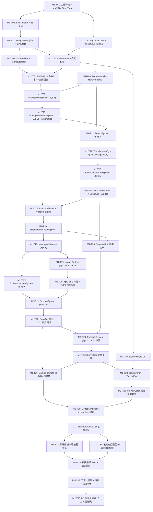

# M1 开发任务分解与执行路线图（`M1-T01` – `M1-T36`）

> **里程碑目标**：完成《守夜》Nightwatch 的 **M1 可玩灰盒原型**——C# 纯确定性模拟层（`sim/`，无 Godot 依赖）、完整单元测试套件（`sim.tests/`）、命令行校验与推演工具（`tools/validate`、`tools/simrun`），以及 Godot 4 .NET 灰盒客户端（`game/`，在 `test_01` 关卡上实现从简报 $\rightarrow$ 预部署 $\rightarrow$ 第 1 夜作战与二选一 $\rightarrow$ 夜末战报 $\rightarrow$ 跨夜整备与换防 $\rightarrow$ 第 2 夜作战的完整可玩闭环）。
> **执行粒度**：全部拆解为 **36 个原子任务（`M1-T01` – `M1-T36`）**。每个任务对应 **1 个专注的 AI 会话 + 1 次独立 Git 提交**，任何子代理无需阅读整套规格书即可凭本任务卡、所引用的 `docs/spec/00–07` 精确章节及 `tools/papersim/` 黄金参考实现完成开发与验收。

---

## 0. 总则与开工前自检（Pre-flight Checklist）

### 0.1 六条硬性铁律（违反任意一条不予合并）

1. **`sim/` 零 Godot 依赖**：`sim/` 下所有 `.cs` 与 `sim/Nightwatch.Sim.csproj` **严禁**出现 `using Godot;`、`Godot.Sdk` 或任何 Godot 程序集引用；目标框架固定为 `net8.0`，必须能通过命令行 `dotnet test sim.tests` 独立编译运行（由 `T-00-37` 自动扫描校验）。
2. **严格确定性**：
   - 模拟层只允许使用 `SimRandom`（PCG32 + SplitMix64 派生子流）；**严禁** `System.Random`、`DateTime.Now`、`Guid.NewGuid()`、`Environment.TickCount`、并行无序执行。
   - **严禁以 `Dictionary<K,V>` 或 `HashSet<T>` 的遍历顺序作为任何模拟逻辑、事件发射或状态哈希的依据**。所有实体遍历必须走 `EntityStore<T>` 的 `Id` 升序，所有字典写出哈希或参与遍历前必须按键排序（`OrderBy(kv => kv.Key, StringComparer.Ordinal)`）。
   - 禁止使用跨平台精度不一致的 `Math.Hypot` 或 `Math.FusedMultiplyAdd`；距离计算统一写 `Math.Sqrt(dx * dx + dy * dy)`。
3. **数据驱动 + 测试夹具隔离**：
   - 单位、武器、敌人、规则、关卡的一切参数从 `data/` JSON 读取，加载时完成单位换算（`Km → M`、`GameSec → Sec`、`Kmh → Mps`、`Cells → M`、`PerGameSec → PerSec`、`Pct → Frac`）。
   - 单元测试（除显式标注为正式数据集成测试的 `T-00-35`、`T-01-55`、`T-07-02` 外）一律使用各规格第 7 节定义的小型手写夹具（`Mini01`、`Mini02`、`Mini03`、`Mini04`、`Mini05`），不依赖正式平衡数值。
4. **`SimWorld.Step()` 顺序铁律**：
   - 每步固定推进 `1` 世界秒（`Tick++`），执行顺序严格固定为：**阶段 0（`CommandStage`：`ApplyDueCommands → DeploymentStage.Run → ChoiceStage.Run → StoryStage.Run`） $\rightarrow$ 系统 1 `WaveSpawnSystem` $\rightarrow$ 系统 2 `EnemyMovementSystem`（后重建 `ThreatGrid`） $\rightarrow$ 系统 3 `SensorSystem` $\rightarrow$ 系统 4 `TrackFusionSystem`（后重建 `TrackGrid`） $\rightarrow$ 系统 5 `ElectronicWarfareSystem` $\rightarrow$ 系统 6 `EmissionSystem` $\rightarrow$ 系统 7 `EngagementSystem` $\rightarrow$ 系统 8 `InterceptorSystem` $\rightarrow$ 系统 9 `ExternalSupportSystem` $\rightarrow$ 系统 10 `ImpactSystem` $\rightarrow$ 系统 11 `ExposureSystem` $\rightarrow$ 系统 12 `EnemyAiSystem` $\rightarrow$ 系统 13 `ScoringSystem` $\rightarrow$ 系统 14 `EventLog.SealStep()` $\rightarrow$ `CompactAllStores()`**。
5. **命名与本地化**：C# 标识符一律使用 `docs/spec/00_core.md` 登记的精确英文名（数据定义以 `Def` 结尾，运行时实体无后缀）；注释与文档用中文；显示文本用 `loc.xxx` 键引用。
6. **一任务一提交**：每个 `M1-Txx` 完成后必须运行本卡验收命令且 100% 通过，立即提交并推送，提交信息格式：`[M1-Txx] (WSxx-nnn) 简短中文说明`。

### 0.2 Python 黄金参考实现（Golden Oracle）使用指南

仓库中的 [`tools/papersim/`](../../tools/papersim/) 是与 `docs/spec/00–07` 100% 对齐并通过全部契约与双夜可玩性验证的纯 Python 确定性参考实现。实现任何 C# 任务时，若对边界条件或公式存疑，直接对照对应 Python 文件及行号，或运行以下命令获取基准输出：

```bash
# 1. 运行 Python 黄金参考实现的完整单元测试（13 个测试套件）
python3 -m tools.papersim test

# 2. 运行参考数值向量生成脚本（核对 PCG32、StateHasher、运动学、地形、探测、拦截、评分精确浮点值）
python3 tools/spec_calc/00/simrandom_vectors.py
python3 tools/spec_calc/00/hasher_vectors.py
python3 tools/spec_calc/01/01_movement_calc.py
python3 tools/spec_calc/01/01_terrain_calc.py

# 3. 运行 test_01 单夜无头黄金推演并输出 JSON 报告（用于 M1-T29 跨语言对齐）
python3 -m tools.papersim simrun --level test_01 --night 1 --seed 1 --json
```

---

## 1. 36 个原子任务总表与依赖图（DAG）

### 1.1 任务总表

| 任务 ID | 阶段 | WBS 编号 | 任务名称 | 规格书章节 | `papersim` 黄金参考 | 前置依赖 | 人工参与 |
|---|---|---|---|---|---|---|---|
| `M1-T01` | A | WS01-001 | 解决方案骨架、`Vec2`、`SimTime`、`Geo` 几何库与无 Godot 自检 | `00` §0.4–0.5 | `core.py:1–182` | 无 | 🟢 |
| `M1-T02` | A | WS01-002 | `SimRandom`（PCG32 + SplitMix64）与 18 个命名子流派生 | `00` §2.1, §3.1 | `core.py:185–318` | `M1-T01` | 🟢 |
| `M1-T03` | A | WS01-003a | `EntityIdGen`、`EntityStore<T>`、全部实体与 `SimState` 容器 | `00` §2.2–2.5 | `entities.py:1–540` | `M1-T02` | 🟢 |
| `M1-T04` | A | WS01-020a | `StateHasher`（FNV-1a 64 位规范编码）与 `SimState.ComputeHash()` | `00` §3.7 | `core.py:321–410`, `entities.py:541–620` | `M1-T03` | 🟢 |
| `M1-T05` | A | WS01-004a | 数据源抽象、`Png16Decoder`、单位换算器与时期解析器 | `00` §0.4.2, §1.1–1.5 | `loader.py:17–548` | `M1-T01` | 🟢 |
| `M1-T06` | A | WS01-004b | `DataLoader.LoadCatalog` / `LoadLevel`、交叉引用校验与 `DataHash` | `00` §1.2–1.6 | `loader.py:550–917` | `M1-T03`, `M1-T05` | 🟢 |
| `M1-T07` | A | WS01-003b | `SimWorld` 骨架、14 系统调度、命令队列、`EventLog`、`SimSnapshot` 与 `ReplayRunner` | `00` §2.6–2.7, §3.2–3.9 | `world.py:290–906` | `M1-T04`, `M1-T06` | 🟢 |
| `M1-T08` | A | WS01-006 | `TerrainModel`：双线性高程采样、地球曲率视线与 `HorizonProfile` 多山脊包络 | `01` §1.6, §3.3 | `terrain.py:1–252` | `M1-T05` | 🟢 |
| `M1-T09` | A | WS01-005a | `WaveSpawnSystem`（系统 1）：时间表、目标抽取、平台挂载与注入波次 | `01` §1.1–1.4, §3.1 | `movement.py:1–345` | `M1-T07`, `M1-T08` | 🟢 |
| `M1-T10` | A | WS01-005b | `EnemyMovementSystem`（系统 2）、12 种高度剖面、`ThreatRouting` 与 `ThreatKinematics` | `01` §1.5, §2, §3.2 | `movement.py:348–850` | `M1-T09` | 🟢 |
| `M1-T11` | B | WS01-007a | 环境修正 `EnvironmentResolver` 与 `SensorSystem`（系统 3：雷达/光学/声学探测与预警） | `02` §1.1–1.3, §3.1 | `sensing.py:35–305` | `M1-T08`, `M1-T10` | 🟢 |
| `M1-T12` | B | WS01-007b | `TrackFusionSystem`（系统 4）：航迹融合、火控指示 `Cueing`、诱饵甄别与 `CoverageQuery` | `02` §1.3, §3.2, §3.5 | `sensing.py:308–520` | `M1-T11` | 🟢 |
| `M1-T13` | B | WS01-016 | `ElectronicWarfareSystem`（系统 5）：导航欺骗、反无人机致盲、雷达压缩与友好误伤区 | `02` §1.4, §3.3 | `sensing.py:523–695` | `M1-T12` | 🟢 |
| `M1-T14` | B | WS01-008 | `EmissionSystem`（系统 6）：4 种辐射策略、反辐射锁定归航与 `ExposureSystem`（系统 11） | `02` §1.5, §3.4, §3.6 | `sensing.py:698–915` | `M1-T13` | 🟢 |
| `M1-T15` | B | WS01-010a | `InterceptSolver`（3D 步进包围 + 32 步二分）与 `WeaponParams` 命中率修正链 | `03` §1.1–1.2, §3.0 | `engagement.py:47–260` | `M1-T10`, `M1-T14` | 🟢 |
| `M1-T16` | B | WS01-009 | `EngagementSystem`（系统 7）：交战规则过滤、弹药保留、期望成本选优与装填冷却 | `03` §1.1, §3.1 | `engagement.py:262–572` | `M1-T15` | 🟢 |
| `M1-T17` | B | WS01-010b | `InterceptorSystem`（系统 8）：拦截弹飞行、半主动失锁、命中掷骰与杀伤结算 | `03` §3.2 | `engagement.py:573–710` | `M1-T16` | 🟢 |
| `M1-T18` | B | WS01-018 | `ExternalSupportSystem`（系统 9）：战斗机巡逻区、防空净空限制、国级干扰与邻州借调 | `03` §1.3, §3.3 | `engagement.py:712–835` | `M1-T17` | 🟢 |
| `M1-T19` | B | WS01-012 | `ImpactSystem`（系统 10）：精度档偏移、设施伤害、我方单位战损与城区拦截残骸 `Debris` | `03` §1.4, §3.4.1–3.4.4 | `engagement.py:838–1035` | `M1-T17` | 🟢 |
| `M1-T20` | B | WS01-013 | 电网连通性传播（BFS 供电判定）与 `CivilDefense` 空袭警报响应度演进 | `03` §1.5, §3.4.5, §3.5.3 | `engagement.py:1036–1110` | `M1-T19` | 🟢 |
| `M1-T21` | B | WS01-014 | `ScoringSystem`（系统 13）：交换比、挥霍质询、囤弹漏防、信任值奖惩与胜负评级 | `03` §1.6, §3.5 | `engagement.py:1112–1244` | `M1-T18`, `M1-T20` | 🟢 |
| `M1-T22` | B | WS01-014b | `CarryOut` 跨夜结转打包与 02+03 联合集成测试 | `03` §3.6, §7 | `world.py:770–855` | `M1-T21` | 🟢 |
| `M1-T23` | C | WS01-011 | 阶段 0 命令与部署系统：`DeploymentValidator`、`CommandStage`、`DeploymentStage` 与 `ChoiceStage` | `04` §1.1–1.2, §3.1–3.2 | `world.py:55–288`, `enemy_ai.py:30–310` | `M1-T14`, `M1-T16` | 🟢 |
| `M1-T24` | C | WS01-019 | `EnemyAiSystem`（系统 12）：试探目击、压制延后、猎杀索敌、饱和齐射与 A* 防空圈绕行 | `04` §1.3, §3.3 | `enemy_ai.py:312–660` | `M1-T22`, `M1-T23` | 🟢 |
| `M1-T25` | C | WS01-027 | `StoryStage` 剧情触发器与动作执行（`spawn_wave` / `grant_support` / `choice` / `ModifyRule`） | `04` §1.4, §3.4 | `enemy_ai.py:662–762` | `M1-T24` | 🟢 |
| `M1-T26` | C | WS01-021 | 战役与跨夜状态机 `CampaignState`：昼间修缮、换防槽位、紧急支援与补给窗口（M1 子集） | `05` §1–§3 | `campaign.py:1–498` | `M1-T22`, `M1-T25` | 🟢 |
| `M1-T27` | C | WS06-004 | `tools/validate` 数据校验 CLI 与 `DataValidator` 全量规则检查 | `07` §1 | `cli.py:20–85`, `loader.py` | `M1-T06` | 🟢 |
| `M1-T28` | C | WS06-006 | `tools/simrun` 无头推演 CLI、内置 `TacticalBot` 策略与回放校验命令 | `07` §2 | `cli.py:88–220`, `bots.py:1–320` | `M1-T25`, `M1-T27` | 🟢 |
| `M1-T29` | C | WS01-020b | C# `sim` 与 Python `papersim` 在 `test_01` 上的跨语言黄金基准对齐测试 | `00` §3.7, `07` §2.4 | `tests/test_contracts.py` | `M1-T28` | 🟢 |
| `M1-T30` | D | WS02-001 | Godot 4 .NET 项目配置（`game/`）、`SimBridge` 会话门面与 `Test01HeadlessSmoke` | `06` §1–§2 | `webproto/session.py:46–260` | `M1-T26`, `M1-T29` | 🟢 |
| `M1-T31` | D | WS02-002 | 2D 战术地图渲染器 `MapCanvas`（高程热力、河谷/城区/山脊、电网、保护目标与平移缩放） | `06` §3.1–3.2 | `webproto/static/app.js:240–520` | `M1-T30` | 🟢 |
| `M1-T32` | D | WS02-003 | 夜前部署与跨夜整备 UI：拖拽放置、`CoverageQuery` 覆盖圈预览、预设方案与暴露换防提醒 | `06` §3.3, §4.1 | `webproto/static/app.js:525–740` | `M1-T31` | 🟢 |
| `M1-T33` | D | WS02-005 | 夜间态势图层：航迹符号（模糊/大致/精确）、扇形预警、拦截线、辐射圈与暴露度色环 | `06` §3.4 | `webproto/static/app.js:380–515` | `M1-T31` | 🟢 |
| `M1-T34` | D | WS02-006 | 夜间指挥 HUD：倍速控制（暂停/1×/2×/4×/自动快进 8×）、雷达开关、交战规则与转移指令 | `06` §4.2–4.4 | `webproto/static/app.js:745–920` | `M1-T32`, `M1-T33` | 🟢 |
| `M1-T35` | D | WS02-008 | 二选一硬暂停弹窗 `ChoiceDialog`、多维度夜末战报 `ReportModal` 与双夜流程闭环 | `06` §4.5–4.7 | `webproto/static/app.js:925–1120` | `M1-T34` | 🟢 |
| `M1-T36` | D | WS02-010 | M1 灰盒集成验收、Godot `--headless` 冒烟脚本与人工试玩审核清单 | `06` §6–§7 | `run_d4_3_playtest.py` | `M1-T35` | 🔴 |

### 1.2 依赖拓扑图（DAG）与并发执行分层



- **拓扑并发分层（同一层内的任务互不依赖，可并行派发子代理）**：
  - **Layer 0**：`M1-T01`
  - **Layer 1**：`M1-T02`、`M1-T05`
  - **Layer 2**：`M1-T03`、`M1-T08`
  - **Layer 3**：`M1-T04`、`M1-T06`
  - **Layer 4**：`M1-T07`、`M1-T27`
  - **Layer 5**：`M1-T09` $\rightarrow$ `M1-T10` $\rightarrow$ `M1-T11` $\rightarrow$ `M1-T12` $\rightarrow$ `M1-T13` $\rightarrow$ `M1-T14` $\rightarrow$ `M1-T15` $\rightarrow$ `M1-T16`
  - **Layer 6**：`M1-T17` + `M1-T23`（并行） $\rightarrow$ `M1-T18` + `M1-T19`（并行） $\rightarrow$ `M1-T20` $\rightarrow$ `M1-T21` $\rightarrow$ `M1-T22`
  - **Layer 7**：`M1-T24` $\rightarrow$ `M1-T25` $\rightarrow$ `M1-T26` + `M1-T28`（并行） $\rightarrow$ `M1-T29`
  - **Layer 8**：`M1-T30` $\rightarrow$ `M1-T31` $\rightarrow$ `M1-T32` + `M1-T33`（并行） $\rightarrow$ `M1-T34` $\rightarrow$ `M1-T35` $\rightarrow$ `M1-T36`

### 1.3 WBS 条目 ↔ M1 原子任务双向映射表

| WBS 编号 | WBS 标题 | 对应 `M1-Txx` | 说明 |
|---|---|---|---|
| `WS01-001` | 创建解决方案与 `sim` / `sim.tests` 工程 | `M1-T01` | 含 `Vec2`、`SimTime`、`Geo` 及无 Godot 扫描测试 |
| `WS01-002` | `SimRandom` 确定性随机数与子流 | `M1-T02` | PCG32 + SplitMix64 + 18 子流向量 |
| `WS01-003` | 实体容器、`SimState`、`SimWorld.Step()`、命令与事件 | `M1-T03`, `M1-T07` | 拆分为状态容器（T03）与世界门面/调度（T07） |
| `WS01-004` | 数据加载器（JSON + 16 位 PNG 高程图 + 时期解析） | `M1-T05`, `M1-T06` | 拆分为底层解码换算（T05）与目录/关卡加载校验（T06） |
| `WS01-005` | 波次生成、敌方运动学与 12 种高度剖面 | `M1-T09`, `M1-T10` | 拆分为 `WaveSpawnSystem`（T09）与 `EnemyMovementSystem`（T10） |
| `WS01-006` | 地形高程双线性采样、地球曲率视线与山脊遮挡 | `M1-T08` | 含 `HorizonProfile` 720 方位桶加速包络 |
| `WS01-007` | 传感器探测、航迹融合、火控指示与诱饵甄别 | `M1-T11`, `M1-T12` | 拆分为 `SensorSystem`（T11）与 `TrackFusionSystem`（T12） |
| `WS01-008` | 雷达辐射策略、暴露度累积与反辐射导弹归航 | `M1-T14` | 同时实现系统 6 `EmissionSystem` 与系统 11 `ExposureSystem` |
| `WS01-009` | 交战规则、目标筛选、弹药保留与装填冷却 | `M1-T16` | 系统 7 `EngagementSystem` |
| `WS01-010` | 解析拦截求解器与拦截弹飞行/命中掷骰 | `M1-T15`, `M1-T17` | 拆分为 `InterceptSolver`（T15）与 `InterceptorSystem`（T17） |
| `WS01-011` | 玩家夜间指令、展开/撤收/转移状态机与二选一 | `M1-T23` | 阶段 0 `CommandStage` / `DeploymentStage` / `ChoiceStage` |
| `WS01-012` | 弹药落地、设施伤害、我方战损与城区碎片 | `M1-T19` | 系统 10 `ImpactSystem`（前半部分） |
| `WS01-013` | 电网节点破坏、连通性传播与空袭警报 | `M1-T20` | 系统 10 电网传播 + 系统 13 警报响应度 |
| `WS01-014` | 夜晚结算、交换比、信任值、胜负判定与跨夜结转 | `M1-T21`, `M1-T22` | 拆分为 `ScoringSystem`（T21）与 `CarryOut` 结转集成（T22） |
| `WS01-016` | 电子战系统（导航欺骗、反无人机、雷达压制） | `M1-T13` | 系统 5 `ElectronicWarfareSystem` |
| `WS01-018` | 外部支援系统（战斗机巡逻、国级干扰、邻州火力） | `M1-T18` | 系统 9 `ExternalSupportSystem` |
| `WS01-019` | 敌方 AI（试探、压制、猎杀、绕行、饱和） | `M1-T24` | 系统 12 `EnemyAiSystem` + A* 网格绕行 |
| `WS01-020` | 状态哈希、快照不可变性与回放检验 | `M1-T04`, `M1-T07`, `M1-T29` | 含 C# vs Python 黄金基准对齐（T29） |
| `WS01-021`–`026` | 战役流转、昼间整备、补给修缮与紧急支援（M1 子集） | `M1-T26` | 实现 `05_campaign_and_meta.md` 规定的全部状态转换与测试 |
| `WS01-027` | 剧情事件触发器与动作（`events.json`） | `M1-T25` | 阶段 0 `StoryStage` |
| `WS06-004` / `006` | `tools/validate` 与 `tools/simrun` 命令行工具 | `M1-T27`, `M1-T28` | 校验 `data/` 全量文件 + 无头跑完整夜 |
| `WS02-001`–`010` | Godot 4 .NET 灰盒客户端（地图、部署、作战、战报、双夜） | `M1-T30`–`M1-T36` | 在 `game/` 下交付可玩灰盒并通过人工试玩验收 |

---

## 2. 阶段 A：模拟层地基、数据加载、地形与敌方生成移动（`M1-T01` – `M1-T10`）

### `M1-T01`（WS01-001）：解决方案骨架、`Vec2`、`SimTime`、`Geo` 几何库与无 Godot 自检

1. **目标文件**
   - 创建：`Nightwatch.sln`、`sim/Nightwatch.Sim.csproj`、`sim.tests/Nightwatch.Sim.Tests.csproj`
   - 创建：`sim/Core/Vec2.cs`、`sim/Core/SimTime.cs`、`sim/Core/Geo.cs`、`sim/Core/SimError.cs`、`sim/Core/YearMonth.cs`、`sim/Core/MinMax.cs`
   - 创建：`sim.tests/Core/GeoAndTimeTests.cs`、`sim.tests/Core/NoGodotDependencyTests.cs`
2. **规格书与参考实现对照**
   - 规格书：[`docs/spec/00_core.md`](../spec/00_core.md) §0.4.3–0.4.6（`SimTime`、`Vec2`、`Azimuth`、`Geo`）、§0.5（工程结构与无 Godot 约束）、§7（`T-00-13`、`T-00-14`、`T-00-37`、`T-00-38`）。
   - Python 黄金参考：[`tools/papersim/core.py`](../../tools/papersim/core.py) 第 `1–182` 行。
3. **核心 C# 类型与方法签名**
   ```csharp
   namespace Nightwatch.Sim.Core;

   public readonly record struct Vec2(double X, double Y)
   {
       public static readonly Vec2 Zero = new(0.0, 0.0);
       public double Length => Math.Sqrt(X * X + Y * Y);
       public double LengthSquared => X * X + Y * Y;
       public double DistanceTo(Vec2 other) { double dx = other.X - X, dy = other.Y - Y; return Math.Sqrt(dx * dx + dy * dy); }
       public static Vec2 Lerp(Vec2 a, Vec2 b, double t) => new(a.X + (b.X - a.X) * t, a.Y + (b.Y - a.Y) * t);
       public static Vec2 operator +(Vec2 a, Vec2 b) => new(a.X + b.X, a.Y + b.Y);
       public static Vec2 operator -(Vec2 a, Vec2 b) => new(a.X - b.X, a.Y - b.Y);
       public static Vec2 operator *(Vec2 a, double s) => new(a.X * s, a.Y * s);
   }

   public static class SimTime
   {
       public const double TickEpsilon = 1e-9;
       public static int SecToTicksCeil(double sec, double stepSec = 1.0);
       public static int SecToTicksFloor(double sec, double stepSec = 1.0);
   }

   public static class Geo
   {
       public static double AzimuthRad(Vec2 from, Vec2 to);
       public static double NormalizeAzimuth(double rad);
       public static bool PointInPolygon(Vec2 pt, IReadOnlyList<Vec2> poly);
       public static Vec2? FirstEntryIntoCircle(Vec2 a, Vec2 b, Vec2 center, double radius);
       public static double DistancePointToSegment(Vec2 pt, Vec2 a, Vec2 b, out Vec2 closest);
   }
   ```
4. **核心算法步骤与易错点**
   - `SecToTicksCeil(sec, stepSec)`：当 `sec < -TickEpsilon` 或 `stepSec <= 0` 时抛 `ArgumentOutOfRangeException`；当 `sec <= 0` 时返回 `0`；否则返回 `(int)Math.Ceiling(sec / stepSec - TickEpsilon)`。
   - `AzimuthRad(from, to)`：正北（`+Y`）为 `0`，顺时针增加，范围 `[0, 2π)`，用 `Math.Atan2(dx, dy)` 实现（注意参数顺序是 `(dx, dy)` 而非 `(dy, dx)`！重合点返回 `0.0`）。
   - `PointInPolygon`：标准奇偶射线法（向 `+X` 射线），半开区间 `((vi.Y > pt.Y) != (vj.Y > pt.Y))` 且 `pt.X < (vj.X - vi.X) * (pt.Y - vi.Y) / (vj.Y - vi.Y) + vi.X`，左边界含、右边界不含；顶点数 `< 3` 返回 `false`。
   - `FirstEntryIntoCircle(a, b, c, r)`：若起点 `a` 已在圆内（`a.DistanceTo(c) <= r + 1e-9`）直接返回 `a`；否则求解二次方程 $t \in [0, 1]$ 的最小根。
5. **必写单元测试与精确断言值**
   - `T-00-13`：`SecToTicksCeil(6.000000000000001, 1) == 6`、`SecToTicksCeil(6.0000001, 1) == 7`、`SecToTicksFloor(5.999999999999999, 1) == 6`、`SecToTicksCeil(-1, 1)` 抛异常。
   - `T-00-14`：`AzimuthRad((0,0), (0,10)) == 0.0`、`(10,0) == π/2`、`(0,-10) == π`、`(-10,0) == 3π/2`、`NormalizeAzimuth(-π) == π`。
   - `T-00-37`：扫描 `sim/` 下 `.csproj` 与全部 `.cs` 不含 `Godot`，并对含 `"using Godot;"` 的测试字符串断言扫描器报错。
   - `T-00-38`：正方形 `[(0,0),(10,0),(10,10),(0,10)]` 内点 `(5,5) -> true`、`(0,5) -> true`、`(10,5) -> false`；`FirstEntryIntoCircle((-100,0), (100,0), (0,0), 50) == (-50.0, 0.0)`。
6. **验收命令**
   ```bash
   dotnet test sim.tests --filter "FullyQualifiedName~GeoAndTimeTests|FullyQualifiedName~NoGodotDependencyTests"
   ```

---

### `M1-T02`（WS01-002）：`SimRandom`（PCG32 + SplitMix64）与 18 个命名子流派生

1. **目标文件**
   - 创建：`sim/Core/IRandom.cs`、`sim/Core/SimRandom.cs`
   - 创建：`sim.tests/Core/SimRandomTests.cs`
2. **规格书与参考实现对照**
   - 规格书：[`docs/spec/00_core.md`](../spec/00_core.md) §2.1、§3.1.1–3.1.5、§7（`T-00-01` – `T-00-11`）。
   - Python 黄金参考：[`tools/papersim/core.py`](../../tools/papersim/core.py) 第 `185–318` 行；[`tools/spec_calc/00/simrandom_vectors.py`](../../tools/spec_calc/00/simrandom_vectors.py)。
3. **核心 C# 类型与方法签名**
   ```csharp
   namespace Nightwatch.Sim.Core;

   public readonly record struct RngState(ulong Seed, ulong State, ulong Inc);

   public interface IRandom
   {
       ulong Seed { get; }
       uint NextUInt32();
       ulong NextUInt64();
       int NextInt(int minInclusive, int maxExclusive);
       double NextDouble();
       double Range(double minInclusive, double maxInclusive);
       bool Chance(double probability);
       IRandom Derive(string streamName);
       RngState GetState();
       void SetState(RngState state);
   }

   public sealed class SimRandom : IRandom
   {
       public static readonly string[] AllStreamNames = [
           "setup", "command", "spawn", "movement", "sensor", "fusion", "ew", "emission",
           "engagement", "intercept", "support", "impact", "exposure", "enemy_ai", "scoring",
           "civil", "environment", "crew"
       ];
       public SimRandom(ulong seed);
       public static ulong SplitMix64(ref ulong x);
       public static ulong Fnv1a64(ReadOnlySpan<byte> utf8);
       public static ulong ChildSeed(ulong parentSeed, string streamName);
       public static ulong NightSeed(ulong runSeed, string levelId, int nightSeq);
       public static uint Bounded(uint range, Func<uint> next);
   }
   ```
4. **核心算法步骤与易错点**
   - **PCG32 (`pcg32_random_r`)**：常量 `Multiplier = 6364136223846793005UL`。构造时令 `sm = seed`：`initState = SplitMix64(ref sm)`、`initSeq = SplitMix64(ref sm)`，然后 `_state = 0UL; _inc = (initSeq << 1) | 1UL; NextUInt32(); _state += initState; NextUInt32();`。
   - **单步输出**：`ulong old = _state; _state = unchecked(old * Multiplier + _inc); uint xorshifted = (uint)(((old >> 18) ^ old) >> 27); int rot = (int)(old >> 59); return (xorshifted >> rot) | (xorshifted << ((-rot) & 31));`。
   - **`NextDouble()`**：调用两次 `NextUInt32()`：`hi = NextUInt32() >> 5`（27 位），`lo = NextUInt32() >> 6`（26 位），返回 `((ulong)hi * 67108864UL + lo) * (1.0 / (1UL << 53))`。
   - **`Chance(p)`**：`double.IsNaN(p)` 返回 `false` 且**不消耗**随机数；`p <= 0.0` 仍必须调用一次 `NextDouble()` 并返回 `false`；`p >= 1.0` 仍必须调用一次 `NextDouble()` 并返回 `true`（保证随机数消耗次数恒定！见 `T-00-07`）。
   - **`ChildSeed(parentSeed, name)`**：UTF-8 字节非空且纯 ASCII，算 `h = Fnv1a64(bytes)`，令 `x = parentSeed ^ h`，返回 `SplitMix64(ref x)`。`Derive(name)` **绝不推进**父流 `_state`。
5. **必写单元测试与精确断言值**
   - `T-00-01` – `T-00-05`：PCG32 官方向量 `(42, 54)` 首值 `0xA15C02B7`；`seed = 1` 首值 `0x5249C5DC`，首 `NextDouble` = `0.3214380736828547`，首 `NextUInt64` = `0x5249C5DC01959430`。
   - `T-00-06` – `T-00-07`：Lemire 无偏拒绝采样 `Bounded(3, [0, 1]) == 1`；`Chance(0)` 与 `Chance(1)` 各消耗 1 次 `NextDouble()`。
   - `T-00-08` – `T-00-11`：核对全部 18 个子流的 `ChildSeed(1, name)` 与前 3 个 `NextUInt32`（如 `spawn` = `0x247FD80E4FD86BD1` / `0x3F223FCE`）；`NightSeed(1, "test_01", 1) == 0x6DD180096484586D`；`GetState/SetState` 往返一致。
6. **验收命令**
   ```bash
   dotnet test sim.tests --filter "FullyQualifiedName~SimRandomTests"
   ```

---

### `M1-T03`（WS01-003a）：`EntityIdGen`、`EntityStore<T>`、全部实体与 `SimState` 容器

1. **目标文件**
   - 创建：`sim/State/Entity.cs`、`sim/State/EntityIdGen.cs`、`sim/State/EntityStore.cs`、`sim/State/Enums.cs`
   - 创建：`sim/State/Entities/Threat.cs`、`Track.cs`、`FireUnit.cs`、`SensorUnit.cs`、`EwUnit.cs`、`DeceptionUnit.cs`、`Interceptor.cs`、`SupportAsset.cs`、`Debris.cs`、`Structure.cs`、`GridNode.cs`、`ChoiceRequest.cs`
   - 创建：`sim/State/Singletons/WaveState.cs`、`TrackState.cs`、`EngagementState.cs`、`ExposureState.cs`、`EnemyIntelState.cs`、`ScoringState.cs`、`CivilDefenseState.cs`、`CommandState.cs`、`StoryState.cs`、`EnvironmentState.cs`、`SimState.cs`
   - 创建：`sim.tests/State/EntityStoreTests.cs`
2. **规格书与参考实现对照**
   - 规格书：[`docs/spec/00_core.md`](../spec/00_core.md) §2.2–2.5（`EntityStore<T>`、`EntityKind`、全部 11 类实体字段登记表、10 个单例组件登记表）、§7（`T-00-15` – `T-00-17`）。
   - Python 黄金参考：[`tools/papersim/entities.py`](../../tools/papersim/entities.py) 第 `1–540` 行。
3. **核心 C# 类型与方法签名**
   ```csharp
   namespace Nightwatch.Sim.State;

   public abstract class Entity
   {
       public int Id { get; internal set; }
       public bool Alive { get; internal set; }
       public int CreatedTick { get; internal set; }
       public int RemovedTick { get; internal set; } = -1;
       public string? DefId { get; set; }
       public Vec2 Pos { get; set; }
       public double AltM { get; set; }
   }

   public sealed class EntityStore<T> where T : Entity
   {
       public EntityKind Kind { get; }
       public int Count { get; } // Alive 实体数量
       public T Add(T entity);
       public bool Remove(int id);
       public bool TryGet(int id, out T? entity);
       public bool TryGetIncludingRemoved(int id, out T? entity);
       public ReadOnlySpan<T> AliveSnapshot(); // 遍历前拍快照，允许循环体内 Add/Remove
       public void Compact();
   }
   ```
4. **核心算法步骤与易错点**
   - `EntityIdGen` 全局单调递增，从 `1` 开始分配，跨所有 `EntityStore` 共享同一个 `EntityIdGen`，删除实体后**永不重用 ID**。
   - `Add(entity)`：分配 `Id = _idGen.Next()`，`Alive = true`，`CreatedTick = _tickProvider()`，`RemovedTick = -1`，追加到内部列表（保持 `Id` 严格升序）。
   - `Remove(id)`：惰性标记删除（`Alive = false; RemovedTick = _tickProvider(); _aliveCount--;`），当步内仍可通过 `TryGetIncludingRemoved(id)` 读取，步末由 `SimWorld.Step()` 统一调用 `Compact()` 物理移除 `!Alive` 项。
   - 遍历语义：`foreach` 或 `AliveSnapshot()` 在进入循环瞬间固定上界 `n = _items.Count`，循环体中新 `Add` 的实体在本轮循环中不可见，但循环结束后立即可被后续系统访问（`T-00-17`）。
5. **必写单元测试与精确断言值**
   - `T-00-15`：按序添加电网节点 `g1,g2`、保护目标 `s1,s2,s3`、我方单位 `f1,r1`，断言 ID 依次为 `1..7` 且 `Ids.NextId == 8`。
   - `T-00-16`：添加 3 个实体 `a<b<c` 后同一步删除 `b`，断言当步 `TryGet(b) == false`、`TryGetIncludingRemoved(b) == true` 且 `RemovedTick == 1`、`Count == 2`；`Compact()` 后新加实体 ID 为 `c + 1`。
   - `T-00-17`：已有 2 个实体时在遍历循环中各 `Add` 1 个新实体，断言循环体恰好执行 2 次，循环后 `Count == 4`。
6. **验收命令**
   ```bash
   dotnet test sim.tests --filter "FullyQualifiedName~EntityStoreTests"
   ```

---

### `M1-T04`（WS01-020a）：`StateHasher`（FNV-1a 64 位规范编码）与 `SimState.ComputeHash()`

1. **目标文件**
   - 创建：`sim/Core/StateHasher.cs`
   - 更新：`sim/State/SimState.cs` 及各实体 / 单例组件的 `WriteHash(ref StateHasher h)` 方法
   - 创建：`sim.tests/Core/StateHasherTests.cs`
2. **规格书与参考实现对照**
   - 规格书：[`docs/spec/00_core.md`](../spec/00_core.md) §3.7.1–3.7.3（`StateHasher` 字节编码规范与 `SimState` 哈希写入总顺序）、§7（`T-00-24`）。
   - Python 黄金参考：[`tools/papersim/core.py`](../../tools/papersim/core.py) 第 `321–410` 行；[`tools/papersim/entities.py`](../../tools/papersim/entities.py) 第 `541–620` 行；[`tools/spec_calc/00/hasher_vectors.py`](../../tools/spec_calc/00/hasher_vectors.py)。
3. **核心 C# 类型与方法签名**
   ```csharp
   namespace Nightwatch.Sim.Core;

   public struct StateHasher
   {
       public const ulong OffsetBasis = 0xCBF29CE484222325UL;
       public const ulong Prime = 0x00000100000001B3UL;
       public StateHasher();
       public readonly ulong Value { get; }
       public void WriteByte(byte b);
       public void WriteBool(bool v);
       public void WriteInt32(int v);
       public void WriteUInt32(uint v);
       public void WriteInt64(long v);
       public void WriteUInt64(ulong v);
       public void WriteDouble(double v);
       public void WriteString(string? s);
       public void WriteVec2(Vec2 v);
   }
   ```
4. **核心算法步骤与易错点**
   - 所有多字节整数按 **Little-Endian（小端序）** 逐字节执行 `h = (h ^ b) * Prime`。
   - `WriteDouble(double v)`：
     - 若 `v == 0.0`（含 `-0.0`！通过 `v == 0.0` 归零），统一写入 `0UL`（8 个 `0x00` 字节）；
     - 若 `double.IsNaN(v)` 写入固定位模式 `0x7FF8000000000000UL`；
     - 否则写入 `(ulong)BitConverter.DoubleToInt64Bits(v)` 的小端 8 字节。
   - `WriteString(string? s)`：`null` 写入 `WriteInt32(-1)`（即 `ffffffff`）；非空先写 UTF-8 字节长度 `WriteInt32(bytes.Length)`，再依次写 UTF-8 字节。
   - `SimState.ComputeHash()` 严格按 `00_core.md` §3.7.2 顺序写出：`Tick` $\rightarrow$ `Ids.NextId` $\rightarrow$ `EndRequest` $\rightarrow$ 18 个命名子流的 `GetState()`（按 `SimRandom.AllStreamNames` 固定顺序） $\rightarrow$ 11 个 `EntityStore` 的存活实体列表（先写 `Count`，再按 `Id` 升序调每个实体的 `WriteHash`） $\rightarrow$ 10 个单例组件状态 $\rightarrow$ `EventLog.Hash`。
5. **必写单元测试与精确断言值**
   - `T-00-24`：
     - 空 `StateHasher().Value == 0xCBF29CE484222325UL`
     - `WriteInt32(7) -> 0x6D3572669B2CDE42UL`
     - `WriteDouble(1.5) -> 0xAA95E93229A27C80UL`
     - `WriteDouble(-0.0) == WriteDouble(0.0) == 0xA8C7F832281A39C5UL`
     - `WriteString("ab") -> 0x9254FD600693E9A0UL`
     - `WriteString(null) -> 0x994F76653E2A3951UL`
     - 组合写入 `(7, 1.5, "ab", true, 0xDEADBEEFUL) -> 0x461DC66E88FEC47BUL`
6. **验收命令**
   ```bash
   dotnet test sim.tests --filter "FullyQualifiedName~StateHasherTests"
   ```

---

### `M1-T05`（WS01-004a）：数据源抽象、`Png16Decoder`、单位换算器与时期解析器

1. **目标文件**
   - 创建：`sim/Data/IDataSource.cs`、`sim/Data/DataError.cs`、`sim/Data/Png16Decoder.cs`、`sim/Data/UnitConverter.cs`、`sim/Data/PeriodResolver.cs`、`sim/Data/Heightmap.cs`
   - 创建：`sim.tests/Data/UnitAndPeriodTests.cs`、`sim.tests/Data/Png16DecoderTests.cs`
2. **规格书与参考实现对照**
   - 规格书：[`docs/spec/00_core.md`](../spec/00_core.md) §0.4.2（单位换算规则与 3 个特例）、§1.3–1.5（错误码、时期解析 3 种形态、16 位 PNG 解码器）、§7（`T-00-12`、`T-00-32` – `T-00-34`）。
   - Python 黄金参考：[`tools/papersim/loader.py`](../../tools/papersim/loader.py) 第 `17–548` 行。
3. **核心 C# 类型与方法签名**
   ```csharp
   namespace Nightwatch.Sim.Data;

   public interface IDataSource
   {
       bool Exists(string relativePath);
       byte[] ReadBytes(string relativePath);
   }

   public sealed record DataError(string Code, string File, string JsonPath, string Detail)
   {
       public override string ToString() => $"[{Code}] {File} {JsonPath}: {Detail}";
   }

   public sealed class DataLoadException(IReadOnlyList<DataError> errors) : Exception(string.Join("\n", errors))
   {
       public IReadOnlyList<DataError> Errors { get; } = errors;
   }

   public static class Png16Decoder
   {
       public static Heightmap Decode(ReadOnlySpan<byte> pngBytes, double metersPerPixel, double minElevationM, double maxElevationM, string filePath = "");
   }
   ```
4. **核心算法步骤与易错点**
   - **单位换算乘除顺序铁律**：必须严格按单次运算执行：`Km -> v * 1000.0`、`GameSec -> v * C.GameSecToWorldSec`、`Kmh -> v / 3.6`、`Cells -> (v * C.CellKm) * 1000.0`、`PerGameSec -> v / C.GameSecToWorldSec`、`Mach -> (v * C.MachKmh) / 3.6`、`Pct -> v / 100.0`。兼容 `00_core.md` §0.4.2 第 7 条的 3 个特例字段（`offsetCellsAdd`、`configurableOnOffGameSec`、`sensorExposureLevelRates` / `ewExposureLevelRates`）。
   - **时期解析 3 种形态**：
     - 形态 A（`periodValue` 标量或 `[{from, value}]`）：`from` 必须严格升序（否则报 `E_PERIOD_ORDER`）；取最后一个 `from <= levelDate` 的项；若所有 `from > levelDate`，除 `rules/intercept.json` 的未来解锁列允许返回 `0.0` 外，一律报 `E_PERIOD_BEFORE_FIRST`。
     - 形态 B（时期表 `effectivenessByPeriod` / `accuracyByPeriod`）：取最后一个 `from <= levelDate` 的行。
     - 形态 C（日期闸门 `from` / `until`）：满足 `(from == null || levelDate >= from) && (until == null || levelDate < until)`（注意 `until` 是**左闭右开** `< until`，如 `until: "2023-04"` 在 `2023-03-31` 为 `true`，在 `2023-04-01` 为 `false`！见 `T-00-33`）。
   - **`Png16Decoder`**：校验 PNG 签名与 `IHDR`（`bitDepth == 16 && colorType == 0 && interlace == 0`），拼接全部 `IDAT` 用 `ZLibStream` 解压，支持全部 5 种行滤波器（0 `None`、1 `Sub`、2 `Up`、3 `Average`、4 `Paeth`，步长 `bpp = 2` 字节），大端 `ushort` 转高程：`minElevationM + (sample / 65535.0) * (maxElevationM - minElevationM)`。
5. **必写单元测试与精确断言值**
   - `T-00-12`：`speedKmh: 500 -> 138.88888888888889`、`ratesPerGameSec: 1.5 -> 0.025`、`worldStepSec: 2` 报 `E_RANGE`。
   - `T-00-32` & `T-00-33`：`2025-07-31 -> 0.75`、`2025-08-01 -> 0.55`、`2022-01-15` 报 `E_PERIOD_BEFORE_FIRST`；逆序报 `E_PERIOD_ORDER`；`until: "2023-04"` 在 `2023-04-01` 为 `false`。
   - `T-00-34`：2×2 16-bit PNG `[0, 65535; 32768, 0]` 解码为 `[100.0, 300.0, 200.00152590218966, 100.0]`；8-bit PNG 报 `E_PNG_FORMAT`。
6. **验收命令**
   ```bash
   dotnet test sim.tests --filter "FullyQualifiedName~UnitAndPeriodTests|FullyQualifiedName~Png16DecoderTests"
   ```

---

### `M1-T06`（WS01-004b）：`DataLoader.LoadCatalog` / `LoadLevel`、交叉引用校验与 `DataHash`

1. **目标文件**
   - 创建：`sim/Data/Defs/*.cs`（或汇总于 `sim/Data/CatalogDefs.cs`、`sim/Data/LevelDefs.cs`、`sim/Data/RulesDefs.cs`）、`sim/Data/GameCatalog.cs`、`sim/Data/LevelData.cs`、`sim/Data/DataLoader.cs`
   - 创建：`sim.tests/Data/DataLoaderTests.cs`、`sim.tests/Data/MovementRulesLoadTests.cs`、`sim.tests/Helpers/MiniLevelBuilder.cs`
2. **规格书与参考实现对照**
   - 规格书：[`docs/spec/00_core.md`](../spec/00_core.md) §1.1–1.6（26 个全局文件 + 9 个关卡文件固定加载序、18 条校验规则、`DataHash` 计算）、§7（`T-00-29` – `T-00-31`、`T-00-35`、`T-00-39`）；[`docs/spec/01_spawn_movement_terrain.md`](../spec/01_spawn_movement_terrain.md) §1.1–1.6、§7.5（`T-01-60` – `T-01-62`）。
   - Python 黄金参考：[`tools/papersim/loader.py`](../../tools/papersim/loader.py) 第 `162–917` 行。
3. **核心 C# 类型与方法签名**
   ```csharp
   namespace Nightwatch.Sim.Data;

   public static class DataLoader
   {
       public static GameCatalog LoadCatalog(IDataSource source, string levelDate, List<DataError>? errorsOut = null, List<string>? loadedFilesOut = null);
       public static LevelData LoadLevel(IDataSource source, string levelId, int? nightIndex = null);
       public static string ComputeDataHash(IDataSource source, IReadOnlyList<string> loadedFiles);
   }
   ```
4. **核心算法步骤与易错点**
   - **严格未知字段检查（`E_UNKNOWN_FIELD`）**：除白名单忽略字段 `"$schema"`、`"_source"`、`"notes"`、`"provisional"` 外，任何不在 schema 定义中的 JSON 属性必须收集 `E_UNKNOWN_FIELD` 错误；所有错误收集到列表末尾一次性抛出 `DataLoadException`（除非某文件报 `E_JSON_SYNTAX`，此时跳过依赖该文件的交叉引用检查，见 `T-00-31`）。
   - **共享武器一致性（`E_SHARED_WEAPON_MISMATCH`）**：不同防空单位引用同一武器 `id`（如 `s300ps` 与 `s300pt` 共用 `s300_missile`）时，去掉忽略字段后的原始定义必须完全一致，否则在第二次出现处报 `E_SHARED_WEAPON_MISMATCH`。
   - **按夜日期解析（`B-T2-17` / `T-00-39`）**：若 `LoadLevel(source, levelId, nightIndex)` 传入了 `nightIndex`，先预读 `waves.json` 查找该夜的 `date`（若有则校验落在 `level.json` 的 `[dateRange.from, dateRange.to]` 内），用 `night.Date ?? meta.DateRange.From` 作为 `resolvedDate` 加载并解析 `GameCatalog`。
   - **`DataHash` 计算**：对 `LoadedFiles`（正式关卡共 35 个文件：26 全局 + 8 关卡 JSON + 1 PNG）按加载顺序依次写入：`UTF8(relPath) + 0x00 + LittleEndianInt64(rawBytes.Length) + rawBytes`，求 SHA-256，格式化为 `"sha256:" + lowerHex`（总长 71 字符）。
5. **必写单元测试与精确断言值**
   - `T-00-29` – `T-00-31`：缺 `rangeKm` 报 `[E_MISSING_FIELD] units/air_defense.json $.units[0].weapons[0].rangeKm: 缺少必填字段`；类型/枚举/未知字段同时收集 3 条错误；`waves.json` 引用不存在敌人报 `E_UNKNOWN_REF`；共享武器不一致报 `E_SHARED_WEAPON_MISMATCH`。
   - `T-00-35`：正式 `data/` 加载 `test_01` 成功，`LoadedFiles.Count == 35`，`DataHash` 以 `"sha256:"` 开头且长 71。
   - `T-00-39`：多夜日期解析与 `E_NIGHT_DATE_MISMATCH`。
   - `T-01-60` – `T-01-62`：`rules/movement.json` 8 个高度带键校验、`rules/terrain.json` 范围校验、平台挂载与 `carrier` 弹药交叉校验。
6. **验收命令**
   ```bash
   dotnet test sim.tests --filter "FullyQualifiedName~DataLoaderTests|FullyQualifiedName~MovementRulesLoadTests"
   ```

---

### `M1-T07`（WS01-003b / WS01-020）：`SimWorld` 骨架、14 系统调度、命令队列、`EventLog`、`SimSnapshot` 与 `ReplayRunner`

1. **目标文件**
   - 创建：`sim/World/ISimSystem.cs`、`sim/World/SimContext.cs`、`sim/World/SimConfig.cs`、`sim/World/SimCommand.cs`、`sim/World/SimEvent.cs`、`sim/World/EventLog.cs`、`sim/World/SpatialGrid.cs`、`sim/World/SimSnapshot.cs`、`sim/World/SimWorld.cs`、`sim/World/Replay.cs`
   - 创建：`sim.tests/World/SimWorldFrameworkTests.cs`、`sim.tests/World/DeterminismAndReplayTests.cs`
2. **规格书与参考实现对照**
   - 规格书：[`docs/spec/00_core.md`](../spec/00_core.md) §2.6–2.7、§3.2–3.9、§4（事件与命令总表）、§7（`T-00-18` – `T-00-23`、`T-00-25` – `T-00-28`、`T-00-36`）。
   - Python 黄金参考：[`tools/papersim/world.py`](../../tools/papersim/world.py) 第 `290–906` 行。
3. **核心 C# 类型与方法签名**
   ```csharp
   namespace Nightwatch.Sim.World;

   public interface ISimSystem
   {
       int Order { get; }
       string Name { get; }
       string? StreamName { get; }
       void Initialize(SimContext ctx);
       void Execute(SimContext ctx);
   }

   public sealed class SimWorld
   {
       public static SimWorld Create(LevelData level, SimConfig config, ulong seed);
       public int Tick => State.Tick;
       public int DurationTicks { get; }
       public bool IsFinished => State.EndRequest != null;
       public NightResult? Result { get; private set; }
       public SimSnapshot Snapshot { get; }
       public SimCommand EnqueueCommand(SimCommand cmd);
       public IReadOnlyList<SimEvent> Step();
       public IReadOnlyList<SimEvent> DrainEvents();
       public ulong ComputeStateHash() => State.ComputeHash();
       public Replay ExportReplay(int checkpointInterval = 300);
   }
   ```
4. **核心算法步骤与易错点**
   - **命令入队规范化**：`EnqueueCommand(cmd)` 若 `cmd.EffectiveTick <= State.Tick`，自动规范化为 `State.Tick + 1`；分配单调递增 `Seq = _nextCommandSeq++`；队列按 `(EffectiveTick, Seq)` 严格升序出队（`T-00-18`）。
   - **命令校验与拒绝**：阶段 0 对当步到期命令调用 `Validate`；若返回拒绝原因，发出 `CommandRejected(CommandSeq, Type, Reason)` 且**不改变任何业务状态**（注意：`CommandRejected` 事件本身进入 `EventLog`，推进 `EventLog.Hash`；测试 `T-00-19` 中若需对比无命令世界，注意 `00_core.md` §3.4.3 规定被拒绝命令不改变 `EventLog.Hash`，即 `EventLog.Emit` 对 `CommandRejected` 不混入 `EventLog.Hash`！务必对照 `world.py` 与 `00_core.md` §3.4.3 实现）。
   - **快照缓存与不可变性**：在两次 `Step()` 之间多次读取 `world.Snapshot` 返回同一引用（`ReferenceEquals`），且 `Step()` 推进后旧 `SimSnapshot` 实例的数组内容绝不改变（`T-00-27`）。只读访问 `Snapshot`、`DrainEvents()` 或开启 `CaptureDebug` 绝不影响 `ComputeStateHash()`（`T-00-26`）。
5. **必写单元测试与精确断言值**
   - `T-00-18` – `T-00-23`：命令生效步规范化与拒绝、空世界 600 步 `DurationElapsed`、14 系统 `Initialize` 与 `Execute` 顺序与子流种子校验、`EndWhenClear` 第 1 步提前结束、`DrainEvents` 连续序号 `1..7`。
   - `T-00-25` – `T-00-28`：同种子 1000 步哈希逐步一致、读取 `Snapshot`/`DrainEvents`/`CaptureDebug` 不影响哈希、快照不可变、`ReplayRunner` 往返及篡改 `dataHash` / `effectiveTick` 抛 `ReplayDataMismatchException` / `ReplayDivergedException`。
   - `T-00-36`：请求不存在的 `NightIndex = 2` 抛 `SimSetupException`（`E_NIGHT_NOT_FOUND`）。
6. **验收命令**
   ```bash
   dotnet test sim.tests --filter "FullyQualifiedName~SimWorldFrameworkTests|FullyQualifiedName~DeterminismAndReplayTests"
   ```

---

### `M1-T08`（WS01-006）：`TerrainModel`：双线性高程采样、地球曲率视线与 `HorizonProfile` 多山脊包络

1. **目标文件**
   - 创建：`sim/Terrain/TerrainModel.cs`、`sim/Terrain/HorizonProfile.cs`
   - 创建：`sim.tests/Terrain/TerrainModelTests.cs`
2. **规格书与参考实现对照**
   - 规格书：[`docs/spec/01_spawn_movement_terrain.md`](../spec/01_spawn_movement_terrain.md) §1.6、§3.3.1–3.3.5（像素中心坐标、双线性插值、地球曲率下沉、视线采样与快速接受、`HorizonProfile` 多山脊径向单调包络）、§7.4（`T-01-50` – `T-01-58`）。
   - Python 黄金参考：[`tools/papersim/terrain.py`](../../tools/papersim/terrain.py) 第 `1–252` 行；[`tools/spec_calc/01/01_terrain_calc.py`](../../tools/spec_calc/01/01_terrain_calc.py)。
3. **核心 C# 类型与方法签名**
   ```csharp
   namespace Nightwatch.Sim.Terrain;

   public sealed class TerrainModel
   {
       public TerrainModel(Heightmap heightmap, TerrainRulesDef rules);
       public double MaxElevationM { get; }
       public double? ReffM { get; }
       public double ElevationAt(double x, double y);
       public double ElevationAt(Vec2 pos) => ElevationAt(pos.X, pos.Y);
       public double CurvatureDropM(double sM, double dM);
       public bool HasLineOfSight(Vec2 a, double aMslM, Vec2 b, double bMslM);
       public bool HasLineOfSightAgl(Vec2 a, double aAglM, Vec2 b, double bAglM);
       public HorizonProfile BuildHorizonProfile(Vec2 observer, double observerAglM, double maxRangeM, int? azimuthBins = null);
   }
   ```
4. **核心算法步骤与易错点**
   - **像素中心与北行在前约定**：高程图第 `0` 行在北侧（$y$ 最大），第 `HeightPx - 1` 行在南侧（$y$ 最小）。連続像素坐标：$u = x / \text{mpp} - 0.5$，$v = (\text{HeightPx} \cdot \text{mpp} - y) / \text{mpp} - 0.5$；钳位到 $[0, W-1]$ 与 $[0, H-1]$ 后做标准双线性插值（地图外自动延伸边缘像素值）。
   - **地球曲率遮挡公式**：当 `ReffM = RefractionK * EarthRadiusM` 非空时，距离为 $d$ 的两点在中间弧长 $s \in (0, d)$ 处的地球曲率隆起量为 $\Delta h(s) = \frac{s(d - s)}{2 R_{\text{eff}}}$；视线高度 $z_{\text{ray}}(s) = a_{\text{msl}} + (b_{\text{msl}} - a_{\text{msl}}) \cdot (s / d) - \Delta h(s)$。当且仅当存在内部采样点满足 `ElevationAt(p_i) > z_ray(s_i) + 1e-9`（严格大于！）时判定为遮挡（返回 `false`）。
   - **快速接受优化**：若 $\min(a_{\text{msl}}, b_{\text{msl}}) - \frac{d^2}{8 R_{\text{eff}}} > \text{MaxElevationM} + 10^{-6}$，无需采样地形直接返回 `true`（`T-01-54`）。
   - **`HorizonProfile` 多山脊包络**：按 `HorizonAzimuthBins`（默认 720）个方位角、径向步长 `stepM = LosSampleStepPx * mpp` 向外采样，记录径向**单调非降**的累积最大仰角斜率包络 $S_{\max}[bin, k] = \max_{1 \le j \le k} \frac{E(r_j) + r_j^2 / (2 R_{\text{eff}}) - a_{\text{msl}}}{r_j}$。查询距离 $d$ 的目标时，只需取 $d$ 之前的包络值与目标斜率比较，既 $O(1)$ 查表又不会让远处高山脊遮挡两山脊之间的中空目标（`T-01-58`）。
5. **必写单元测试与精确断言值**
   - `T-01-50` – `T-01-51`：3×2 网格双线性采样 `(12, 7) -> 31.0`、`(0, 0) -> 30.0`、地图外 `(-100, 100) -> 0.0`。
   - `T-01-52` – `T-01-54`：单山脊临界高度 `bMsl = 190 -> true`、`189.99 -> false`；地球曲率 `50/50 -> true`、`49.99/49.99 -> false`；快速接受 `ElevationAt` 零调用。
   - `T-01-55` – `T-01-58`：`test_01` 正式高程图山脊遮挡（AGL 220 遮挡、228 可见）、2000 组随机视线一致性、双山脊 `HorizonProfile` 4 点精确验证。
6. **验收命令**
   ```bash
   dotnet test sim.tests --filter "FullyQualifiedName~TerrainModelTests"
   ```

---

### `M1-T09`（WS01-005a）：`WaveSpawnSystem`（系统 1）：时间表、目标抽取、平台挂载与注入波次

1. **目标文件**
   - 创建：`sim/Movement/IEnemyAiHooks.cs`、`sim/Movement/WaveSpawnSystem.cs`
   - 创建：`sim.tests/Spawn/WaveSpawnTests.cs`
2. **规格书与参考实现对照**
   - 规格书：[`docs/spec/01_spawn_movement_terrain.md`](../spec/01_spawn_movement_terrain.md) §3.1.1–3.1.9（时间表展开、注入波次、目标选择 5 种模式、`decoy_flight` 飞出边界、平台挂载与 `entersMap: false`、`IEnemyAiHooks` 钩子）、§7.1（`T-01-01` – `T-01-12`）。
   - Python 黄金参考：[`tools/papersim/movement.py`](../../tools/papersim/movement.py) 第 `1–345` 行。
3. **核心 C# 类型与方法签名**
   ```csharp
   namespace Nightwatch.Sim.Movement;

   public interface IEnemyAiHooks
   {
       bool DeferGroup(SimState state, LevelData level, WaveDef wave, int groupIndex);
       IReadOnlyList<double>? SaturationSpawnTimes(SimState state, LevelData level, WaveDef wave, int groupIndex, int count, double groupStartSec, double spacingSec);
       TargetChoice? SelectWeightedRandomOverride(SimState state, LevelData level, TargetRequest req, IRandom rng);
       TargetChoice SelectKnownTarget(SimState state, LevelData level, TargetRequest req, IRandom rng);
       TargetChoice SelectAirDefenseTarget(SimState state, LevelData level, TargetRequest req, IRandom rng);
       IReadOnlyList<Vec2> AdjustAvoidance(SimState state, LevelData level, AvoidanceRequest req);
   }

   public sealed class WaveSpawnSystem : ISimSystem
   {
       public int Order => 1;
       public string Name => "WaveSpawnSystem";
       public string StreamName => "spawn";
       public void Initialize(SimContext ctx);
       public void Execute(SimContext ctx);
   }
   ```
4. **核心算法步骤与易错点**
   - **故事专用波次过滤**：在 `Initialize` 中扫描 `level.StoryEvents` 中所有 `spawn_wave` 动作引用的 `waveId`（`IsStoryOnlyWave`），这些波次**不加入**初始 `WaveState.Pending` 队列，只有当 `State.Waves.Injections` 注入时才展开生成（`T-01-11`）。
   - **小数生成时刻与同一步立即移动**：若某目标的精确生成时刻 `SpawnAtSec` 落在 `((Tick - 1) * StepSec, Tick * StepSec]` 内（`Tick == 1` 时含 `0.0`），在第 `Tick` 步生成该 `Threat`；随后同一步的系统 2 `EnemyMovementSystem` 会将其推进 `dt = TimeSec - SpawnAtSec` 秒（例如 `SpawnAtSec = 60.6` 在第 61 步生成，第 61 步末已推进 `0.4` 秒！见 `T-01-02`）。
   - **`weighted_random` 抽签**：只从当前 `Hp > 0` 的存活保护目标中按 `Weight` 抽签（若全部 `Hp <= 0` 则回退到全部保护目标），每个生成个体独立调用一次 `rng.NextDouble() * totalWeight`，按定义顺序累加 `acc += s.Weight`，选第一个满足 `r < acc`（严格小于！）的目标（`T-01-05`、`T-01-06`）。
   - **诱饵 `decoy_flight` 航线延伸**：先按 `weighted_random` 选一个保护目标作为假目标点 `aimPos`（`TargetKind = AimPoint, TargetStructureId = 0`），然后沿末段方向单位向量 $\hat{d}$ 计算射线 $P(t) = \text{aimPos} + t \hat{d}$ 与地图边界矩形 $[0, W] \times [0, H]$ 的正向交点 `exitPt` 追加到 `Path` 末尾，设 `PathEnd = Exit`（`T-01-08`）。
5. **必写单元测试与精确断言值**
   - `T-01-01` – `T-01-04`：组内间隔生成、小数生成时刻 `60.6s -> PathArcM = 19.99999999999993`、`atGameSec = 0`、同时刻多波事件序。
   - `T-01-05` – `T-01-08`：`weighted_random` 边界 `r = 5.0 -> s2`、排除 `Hp == 0` 目标、`SelectKnownTarget` 钩子、`decoy_flight` 第 620 步 `DecoyPathEnd`。
   - `T-01-09` – `T-01-12`：`entersMap: false` 波次源、挂载 `Bounded` 抽签、`WaveInjection` 与 `GroupIndices` 压制波放行、`route.template` 报 `E_NOT_IMPLEMENTED`。
6. **验收命令**
   ```bash
   dotnet test sim.tests --filter "FullyQualifiedName~WaveSpawnTests"
   ```

---

### `M1-T10`（WS01-005b）：`EnemyMovementSystem`（系统 2）、12 种高度剖面、`ThreatRouting` 与 `ThreatKinematics`

1. **目标文件**
   - 创建：`sim/Movement/EnemyMovementSystem.cs`、`sim/Movement/ThreatRouting.cs`、`sim/Movement/ThreatKinematics.cs`
   - 创建：`sim.tests/Movement/EnemyMovementTests.cs`、`sim.tests/Movement/ThreatKinematicsTests.cs`
2. **规格书与参考实现对照**
   - 规格书：[`docs/spec/01_spawn_movement_terrain.md`](../spec/01_spawn_movement_terrain.md) §3.2.1–3.2.9（12 种 `AltitudeBand` 剖面参数初始化、分段弧长推进、平台防区外投放与返航、改航/返航/悬停/归航接口、`ThreatKinematics.Predict` / `Legs` / `MaxSpeed3DMps`）、§7.2–7.3（`T-01-20` – `T-01-43`, `T-01-63`）。
   - Python 黄金参考：[`tools/papersim/movement.py`](../../tools/papersim/movement.py) 第 `348–850` 行；[`tools/spec_calc/01/01_movement_calc.py`](../../tools/spec_calc/01/01_movement_calc.py)。
3. **核心 C# 类型与方法签名**
   ```csharp
   namespace Nightwatch.Sim.Movement;

   public readonly record struct PredictedPose(
       Vec2 Pos, double AltM, Vec2 VelMps, double VertSpeedMps, double PathArcM, bool AtPathEnd);

   public readonly record struct MotionLeg(
       double StartSec, double EndSec, Vec2 StartPos, Vec2 VelMps,
       double StartAltM, double VertSpeedMps, double VertAccelMps2);

   public static class ThreatRouting
   {
       public static bool Retarget(SimContext ctx, Threat th, Vec2 newTargetPos, ThreatTargetKind kind = ThreatTargetKind.AimPoint, int structureId = 0, int unitId = 0);
       public static bool BeginEgress(SimContext ctx, Threat th);
       public static bool Hover(SimContext ctx, Threat th);
   }

   public static class ThreatKinematics
   {
       public static PredictedPose Predict(Threat th, double atSec);
       public static IReadOnlyList<MotionLeg> Legs(Threat th, double fromSec);
       public static double? PredictArrivalSec(Threat th);
       public static double MaxSpeed3DMps(Threat th);
   }
   ```
4. **核心算法步骤与易错点**
   - **高度剖面初始化（`movement` 子流）**：
     - `VeryLow..High` 巡航弹药（`PathEnd == Arrive`）：用 `ctx.Rng.Range(minAlt, maxAlt)` 抽巡航高度 $A_0$（注意：哪怕 `minAlt == maxAlt` 也必须调用一次 `Range` 消耗随机数！见 `T-01-22`）；末段下降起点弧长 `TerminalStartArcM = Math.Max(0.0, L - A0 / Math.Tan(rules.CruiseDescentAngleRad))`。
     - `Ballistic` / `QuasiBallistic` / `TerminalManeuver`：**不消耗** `movement` 子流随机数！忽略航点直飞目标，采用抛物线剖面 `MotionProfile.Parabolic`：顶点高度 $A_0 = \frac{1}{2} L \tan(\theta_{\text{term}})$，随弧长 $s$ 的高度为 $z(s) = A_0 (1 - (s / L)^2)$，垂直速度 $\dot{z}(s) = -\frac{2 A_0 v}{L^2} s$（`T-01-24`）。
     - `Glide`：若由平台投放则继承平台投放瞬间高度 $A_0$（不消耗随机数），全程从 $s=0$ 到 $L$ 线性滑翔下降至 `0`。
   - **平台投放与返航（`StandoffReleaseAndReturn` / `B-T3-09`）**：每个挂载项的有效投放距离 `effReleaseM = munDef.ReleaseRangeM ?? platDef.ReleaseRangeM`（若平台 `StandoffActive == false` 则强制为 `0`）。投放弧长 `AtArcM = Math.Max(0.0, L_in - effReleaseM)`。平台进场路径在 `TurnArcM = max(AtArcM)` 处折返向进入点 `EntryPos`；当步内跨过 `AtArcM` 时在精确时刻 `releaseSec` 生成子弹药并立刻推进子弹药剩余时间 `TimeSec - releaseSec`（`T-01-26`、`T-01-28`）。
   - **解析预测逐位一致（`T-01-41`）**：`EnemyMovementSystem` 推进状态与 `ThreatKinematics.Predict(th, atSec)` 必须复用完全相同的弧长 $\leftrightarrow$ 时间换算与折线插值函数，保证预测值与未来实际推进值 `==` 逐位相等。
5. **必写单元测试与精确断言值**
   - `T-01-20` – `T-01-25`：折线转弯与悬停、巡航末段下降、高度掷骰次数、`diveFaster` 末段 2 倍速、弹道抛物线 `StartAltM == 4999.999999999999`、高空俯冲。
   - `T-01-26` – `T-01-34`：滑翔炸弹防区外投放（`AtSec ≈ 488.57142857142856`）、`standoffFrom` 未生效飞顶投弹、平台默认 `releaseRangeKm` 与投放前被击落、`carrier` 无制导炸弹、`Retarget`/`BeginEgress`/`Hover` 接口、反辐射 `HomingUnitId` 归航、`AdjustAvoidance` 绕行钩子。
   - `T-01-40` – `T-01-43` & `T-01-63`：`Predict` 与实际步进逐位 `==`、`Legs` 3 段分解、`MaxSpeed3DMps` 上界、双世界 1000 步哈希确定性。
6. **验收命令**
   ```bash
   dotnet test sim.tests --filter "FullyQualifiedName~EnemyMovementTests|FullyQualifiedName~ThreatKinematicsTests"
   ```
