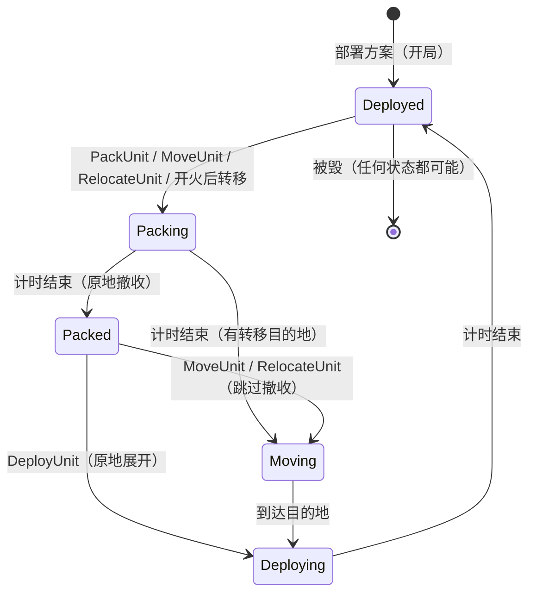

# 04 敌方 AI、部署状态机、指挥点与二选一、剧情事件

> 依赖：00（全部）、01（波次生成 / 钩子 / 地形）、02（辐射源 / 暴露度 / 欺骗）、03（指挥点调用方、警报、开火资格）。
> 本文件中的名字就是最终代码中的名字。与 00 / 01 / 02 / 03 的跨模块接口已在第 8.3 节统一收口；本规格已与 GDD / 数值表 / WBS 同步收口，进入实现前无需再次停下询问（C-T1-12）。
> 标 ★ 的数据字段 / 文件（`rules/enemy_ai.json`、`rules/commands.json` 等）已由 D2 人工决定批准（`DECISIONS.md`），由后续数据任务加入 `data/` 与 Schema（8.2 G）。

---

## 0. 范围与依据

### 0.1 覆盖范围

| 主题 | 本文件章节 | 对应 WBS / 00 |
|---|---|---|
| 敌方 AI：已知目标清单、试探 / 压制 / 猎杀 / 绕行 / 饱和、敌方可知信息、欺骗单位接口 | 1.1、2.3、3.2、3.3 | WS01-019；Step 12 `EnemyIntelSystem`；01 的 `IEnemyAiHooks` 正式实现 |
| 部署状态机：状态与转换、展开 / 撤收 / 移动、备用阵地 / 新阵地、开局部署合法性 | 1.3、2.1、3.4、3.5 | 00 Q7、Q17；`DeploymentValidator` |
| 指挥点：消耗、扣除 / 退还接口 | 1.2、2.4、3.6 | WS01-021；03 的 D15 |
| 二选一请求：自动生成（反辐射导弹 + 巡航导弹）、剧情二选一、超时与默认、慢放提示 | 2.2、3.7 | WS01-021 |
| 剧情事件：`events.json` 触发器与动作语义 | 3.8 | 00 Q15 |
| 命令 `DeployUnit / PackUnit / MoveUnit / RelocateUnit / AnswerChoice` | 4.2 | 00 4.3 |

### 0.2 依据

- GDD v1.3：5.1–5.2（指挥点操作、慢放 + 二选一）、7.3–7.4（波次结构、敌方 AI 行为）、8.1（低空盲区）、8.2（辐射策略、暴露度后果）、11.3（展开 / 撤收 / 新阵地 / 备用阵地）、13.4（敌人适应——跨关，不在本文件）、14（难度：普通弹出二选一，硬核提示更少）、17（敏感内容）。
- 数值表 v1.2：1.1（部署档、展开 / 撤收、移动速度、行进间射击）、1.3（"敌方 AI 对警戒雷达的权重 = 一个中程防空单元"）、1.5（假发射车、备用阵地、新阵地）、2.3（A‑50U、Orlan）、3.4（暴露度阈值 40 / 70 / 100）、3.5（触发规则）。
- 数据：`waves.json`（`aiTags`、`target.mode`）、`events.json`、`map/deploy.json`、`level.json`（`availableUnits`、`commandPointsPerNight`）、`rules/exposure.json`（`thresholds`）、`rules/positions.json`、`rules/tracks.json`（`warningRadarEnemyAiWeightAs`）、`rules/economy.json`（`commandPointsPerNight` 范围）、`support/support.json`（`cost.commandPoints`）、`units/*.json`（`deployTier`、`deployGameSec`、`packGameSec`、`mobility`、`moveSpeedKmh`、`fireOnMove`）。
- WBS：01.B（Step 12）、01.D（WS01-019、WS01-021）。

### 0.3 依赖

| 规格 | 本文件使用的东西 |
|---|---|
| 00 | 术语、`SimRandom`、实体存储、阶段 0、`SimContext`（含 `ThreatGrid` / `TrackGrid` 空间索引，C-T1-08）、事件 / 命令框架、`EndRequest`、`AllClear`、`SimTime`、`Geo.PointInPolygon`（`00_core.md §0.4.6`，A-2-23、P48）、`WeaponParams.RangeFor`（`00_core.md §1.8`，A-2-30、A-3-09）、`CarryIn` / `KnownTargetCarry`（`00_core.md §2.6`，A-2-18、P34）、`CommandSummary`（`00_core.md §3.5`，P42） |
| 01 | `IEnemyAiHooks`（含 `SelectWeightedRandomOverride`，A-2-10、B-T3-05）、`TargetChoice`、`ThreatTargetKind`、`WaveState.Pending`、`WaveState.Injections`、`WaveInjection`、`Threat` 字段（`WaveId`、`TargetKind`、`TargetPos`、`TargetUnitId`、`Phase`、`Kind`）、`TerrainModel`（`ElevationAt`、`HasLineOfSightAgl`、`BuildHorizonProfile`、`HorizonProfile`，C-T2-01）、`PlatformDef.Behavior` / `WhileAlive`、`EnemyAiQueries.AvoidanceActive`（A-2-10、P49） |
| 02 | `Emitter`（`EmitterControl`：`On`、`OnArmIncoming`、`ArmSilenced`、`ArmPending`）、`EmitterQueries.ListActive`（`ActiveEmitter.EntityKind`，A-3-05）、`EmissionChoiceEffects.ApplyArmChoice`（A-2-11）、`DeceptionUnit.SeenThrough`、`PendingRelocationAltId`、`ExposureThresholdCrossed`、`EmitterSwitched`、`ArmThreatDetected`、`Track.Tag / Quality / Pos`、`EmissionPolicyRules.CheckAvailable`（A-2-25） |
| 03 | `CivilRules.SetAlert`、`Civil.AlertOn`、`PlayerUnitDestroyed`（含 `Category`、`Pos`，A-2-05、A-3-05）、`InterceptorLaunched` / `GunFired`（含 `FireUnitId`、`ThreatId`）、`CanAct`（行进间射击，03 3.2.2）、`StructureDestroyed`；03 的命令处理者调用本文件的 `CommandPointRules`（A-2-17） |

### 0.4 已作的关键选择（理由见各节）

| # | 选择 |
|---|---|
| K1 | **目标选择在生成时同步完成**：沿用 01 的设计——01 的 `WaveSpawnSystem` 在生成每个目标时调用本文件实现的 `IEnemyAiHooks`（用 `spawn` 子流）。`EnemyIntelSystem`（Step 12）只维护"敌方知道什么"（已知目标清单、暴露度 100 改派名额、绕行代价网格、压制波的放行），不直接生成目标。 |
| K2 | 已知目标清单中每一条记录的是**敌方掌握的位置**（快照），不跟随单位移动。单位转移后，打击仍落在旧位置（GDD 7.4"猎杀"与 11.3"转移"的意义）。 |
| K3 | 暴露度是"被敌方定位的程度"的抽象（GDD 8.2），因此敌方 AI **可以读取**我方单位的 `Exposure` 数值与单位类型（B-T3-05）；除此之外只能使用 1.1.4 所列的信息。 |
| K4 | `aiTags` 只在三处改变执行：`suppress`（非反辐射组推迟放行）、`saturate`（重排生成时刻）、`bypass`（绕行航线）。`probe` 只标记"本波的目标会观察开火"。`hunt` **不自动改目标**——猎杀由 `target.mode = known_targets` 表达；`hunt` 标签只用于校验与显示（3.3.6）。 |
| K5 | 绕行用**固定网格 A\***，代价网格由 Step 12 预先计算（带站点 `HorizonProfile` 视线包络与河谷偏好，C-T2-01），生成时跑带缓存的 A\*（C-T1-07）；网格格数、站点数都有上限。 |
| K6 | 部署状态机的推进在**阶段 0**（命令应用之后）。我方单位的"受损"不是部署状态（03 的 `DamageEfficiencyMult` 等字段），"被毁" = 从存储删除（00 2.4）。 |
| K7 | 移动按**直线**（不沿道路），只要求终点合法性（B-T2-98）。 |
| K8 | 指挥点由各命令的**处理者**在 `Validate` 中检查、在 `Apply` 中扣除，统一通过本文件的 `CommandPointRules`（A-2-17）；消耗表在新数据文件 `rules/commands.json`★。 |
| K9 | 自动二选一的超时 = **按单位预设的触发规则处理**（即不改变 02 已执行的预设），默认选项只用于显示与记录。客户端在二选一出现时硬暂停并按现实秒倒计时（硬核模式不暂停、改为极慢速 `1/60×`，C-T3-01）。 |
| K10 | 本文件**不消耗** `enemy_ai` 子流（目标选择用 01 传入的 `spawn` 子流；其余算法全部确定性）。`command` 子流也不消耗。 |

---

## 1. 数据输入

### 1.1 敌方 AI

#### 1.1.1 ★ 新增规则文件 `rules/enemy_ai.json`（`kind: "enemy_ai"`）→ `EnemyAiRulesDef`

加载顺序为 `00_core.md §1.2` 第 25 项（第 26 项为 `rules/commands.json`，总计 `LoadedFiles.Count == 35`，P01、P49）。全部字段必填（加载器严格，00 1.2）。建议默认值即下表"建议值"列（均为 provisional 暂定值，由 D3/D4 纸面模拟器与试玩调整，WS01-019 🟡）。

| JSON 路径 | 单位 / 类型 | 加载后 C# | 建议值 | 用途 |
|---|---|---|---|---|
| `knownTargets.dedupeRadiusKm` | km | `KnownTargets.DedupeRadiusM` | 0.5 | 同一单位、相距不超过此距离的新记录视为重复（3.2.3） |
| `knownTargets.maxEntries` | int ≥ 1 | `KnownTargets.MaxEntries` | 32 | 清单上限（3.2.3 淘汰） |
| `knownTargets.carryMatchRadiusKm` | km | `KnownTargets.CarryMatchRadiusM` | 0.5 | 跨夜带入的记录与今晚单位的匹配半径（3.2.1） |
| `knownTargets.scoutedRadiusKm` | km | `KnownTargets.ScoutedRadiusM` | 1.0 | "已被敌方侦察过的阵地"判定半径（3.4.6） |
| `knownTargets.reasonWeights` | 对象 `{carried_in, precision_exposure, probe_fire, emitting}` | `ReasonWeights`（按 `KnownTargetReasonWeightKey` 查） | 1.0 / 3.0 / 1.5 / 1.0 🟡 | 选择权重：原因（`precision_exposure = 3.0`，B-T2-90；Mini04 测试夹具显式设为 `2.0`，见 7.0） |
| `knownTargets.kindWeights` | 对象 `{air_defense, radar, ew, sensor}` | `KindWeights` | 1.0 / 1.0 / 0.6 / 0.3 🟡 | 选择权重：敌方认为的类型。`radar = air_defense` 依据 `tracks.json` `warningRadarEnemyAiWeightAs = medium_sam` |
| `knownTargets.spreadFactor` | (0, 1] | `SpreadFactor` | 0.5 🟡 | 每多一个在飞弹药瞄准同一记录，权重 × 此值（分散打击） |
| `exposure100.retargetFrac` | [0, 1] | `Exposure100.RetargetFrac` | 0.25 🟡 | 暴露度首次达到 100 时，从本夜尚未出发的 `weighted_random` 弹药组中改派打该单位的比例（向上取整，至少 1 枚，B-T3-05） |
| `exposure100.preferAttracts` | `string[]` | `Exposure100.PreferAttracts` | `["iskander_m", "lancet", "geran_2"]` 🟡 | 暴露度 100 改派时优先选择的精确打击弹药定义 ID 顺序（与 `deception.attracts` 对应，B-T3-05） |
| `probe.observeRadiusKm` | km，≥ 0 | `Probe.ObserveRadiusM` | 3.0 🟡 | 试探波的存活目标在此半径内看到开火也记录（3.2.4 条件 B）；0 = 只用条件 A |
| `suppress.minHoldGameSec` | 游戏秒 | `Suppress.MinHoldSec` | 0.25（15 s）🟡 | 压制波主力最少推迟 |
| `suppress.maxHoldGameSec` | 游戏秒 | `Suppress.MaxHoldSec` | 2（120 s）🟡 | 压制波主力最多推迟 |
| `saturate.arrivalWindowGameSec` | 游戏秒 | `Saturate.ArrivalWindowSec` | 0.5（30 s）🟡 | 饱和波全部目标的到达时间窗 |
| `bypass.tags` | `TargetTag[]`，非空 | `Bypass.Tags` | `["CM"]` | 哪些标签的弹药会绕行（与 01 的 A‑50 规则一致：只对 CM） |
| `bypass.cellKm` | km，> 0 | `Bypass.CellM` | 1.0 | 网格初始格边长 |
| `bypass.maxCells` | int ≥ 4 | `Bypass.MaxCells` | 4096 | 网格格数上限（3.2.6 放大格边长） |
| `bypass.marginKm` | km，≥ 0 | `Bypass.MarginM` | 5 | 网格在地图四周的外扩（进入点常在地图外） |
| `bypass.threatWeight` | ≥ 0 | `Bypass.ThreatWeight` | 4.0 🟡 | 格子每落入一个已知防空圈（且可见）加的代价 |
| `bypass.valleyWeight` | ≥ 0 | `Bypass.ValleyWeight` | 0.5 🟡 | 归一化高程（0 = 最低）乘此权重，使航线偏向河谷 |
| `bypass.assumedAltitudeM` | m（AGL），≥ 0 | `Bypass.AssumedAltitudeM` | 50 | 计算视线遮挡时假定的巡航高度（Kh‑101 30–70 m 的中值） |
| `bypass.siteAntennaHeightM` | m，≥ 0 | `Bypass.SiteAntennaHeightM` | 10 | 敌方 AI 估算绕行防空圈视线时统一假设的阵地天线高度（与 `terrain.defaultAntennaHeightM` 独立配置，A-2-26） |
| `bypass.useLineOfSight` | bool | `Bypass.UseLineOfSight` | true | false = 只按圆形，不计地形遮挡 |
| `bypass.maxSites` | int ≥ 0 | `Bypass.MaxSites` | 8 | 每张网格计入的站点上限 |
| `bypass.radiusMult` | > 0 | `Bypass.RadiusMult` | 1.0 🟡 | 已知防空圈半径倍率 |
| `bypass.fakeLauncherAssumedRangeKm` | km | `Bypass.FakeLauncherAssumedRangeM` | 10 🟡 | 敌方以为假发射车的射程 |
| `bypass.maxWaypoints` | int ≥ 1 | `Bypass.MaxWaypoints` | 16 | 绕行生成的中间航点上限 |
| `bypass.a50.radiusMult` | > 0 | `Bypass.A50.RadiusMult` | 1.2 🟡 | A‑50 存活时圆半径再乘此值 |
| `bypass.a50.threatWeightMult` | ≥ 0 | `Bypass.A50.ThreatWeightMult` | 2.0 🟡 | A‑50 存活时站点代价再乘此值 |
| `bypass.a50.siteMinExposure` | 0–100 | `Bypass.A50.SiteMinExposure` | 40 🟡 | A‑50 存活时，暴露度 ≥ 此值的防空单位即使不在清单中也被绕开 |
| `bypass.a50.appliesToUntagged` | bool | `Bypass.A50.AppliesToUntagged` | true | A‑50 存活时，未标 `bypass` 的波次中的 CM 也绕行（01 的 `AvoidanceActive` 规则） |

加载校验（`E_RANGE`）：`spreadFactor ∈ (0, 1]`；`retargetFrac ∈ [0, 1]`；所有权重 ≥ 0；`minHoldGameSec ≤ maxHoldGameSec`；`cellKm > 0`；`maxCells ≥ 4`；`siteMinExposure ∈ [0, 100]`。`reasonWeights` / `kindWeights` 恰好这 4 个键（缺 → `E_MISSING_FIELD`，多 → `E_UNKNOWN_FIELD`）。

#### 1.1.2 其他数据（已存在）

| 来源 | C# | 用途 |
|---|---|---|
| `waves.json` → `waves[].aiTags` | `WaveDef.AiTags`（`AiTag?[]`） | 3.3 |
| `waves.json` → `groups[].target.mode` | `TargetSpecDef.Mode` | 3.3.1 |
| `rules/exposure.json` → `thresholds[]` | `ExposureRulesDef.Thresholds`（02：已按 `AtLeast` 升序，带 `Consequence`） | 取 `AntiRadiationPriorityTonight` / `KnownTargetListNextNight` / `PrecisionStrikeTonight` 三档的 `AtLeast`（记作 `T40`、`T70`、`T100`）；某档缺失 → 该后果不生效（阈值视为 `+∞`） |
| `enemies/munitions.json` → `tracksEmittingRadarOnly`、`tag`、`speedKmh`、`altitudeBand` | `MunitionDef` | 反辐射判定、绕行 / 饱和 |
| `enemies/platforms.json` → `behavior`、`whileAlive.cruiseMissilesAvoidAirDefense` | `PlatformDef.Behavior`、`WhileAlive` | 反辐射平台判定、A‑50 |
| `units/air_defense.json` → `weapons[].targets / rangeKm / rangeByTagKm` | `WeaponDef` | 绕行圈半径（3.2.6） |
| `units/deception.json` → `effect` | `DeceptionUnitDef.Effect` | 敌方认为的类型（1.1.3） |
| `units/sensors.json` → `emission` | `SensorDef.Emission` | 敌方认为的类型 |

#### 1.1.3 "敌方认为的类型" `KnownTargetKind`

敌方只看外观与辐射，不知道是不是诱饵：

| 实体 | 条件 | `KnownTargetKind` |
|---|---|---|
| `FireUnit` | — | `AirDefense` |
| `SensorUnit` | `Def.Emission == Active` | `Radar` |
| `SensorUnit` | 其他 | `Sensor` |
| `EwUnit` | — | `Ew` |
| `DeceptionUnit` | `Effect == FakeLauncher` | `AirDefense` |
| `DeceptionUnit` | `Effect ∈ {FakeEmitter, SacrificialEmitter}` | `Radar` |

函数 `EnemyBelief.KindOf(SimState, int unitId) : KnownTargetKind?`（单位不存在 → `null`）；`EnemyBelief.KindOfDef(GameCatalog, string defId) : KnownTargetKind`（带入数据用）。

#### 1.1.4 敌方能知道什么（信息边界，写死）

敌方 AI 的全部输入**只能**来自下表。实现中任何读取真值的地方都必须对应表中一行；代码审查按此表核对。

| # | 信息 | 途径（游戏化） | 读取方式 |
|---|---|---|---|
| I1 | 保护目标的位置与权重 | 战前侦察、公开信息 | `Level.Structures`（01 的 `weighted_random` 已用） |
| I2 | 我方单位的暴露度数值与单位类型 | 暴露度本身就是"被敌方定位的程度"（K3、B-T3-05） | `PlayerUnitCommon.Exposure`、`EnemyBelief.KindOf` |
| I3 | 当前开机的辐射源位置 | 电子侦察（实时） | 02 的 `EmitterQueries.ListActive(state)`：只用 `UnitId`、`Pos`、`Exposure`、`EntityKind`（A-3-05）；**不得读 `IsDecoy`** |
| I4 | 已知目标清单（记录时的位置 + 敌方认为的类型 + 单位定义 ID） | 暴露度达到 `T100`（当夜）、上一夜暴露度 ≥ `T70`（次夜）、试探波观察到开火 | `EnemyIntel.KnownTargets`（3.2） |
| I5 | 清单中单位是否被摧毁 | 战果评估 | `PlayerUnitDestroyed` 事件 → 删除记录 |
| I6 | 假发射车被识破 | 侦察（02 掷骰） | `DeceptionUnit.SeenThrough` |
| I7 | 己方资产状态（A‑50 是否存活、本波反辐射导弹是否还在飞、目标在瞄准谁） | 自己的资产 | `Threat` 存储（01 字段） |
| I8 | 被反辐射导弹瞄准的辐射源是否关机 | 电子侦察 | `EmitterSwitched { On = false }` 事件（只对本波反辐射导弹瞄准的单位） |

敌方**不知道**：航迹、我方弹药余量、辐射策略与触发规则、未开机且不在清单中的单位位置、诱饵 / 假目标的真实身份（除 I6）、单位转移后的新位置（除非它再次开机或再次进入清单）。

> 注：清单记录中的 `UnitId` 是**实现用的真值关联**（用于 I5 删除与 02 的 `TargetUnitId`），敌方的选择逻辑只依据记录的 `Pos`、`Kind`、`Reason` 与在飞弹药的瞄准计数，不得读取该 ID 对应单位的当前状态（如当前位置、是否展开）。

### 1.2 ★ 新增规则文件 `rules/commands.json`（`kind: "commands"`）→ `CommandRulesDef`

| JSON 路径 | 类型 | C# | 建议值 | 说明 |
|---|---|---|---|---|
| `commandPointCosts` | 对象：键 = 命令名的 snake_case（按 00 1.2 第 8 条转成 `SimCommandType`），值 = int ≥ 0 | `CommandPointCosts`（`IReadOnlyDictionary<SimCommandType,int>`，只查找） | `set_emission_policy 1`、`sector_emission_override 1`、`set_engagement_rule 1`、`set_air_raid_alert 1`、`set_fighter_zone 0`、`pack_unit 1`、`deploy_unit 0`、`move_unit 1`、`relocate_unit 1`、`answer_choice 0` | 缺键 = 0。**不得**出现 `call_support`（其消耗在 `support.json` 的 `cost.commandPoints`）与 `noop`（→ `E_RANGE`：`取值 call_support 超出范围 消耗由 support.json 给出`）。未知命令名 → `E_ENUM` |
| `moveUnitTiers` | `DeployTier[]` | `MoveUnitTiers` | `["instant"]` | `MoveUnit` 允许的部署档（"调动机动单位"，B-T3-06） |
| `relocateUnitTiers` | `DeployTier[]` | `RelocateUnitTiers` | `["instant", "minutes"]` | `RelocateUnit` 允许的部署档（"仅限展开时间按分钟计的系统"，B-T3-06） |
| `armChoice.enabled` | bool | `ArmChoice.Enabled` | true | 自动二选一总开关 |
| `armChoice.choiceKey` | locKey | `ArmChoice.ChoiceKey` | `"choice.arm_vs_cruise"` | 界面文本键（选项 0 = 静默、1 = 坚持） |
| `armChoice.timeoutGameSec` | 游戏秒，> 0 | `ArmChoice.TimeoutSec` | 0.5（30 s） | 模拟层超时世界秒数（客户端硬暂停时按现实秒倒计时，C-T3-01） |
| `armChoice.minCruiseTracks` | int ≥ 1 | `ArmChoice.MinCruiseTracks` | 1 | 扇区内至少几个巡航导弹航迹才弹出 |
| `armChoice.cruiseTags` | `TargetTag[]` | `ArmChoice.CruiseTags` | `["CM", "SCM"]` | 什么算"巡航导弹" |
| `armChoice.minTrackQuality` | `vague / approximate / precise` | `ArmChoice.MinTrackQuality` | `approximate` | 航迹最低质量 |
| `armChoice.rangeMult` | > 0 | `ArmChoice.RangeMult` | 1.0 | "进入其扇区" = 航迹在单位对该标签射程 × 此值内 |
| `maxOpenAutoChoices` | int ≥ 1 | `MaxOpenAutoChoices` | 1 | 同时未决的自动二选一上限（剧情二选一不计） |
| `storyChoice.defaultTimeoutGameSec` | 游戏秒，> 0 | `StoryChoice.DefaultTimeoutSec` | 1（60 s） | `events.json` 未写 `timeoutGameSec` 时使用 |
| `storyChoice.optionCount` | int ≥ 2 | `StoryChoice.OptionCount` | 2 | 剧情选择的选项数（数据无此字段，GDD 只有"二选一"） |

`economy.json` 的 `commandPointsPerNight {min 3, max 6}` 是关卡配置范围：加载器检查 `level.commandPointsPerNight ∈ [min, max]`，否则 `E_RANGE`（`取值 {n} 超出范围 economy.commandPointsPerNight [3, 6]`）。

### 1.3 部署

| 来源 | C# | 用途 |
|---|---|---|
| `units/air_defense.json` → `deployTier` | `AirDefenseUnitDef.DeployTier`（`DeployTier { Instant = 0, Minutes = 1, HoursShort = 2, Hours = 3, Fixed = 4 }`） | 命令可用性（3.4.4） |
| `deployGameSec` / `packGameSec` | `DeploySec` / `PackSec`（`double?`，世界秒；`null` = 不可展开 / 撤收） | 3.4 |
| `mobility` | `Mobility` | 部署区 `allowedMobility`（3.5） |
| `moveSpeedKmh` | `MoveSpeedMps`（`double?`；`null` = 不可移动） | 3.4.3 |
| `fireOnMove` | `FireOnMove { Yes = 0, Partial = 1, No = 2 }` | 03 的 `CanAct` 读取（03 3.2.2，本文件不重复定义） |
| `units/sensors.json` → `deployGameSec` / `packGameSec` | `SensorDef.DeploySec` / `PackSec`（`double?`） | 撤收 / 原地展开 |
| `units/ew.json` → `deployGameSec` / `packGameSec` | `EwUnitDef.DeploySec` / `PackSec`（`double`） | 同上 |
| `units/deception.json` | 无部署字段 | 欺骗单位不能撤收、不能移动（B-T3-06） |
| `map/deploy.json` | `DeployDef`：`Zones`（`Polygon`、`AllowedMobility?`）、`Forbidden`（`Polygon`、`Reason`）、`AlternatePositions`（`Id`、`Pos`、`Surveyed`） | 3.5 |
| `level.json` → `availableUnits[]` | `AvailableUnitDef(UnitId, Count, Source)` | 数量上限（同一 `UnitId` 多行 → 数量相加） |
| `level.json` → `map.widthM / heightM` | `Meta.Map` | 地图范围 |
| `rules/positions.json` → `preparedAlternate.deployTimeMult` | `PositionRulesDef.PreparedAlternate.DeployTimeMult` | 展开到已勘察备用阵地 × 0.5 |
| `rules/positions.json` → `newUnsurveyed` | 02 使用 | 新阵地惩罚由 02 / 03 实施（本文件只给出 `UnitDeployStateChanged` 的字段） |
| `units/sensors.json` → `automatic`；`nightPenaltyNegatedBy` | `SensorDef.Automatic`、`NightPenaltyNegatedBy` | 校验 |
| `units/ew.json` → `equipmentSlot`、`effect` | `EwUnitDef` | 校验装备 / 诱导点 |

### 1.4 剧情事件 `events.json` → `StoryEventsDef`（00 1.6）

`StoryTriggerDef(Type, Night?, Sec?, RefId?)`、`StoryActionDef(Type, DialogueKey?, WaveId?, ChoiceKey?, TimeoutSec?, DefaultOption?, On?)`（其中 `set_alert` 的可选布尔字段 `On` 对应 JSON `on`，缺省视为 `true`，用于拉响或解除警报，B-T2-101）。加载时（00 1.2 之外**追加**的校验，`E_MISSING_FIELD`，路径指向缺失字段的位置）：

| 条件 | 错误 |
|---|---|
| `trigger.type == at_game_sec` 缺 `gameSec` | `E_MISSING_FIELD $.events[i].trigger.gameSec` |
| `trigger.type ∈ {structure_destroyed, unit_destroyed, wave_spawned}` 的 `ref` | 可缺省（= 任意一个） |
| `action.type == dialogue` 缺 `dialogueKey` | `E_MISSING_FIELD …actions[j].dialogueKey` |
| `action.type == spawn_wave` 缺 `wave` | `E_MISSING_FIELD …actions[j].wave` |
| `action.type == choice` 缺 `choiceKey` | `E_MISSING_FIELD …actions[j].choiceKey` |
| `choice` 的 `defaultOption ≥ StoryChoice.OptionCount` | `E_RANGE` |
| `unit_destroyed` 的 `ref` 不是单位定义 ID | `E_UNKNOWN_REF`（类别 `单位`） |
| `structure_destroyed` 的 `ref` 不是保护目标 ID | `E_UNKNOWN_REF`（类别 `保护目标`） |
| `wave_spawned` 的 `ref`、`spawn_wave` 的 `wave` 不是任一夜的波次 ID | `E_UNKNOWN_REF`（类别 `波次`） |

---

## 2. 状态

> "写 / 读"列：数字 = Step 序号；"0" = 阶段 0；"I" = `Initialize`；"H" = 01 调用的钩子（只读）。全部字段**按表中行顺序**哈希，标"不哈希"的除外。

### 2.1 我方单位公共字段（`PlayerUnitCommon`，本文件拥有字段见 `00_core.md §2.4` 完整 14 项哈希表）

`PlayerUnitCommon` 的全部 14 个哈希字段与不参与哈希的只读关联字段（`Placement`、`RosterId`）在 `00_core.md §2.4` 统一声明（P24）。其中本文件负责维护的字段为（序号对应 `00_core.md §2.4`）：

| 00 序号 | 字段 | C# 类型 | 单位 | 初值 | 写 | 读 |
|---|---|---|---|---|---|---|
| 1 | `DeployState` | `UnitDeployState`（00 已定义） | — | `Deployed` | 0 | 全部 |
| 2 | `DeployPhaseEndTick` | `int` | 步 | `-1`（当前状态没有计时） | 0 | 0、快照 |
| 3 | `Relocation` | `RelocationOrder?` | — | `null` | 0 | 0、快照 |
| 10 | `PendingRelocationAltId` | `string?` | — | `null` | 6（02 置位）、0（04 清空并执行） | 0 |

```csharp
public enum RelocationKind { Move = 0, Relocate = 1, AutoAfterFiring = 2 }
public sealed class RelocationOrder          // 哈希顺序 = 字段声明顺序；前置 Write(bool 非 null)
{
    public RelocationKind Kind;
    public Vec2 From;                        // 开始移动时的位置（撤收完成时写入；撤收前 = 单位当前位置）
    public Vec2 Dest;
    public string? AlternatePositionId;      // 目的地为备用阵地时
    public bool DestSurveyed;                // 目的地是 Surveyed == true 的备用阵地
    public int MoveStartTick;                // 撤收完成、开始移动的步；尚未开始 = -1
    public int MoveEndTick;                  // 到达的步；尚未开始 = -1
}
```

`UnitDeployState` 与任务要求中各状态的对应（写死）：

| 中文 | 表示方式 |
|---|---|
| 未部署（预备队） | 不是实体（本版本夜间不能从预备队部署，3.4.5、B-T3-06） |
| 展开中 | `Deploying` |
| 就绪 | `Deployed` |
| 撤收中 | `Packing` |
| 已撤收（原地） | `Packed` |
| 机动中 | `Moving` |
| 受损 | 不是部署状态：03 的 `DamageEfficiencyMult` / `LightDamaged` / 重伤暂停等字段，与部署状态正交 |
| 被毁 | 从存储删除 + `PlayerUnitDestroyed`（00 2.4） |

### 2.2 `ChoiceRequest`（实体，`EntityKind.ChoiceRequest = 11`；本文件拥有全部专有字段）

没有 `DefId`、`Pos`、`AltM`（00 2.4）；`Id` 与 `CreatedTick` 继承自基类 `Entity` 并由 `EntityStore` 头统一写入哈希，不在子类 `WriteHash` 中重复写（A-3-01、P25、P26）。解决（回答 / 超时 / 取消）时立即 `Remove`。

| 字段 | C# 类型 | 初值 | 写 | 读 |
|---|---|---|---|---|
| `Kind` | `ChoiceKind { ArmVsCruise = 0, Story = 1 }` | 创建时 | 0 | 0、快照 |
| `ChoiceKey` | `string` | 创建时 | 0 | 快照 |
| `OptionCount` | `int` | 2（剧情 = `StoryChoice.OptionCount`） | 0 | 0、快照 |
| `DefaultOption` | `int` | 3.7.2 / 3.8.3 | 0 | 0、快照 |
| `DeadlineTick` | `int` | 3.7.2 / 3.8.3 | 0 | 0、快照 |
| `SubjectUnitId` | `int` | 自动：被瞄准的火力单元；剧情：0 | 0 | 0、快照 |
| `SubjectTrackId` | `int` | 自动：反辐射导弹的航迹；剧情：0 | 0 | 0、快照 |
| `StoryEventId` | `string?` | 剧情：事件 ID；自动：`null` | 0 | 0、快照 |

### 2.3 单例组件 `EnemyIntelState`（`SimState.EnemyIntel`，00 3.7.2 第 5 项）

| 字段 | C# 类型 | 初值 | 写 | 读 | 哈希 |
|---|---|---|---|---|---|
| `KnownTargets` | `List<KnownTarget>`（按 `EntryId` 升序） | I（带入，3.2.1） | I、12 | 12、H、0（`DestinationScouted`）、快照 | ✔ |
| `NextKnownEntryId` | `int` | 1 | I、12 | 12 | ✔ |
| `ScoutedPositions` | `List<Vec2>`（只追加，按加入顺序） | I | I、12 | 0（3.4.6） | ✔ |
| `CarryInAnnounced` | `bool` | false | 12 | 12 | ✔ |
| `HeldWaves` | `List<HeldWave>`（按创建顺序） | 空 | 12 | 12、00（`AllClear`） | ✔ |
| `AvoidanceSiteKey` | `List<AvoidanceSite>`（两组，见 3.2.6） | I | I、12 | 12 | ✔ |
| `RetargetOverrides` | `List<RetargetOverride>`（按 `(WaveIndex, GroupIndex, Ordinal)` 升序，无重复） | I（3.2.1） | I、12 | H（`SelectWeightedRandomOverride`） | ✔（B-T3-05） |
| `Exposure100RetargetedUnits` | `List<int>`（升序，无重复） | 空 | I、12 | 12 | ✔（B-T3-05） |
| `UnfulfilledExposure100Units` | `List<int>`（升序，无重复） | 空 | I、12 | 12、结算（`BuildCarryOut`） | ✔（B-T3-05） |
| `AvoidanceGrids` | `List<AvoidanceGrid>`（每个 `Bypass.Tags` 一张） | I | I、12 | H | **不哈希**（由 `AvoidanceSiteKey` 与静态数据唯一推出的缓存） |
| `AvoidanceGridVersion` | `int` | 0（每次重建 `+1`） | I、12 | H | **不哈希**（C-T1-07） |
| `AStarCache` | `Dictionary<(int TagIndex, bool A50Active, int StartCell, int GoalCell, int GridVersion), IReadOnlyList<Vec2>>` | 空 | I、12、H | H | **不哈希**（只查找不遍历，命中与否不改变结果，C-T1-07） |
| `AssignedByUnit` / `AssignedByPos` / `ArmAssignedByUnit` | `Dictionary<int, int>` / `Dictionary<Vec2, int>` / `Dictionary<int, int>` | 空 | 01 生成 / 推进到达 / 删除时或惰性重建 | H | **不哈希**（只查找不遍历，与全表扫描逐位等价，C-T1-06） |

```csharp
public enum KnownTargetKind { AirDefense = 0, Radar = 1, Ew = 2, Sensor = 3 }
public enum KnownTargetReason { CarriedIn = 0, PrecisionExposure = 1, ProbeFire = 2 }
public sealed class KnownTarget                      // 哈希顺序 = 声明顺序
{
    public int EntryId;                              // 清单内编号，从 1 起，不重用
    public int UnitId;                               // 真值关联（见 1.1.4 注）；带入时未匹配到单位 = 0
    public string UnitDefId;                         // 敌方认为的单位定义（= 记录时单位的 DefId）
    public KnownTargetKind Kind;
    public Vec2 Pos;                                 // 敌方掌握的位置（快照，不随单位移动）
    public KnownTargetReason Reason;
    public int AddedTick;                            // 带入 = 0
}
public readonly record struct RetargetOverride(
    int WaveIndex, int GroupIndex, int Ordinal, int UnitId, Vec2 Pos);
    // 哈希顺序 = 参数顺序（B-T3-05）
public enum ReleaseCause { SuppressionAchieved = 0, ArmsGone = 1, MaxHold = 2 }
public sealed class HeldWave                         // 哈希顺序 = 声明顺序
{
    public string WaveId;
    public int WaveIndex;                            // 今晚 NightDef.Waves 中的下标
    public List<int> HeldGroupIndices;               // 升序
    public int StartTick;                            // 收到 WaveStarted 的步
    public int ExpectedArmCount;                     // 未推迟的反辐射组的 Count 之和（平台按 3.3.3 计 0）
    public List<int> ArmThreatIds;                   // 本波已生成的反辐射弹药，升序
    public List<int> SuppressTargetUnitIds;          // 这些弹药生成时的 TargetUnitId（≠ 0），升序无重复
    public bool SuppressionAchieved;
}
public readonly record struct AvoidanceSite(int Set, Vec2 Pos, double RadiusM, int TagIndex);
    // Set：1 = 平时（只含已知清单），2 = A‑50 存活；哈希顺序 = 参数顺序
public sealed class AvoidanceGrid                    // 不哈希
{
    public TargetTag Tag; public double MinX, MinY, CellM; public int Nx, Ny;
    public double[] Penalty1;                        // 平时
    public double[] Penalty2;                        // A‑50 存活
}
```

### 2.4 单例组件 `CommandState`（`SimState.Commands`，00 3.7.2 第 4 项）

| 字段 | C# 类型 | 初值 | 写 | 读 |
|---|---|---|---|---|
| `Points` | `int` | `Math.Clamp(Meta.CommandPointsPerNight + (CarryIn?.CommandPointsBonus ?? 0), 0, Rules.Economy.CommandPointsPerNight.Max)`（A-2-18、P38） | 0（经 `CommandPointRules`） | 全部命令处理者、快照 |
| `InitialPoints` | `int` | 同上 | I | 快照、结算 |
| `SpentTotal` | `int` | 0 | 0 | 结算 |
| `RefundedTotal` | `int` | 0 | 0、9（03 的退还） | 结算 |
| `RelocationsCompleted` | `int` | 0 | 0b（`CompletedRelocation == true` 时 `+1`） | 结算（`CommandSummary.RelocationsCompleted`，P42） |
| `FiredStoryEventIds` | `List<string>`（序数升序，无重复） | 空 | 0 | 0 |
| `StoryChoiceResults` | `List<StoryChoiceResult>`（按解决顺序） | 空 | 0 | 结算（CarryOut） |
| `ChoicesRequested` / `ChoicesAnswered` / `ChoicesTimedOut` / `ChoicesCancelled` | `int` ×4 | 0 | 0 | 结算 |

```csharp
public sealed record StoryChoiceResult(string StoryEventId, string ChoiceKey, int Option, bool TimedOut);   // 哈希 = 参数顺序
```

注意：`RefundedTotal` 由 03 在第 9 步（`ExternalSupportSystem` 退还呼叫）经 `CommandPointRules.Refund` 写入——这是 `CommandState` 唯一在阶段 0 之外被修改的地方。

### 2.5 快照（00 2.7）

- `FireUnitView` / `SensorUnitView` / `EwUnitView` / `DeceptionUnitView` 追加：`DeployState`、`DeployPhaseEndTick`、`RelocationDest`（`Vec2?`，= `Relocation?.Dest`）。
- `ChoiceRequestView(int Id, ChoiceKind Kind, string ChoiceKey, int OptionCount, int DefaultOption, int CreatedTick, int DeadlineTick, int SubjectUnitId, int SubjectTrackId, string? StoryEventId)`（其中 `CreatedTick` 取自基类 `Entity.CreatedTick`，A-3-01）。
- `GlobalView` 追加：`int CommandPoints`、`int CommandPointsInitial`、`IReadOnlyList<KnownTargetView> EnemyKnownTargets`（**调试 / 复盘用**：正常界面不得显示敌方掌握的情报——06 决定开关，同 00 Q12）、`int HeldWaveCount`。
- `KnownTargetView(int EntryId, int UnitId, string UnitDefId, KnownTargetKind Kind, Vec2 Pos, KnownTargetReason Reason, int AddedTick)`。

---

## 3. 每步算法

### 3.1 时序总览与通用实现约定

```
Step():
  阶段 0（00 3.4）:
    0a ApplyDueCommands()                      # 00：本文件处理 400–404；02 / 03 的处理者在其中调用 CommandPointRules
    0b DeploymentStage.Run(ctx)                # 3.4.7：执行 PendingRelocationAltId、推进计时
    0c ChoiceStage.Run(ctx)                    # 3.7：取消 → 超时 → 生成新的自动二选一
    0d StoryStage.Run(ctx)                     # 3.8：剧情触发与动作
  系统 1 WaveSpawnSystem（01）：生成时调用本文件的 IEnemyAiHooks（3.3）
  …
  系统 12 EnemyIntelSystem（本文件，3.2）
  …
```

- `0b–0d` 构成 `00_core.md §3.4` 中的 `CommandStageHooks()`，执行顺序严格固定为 `DeploymentStage.Run(ctx) → ChoiceStage.Run(ctx) → StoryStage.Run(ctx)`（B-T2-15、P40）。阶段 0 的代码放在 `Nightwatch.Sim.Commands.CommandStage`（静态类，持有 `DeploymentStage`、`ChoiceStage`、`StoryStage` 三个静态方法组），`ctx.Rng` = `command` 子流（本文件不消耗）。
- 本文件命令（400–404）的处理者是 `CommandStage`（实现 `ICommandHandler` 的阶段 0 组件，**不是** 14 个系统之一；`00_core.md §3.2` 第 10 步的处理者收集已包含它）。
- 阶段 0 读取事件：`ctx.Events.PreviousStep`（上一步全部事件）与 `ctx.Events.CurrentStep`（本步阶段 0 已产生的事件，例如 `0a` 中的 `CommandApplied`）。
- `EnemyIntelSystem` 在第 12 步读取 `ctx.Events.CurrentStep`：本步第 1–11 步产生的全部事件都在其中（`ThreatSpawned`、`MunitionReleased`、`EmitterSwitched`、`InterceptorLaunched`、`GunFired`、`PlayerUnitDestroyed`、`ExposureThresholdCrossed`、`WaveStarted`），**不需要**游标、也不读 `PreviousStep`。
- **欧氏距离约定（C-T1-04）**：凡需要开方的欧氏距离一律使用 `Math.Sqrt(dx * dx + dy * dy)`，禁止使用 `Math.Hypot`（与 `00_core.md §0.4.4 / §6.2` 一致）。
- **空步快速返回（C-T1-16）**：当某一步无活跃转移 / 撤收 / 展开计时、无存活 `ChoiceRequest`、无 `HeldWaves`、且 `PreviousStep` / `CurrentStep` 无相关事件时，`0b–0d` 与第 12 步 `EnemyIntelSystem` 完成 $O(1)$ 状态检查后立即返回，不分配临时集合。

### 3.2 `EnemyIntelSystem`（Order 12，子流 `enemy_ai`，本文件不消耗）

#### 3.2.1 `Initialize(ctx)`（`ctx.Tick = 0`；在 01 与 02 的 `Initialize` 之后，因此 `Waves.Pending`、`Exposure`、`Emitter` 已就绪）

```
# A. 跨夜带入（CarryIn.KnownTargets，类型 KnownTargetCarry(string UnitDefId, Vec2 Pos, double Exposure, int RosterId = 0, bool Priority = false)，A-2-18、B-T3-05）
matched = 空集合（实体 ID）
for c in Config.CarryIn.KnownTargets ?? []:                       # 列表顺序
    if c.UnitDefId 不在 GameCatalog 的单位 ID 中: 记录错误（见下）; continue
    uid = 0
    for u in 我方单位（FireUnit → SensorUnit → EwUnit → DeceptionUnit，各自 ID 升序）:
        if u.DefId == c.UnitDefId（序数）且 u.Id ∉ matched 且 |u.Pos − c.Pos|² ≤ CarryMatchRadiusM²:
            uid = u.Id; matched.Add(u.Id); break
    reason = CarriedIn
    if c.Priority:                                                # 上一夜暴露度 100 且未能在当夜改派（B-T3-05）
        tKnown    = State.Waves.Pending 中满足 g.Target.Mode == KnownTargets 的最早 SpawnAtSec（无则 +∞）
        tWeighted = State.Waves.Pending 中满足 g.Target.Mode == WeightedRandom 且 g.EnemyId ∈ Catalog.Munitions 的最早 SpawnAtSec（无则 +∞）
        if tKnown <= tWeighted 且 tKnown < +∞:
            reason = PrecisionExposure                            # 次夜首个打击组为 known_targets：以 PrecisionExposure 高权重入单
        elif tWeighted < +∞:
            TryAllocateExposure100Retarget(ctx.State, ctx.Level, uid, c.Pos)   # 次夜分配 25% 待生成 weighted_random 弹药改打该位置
    AddEntrySilently(uid, c.UnitDefId, EnemyBelief.KindOfDef(catalog, c.UnitDefId), c.Pos, reason, tick 0)
有错误 → SimSetupException，消息每行：[E_UNKNOWN_REF] carryIn.knownTargets[{i}].unitDefId: 引用的 单位 "{id}" 不存在

# B. 带入的高暴露度（02 3.6.4：带入不发阈值事件，由 04 直接读）
for u in 我方单位（同上顺序，跳过 SensorUnit.Automatic）:
    if u.Exposure ≥ T100 且（u 不是 DeceptionUnit 或 !u.SeenThrough）:
        AddEntrySilently(u.Id, u.DefId, KindOf(u), u.Pos, PrecisionExposure, tick 0)    # 经 3.2.3 去重
        TriggerExposure100Retarget(ctx.State, ctx.Level, u.Id, u.Pos)                   # B-T3-05

# C. 绕行网格
RebuildAvoidanceIfNeeded(ctx)                                       # 3.2.6
```

`AddEntrySilently` = 3.2.3 的 `AddEntry`，但**不发事件**（`NightStarted` 必须是 `Seq 1`）；这些记录在第 1 步的 `Execute` 开头统一补发 `KnownTargetAdded`（`CarryInAnnounced`）。

#### 3.2.2 `Execute(ctx)`

```
# 0. 补发开局记录
if !CarryInAnnounced:
    for e in KnownTargets（EntryId 升序）: Emit KnownTargetAdded(e)
    CarryInAnnounced = true

# 1. 按 Seq 升序处理 ctx.Events.CurrentStep
for ev in CurrentStep:
    switch ev:
      PlayerUnitDestroyed { UnitId }:
          RemoveEntries(unitId: UnitId, reason: Destroyed)                       # I5
          UnfulfilledExposure100Units.Remove(UnitId)
          for h in HeldWaves: if UnitId ∈ h.SuppressTargetUnitIds: h.SuppressionAchieved = true
      ExposureThresholdCrossed { UnitId, Consequence == PrecisionStrikeTonight, Rising == true }:
          u = 存活单位 UnitId（找不到 → 跳过）
          if u 是 DeceptionUnit 且 u.SeenThrough: 跳过
          AddEntry(u.Id, u.DefId, KindOf(u), u.Pos, PrecisionExposure)           # I2 → I4
          TriggerExposure100Retarget(ctx.State, ctx.Level, u.Id, u.Pos)          # B-T3-05：改派 25% 尚未出发的 weighted_random 组
      InterceptorLaunched { FireUnitId, ThreatId } / GunFired { FireUnitId, ThreatId }:
          if FireUnitId == 0: 跳过                                                # 战斗机等外部支援
          ProbeCheck(ctx, FireUnitId, ThreatId)                                  # 3.2.4
      WaveStarted { WaveId, AiTags }:
          MaybeCreateHeldWave(WaveId)                                             # 3.3.3
      ThreatSpawned { ThreatId, WaveId } / MunitionReleased { ThreatId }:
          TrackHeldArm(ThreatId)                                                  # 3.3.3
      EmitterSwitched { UnitId, On == false }:
          for h in HeldWaves: if UnitId ∈ h.SuppressTargetUnitIds: h.SuppressionAchieved = true   # I8

# 2. 识破的假发射车（I6）
for e in KnownTargets（EntryId 升序，复制后遍历）:
    if e.UnitId != 0 且 DeceptionUnits.TryGet(e.UnitId, out d) 且 d.SeenThrough:
        RemoveEntry(e, SeenThrough)
        RetargetOverrides.RemoveAll(ov => ov.UnitId == e.UnitId)
        UnfulfilledExposure100Units.Remove(e.UnitId)

# 3. 压制波放行
EvaluateHeldWaves(ctx)                                                            # 3.3.3

# 4. 绕行网格
RebuildAvoidanceIfNeeded(ctx)                                                     # 3.2.6
```

#### 3.2.3 清单维护与暴露度 100 改派（B-T3-05）

```
AddEntry(unitId, defId, kind, pos, reason):
    # 去重：同一单位、位置接近 → 不新增、不发事件
    for e in KnownTargets:
        if unitId != 0 且 e.UnitId == unitId 且 |e.Pos − pos|² ≤ DedupeRadiusM²: return
    # 淘汰
    if KnownTargets.Count ≥ MaxEntries:
        victim = argmin over e of (ReasonWeight(e.Reason) × KindWeight(e.Kind))，并列取 EntryId 最小者
        RemoveEntry(victim, Evicted)
    e = new KnownTarget { EntryId = NextKnownEntryId++, UnitId = unitId, UnitDefId = defId, Kind = kind,
                          Pos = pos, Reason = reason, AddedTick = ctx.Tick }
    KnownTargets.Add(e)                       # EntryId 单调 ⇒ 列表保持升序
    ScoutedPositions.Add(pos)
    Emit KnownTargetAdded { EntryId, UnitId, UnitDefId, Kind, Reason, Pos }

RemoveEntries(unitId, reason): 对 KnownTargets 中 UnitId == unitId 且 unitId != 0 的每条（EntryId 升序）RemoveEntry
RemoveEntry(e, reason): KnownTargets.Remove(e); Emit KnownTargetRemoved { EntryId, UnitId, Reason }
```

- `ReasonWeight(r)` = `ReasonWeights` 中对应键（`CarriedIn → carried_in`、`PrecisionExposure → precision_exposure`、`ProbeFire → probe_fire`）；`KindWeight(k)` 同理。
- `UnitId == 0` 的记录（带入时未匹配）永远不会因 I5 被删除，只会被淘汰。
- 去重只比较**同一单位**：同一位置先后出现两个不同单位，各自记录。
- 记录的 `Pos` 一旦写入不再修改。

**暴露度 100 改派 `TriggerExposure100Retarget(state, level, unitId, pos)`**（B-T3-05）：
- 当某友方单位当夜暴露度**首次**达到 100 时（`unitId ∉ Exposure100RetargetedUnits`），将 `unitId` 插入 `Exposure100RetargetedUnits`（保持升序），并调用 `TryAllocateExposure100Retarget(state, level, unitId, pos)`；同一单位当夜再次跨过 100 不重复触发改派。
- `TryAllocateExposure100Retarget(state, level, unitId, pos)`：
  1. 在 `state.Waves.Pending` 中查找所有满足以下条件的待生成项 `p`：`g = night.Waves[p.WaveIndex].Groups[p.GroupIndex]` 的 `g.Target.Mode == TargetMode.WeightedRandom`、`level.Catalog.Munitions.ContainsKey(g.EnemyId)`，且 `(p.WaveIndex, p.GroupIndex, p.Ordinal)` 尚不在 `state.EnemyIntel.RetargetOverrides` 中。
  2. 按 `(WaveIndex, GroupIndex)` 分组；若至少存在一个非空候选组 `(wi, gi)`：
     - 按全序键 `(preferRank, minSpawnAtSec, wi, gi)` 升序选取最优组 `(wi, gi)`，其中 `preferRank` 为 `g.EnemyId` 在 `Rules.EnemyAi.Exposure100.PreferAttracts` 中的下标（不在列表中则为 `int.MaxValue`），`minSpawnAtSec` 为该组剩余未覆盖待生成项的最小 `SpawnAtSec`。
     - 设该组剩余未覆盖待生成项（按 `Ordinal` 升序）共有 `rem` 项，计算改派名额 `k = Math.Clamp(Math.Max(1, (int)Math.Ceiling(rem * Rules.EnemyAi.Exposure100.RetargetFrac - 1e-9)), 1, rem)`。
     - 取前 `k` 项，分别将 `new RetargetOverride(wi, gi, item.Ordinal, unitId, pos)` 插入 `state.EnemyIntel.RetargetOverrides`（按 `(WaveIndex, GroupIndex, Ordinal)` 升序保持有序），返回 `true`。
  3. 若不存在任何可改派的 `weighted_random` 弹药组，且 `state.Waves.Pending` 中也不存在尚未出发的 `known_targets` 组，且 `unitId != 0`：将 `unitId` 插入 `state.EnemyIntel.UnfulfilledExposure100Units`（保持升序、无重复），供夜末 `BuildCarryOut` 标记 `Priority = true`（3.2.7），返回 `false`。

#### 3.2.4 试探：记录开火位置 `ProbeCheck(ctx, fireUnitId, threatId)`

```
if !FireUnits.TryGet(fireUnitId, out f): return             # 发射后同一步被毁（03 第 10 步）→ 不记录
seen = false
# 条件 A：开火所针对的目标属于试探波
if Threats.TryGetIncludingRemoved(threatId, out t) 且 IsProbeThreat(t): seen = true
# 条件 B：任何存活的试探波目标在观察半径内（看到发射，经 ThreatGrid 空间索引查询，C-T1-08）
if !seen 且 Probe.ObserveRadiusM > 0:
    for t in ctx.ThreatGrid.QueryCircle(f.Pos, Probe.ObserveRadiusM):   # 按 ID 升序返回距离 ≤ ObserveRadiusM 的存活 Threat
        if IsProbeThreat(t): seen = true; break
if seen: AddEntry(f.Id, f.DefId, AirDefense, f.Pos, ProbeFire)

IsProbeThreat(t) = t.WaveId != null 且 今晚 NightDef.Waves 中第一个 Id == t.WaveId 的波次的 AiTags 含 Probe
```

- `Pos` = **开火时**火力单元的位置（本步的 `f.Pos`）。行进间开火的单位（03 `CanAct`）记录的是开火位置，之后移动不影响记录。
- `ctx.ThreatGrid.QueryCircle(f.Pos, Probe.ObserveRadiusM)` 与全表扫描 `State.Threats` 按 `|t.Pos − f.Pos|² ≤ ObserveRadiusM²` 过滤的结果集合和顺序逐位完全一致（`00_core.md §3.3.1`，C-T1-08）。
- 只记录火力单元。探测单位不开火；辐射源由 I3 实时可见，不需要试探。
- 同一单位多次开火只产生一条记录（去重）。

#### 3.2.5 敌方实时可见的辐射源

`ActiveEmitters(state)` = 02 的 `EmitterQueries.ListActive(state)`（`FireUnit → SensorUnit → EwUnit → DeceptionUnit`，各自 ID 升序，元素类型 `ActiveEmitter(int UnitId, EntityKind EntityKind, Vec2 Pos, double Exposure, bool IsDecoy)`，A-3-05）。每项转换为候选 `(UnitId, Kind = KindOf(UnitId), Pos, Exposure)`；**`IsDecoy` 不得读取**。

#### 3.2.6 绕行代价网格 `RebuildAvoidanceIfNeeded(ctx)`

**站点集合**（对 `Bypass.Tags` 中下标为 `ti` 的每个标签 `tag` 分别计算，复用 `00_core.md §1.8` 的 `WeaponParams.RangeFor(w, tag)`，A-2-30、A-3-09）：

```
MaxRangeAgainst(defId, tag):
    若 defId 是 AirDefenseUnitDef d:
        r = max over w ∈ d.Weapons，w.Targets 含 tag：WeaponParams.RangeFor(w, tag)；没有这样的武器 → 0
    若 defId 是 DeceptionUnitDef 且 Effect == FakeLauncher: r = Bypass.FakeLauncherAssumedRangeM
    其他: r = 0
    return r

Set1(ti) = []
for e in KnownTargets（EntryId 升序）:
    if e.Kind != AirDefense: continue
    r = MaxRangeAgainst(e.UnitDefId, tag); if r <= 0: continue
    Set1.Add(AvoidanceSite(1, e.Pos, r × Bypass.RadiusMult, ti))
    if Set1.Count == Bypass.MaxSites: break

Set2(ti) = Set1(ti) 中各站点改为 Set = 2、RadiusM = r × RadiusMult × A50.RadiusMult
inList = { e.UnitId | e ∈ KnownTargets, e.Kind == AirDefense, e.UnitId != 0 }
for u in FireUnits（ID 升序）然后 DeceptionUnits（ID 升序，只取 Effect == FakeLauncher 且 !SeenThrough）:
    if Set2.Count == MaxSites: break
    if u.Id ∈ inList 或 u.Exposure < A50.SiteMinExposure: continue
    r = MaxRangeAgainst(u.DefId, tag); if r <= 0: continue
    Set2.Add(AvoidanceSite(2, u.Pos, r × RadiusMult × A50.RadiusMult, ti))
```

`key` = 对 `ti` 升序拼接 `Set1(ti) + Set2(ti)`。若 `key` 与 `AvoidanceSiteKey` 逐项相等（`record struct` 相等，`double` 按值）且 `AvoidanceGrids` 已建立 → 不重建。否则 `AvoidanceSiteKey = key`，递增 `AvoidanceGridVersion += 1` 并清空 `AStarCache`（C-T1-07），对每个 `ti` 重建网格：

```
# 网格几何（与站点无关，只依赖地图与参数）
MinX = −MarginM; MinY = −MarginM
w = Meta.Map.WidthM + 2·MarginM; h = Meta.Map.HeightM + 2·MarginM
c = CellM
while Ceil(w / c) × Ceil(h / c) > MaxCells: c = c × 1.25           # Ceil(x) = (int)Math.Ceiling(x − 1e-9)
Nx = Ceil(w / c); Ny = Ceil(h / c); CellM = c
Center(i) = (MinX + (i % Nx + 0.5)·c, MinY + (i / Nx + 0.5)·c)      # i = iy·Nx + ix，iy 从南向北

# 预计算各站点的多山脊视线包络（UseLineOfSight == true 时，01 §3.3.4，C-T2-01）
for s in Set1(ti) ∪ Set2(ti)（按 (s.Pos, s.RadiusM) 去重或取同位置最大 RadiusM）:
    if UseLineOfSight: profile[s] = ctx.Terrain.BuildHorizonProfile(s.Pos, SiteAntennaHeightM, s.RadiusM)

Hmin = Heightmap.MinElevationM; Hmax = Heightmap.MaxElevationM
for i in 0 .. Nx·Ny − 1:
    p = Center(i)
    valley = (Hmax > Hmin) ? (Terrain.ElevationAt(p) − Hmin) / (Hmax − Hmin) : 0.0
    base = ValleyWeight × valley
    s1 = 0; for s in Set1(ti): if Covers(s, p): s1 += ThreatWeight
    s2 = 0; for s in Set2(ti): if Covers(s, p): s2 += ThreatWeight × A50.ThreatWeightMult
    Penalty1[i] = base + s1;  Penalty2[i] = base + s2

Covers(s, p) = |p − s.Pos|² < s.RadiusM²
               且 (!UseLineOfSight 或 profile[s].HasLineOfSightAgl(p, AssumedAltitudeM))
```

- 视线与遮挡包络（C-T2-01）：当 `UseLineOfSight == true` 时，对每个防空站点调用 `ctx.Terrain.BuildHorizonProfile(s.Pos, SiteAntennaHeightM, s.RadiusM)`（见 `01_spawn_movement_terrain.md §3.3.4`）预计算径向多山脊最大遮挡斜率包络，随后对落入圆内的每个格子中心 `p` 以 $O(1)$ 的 `profile[s].HasLineOfSightAgl(p, AssumedAltitudeM)` 查表判定（替代 65,536 次全长射线步进，将重建尖峰从 ≈300 ms 降至 ≈5–10 ms）。在平坦地形（如 `Mini04`）上，`HorizonProfile.HasLineOfSightAgl` 与 `Terrain.HasLineOfSightAgl` 恒为 `true`，结果完全一致。在 `BypassPlanner.BuildPenalties` 单元测试中，仍支持直接注入 `losFn(s.Pos, p)` 委托（7.5）。
- 平时（`Set1`）只含已知清单——敌方**不会**因为某雷达此刻开机就自动绕开它（开机信息用于反辐射导弹，见 3.3.2）。

#### 3.2.7 夜末带出 `EnemyIntelRules.BuildCarryOut(SimState s, LevelData level) : IReadOnlyList<KnownTargetCarry>`

供 `ScoringSystem.BuildResult`（03）写入 `NightResult.CarryOut.KnownTargets`（`00_core.md §2.6 / §3.5`，A-2-18、B-T3-05）。只读、不发事件：

```
out = []
for u in 我方单位（FireUnit → SensorUnit → EwUnit → DeceptionUnit，各自 ID 升序，Alive）:
    if u 是 SensorUnit 且 u.Automatic: continue
    if u 是 DeceptionUnit 且 u.SeenThrough: continue
    if u.Exposure ≥ T70:
        priority = (u.Exposure ≥ T100) 且 (u.Id ∈ s.EnemyIntel.UnfulfilledExposure100Units)
        out.Add(new KnownTargetCarry(u.DefId, u.Pos, u.Exposure, u.RosterId, priority))
return out
```

- 记录的是单位**此刻**的位置（暴露度是在当前位置累积的；转移会把暴露度清零或减半，02 3.6.3）与 `RosterId`（供 05 跨夜维护，缺省 `0`，A-2-18）。
- 当某单位当夜暴露度达到 100 且因本夜已无待出发的 `weighted_random` / `known_targets` 弹药组而未能改派时（`u.Id ∈ UnfulfilledExposure100Units`），带出项的 `Priority = true`，在次夜 `Initialize`（3.2.1）中优先分配打击（B-T3-05）。
- 今晚清单中的记录**不**直接带出：次夜清单只由"夜末暴露度 ≥ T70"决定（数值表 3.4）。

### 3.3 敌方行为（`IEnemyAiHooks` 正式实现 `EnemyAiHooks` 与压制 / 饱和 / 绕行）

#### 3.3.0 01 钩子接口（与 `01_spawn_movement_terrain.md §3.1.9` 完全对齐，A-2-10、B-T3-05、P46、P49）

```csharp
namespace Nightwatch.Sim.EnemyAi;
public readonly record struct TargetRequest(string EnemyId, ThreatKind Kind, string WaveId, int WaveIndex,
                                            int GroupIndex, int Ordinal, Vec2 EntryPos);
public readonly record struct AvoidanceRequest(string EnemyId, TargetTag Tag, string WaveId, bool A50Active, bool BypassTagged);
public interface IEnemyAiHooks
{
    TargetChoice? SelectKnownTarget(SimState state, LevelData level, TargetRequest req, IRandom rng);
    TargetChoice? SelectAirDefenseTarget(SimState state, LevelData level, TargetRequest req, IRandom rng);
    // 暴露度达 100 时将本夜尚未出发的 weighted_random 弹药组中 25%（至少 1 枚）改打暴露单位（B-T3-05）；默认返回 null
    TargetChoice? SelectWeightedRandomOverride(SimState state, LevelData level, TargetRequest req, IRandom rng) => null;
    IReadOnlyList<Vec2> AdjustAvoidance(SimState state, LevelData level, AvoidanceRequest req, IReadOnlyList<Vec2> path);
    // 纯数据函数（可在 Initialize 中调用）：该组是否推迟到压制成功后再生成（3.3.3）
    bool DeferGroup(LevelData level, NightDef night, int waveIndex, int groupIndex);
    // 饱和波的生成时刻（3.3.4）；返回 null = 用 01 默认间隔
    IReadOnlyList<double>? SaturationSpawnTimes(SimState state, LevelData level, NightDef night, int waveIndex,
                                                IReadOnlyList<int> groupIndices, double baseSec);
}
```

- `EnemyAiQueries.AvoidanceActive(SimState state, GameCatalog catalog)` 定义在 `01_spawn_movement_terrain.md §3.1.9`（`Nightwatch.Sim.EnemyAi`），检查是否存在存活、`Phase != Arrived` 且 `PlatformDef.WhileAlive?.CruiseMissilesAvoidAirDefense == true` 的平台（A-2-10、P49）。
- 01 侧的调用方式已在 `01_spawn_movement_terrain.md §3.1.2–3.1.6` 完整落地（A-2-10、B-T3-05）。

#### 3.3.1 `target.mode` 与 `aiTags` 的关系（总表）

| `target` | 谁选 | 本文件算法 |
|---|---|---|
| `structure` | 01 | — |
| `weighted_random` | 01 先调 `SelectWeightedRandomOverride`，返回 `null` 时走 `WeightedStructure` | 3.3.2：若 `(WaveIndex, GroupIndex, Ordinal)` 命中 `RetargetOverrides`（暴露度 100 改派，B-T3-05），返回该暴露单位位置（不消耗随机数）；否则返回 `null` |
| `decoy_flight` | 01 | — |
| `known_targets` | 01 调用 `SelectKnownTarget` | 3.3.2：反辐射请求 → `SelectArm`；否则 `SelectWeighted(全部清单记录)` |
| `air_defense` | 01 调用 `SelectAirDefenseTarget` | 3.3.2：反辐射请求 → `SelectArm`；否则 `SelectWeighted(防空 / 雷达记录 + 开机辐射源)` |

| `aiTags` | 效果 | 位置 |
|---|---|---|
| `probe` | 本波目标"观察"我方开火；被观察到的火力单元进入清单（`ProbeFire`），之后的 `known_targets` / `air_defense` 组会打这些位置 | 3.2.4 |
| `suppress` | 本波反辐射组照常生成；其余组推迟，直到压制成功 / 反辐射导弹全部消失 / 超时 | 3.3.3 |
| `hunt` | 不改变执行（K4）；`tools/validate` 警告：`hunt` 波次中没有任何 `known_targets` 组 | 3.3.6 |
| `bypass` | 本波 `Bypass.Tags` 标签的弹药按 A\* 绕行 | 3.3.5 |
| `saturate` | 重排本波生成时刻，使目标在时间窗内同时到达 | 3.3.4 |

"反辐射请求" `IsArmRequest(req)`：`req.Kind == Munition` 且该弹药 `TracksEmittingRadarOnly == true`；或 `req.Kind == Platform` 且 `PlatformDef.Behavior == HuntFightersAndRadars`（平台的子弹药继承平台目标，01 3.2.6）。

#### 3.3.2 目标选择与增量计数（B-T3-05、C-T1-06）

```
SelectWeightedRandomOverride(state, level, req, rng):              # 只读 state；不消耗 rng（B-T3-05）
    if req.Kind != ThreatKind.Munition: return null
    在 state.EnemyIntel.RetargetOverrides 中二分或顺序查找 (req.WaveIndex, req.GroupIndex, req.Ordinal)
    若未找到 ov: return null
    uid = (ov.UnitId != 0 且 FindUnit(state, ov.UnitId) != null) ? ov.UnitId : 0
    return new TargetChoice(ThreatTargetKind.PlayerUnit, ov.Pos, StructureId: 0, UnitId: uid)

SelectKnownTarget(state, level, req, rng):
    if IsArmRequest(req): return SelectArm(state, req)
    cands = [ Cand(e.UnitId, e.Pos, ReasonWeight(e.Reason) × KindWeight(e.Kind)) for e in KnownTargets（EntryId 升序） ]
    return SelectWeighted(state, cands, rng)

SelectAirDefenseTarget(state, level, req, rng):
    if IsArmRequest(req): return SelectArm(state, req)
    act = [ a ∈ ActiveEmitters(state) | KindOf(a.UnitId) ∈ {AirDefense, Radar} ]
    actIds = { a.UnitId | a ∈ act }
    cands = [ Cand(e.UnitId, e.Pos, ReasonWeight(e.Reason) × KindWeight(e.Kind))
              for e in KnownTargets（EntryId 升序） if e.Kind ∈ {AirDefense, Radar} 且 (e.UnitId == 0 或 e.UnitId ∉ actIds) ]
          + [ Cand(a.UnitId, a.Pos, ReasonWeights.Emitting × KindWeight(KindOf(a.UnitId))) for a in act（原顺序） ]
    return SelectWeighted(state, cands, rng)

SelectWeighted(state, cands, rng):
    if cands 为空: return null                                     # 不消耗随机数；01 回退 weighted_random
    for c in cands: c.W = c.BaseW × SpreadFactor ^ Assigned(state, c)
    W = Σ c.W（按候选顺序从左到右累加）
    if W <= 0: return null                                         # 不消耗随机数
    r = rng.NextDouble() × W                                       # 恰好 1 次
    cum = 0
    for c in cands: cum += c.W; if r < cum: return Choice(c)
    return Choice(cands 的最后一个)

Assigned(state, c) = 存活且 t.Phase != ThreatPhase.Arrived 的 Threat 个数，满足 t.TargetKind == PlayerUnit 且
                     (c.UnitId != 0 ? t.TargetUnitId == c.UnitId : t.TargetPos == c.Pos（逐位相等）)
Choice(c) = TargetChoice(Kind = PlayerUnit, Pos = c.Pos, StructureId = 0, UnitId = c.UnitId)
```

- `SpreadFactor ^ n` 用循环连乘（`n` 次 `×`），不用 `Math.Pow`。
- 同一步较早生成的目标已加入 `State.Threats`（01 3.1.3），因此同组后续目标会看到它们（自然分散）。
- `Choice.Pos` 是**敌方掌握的位置**：清单记录（及 `RetargetOverride`）为记录时的位置；开机辐射源为当前位置。

```
SelectArm(state, req):                                             # 确定性，不消耗随机数
    act = ActiveEmitters(state)
    if act 非空:
        按以下键升序取第一个：
            k1 = (a.Exposure ≥ T40) ? 0 : 1                         # 暴露度 ≥ 40 当夜反辐射导弹优先锁定
            k2 = ArmAssigned(state, a.UnitId)                       # 已被多少枚存活反辐射弹药瞄准（分散）
            k3 = −a.Exposure
            k4 = |a.Pos − req.EntryPos|²
            k5 = a.UnitId
        return TargetChoice(PlayerUnit, a.Pos, 0, a.UnitId)
    # 没有开机的辐射源：打最后已知的雷达 / 电子战 / 防空记录
    cands = [ e ∈ KnownTargets | e.Kind ∈ {Radar, Ew, AirDefense} ]
    if cands 非空: 按 (Assigned(state, e), e.EntryId) 升序取第一个 → TargetChoice(PlayerUnit, e.Pos, 0, e.UnitId)
    return null

ArmAssigned(state, uid) = 存活且 t.Phase != ThreatPhase.Arrived 的 Threat 个数，满足该弹药 TracksEmittingRadarOnly == true 且 t.TargetUnitId == uid
```

- **增量计数加速约定（C-T1-06）**：为避免同一步齐射多枚弹药时对每个候选重复扫描 `State.Threats` 全表，`EnemyIntelState` 维护不参与哈希的只读查找表 `AssignedByUnit`（`UnitId → count`）、`AssignedByPos`（`Vec2 → count`，用于 `UnitId == 0` 的位置记录）与 `ArmAssignedByUnit`（`UnitId → count`）。在 `Threat` 新生成、转入 `Arrived` 或 `Remove` 时增量更新（或在 `Threats` 集合版本变化时每批一次 $O(N)$ 重建），`Assigned` 与 `ArmAssigned` 直接 $O(1)$ 查表；查表返回值**必须与全表扫描结果逐位完全相同**（T-04-07）。
- 诱饵辐射源 / 牺牲雷达开机时与真雷达一样出现在 `ActiveEmitters` 中、按同样的键排序——这就是"诱饵吸引反辐射导弹"的全部实现。
- 平台（`HuntFightersAndRadars`）选到的目标由其投放的反辐射弹药继承；之后的归航由 02 设置 `HomingUnitId`（01 3.2.8）。
- `TargetChoice.UnitId` 由 01 写入 `Threat.TargetUnitId`（01 3.1.3）。**本文件从不直接写 `Threat`**（A-2-04）。

#### 3.3.3 压制：先压制、后突击

**推迟判定**（纯数据，01 在展开时调用）：

```
IsArmGroup(g) = g.EnemyId 是弹药且 TracksEmittingRadarOnly == true，或是平台且 Behavior == HuntFightersAndRadars
DeferGroup(level, night, wi, gi):
    w = night.Waves[wi]
    return (w.AiTags 含 Suppress) 且 !IsArmGroup(w.Groups[gi]) 且 (存在 gj：IsArmGroup(w.Groups[gj]))
```

没有反辐射组的 `suppress` 波次不推迟任何组（`tools/validate` 警告：`suppress 波次没有反辐射组`）。

**跟踪**（3.2.2 的事件处理）：

```
MaybeCreateHeldWave(waveId):
    wi = 今晚 NightDef.Waves 中第一个 Id == waveId 的下标；找不到 → return
    held = [ gi | DeferGroup(level, night, wi, gi) ]（升序）
    if held 为空: return
    expected = Σ w.Groups[gj].Count，gj 满足 IsArmGroup 且该组敌人是弹药     # 平台组计 0（其子弹药数量取决于挂载）
    HeldWaves.Add(new HeldWave { WaveId, WaveIndex = wi, HeldGroupIndices = held, StartTick = ctx.Tick,
                                 ExpectedArmCount = expected, ArmThreatIds = [], SuppressTargetUnitIds = [],
                                 SuppressionAchieved = false })

TrackHeldArm(threatId):
    t = Threats.TryGetIncludingRemoved(threatId)；t.Kind != Munition 或 !TracksEmittingRadarOnly → return
    h = HeldWaves 中**最后一个** WaveId == t.WaveId 的条目；没有 → return
    插入 threatId 到 h.ArmThreatIds（保持升序、去重）
    if t.TargetUnitId != 0: 插入到 h.SuppressTargetUnitIds（保持升序、去重）
```

> 收到 `WaveStarted` 时 01 已发出该波第一个 `ThreatSpawned`（同一步、Seq 更大），按 Seq 顺序处理保证先建 `HeldWave` 再跟踪。

**放行** `EvaluateHeldWaves(ctx)`（每步一次，`HeldWaves` 按列表顺序，复制后遍历）：

```
elapsed = (ctx.Tick − h.StartTick) × StepSec
armsGone = h.ArmThreatIds.Count ≥ h.ExpectedArmCount 且 h.ArmThreatIds 非空 且 每个 id 都 !Threats.TryGet(id)
cause = null
if elapsed ≥ Suppress.MaxHoldSec: cause = MaxHold
elif elapsed ≥ Suppress.MinHoldSec:
    if h.SuppressionAchieved: cause = SuppressionAchieved
    elif armsGone: cause = ArmsGone
if cause != null:
    State.Waves.Injections.Add(new WaveInjection(h.WaveId, StartAtSec: ctx.TimeSec, GroupIndices: h.HeldGroupIndices))
    Emit EnemyGroupsReleased { WaveId = h.WaveId, HeldGroupCount = h.HeldGroupIndices.Count, Cause = cause }
    HeldWaves.Remove(h)
```

- 01 在**下一步**第 1 步消费注入，`baseSec = Math.Max(StartAtSec, TimeSec)` = 下一步时刻（01 3.1.3），被推迟的组从下一步开始按原间隔（或饱和时刻）生成。
- "压制成功" = 本波任一反辐射导弹瞄准的单位**关机**（无论原因：预设的"立即关机"、玩家静默、扇区静默）或**被摧毁**。GDD："即使没打中也算成功"。
- 同一判定步内多个条件同时满足时按 `MaxHold → SuppressionAchieved → ArmsGone` 的顺序取第一个（见上）。
- 剧情注入的整波（`GroupIndices == null`）同样经过 `DeferGroup` 与本流程。

#### 3.3.4 饱和：同一时刻从多方向集中到达 `SaturationSpawnTimes`

```
SaturationSpawnTimes(state, level, night, wi, groupIndices, baseSec):
    w = night.Waves[wi]
    items = []                                                     # 每个将要展开的目标一项，顺序 = 组升序、组内序号升序
    for gi in groupIndices: g = w.Groups[gi]
        for k in 0 .. g.Count−1: items.Add((gi, k, default = baseSec + k × (g.SpacingSec ?? 0)))
    inc = items 中满足 Included(g) 的项（保持顺序）
    if inc.Count == 0: return null
    for each it in inc: it.Flight = PathLengthEstimate(g, it) / m.SpeedMps
    N = inc.Count; W = Saturate.ArrivalWindowSec
    f(i) = N ≥ 2 ? (double)i / (N − 1) : 0.0                        # i = 在 inc 中的序号
    Tstar = max over i of (baseSec + inc[i].Flight − W × f(i))
    for i: inc[i].Time = Tstar + W × f(i) − inc[i].Flight            # 必然 ≥ baseSec
    return items 的时刻列表（Included 的取 Time，其余取 default）

Included(g) = g.EnemyId 是弹药 m 且 m.SpeedMps > 0 且 g.Target.Mode != DecoyFlight
PathLengthEstimate(g, it):
    E = 进入点；T = EstimatedTargetPos(g)
    pts = (m.AltitudeBand ∈ {Ballistic, QuasiBallistic, TerminalManeuver, Glide} 或 g.Route.Kind != Waypoints)
          ? [E, T] : [E] + g.Route.Waypoints + [T]
    return Σ |pts[j+1] − pts[j]|（j 升序累加，每段用 Math.Sqrt(dx*dx + dy*dy)，C-T1-04）
```

`EstimatedTargetPos(g)`（确定性，不消耗随机数；选目标本身仍在生成时由 01 / 钩子完成，所以这里只是估计）：

| `g.Target` | 估计位置 |
|---|---|
| `structure = s` | 该保护目标 `Pos` |
| `weighted_random` | 候选保护目标（与 01 `WeightedStructure` 同一候选集合）的权重质心 `Σ wᵢpᵢ / Σ wᵢ`（ID 升序累加）；`Σw ≤ 0` → 地图中心 `(WidthM/2, HeightM/2)` |
| `known_targets` / `air_defense`，反辐射弹药 | `ActiveEmitters` 的位置算术平均（顺序累加）；为空 → 同 `weighted_random` |
| `known_targets` | 3.3.2 中 `SelectKnownTarget` 的候选按 `BaseW`（不含分散因子）加权的质心；无候选 → 同 `weighted_random` |
| `air_defense` | 同上，用 `SelectAirDefenseTarget` 的候选 |

- 估计不含绕行、俯冲加速、电子战改航；实际到达时间与估计的差异是可接受的"手感"误差（🟡）。
- 01 在 `Initialize` 展开时间表波次时调用本函数（此时本文件的 `Initialize` 尚未执行，清单为空，`known_targets` 退化为权重质心）；剧情 / 放行注入时调用则使用当时的状态。
- 过晚的时刻（超过夜晚长度）照常返回；01 的时间表中超出 `DurationTicks` 的生成永不发生（00 5 #4 同理）。

#### 3.3.5 绕行航线 `AdjustAvoidance` 与 A\* 缓存（C-T1-07）

```
AdjustAvoidance(state, level, req, path):            # 只读；不使用随机数；首末点不变
    ti = Bypass.Tags 中 req.Tag 的下标；不存在 → return path
    if EnemyIntel.AvoidanceGrids.Count <= ti: return path          # 网格尚未建立（例如 04 的 Initialize 之前）
    grid = EnemyIntel.AvoidanceGrids[ti]；P = req.A50Active ? grid.Penalty2 : grid.Penalty1
    S = path[^2]（倒数第二点：最后一个设计者航点；直飞时 = 进入点）; G = path[^1]（目标点）
    s = CellOf(S); g = CellOf(G)
    if s == g: return path
    cacheKey = (ti, req.A50Active, s, g, EnemyIntel.AvoidanceGridVersion)
    if !EnemyIntel.AStarCache.TryGetValue(cacheKey, out wps):      # C-T1-07：按 (标签, A-50, 起格, 终格, 网格版本) 缓存中间航点
        cells = AStar(grid, P, s, g)                               # 下；不可达时返回 null
        if cells == null: wps = []
        else:
            wps = TurningPoints(grid, cells)
            if wps.Count > MaxWaypoints:
                wps = [ wps[(int)Math.Round(j × (wps.Count − 1) / (double)(MaxWaypoints − 1), MidpointRounding.AwayFromZero)]
                        for j in 0 .. MaxWaypoints−1 ]             # MaxWaypoints == 1 时取 wps[0]
        EnemyIntel.AStarCache[cacheKey] = wps
    if wps.Count == 0: return path
    return path[0 .. ^1] + wps + [G]

CellOf(p): ix = Clamp((int)Math.Floor((p.X − MinX) / CellM), 0, Nx−1); iy 同理；return iy·Nx + ix
```

A\*（全部确定性）：

```
AStar(grid, P, s, g):
    gC = Center(g)
    h(i) = Math.Sqrt((Center(i).X − gC.X)² + (Center(i).Y − gC.Y)²)
    G[] = +∞; Parent[] = −1; Closed[] = false
    G[s] = 0; Open = SortedSet<(double F, double H, int I)>，比较器依次比较 F、H、I（全序）；Open.Add((h(s), h(s), s))
    while Open 非空:
        (_, _, u) = Open.Min; Open.Remove(Open.Min)
        if Closed[u]: continue
        Closed[u] = true
        if u == g: break
        for (dx, dy) in [(1,0),(0,1),(−1,0),(0,−1),(1,1),(−1,1),(−1,−1),(1,−1)]:     # 固定顺序
            v = 邻格；越界或 Closed[v] → 跳过
            len = (dx == 0 或 dy == 0) ? CellM : CellM × Math.Sqrt(2.0)
            ng = G[u] + len × (1.0 + P[v])
            if ng < G[v]:
                if G[v] < +∞: Open.Remove((G[v] + h(v), h(v), v))
                G[v] = ng; Parent[v] = u; Open.Add((ng + h(v), h(v), v))
    if !Closed[g]: return null
    return 从 g 沿 Parent 回溯到 s 再反转的格子列表

TurningPoints(grid, cells): 对 j = 1 .. cells.Count−2：方向 (c[j] − c[j−1]) 与 (c[j+1] − c[j])（以格坐标差表示）不同 → 加入 Center(c[j])
```

- 启发函数是欧氏距离、边代价 ≥ 几何长度（`P ≥ 0`），启发可采纳；每格最多关闭一次 ⇒ 展开数 ≤ `Nx·Ny ≤ MaxCells`。
- **A\* 结果缓存（C-T1-07）**：由于 `AStar` 与 `TurningPoints` 仅依赖 `(grid, P, s, g)`，同一步齐射多枚同入口、同目标点的巡航导弹时，`AStarCache` 直接命中已计算的中间转折点列表 `wps`，与无缓存逐次运行结果逐位相同。
- 只替换路径的**最后一段**（最后一个设计者航点 → 目标）：设计者用 `waypointsM` 画的入口（如河谷进入）保留，AI 只规划末段。
- 平时用 `Penalty1`（只绕开已知清单中的防空）；A‑50 存活用 `Penalty2`（半径更大、代价更高，并加入暴露度 ≥ `SiteMinExposure` 的防空单位）。
- 没有任何已知站点时，A\* 仍会按 `ValleyWeight` 偏向低处（"沿河谷"）；设 `ValleyWeight = 0` 则直飞。

#### 3.3.6 猎杀与暴露度 100 后果（B-T3-05）

- "暴露度 ≥ 70 的单位次夜遭定点打击" = 上一夜 `BuildCarryOut` → 今晚 `CarriedIn` 记录 → 今晚 `known_targets` 组按 3.3.2 选择。
- "暴露度 100 当夜即遭定点打击"（B-T3-05）同时产生两项效果：
  1. 当夜加入 `PrecisionExposure` 记录（原因权重 `3.0`，Mini04 夹具为 `2.0`），供后续生成的 `known_targets` / `air_defense` 组高权重选择；
  2. 立即从本夜尚未出发的 `weighted_random` 弹药组（优先选择 `exposure100.preferAttracts` 中的精确打击弹药）中将剩余待生成弹药的 `25%`（向上取整，至少 1 枚）记入 `RetargetOverrides`，在生成时经 `SelectWeightedRandomOverride` 改打该暴露单位记录位置（不新增敌人，保持"同种子同波次"）。若当夜已无尚未出发的可改派组，则在夜末 `CarryOut.KnownTargets` 中标记 `Priority = true`，次夜首个 `known_targets` 或 `weighted_random` 组优先分配（3.2.1、3.2.3、3.2.7）。

`tools/validate` 的数据警告（不是加载错误，详见 `07_tools.md §2`，C-T1-11）：`hunt` 波次没有 `known_targets` / `air_defense` 组；`suppress` 波次没有反辐射组；反辐射弹药的组使用 `structure` / `weighted_random`。

### 3.4 部署状态机

#### 3.4.1 状态与转换



| 当前状态 | 能否开火 | 辐射源 | 探测 / 电子战效果 |
|---|---|---|---|
| `Deployed` | 是 | 按策略 | 有效 |
| `Moving` | 03 `CanAct`：`FireOnMove == Yes`，或 `Partial` 且武器 `Kind == Gun` | 关（02 `Desired` 第 1 条） | 无效 |
| `Packing` / `Packed` / `Deploying` | 否 | 关 | 无效 |

（"探测 / 电子战无效"由 02 以 `DeployState != Deployed` 判定。）

#### 3.4.2 计时

- `DeployPhaseEndTick = 开始步 + SimTime.SecToTicksCeil(时长, StepSec)`。
- 展开时长 `DeploySecEff = Def.DeploySec × (Relocation?.DestSurveyed == true ? PreparedAlternate.DeployTimeMult : 1.0)`；原地展开（`DeployUnit`）不乘。
- 撤收时长 = `Def.PackSec`。
- 时长为 0 → 同一次推进中立即完成（见 3.4.7 的循环），同一步内可连续发生多次转换，每次都发事件。

#### 3.4.3 移动（直线）

撤收完成（或从 `Packed` 直接开始）时：

```
r = u.Relocation
r.From = u.Pos
d = |r.Dest − r.From|
v = AirDefenseUnitDef.MoveSpeedMps
r.MoveStartTick = ctx.Tick
r.MoveEndTick = ctx.Tick + (d > 0 ? SimTime.SecToTicksCeil(d / v, StepSec) : 0)
DeployState = Moving；DeployPhaseEndTick = r.MoveEndTick
```

每步推进（`Moving` 且 `ctx.Tick < MoveEndTick`）：

```
s = Math.Min(d, v × (ctx.Tick − r.MoveStartTick) × StepSec)
u.Pos = r.From + (r.Dest − r.From) × (s / d)
```

`ctx.Tick ≥ MoveEndTick` → `u.Pos = r.Dest`（逐位等于目的地），转入 `Deploying`。

- 不沿道路、不绕开禁区，只要求目的地合法（B-T2-98）。
- 位置在阶段 0 更新，因此本步第 3–13 步看到的是本步结束时的位置。

#### 3.4.4 命令的部署档限制（B-T3-06）

| 命令 | 适用实体 | 部署档 | 其他前提 |
|---|---|---|---|
| `PackUnit` | `FireUnit`、`SensorUnit`、`EwUnit` | 不限 | `PackSec != null`；`DeployState == Deployed` |
| `DeployUnit`（`UnitId != 0`，原地展开） | 同上 | 不限 | `DeploySec != null`；`DeployState == Packed` |
| `MoveUnit` | `FireUnit` | `∈ MoveUnitTiers`（默认 `instant`） | `PackSec`、`DeploySec`、`MoveSpeedMps` 均非 null 且速度 > 0；`DeployState ∈ {Deployed, Packed}` |
| `RelocateUnit` | `FireUnit` | `∈ RelocateUnitTiers`（默认 `instant`、`minutes`） | 同上 |
| 开火后转移（02 写 `PendingRelocationAltId`） | `FireUnit` | 不限（玩家战前设定，不耗指挥点，B-T3-06） | 同上，且 `DeployState == Deployed` |

`DeceptionUnit` 没有部署字段：不能撤收、不能移动（B-T3-06）。`SensorUnit` / `EwUnit` 没有移动速度：只能原地撤收 / 展开（B-T3-06）。若玩家在战前为 `hours_short` / `hours` 档单位配置了 `AfterFiring == RelocateToAlternate`，夜间触发开火后转移时照常撤收并耗费小时级时间，基本在本夜剩余时间失去战斗力（这是玩家战前配置的选择，B-T3-06）。

#### 3.4.5 夜间部署预备队（00 Q17、B-T3-06）

本版本**不实现**：`DeployUnit { UnitId = 0 }` 一律拒绝 `NotAvailable`（B-T3-06）。

#### 3.4.6 "已被敌方侦察过的阵地"

`IsScouted(p)` = `EnemyIntel.ScoutedPositions` 中存在 `q`，`|q − p|² ≤ ScoutedRadiusM²`。`ScoutedPositions` 包含今晚加入过清单的全部位置（含带入、已删除的记录）。在转移**完成时**计算，写入 `UnitDeployStateChanged.DestinationScouted`；02 据此把暴露度减半而不是归零（02 3.6.3）。

#### 3.4.7 阶段 0b：`DeploymentStage.Run(ctx)`

```
# 1. 开火后转移请求（02 在上一步第 6 步写入）
for f in FireUnits（ID 升序，Alive）:
    if f.PendingRelocationAltId == null: continue
    altId = f.PendingRelocationAltId; f.PendingRelocationAltId = null                    # 无论是否执行都清空
    alt = DeployDef.AlternatePositions 中 Id == altId 的一项；找不到 → continue
    if f.DeployState != Deployed 或 !CanRelocateDef(f.Def): continue
    if DeploymentRules.CheckPosition(level, f.DefId, alt.Pos) != null: continue          # 3.5.2
    BeginRelocation(ctx, f, RelocationKind.AutoAfterFiring, alt.Pos, alt.Id, alt.Surveyed)

# 2. 推进计时（四类我方单位，FireUnit → SensorUnit → EwUnit → DeceptionUnit，各自 ID 升序）
for u in …:
    loop:                                                     # 直到没有转换发生
        switch u.DeployState:
            Packing  when ctx.Tick ≥ u.DeployPhaseEndTick:
                if u.Relocation == null: Transition(u, Packed); u.DeployPhaseEndTick = −1
                else: StartMove(u)                                                       # 3.4.3，发 Packing → Moving
                continue
            Moving   when ctx.Tick ≥ u.DeployPhaseEndTick:
                u.Pos = u.Relocation.Dest
                StartDeploying(u, DeploySecEff)                                          # 发 Moving → Deploying
                continue
            Moving:   更新位置（3.4.3）；break
            Deploying when ctx.Tick ≥ u.DeployPhaseEndTick:
                FinishDeploying(u); break                                                # 发 Deploying → Deployed
            default: break
        break

CanRelocateDef(d) = d.PackSec != null 且 d.DeploySec != null 且 d.MoveSpeedMps != null 且 d.MoveSpeedMps > 0

BeginRelocation(ctx, u, kind, dest, altId, surveyed):
    u.Relocation = new RelocationOrder { Kind = kind, From = u.Pos, Dest = dest, AlternatePositionId = altId,
                                         DestSurveyed = surveyed, MoveStartTick = −1, MoveEndTick = −1 }
    if u.DeployState == Packed: StartMove(u)                                   # 已撤收：直接出发
    else: Transition(u, Packing); u.DeployPhaseEndTick = ctx.Tick + SecToTicksCeil(Def.PackSec)
    # 之后在同一 Run 的第 2 步中处理 0 时长

FinishDeploying(u):
    r = u.Relocation
    if r != null: State.Commands.RelocationsCompleted += 1                     # P42：供 CommandSummary 统计
    Transition(u, Deployed, completed: r != null,
               scouted: r != null 且 IsScouted(u.Pos), altId: r?.AlternatePositionId)
    u.Relocation = null; u.DeployPhaseEndTick = −1

Transition(u, to, completed = false, scouted = false, altId = null):
    from = u.DeployState; u.DeployState = to
    Emit UnitDeployStateChanged { UnitId = u.Id, From = from, To = to, CompletedRelocation = completed,
                                  DestinationScouted = scouted, DestinationAlternatePositionId = altId }
```

- 命令处理者（0a）在 `Apply` 中调用 `BeginRelocation` / 原地撤收 / 原地展开，只设置状态与计时；**同一步**的 0b 处理 0 时长转换。因此 `PackSec == 0` 的单位在命令生效的那一步就已进入 `Moving`。
- 转移完成后的 `NewPositionPenalty`、暴露度清零 / 减半、以及该单位在新位置的 `HorizonProfile` 重算由 02 在第 11 步依据 `UnitDeployStateChanged { CompletedRelocation = true }` 事件处理（`02_sensing_tracks_ew_emission.md §3.6.3`，B-T2-31、C-T2-01）。
- 原地展开（`DeployUnit`）完成时 `CompletedRelocation = false`：暴露度不清零（没有换阵地），位置未变故 `HorizonProfile` 无需重算。

### 3.5 开局部署方案的合法性 `DeploymentValidator`

#### 3.5.1 入口与单点放置预检（A-2-15）

```csharp
namespace Nightwatch.Sim.Commands;
public static class DeploymentValidator
{
    public static IReadOnlyList<DeploymentError> Validate(LevelData level, DeploymentPlan plan);   // 空列表 = 合法
    // 供 06 客户端部署界面实时预检单个候选摆放（A-2-15）：
    // replaceIndex < 0 时视作追加到 plan.Units 末尾（targetIndex = plan.Units.Count）；
    // 0 <= replaceIndex < plan.Units.Count 时视作替换该下标元素（targetIndex = replaceIndex）；
    // 调用 Validate 并返回第一个 Index == targetIndex 的错误，无则返回 null
    public static DeploymentError? CheckPlacement(LevelData level, DeploymentPlan plan, int replaceIndex, PlacedUnit candidate);
}
public sealed record DeploymentError(string Code, int Index, string UnitDefId, string Detail)
{
    public override string ToString() => $"[{Code}] deployment.units[{Index}] {UnitDefId}: {Detail}";
}
```

00 3.2 第 7 步：有错误 → `SimSetupException`，消息 = 全部错误 `ToString()` 以 `\n` 连接。客户端（06）在部署界面实时调用 `Validate` 与 `CheckPlacement`（A-2-15）。

#### 3.5.2 位置检查 `DeploymentRules.CheckPosition(level, defId, p) : (string Code, string Detail)?`

按顺序，返回第一个失败：

| # | 条件 | Code | Detail |
|---|---|---|---|
| 1 | `p.X`、`p.Y` 非有限值 | `D_NONFINITE` | `坐标不是有限值` |
| 2 | `p.X < 0 或 p.X > WidthM 或 p.Y < 0 或 p.Y > HeightM` | `D_OUT_OF_MAP` | `位置 ({x}, {y}) 在地图外` |
| 3 | 存在 `Forbidden[k]`，`Geo.PointInPolygon(p, Polygon)` | `D_FORBIDDEN_ZONE` | `位于禁止部署区 "{id}"（{reason}）` |
| 4 | 没有任何 `Zones[k]` 包含 `p` | `D_NOT_IN_ZONE` | `不在任何部署区内` |
| 5 | 单位有 `Mobility`（仅 `AirDefenseUnitDef`），且包含 `p` 的每个部署区都有非空 `AllowedMobility` 且都不含该机动类型 | `D_MOBILITY` | `部署区不允许 {mobility} 单位` |

- 数字格式：`InvariantCulture`、`"R"`（往返格式）。`{reason}` 为 enum 的 snake_case（如 `urban_core`）。
- 多边形包含判定统一调用 `Nightwatch.Sim.Core.Geo.PointInPolygon(p, poly)`（`00_core.md §0.4.6`，半开交叉数法，边界点由公式确定性决定，A-2-23、P48）。
- 没有 `Mobility` 的单位（探测、电子战、欺骗）不受 `allowedMobility` 限制（B-T2-99）。

#### 3.5.3 逐单位检查（`plan.Units` 顺序；每个单位的错误按下表顺序全部收集，某行失败后**仍**继续检查后续行，除非注明"跳过其余"）

| # | 检查 | Code | Detail |
|---|---|---|---|
| 1 | `UnitDefId` 不在任一单位文件中 | `D_UNKNOWN_UNIT` | `未知单位`（跳过其余） |
| 2 | 是 `SensorDef` 且 `Automatic == true` | `D_AUTOMATIC_UNIT` | `自动生效的单位不能部署`（跳过其余） |
| 3 | 不在 `availableUnits` 中 | `D_NOT_AVAILABLE` | `本关不可用`（跳过 #4） |
| 4 | 该 `UnitDefId` 在方案中第 `n` 次出现且 `n > 可用数量`（同 ID 多行相加） | `D_COUNT_EXCEEDED` | `超过可用数量 {count}` |
| 5 | `CheckPosition(Pos)` 失败 | 3.5.2 的 Code | 3.5.2 的 Detail |
| 6 | `AlternatePositionId != null` 且不存在 | `D_ALT_POS_UNKNOWN` | `备用阵地 "{id}" 不存在` |
| 7 | 备用阵地存在但 `CheckPosition(alt.Pos)` 失败 | `D_ALT_POS_ILLEGAL` | `备用阵地 "{id}" 不合法：{3.5.2 的 Detail}` |
| 8 | `Settings.EmissionPolicyId != null`：未知策略 | `D_POLICY` | `未知辐射策略 "{id}"` |
| 9 | 同上：02 `EmissionPolicyRules.CheckAvailable(unitDefId, strategy, level)` 返回非 null（A-2-25） | `D_POLICY` | `辐射策略 "{id}" 不可用：{reason}`（`{reason}` = `CommandRejectReason` 名） |
| 10 | `Settings.EquipmentEwIds` 中某项不是 `EquipmentSlot == true` 的 `EwUnitDef` | `D_EQUIPMENT` | `"{id}" 不是装备槽电子战设备` |
| 11 | 有装备但宿主不是 `Mobility == Vehicle` 的 `FireUnit` | `D_EQUIPMENT` | `只有车载火力单元可以安装装备` |
| 12 | `Settings.NightAids` 非空且宿主不是 `SensorDef`，或某项不在 `NightPenaltyNegatedBy` 中 | `D_NIGHT_AID` | `"{aid}" 不适用于该单位` |
| 13 | `Settings.LurePoint != null` 且（宿主不是 `Effect == NavSpoof` 的 `EwUnitDef`，或点在地图外） | `D_LURE_POINT` | `诱导点只能设置给导航欺骗站且必须在地图内` |

- 同一位置放多个单位**不报错**（没有占位模型）。
- 多个单位共用同一个备用阵地**不报错**。
- `EmissionPolicyRules.CheckAvailable(string unitDefId, EmissionStrategyDef strategy, LevelData level)` 已在 `02_sensing_tracks_ew_emission.md §3.5.2` 定义（A-2-25）。

### 3.6 指挥点 `CommandPointRules` 与 `CommandSummary`（A-2-17、A-2-18、P42）

```csharp
namespace Nightwatch.Sim.Commands;
public static class CommandPointRules
{
    public static int CostOf(LevelData level, SimCommandType type);                  // commandPointCosts 中的值；缺键 = 0
    public static bool CanSpend(SimContext ctx, int n);                               // n <= 0 → true；否则 Points >= n
    public static void Spend(SimContext ctx, int n, SimCommandType cause);
    public static void Refund(SimContext ctx, int n, SimCommandType cause);
    public static CommandSummary BuildSummary(SimState state);                       // P42：供 03 ScoringSystem.BuildResult 调用
}
```

- `Spend`：`n < 0` → `ArgumentOutOfRangeException`；`n == 0` → 无操作（不发事件）；`Points < n` → `InvalidOperationException`（调用方必须先 `CanSpend`）；否则 `before = Points; Points −= n; SpentTotal += n`；发出 `CommandPointsChanged { Before, After, Cause }`。
- `Refund`：`n < 0` → 异常；`n == 0` → 无操作；否则 `Points += n; RefundedTotal += n`；发事件。退还后 `Points` 可以超过当时的值，但不会超过 `InitialPoints`（退还的只是之前扣的）。
- `BuildSummary(state)`：返回 `new CommandSummary { CommandPointsInitial = c.InitialPoints, CommandPointsSpent = c.SpentTotal - c.RefundedTotal, CommandPointsRemaining = c.Points, RelocationsCompleted = c.RelocationsCompleted, ChoicesTriggered = c.ChoicesRequested, ChoicesTimedOut = c.ChoicesTimedOut }`（与 `00_core.md §3.5` 对齐，P42）。
- **处理者约定**（所有耗点命令，含 02 / 03 的处理者，A-2-17）：`Validate` 先做全部其他检查，**最后**一条为 `!CanSpend(ctx, cost)` → `NoCommandPoints`；`Apply` 第一件事是 `Spend(ctx, cost, cmd.Type)`。被拒绝的命令不扣点。
- 每个命令的消耗：

| 命令 | 消耗来源 | 建议值 |
|---|---|---|
| `SetEmissionPolicy`（02） | `CostOf` | 1 |
| `SectorEmissionOverride`（02） | `CostOf` | 1 |
| `SetEngagementRule`（03） | `CostOf` | 1 |
| `CallSupport`（03） | `SupportDef.Cost.CommandPoints ?? 0` | 数据（1–2） |
| `SetAirRaidAlert`（03） | `CostOf` | 1（拉响、解除都耗） |
| `SetFighterZone`（03） | `CostOf` | 0（03 Q-S7） |
| `PackUnit` / `MoveUnit` / `RelocateUnit` | `CostOf` | 1 |
| `DeployUnit`（原地展开） | `CostOf` | 0 |
| `AnswerChoice` | `CostOf` | 0 |
| `Noop` | — | 0 |
| 二选一的选项效果、剧情动作、开火后转移 | — | 0（不是命令） |

- 指挥点每夜重置，不跨夜累积（`InitialPoints` 每夜从 `Math.Clamp(Meta.CommandPointsPerNight + (CarryIn?.CommandPointsBonus ?? 0), 0, Rules.Economy.CommandPointsPerNight.Max)` 重算；奖励点 `CarryIn.CommandPointsBonus` 由 05 给出，GDD 11.5"亲自观看这一夜"的少量奖励，A-2-18、P38）。

### 3.7 二选一请求

#### 3.7.1 阶段 0c：`ChoiceStage.Run(ctx)`

```
# 1. 取消（ID 升序）
for c in Choices（Alive）:
    if c.Kind == ArmVsCruise 且 (!FireUnits.TryGet(c.SubjectUnitId) 或 !Tracks.TryGet(c.SubjectTrackId)):
        Resolve(c, option: −1, timedOut: false, cancelled: true)
# 2. 超时（ID 升序）
for c in Choices（Alive）:
    if ctx.Tick ≥ c.DeadlineTick: Resolve(c, c.DefaultOption, timedOut: true, cancelled: false)
# 3. 新的自动二选一（按 Seq 升序读 PreviousStep）
for ev in PreviousStep: if ev is ArmThreatDetected: MaybeCreateArmChoice(ev)
```

- 回答（`AnswerChoice`）在 0a 处理，早于本阶段：截止步收到的回答有效（回答优先于超时）。
- 剧情二选一在 0d 创建（3.8.3），本阶段第 2 步只会处理之前步创建的请求。

#### 3.7.2 自动二选一：反辐射导弹 + 巡航导弹（GDD 5.2 示例，A-2-30、A-3-09）

```
MaybeCreateArmChoice(ev { TrackId, TargetUnitId }):
    if !Config.AutoChoicePrompts 或 !ArmChoice.Enabled: return                          # 硬核 / 关闭提示
    if !FireUnits.TryGet(TargetUnitId, out U) 或 U.Emitter == null 或 U.DeployState != Deployed: return
    if !Tracks.TryGet(TrackId): return
    if 存在存活 ChoiceRequest c：c.Kind == ArmVsCruise 且 (c.SubjectUnitId == U.Id 或 c.SubjectTrackId == TrackId): return
    if 存活的 ArmVsCruise 请求数 ≥ MaxOpenAutoChoices: return
    n = 0
    for k in Tracks（ID 升序，Alive）:
        if k.Id == TrackId 或 k.Tag == null 或 k.Tag ∉ ArmChoice.CruiseTags 或 k.Quality < ArmChoice.MinTrackQuality: continue
        if 存在 w ∈ U 的武器：w.Targets 含 k.Tag.Value 且 |k.Pos − U.Pos|² ≤ (WeaponParams.RangeFor(w, k.Tag.Value) × ArmChoice.RangeMult)²: n += 1
    if n < ArmChoice.MinCruiseTracks: return
    c = Choices.Add(new ChoiceRequest { Kind = ArmVsCruise, ChoiceKey = ArmChoice.ChoiceKey, OptionCount = 2,
          DefaultOption = (U.Emitter.OnArmIncoming == KeepEngaging) ? 1 : 0,
          DeadlineTick = ctx.Tick + Math.Max(1, SecToTicksCeil(ArmChoice.TimeoutSec)),
          SubjectUnitId = U.Id, SubjectTrackId = TrackId, StoryEventId = null })
    ChoicesRequested += 1
    Emit ChoiceRequested { ChoiceId = c.Id, Kind, ChoiceKey, OptionCount, DefaultOption, DeadlineTick, SubjectUnitId, SubjectTrackId, StoryEventId }
```

- 判定只用玩家可见的信息（航迹的 `Tag`、`Quality`、`Pos`），不读真值。
- 选项：`0` = **静默**（保住雷达，放过巡航导弹）；`1` = **坚持**（拦截巡航导弹，雷达可能被毁）。
- 默认选项 = 单位预设的触发规则（`ShutdownImmediately` / `ShutdownAfterCurrentIntercept` → 0；`KeepEngaging` → 1）。
- 时间：02 在第 T 步第 6 步发出 `ArmThreatDetected` 并已按预设处理；本文件在第 T+1 步阶段 0 生成请求（晚一步，1 世界秒）。`c.CreatedTick` 由 `Choices.Add` 自动赋为 `ctx.Tick`（A-3-01）。

#### 3.7.3 解决 `Resolve(c, option, timedOut, cancelled)`

```
Choices.Remove(c.Id)
Emit ChoiceResolved { ChoiceId = c.Id, Option = option, TimedOut = timedOut, Cancelled = cancelled }
计数：cancelled → ChoicesCancelled += 1；timedOut → ChoicesTimedOut += 1；否则 ChoicesAnswered += 1
switch c.Kind:
    ArmVsCruise:
        if !timedOut 且 !cancelled:
            EmissionChoiceEffects.ApplyArmChoice(ctx.State, c.SubjectUnitId, silence: option == 0)   # 02 §3.5.5（A-2-11）
        # 超时：不做任何事——02 已按预设执行（K9）
    Story:
        StoryChoiceResults.Add(new StoryChoiceResult(c.StoryEventId, c.ChoiceKey, option, timedOut))
```

`EmissionChoiceEffects.ApplyArmChoice(SimState s, int unitId, bool silence)` 由 `02_sensing_tracks_ew_emission.md §3.5.5` 提供（A-2-11）：单位存活且有 `Emitter` 时，`silence` → `ArmSilenced = true, ArmPending = false`；否则 `ArmSilenced = false, ArmPending = false`。效果在本步第 6 步的 `Desired` 中生效；反辐射导弹消失后 02 照常清除 `ArmSilenced`（02 3.5.5 第 3 步）。

#### 3.7.4 暂停 / 慢放提示（C-T3-01）

模拟层本身不变速，`DeadlineTick` 以**世界步**计（缺省 `timeoutGameSec = 0.5` = 30 世界步）。客户端（06 / WS04-008）按 `DECISIONS.md` C-T3-01 执行：
- **普通模式**：当存在任何存活的 `ChoiceRequest` 时，客户端**硬暂停**模拟推进，按现实秒倒计时（缺省 8 现实秒）；玩家点击选项或现实倒计时耗尽时，客户端入队 `AnswerChoice { ChoiceId, Option = 玩家所选或 DefaultOption }` 并恢复模拟推进。
- **硬核模式**（或无画面批跑 / 回放未注入回答时）：不暂停模拟，客户端在二选一期间切为极慢速 `1/60×`（与真实时间 1:1，30 世界步 = 30 现实秒）；若模拟推进至 `ctx.Tick ≥ c.DeadlineTick` 仍未收到 `AnswerChoice`，模拟层在 0c 按超时默认解决（3.7.1）。
- 弹道导弹发射的自适应减速由 02 的 `EarlyWarning { Ballistic = true }` 触发（保证最近一枚弹道目标剩余飞行时间 ≥ 6 现实秒，C-T3-01），不在本文件。

### 3.8 剧情事件

#### 3.8.1 阶段 0d：`StoryStage.Run(ctx)`

```
for (i, ev) in StoryEvents.Events（数据顺序）:
    if ev.Id ∈ FiredStoryEventIds: continue
    if ev.Trigger.Night != null 且 ev.Trigger.Night != Config.NightIndex: continue
    if !Triggered(ev.Trigger): continue
    插入 ev.Id 到 FiredStoryEventIds（序数升序）
    Emit StoryEventFired { StoryEventId = ev.Id }
    for a in ev.Actions（数据顺序）: Execute(ev, a)
```

每个事件每夜最多触发一次。

#### 3.8.2 触发器 `Triggered(t)`

| `Type` | 条件（第 `T = ctx.Tick` 步） |
|---|---|
| `NightStart` | `T == 1` |
| `AtGameSec` | `T == Math.Max(1, SimTime.SecToTicksCeil(t.Sec, StepSec))`（与 01 生成时刻的取整一致）；该步 > `DurationTicks` → 永不触发 |
| `StructureDestroyed` | `PreviousStep` 中存在 `StructureDestroyed { StructureId }`，且 `t.RefId == null` 或 `StructureId == StructureIdByDefId[t.RefId]` |
| `UnitDestroyed` | `PreviousStep` 中存在 `PlayerUnitDestroyed { DefId }`（03 §4.1，含 `Category`、`Pos`，A-2-05、A-3-05），且 `t.RefId == null` 或 `DefId == t.RefId`（序数） |
| `WaveSpawned` | `PreviousStep` 中存在 `WaveStarted { WaveId }`，且 `t.RefId == null` 或 `WaveId == t.RefId` |

事件驱动的触发器读上一步的事件，因此比事件本身晚一步。

#### 3.8.3 动作 `Execute(ev, a)`

| `Type` | 执行 |
|---|---|
| `Dialogue` | `Emit DialogueShown { DialogueKey = a.DialogueKey, StoryEventId = ev.Id }` |
| `SpawnWave` | `State.Waves.Injections.Add(new WaveInjection(a.WaveId, StartAtSec: ctx.TimeSec, GroupIndices: null))`；01 在本步第 1 步展开（01 3.1.3）。被 `spawn_wave` 引用的波次不进入自动时间表（01 3.1.1） |
| `Choice` | 创建 `ChoiceRequest { Kind = Story, ChoiceKey = a.ChoiceKey, OptionCount = StoryChoice.OptionCount, DefaultOption = a.DefaultOption ?? 0, DeadlineTick = T + Math.Max(1, SecToTicksCeil(a.TimeoutSec ?? StoryChoice.DefaultTimeoutSec)), SubjectUnitId = 0, SubjectTrackId = 0, StoryEventId = ev.Id }`；`ChoicesRequested += 1`；发 `ChoiceRequested`。不受 `MaxOpenAutoChoices`、`AutoChoicePrompts` 限制 |
| `SetAlert` | 令 `wantOn = a.On ?? true`（B-T2-101）；若 `State.Civil.AlertOn != wantOn`：`CivilRules.SetAlert(ctx, on: wantOn, AlertCause.Story)`（03 3.7.2）；已处于 `wantOn` 状态 → 无操作。不耗指挥点 |

剧情二选一的选项在夜内**没有模拟效果**（数据中没有每个选项的动作）；结果记入 `StoryChoiceResults`，供 05 战役层 / 叙事使用（B-T2-102）。

#### 3.8.4 `SimWorld.Create` 时的剧情校验（04 在 `CommandStage.Initialize` 中执行）

对 `Night == null` 或 `== NightIndex` 的事件中每个 `SpawnWave` 动作：`a.WaveId` 不在今晚 `NightDef.Waves` 中 → `SimSetupException`，消息 `[E_UNKNOWN_REF] levels/{levelId}/events.json $.events[{i}].actions[{j}].wave: 引用的 波次 "{id}" 不存在`（今晚没有这个波次；01 只在今晚的列表中查找，3.1.3）。

### 3.9 `AllClear` 的补充条件（00 3.5，A-4-02）

`AllClear()`（`00_core.md §3.5`）包含：`State.EnemyIntel.HeldWaves.Count == 0` **且** `!StoryRules.HasPendingScheduledSpawn(ctx)`。

`HasPendingScheduledSpawn` = 存在未触发、适用于今晚的事件，其触发器为 `NightStart` / `AtGameSec`、触发步 `≤ DurationTicks` 且 `> Tick`（或 `NightStart` 且 `Tick < 1`），且动作中含 `SpawnWave`。事件驱动的触发器（被毁、波次生成）不可预知，不计入（01 B12）。

---

## 4. 事件与命令

### 4.1 本文件产生的事件（字段顺序 = 哈希顺序；全部 `AtSec = null`）

| 值 | 事件 | 字段 | 产生者 |
|---|---|---|---|
| 400 | `KnownTargetAdded` | `int EntryId, int UnitId, string UnitDefId, KnownTargetKind Kind, KnownTargetReason Reason, Vec2 Pos` | 12 |
| 401 | `KnownTargetRemoved` | `int EntryId, int UnitId, KnownTargetRemovedReason Reason`；`KnownTargetRemovedReason { Destroyed = 0, SeenThrough = 1, Evicted = 2 }` | 12 |
| 402 | `ChoiceRequested` | `int ChoiceId, ChoiceKind Kind, string ChoiceKey, int OptionCount, int DefaultOption, int DeadlineTick, int SubjectUnitId, int SubjectTrackId, string? StoryEventId` | 0c、0d |
| 403 | `ChoiceResolved` | `int ChoiceId, int Option, bool TimedOut, bool Cancelled`（取消时 `Option = −1`） | 0a、0c |
| 404 | `CommandPointsChanged` | `int Before, int After, SimCommandType Cause` | 0a、9（03 退还） |
| 405 | `UnitDeployStateChanged` | `int UnitId, UnitDeployState From, UnitDeployState To, bool CompletedRelocation, bool DestinationScouted, string? DestinationAlternatePositionId` | 0a、0b |
| 406 | `StoryEventFired` | `string StoryEventId` | 0d |
| 407 | `DialogueShown` | `string DialogueKey, string StoryEventId` | 0d |
| 408 | `EnemyGroupsReleased` | `string WaveId, int HeldGroupCount, ReleaseCause Cause` | 12 |

`UnitDeployStateChanged` 在 0a 中产生的情况：命令 `Apply` 时开始撤收 / 展开（`Deployed → Packing`、`Packed → Deploying`、`Packed → Moving`）。

### 4.2 本文件处理的命令（处理者 `CommandStage`）

| 值 | 命令 | 字段 | 生效时刻 |
|---|---|---|---|
| 400 | `DeployUnit` | `int UnitId, string? UnitDefId, Vec2? Pos` | `EffectiveTick` 的 0a；同步的 0b 处理 0 时长 |
| 401 | `PackUnit` | `int UnitId` | 同上 |
| 402 | `MoveUnit` | `int UnitId, Vec2 Dest` | 同上 |
| 403 | `RelocateUnit` | `int UnitId, Vec2? Dest, string? AlternatePositionId` | 同上 |
| 404 | `AnswerChoice` | `int ChoiceId, int Option` | 0a 立即解决 |

`FindUnit(id)` = 依次在 `FireUnits`、`Sensors`、`EwUnits`、`DeceptionUnits` 中 `TryGet`。

**`DeployUnit` 校验**（按顺序，第一个失败的返回）：
1. `UnitId == 0` → `NotAvailable`（3.4.5）。
2. `FindUnit` 失败 → `UnknownEntity`。
3. 是 `DeceptionUnit`，或定义 `DeploySec == null` → `NotAvailable`。
4. `DeployState != Packed` → `InvalidState`。
5. `!CanSpend(CostOf(DeployUnit))` → `NoCommandPoints`。

应用：`Spend`；`Transition(u, Deploying)`；`DeployPhaseEndTick = Tick + SecToTicksCeil(DeploySec)`。`UnitDefId`、`Pos` 在 `UnitId != 0` 时忽略。

**`PackUnit` 校验**：1. `FindUnit` 失败 → `UnknownEntity`；2. 是 `DeceptionUnit` 或 `PackSec == null` → `NotAvailable`；3. `DeployState != Deployed` → `InvalidState`；4. 点数 → `NoCommandPoints`。
应用：`Spend`；`u.Relocation = null`；`Transition(u, Packing)`；`DeployPhaseEndTick = Tick + SecToTicksCeil(PackSec)`。

**`MoveUnit` / `RelocateUnit` 校验**：
1. `FindUnit` 失败 → `UnknownEntity`。
2. 不是 `FireUnit` → `WrongEntityKind`。
3. `DeployTier ∉ MoveUnitTiers`（或 `RelocateUnitTiers`）→ `NotAvailable`。
4. `!CanRelocateDef(def)` → `NotAvailable`。
5. `DeployState ∉ {Deployed, Packed}` → `InvalidState`。
6. 目的地：
   - `MoveUnit`：`dest = Dest`，`altId = null`，`surveyed = false`。
   - `RelocateUnit`：`Dest` 与 `AlternatePositionId` 都非 null → `InvalidArgument`；`AlternatePositionId` 非 null 但不存在 → `InvalidArgument`；两者都为 null → 用 `u.Placement?.AlternatePositionId`，仍为 null 或不存在 → `InvalidArgument`。用备用阵地时 `dest = alt.Pos`、`altId = alt.Id`、`surveyed = alt.Surveyed`；用 `Dest` 时 `surveyed = false`、`altId = null`。
7. `CheckPosition(level, u.DefId, dest) != null` → `InvalidArgument`。
8. 点数 → `NoCommandPoints`。

应用：`Spend`；`BeginRelocation(ctx, u, Move 或 Relocate, dest, altId, surveyed)`。

**`AnswerChoice` 校验**：1. `Choices.TryGet(ChoiceId)` 失败 → `UnknownEntity`（已解决的请求也是这个原因）；2. `Option < 0` 或 `≥ OptionCount` → `InvalidArgument`；3. 点数（默认 0）→ `NoCommandPoints`。
应用：`Spend`；`Resolve(c, Option, timedOut: false, cancelled: false)`。

拒绝原因只用 00 的公共原因，无新增。

### 4.3 本文件消费的其他事件 / 字段

| 来源 | 事件 / 字段 | 用途 |
|---|---|---|
| 01 | `WaveStarted { WaveId, AiTags, Injected }`、`ThreatSpawned { ThreatId, WaveId }`、`MunitionReleased { ThreatId }` | 压制跟踪；剧情 `wave_spawned` |
| 01 | `Threat.WaveId / Kind / TargetKind / TargetPos / TargetUnitId`、`EnemyAiQueries.AvoidanceActive`、`WaveState.Pending` | 试探判定、分散计数、暴露度 100 改派、A‑50 |
| 02 | `ExposureThresholdCrossed { Consequence }`、`EmitterSwitched { On }`、`ArmThreatDetected` | 清单、暴露度 100 改派、压制成功、自动二选一 |
| 02 | `Exposure`、`Emitter`、`EmitterQueries.ListActive`、`EmissionChoiceEffects.ApplyArmChoice`、`SeenThrough`、`PendingRelocationAltId`、`Track.Tag / Quality / Pos` | 见各节 |
| 03 | `PlayerUnitDestroyed { UnitId, DefId, Category, SourceThreatId, Pos }`、`StructureDestroyed { StructureId }`、`InterceptorLaunched / GunFired { FireUnitId, ThreatId }`、`Civil.AlertOn`、`CivilRules.SetAlert` | 清单删除、剧情、试探、警报 |

---

## 5. 边界情况

| # | 情况 | 处理 |
|---|---|---|
| 1 | 清单记录的单位已转移 | 记录位置（及 `RetargetOverrides` 中的 `Pos`）不变；打击落到旧位置（K2）。转移完成时若目的地靠近任何曾记录的位置 → `DestinationScouted = true` |
| 2 | 清单记录的单位被摧毁 | 删除该单位的全部记录（`Destroyed`）；在飞弹药继续飞向原位置（01 不改航） |
| 3 | 带入记录在今晚找不到同型单位（白天已转移） | `UnitId = 0`，仍然有效（敌方以为它还在那里）；不会因被毁删除 |
| 4 | 同一单位既有带入记录又在当夜暴露度到 100 | 位置相距 ≤ `DedupeRadiusM` → 不新增记录，但若该单位当夜首次达到 100 仍触发一次 `TriggerExposure100Retarget`（B-T3-05）；位置相距 > `DedupeRadiusM` → 新增第二条（单位已移动过） |
| 5 | `known_targets` 组但清单为空 | 钩子返回 null、不消耗随机数；01 回退 `weighted_random`（消耗 1 次） |
| 6 | 反辐射弹药使用 `known_targets` / `air_defense` 但没有开机辐射源也没有雷达 / 防空记录 | 返回 null → 01 回退 `weighted_random`（打保护目标） |
| 7 | 反辐射弹药的组写了 `structure` | 按数据打保护目标（01），`tools/validate` 警告 |
| 8 | 被选中的开机辐射源随后关机 | 01 仍飞向选中时的位置；02 清除 `HomingUnitId`，命中率按关机时机修正（02 3.5.5） |
| 9 | 诱饵辐射源被反辐射导弹选中 | 与真雷达相同（敌方看不出）；02 发 `DeceptionTriggered { Attracted }` |
| 10 | 假发射车被识破 | 下一次第 12 步删除其记录（`SeenThrough`）及 `RetargetOverrides` 项；已在飞的弹药不改航 |
| 11 | `suppress` 波次的反辐射导弹在生成前就因本步其他原因不存在 | `ArmThreatIds` 永远不满 → 只能 `SuppressionAchieved` 或 `MaxHold` 放行 |
| 12 | 压制成功发生在 `MinHoldSec` 之前 | 记住 `SuppressionAchieved`，到 `MinHoldSec` 时放行 |
| 13 | 夜晚在放行前结束 | 被推迟的组不生成；`AllClear` 不会因推迟而提前触发（3.9） |
| 14 | 同一个 `suppress` 波次被剧情注入两次 | 两个 `HeldWave`；`TrackHeldArm` 归入最后一个，第一个只能靠成功 / 超时放行（已知限制） |
| 15 | 饱和波只有一个可计入的目标 | `f = 0`，`Tstar = baseSec + flight`，生成时刻 = `baseSec`（不变） |
| 16 | 饱和波含诱饵 / 平台组 | 这些组用默认间隔，不参与对齐 |
| 17 | 绕行时起点 / 目标在网格外 | `CellOf` 钳到边缘格；路径首末点仍为原值 |
| 18 | 绕行起点格 = 目标格 | 原样返回 |
| 19 | 目标本身在防空圈内（通常如此） | 代价有限，A\* 仍能到达；只是尽量缩短圈内路程 |
| 20 | A‑50 在弹药生成之后被击落 | 已在飞的弹药不改航（01：只在生成时判定一次） |
| 21 | 撤收 / 机动 / 展开中的单位被命令再次 `MoveUnit` | `InvalidState`（不能中途改目的地） |
| 22 | 移动中被摧毁 | 删除；`Relocation` 随实体消失；引用它的二选一在下一步 0c 取消 |
| 23 | `PackSec == 0`、`DeploySec == 0` 或目的地 = 当前位置 | 同一步内连续转换，每次转换各发一个事件；`d == 0` 时 `MoveEndTick = MoveStartTick` |
| 24 | `PendingRelocationAltId` 指向不存在 / 不合法的备用阵地，或单位此时不是 `Deployed` | 清空字段，不执行，不发事件 |
| 25 | 同一步既有 `RelocateUnit` 命令又有开火后转移请求 | 命令先执行（0a）；0b 发现已不是 `Deployed` → 丢弃请求 |
| 26 | 指挥点为 0 时回答二选一 | 允许（消耗 0） |
| 27 | `CallSupport` 被 03 拒绝（大空袭夜） | 03 调用 `Refund` 退还（03 3.4） |
| 28 | 回答已超时 / 已取消的二选一 | `UnknownEntity` |
| 29 | 回答与超时同一步 | 回答在 0a，先于 0c 的超时 ⇒ 回答有效 |
| 30 | 二选一的对象雷达在回答前被毁 / 航迹丢失 | 0c 取消（`Cancelled = true, Option = −1`），不调用效果 |
| 31 | 已有一个未决的自动二选一时又有反辐射导弹来袭 | 达到 `MaxOpenAutoChoices` → 不弹出，按预设处理 |
| 32 | `NightStart` 触发器在第 1 步之前 | 第 1 步阶段 0 触发（`NightStarted` 在第 0 步，事件 `Tick 0`） |
| 33 | 两个剧情事件同一步触发 | 按数据顺序；各自的动作按数据顺序 |
| 34 | `set_alert` 时警报已处于目标状态（`AlertOn == (a.On ?? true)`） | 无操作（B-T2-101） |
| 35 | 剧情二选一与自动二选一同时存在 | 允许；客户端按 `ChoiceId` 升序排队显示（06） |

---

## 6. 不变量（`CheckInvariants` 时每步末尾检查）

1. `KnownTargets` 按 `EntryId` 严格升序；`EntryId < NextKnownEntryId`；`Count ≤ MaxEntries`。
2. 每条 `UnitId != 0` 的记录，其单位在四类我方存储之一中存活（单位被毁的当步第 12 步即删除记录，I5；断言在压缩之后执行）。
3. `ScoutedPositions.Count ≥ KnownTargets.Count`（每条记录加入时都追加过位置）。
4. `HeldWaves` 中每个 `HeldGroupIndices` 非空、升序；`ArmThreatIds`、`SuppressTargetUnitIds` 升序无重复；`RetargetOverrides` 按 `(WaveIndex, GroupIndex, Ordinal)` 严格升序；`Exposure100RetargetedUnits`、`UnfulfilledExposure100Units` 升序无重复。
5. `0 ≤ Points`；`Points == InitialPoints − SpentTotal + RefundedTotal`。
6. `FiredStoryEventIds` 序数升序、无重复。
7. 每个存活 `ChoiceRequest`：`0 ≤ DefaultOption < OptionCount`；`DeadlineTick > CreatedTick`；`DeadlineTick > Tick`（已到期的必然在 0c 被解决）；`Kind == ArmVsCruise` ⇒ `SubjectUnitId != 0` 且 `StoryEventId == null`。
8. 存活的 `ArmVsCruise` 请求数 ≤ `MaxOpenAutoChoices`。
9. 我方单位：`DeployState == Deployed` ⇒ `DeployPhaseEndTick == −1` 且 `Relocation == null`；`DeployState ∈ {Packing, Deploying}` ⇒ `DeployPhaseEndTick > Tick`；`Moving` ⇒ `Relocation != null` 且 `MoveStartTick ≤ Tick < MoveEndTick`（到达当步已转入 `Deploying`）；`Packed` ⇒ `Relocation == null`。
10. `DeceptionUnit.DeployState == Deployed` 恒成立。
11. `PendingRelocationAltId == null`（阶段 0 之后、第 6 步之前）——检查放在阶段 0 末尾的调试断言中（02 在第 6 步可能重新写入）。
12. `AssignedByUnit`、`AssignedByPos`、`ArmAssignedByUnit` 中的计数值与全表扫描 `State.Threats`（`Alive && Phase != Arrived`）的结果完全相等（C-T1-06）。

---

## 7. 测试用例

> 参考计算脚本：`/Users/xtxsinan/.gemini/antigravity/brain/ad28ce54-87e8-4f79-8c69-ec00c00d464b/scratch/spec_calc_04.py`（A\*、饱和、部署计时、加权选择；输出已抄入下文）。
> 浮点断言：未注明的用 `==`（逐位相等）；注明容差的用 `Math.Abs(a − b) ≤ tol`。

### 7.0 夹具 `Mini04`（`MiniLevelBuilder`，手写，不依赖正式数值）

- `conventions`：`gameSecToWorldSec 60, worldStepSec 1, cellKm 1, machKmh 1200`。关卡 `mini`，日期 `2022-11-15`，`number null`，第 1 夜 `durationGameSec 20`（1200 步），`EndWhenClear = false`（除注明）。
- 地图 `10000 × 10000` m；高程图 2×2、`metersPerPixel 5000`、像素全为 0、`min 100 / max 300` ⇒ 全图海拔 100 m（平坦，`valley = 0`，视线恒通）。
- 保护目标：`s1 (2000, 6000) weight 3`、`s2 (8000, 6000) weight 1`（实体 ID 1、2）；无电网节点。
- 进入点：`eE (12000, 5000)`、`eW (−3000, 4500)`、`eA (0, 0)`、`eB (10000, 0)`。
- 我方单位定义：

| ID | 文件 | 关键字段 |
|---|---|---|
| `fu_inst` | air_defense | `deployTier instant, deployGameSec 2, packGameSec 1, mobility vehicle, moveSpeedKmh 72, fireOnMove yes`；武器 `w_gun { targets [UAV, CM], rangeKm 2.5 }` |
| `fu_min` | air_defense | `minutes, 2, 1, towed, 60, no`；武器 `w_sam { targets [CM, SCM], rangeKm 3 }`；有火控雷达（02 字段，`Emitter != null`） |
| `fu_hours` | air_defense | `hours, 45, 30, vehicle, 60, no`；武器 `w_lr { targets [CM], rangeKm 8 }` |
| `fu_zero` | air_defense | `instant, 0, 0, vehicle, 36, yes`；武器 `w_gun` |
| `rad` | sensors | `emission active, deployGameSec 0.5, packGameSec 0.5` |
| `civ` | sensors | `automatic true` |
| `ew1` | ew | `effect nav_jam, deployGameSec 1, packGameSec 1` |
| `fake_l` / `decoy_e` | deception | `effect fake_launcher` / `fake_emitter` |

- 敌方：`m_cm`（CM，`speedKmh 720` = 200 m/s，`altitudeBand very_low`）、`m_slow`（UAV，`speedKmh 180` = 50 m/s，`low`）、`m_fast`（CM，`speedKmh 720`）、`m_arm`（SCM，`tracksEmittingRadarOnly true`，`speedKmh 3600`）、`p_hunter`（平台，`behavior hunt_fighters_and_radars`，挂载 `[m_arm]`）、`p_awacs`（平台，`whileAlive.cruiseMissilesAvoidAirDefense true`，无挂载）。
- `deploy.json`：`zone_a [(500,500),(5500,500),(5500,9500),(500,9500)]`（不限机动）；`zone_b [(6000,500),(9500,500),(9500,9500),(6000,9500)] allowedMobility [vehicle]`；禁区 `f_water [(2000,2000),(3000,2000),(3000,3000),(2000,3000)] reason water`；备用阵地 `alt_s (2000,1000) surveyed true`、`alt_n (1600,1800) surveyed false`、`alt_bad (2500,2500) surveyed true`。
- `availableUnits`：`fu_inst 2`、`fu_min 1`、`fu_zero 1`、`fu_hours 1`、`rad 1`、`fake_l 1`、`decoy_e 1`（`ew1` 不在其中）。`commandPointsPerNight 4`；`economy.commandPointsPerNight {3, 6}`。
- 测试中写"保护目标 `s3` / `s4`"时，它**替换** `s2`（实体 ID 仍为 2），因此我方单位的实体 ID 始终从 3 开始、按部署方案顺序分配。需要第二个 `fu_min` 的测试（T-04-64）把 `fu_min` 的可用数量改为 2。
- `rules/enemy_ai.json`、`rules/commands.json`：1.1.1 / 1.2 的建议值，但 `bypass.marginKm = 0`（网格 = 地图本身）。`exposure.thresholds`：`40 AntiRadiationPriorityTonight`、`70 KnownTargetListNextNight`、`100 PrecisionStrikeTonight`。
- 测试替身：`StubEmitters`（02 的 `EmitterQueries.ListActive` 是实体字段的纯函数：测试代码对列出的单位设 `Emitter.On = true` 与给定 `Exposure`，其余辐射源 `Emitter.On = false`；Order 6 换成不做任何事的替身，使这些字段不被 02 改写——除非该测试另有说明）；`SpyEmissionChoice`（记录 `ApplyArmChoice` 调用，并按 3.7.3 修改字段）；`SpyCivil`（记录 `SetAlert` 调用）；`RecordingSystem` 替身按 Order 发出指定事件（00 `CreateForTest`）。

### 7.1 已知目标清单（WS01-019：猎杀的数据基础）

**T-04-01 跨夜带入与匹配**
部署：`[fu_inst (1000,1200), fu_inst (4000,4000), rad (3000,6000)]` ⇒ 实体 ID 3、4、5。`CarryIn.KnownTargets = [ {fu_inst,(1000,1000),75}, {fu_inst,(8000,8000),72}, {rad,(3000,6000),80} ]`。
- `Create` 后：`KnownTargets` = `[ {EntryId 1, UnitId 3, fu_inst, AirDefense, (1000,1000), CarriedIn, AddedTick 0}, {2, 0, fu_inst, AirDefense, (8000,8000), CarriedIn, 0}, {3, 5, rad, Radar, (3000,6000), CarriedIn, 0} ]`；`NextKnownEntryId == 4`；`ScoutedPositions == [(1000,1000),(8000,8000),(3000,6000)]`；`DrainEvents() == [NightStarted]`。
- 第 1 步的事件中依次有 `KnownTargetAdded` ×3（EntryId 1、2、3）；第 2 步没有。

**T-04-02 带入未知单位**：`CarryIn.KnownTargets = [{nope,(0,0),80}]` ⇒ `SimSetupException`，消息 `[E_UNKNOWN_REF] carryIn.knownTargets[0].unitDefId: 引用的 单位 "nope" 不存在`。

**T-04-03 暴露度 100 当夜入单、去重、识破**
部署 `[fu_inst (1000,1000), fake_l (7000,7000)]`（ID 3、4）。Order 11 替身：第 10 步发 `ExposureThresholdCrossed {UnitId 3, Threshold 100, PrecisionStrikeTonight, Rising true}`；第 11 步把单位 3 的 `Pos` 改为 `(1300,1000)` 后再发同一事件；第 12 步把单位 3 移到 `(2000,1000)` 再发；第 13 步对单位 4 发同一事件；第 14 步替身置 `fake_l.SeenThrough = true`。
- 第 10 步：`KnownTargetAdded {EntryId 1, UnitId 3, fu_inst, AirDefense, PrecisionExposure, (1000,1000)}`。
- 第 11 步：无新事件（距离 300 ≤ 500，去重）。
- 第 12 步：`KnownTargetAdded {EntryId 2, UnitId 3, …, (2000,1000)}`（距离 1000 > 500）。
- 第 13 步：`KnownTargetAdded {EntryId 3, UnitId 4, fake_l, AirDefense, PrecisionExposure, (7000,7000)}`。
- 第 14 步：`KnownTargetRemoved {EntryId 3, UnitId 4, SeenThrough}`；`Rising == false` 的事件不产生任何效果（另测：发 `Rising false` → 无事件）。

**T-04-04 被毁删除**：接 T-04-03 第 12 步后的状态，Order 10 替身第 20 步 `Remove(3)` 并发 `PlayerUnitDestroyed {UnitId 3, DefId fu_inst, Kind Fire}`。第 20 步事件：`KnownTargetRemoved {1, 3, Destroyed}`、`KnownTargetRemoved {2, 3, Destroyed}`（EntryId 升序）。`ScoutedPositions` 仍有 2 项。

**T-04-05 淘汰**：`maxEntries = 2`，`kindWeights.radar = 1.0`、`air_defense = 1.0`、`reasonWeights.carried_in = 1.0`、`precision_exposure = 2.0`。带入 2 条（单位 3、5，都 `CarriedIn`）后，第 10 步单位 4 暴露度 100 ⇒ 事件依次 `KnownTargetRemoved {EntryId 1, UnitId 3, Evicted}`、`KnownTargetAdded {EntryId 3, UnitId 4, …}`（两条 `CarriedIn` 权重相同，淘汰 `EntryId` 较小者）。

**T-04-06 试探：记录开火位置**
波次 `w_probe { atGameSec 0.5, aiTags [probe], groups [{m_slow ×1, entry eE, direct, structure s2}] }`、`w_plain { atGameSec 0.5, groups [{m_slow ×1, entry eE, direct, structure s2}] }`。部署 `fu_inst (8000,5000)`（ID 3）。生成后 `w_probe` 的目标 ID = `tp`，`w_plain` 的 = `tn`。Order 7 替身在第 40 步发 `InterceptorLaunched {FireUnitId 3, ThreatId tn}`，第 41 步发 `{3, tp}`。
- `probe.observeRadiusKm = 0`：第 40 步无清单事件；第 41 步 `KnownTargetAdded {EntryId 1, UnitId 3, fu_inst, AirDefense, ProbeFire, (8000,5000)}`。
- `observeRadiusKm = 3`，且第 40 步时 `tp` 与单位 3 的距离 ≤ 3000（替身先把 `tp.Pos` 设为 `(9000,5000)`）：第 40 步即 `KnownTargetAdded {…, ProbeFire}`（条件 B）；第 41 步去重无事件。
- `InterceptorLaunched {FireUnitId 0, …}`（战斗机）→ 无效果。

### 7.2 目标选择钩子

> 钩子级测试：直接构造 `EnemyIntel.KnownTargets`（不检查不变量），直接调用 `EnemyAiHooks` 的方法。

**T-04-07 已知目标加权选择（`SelectKnownTarget`）**
清单：`E1 {UnitId 3, AirDefense, CarriedIn, (2000,2000)}`、`E2 {4, AirDefense, ProbeFire, (6000,2000)}`、`E3 {5, Radar, PrecisionExposure, (4000,8000)}`；请求 `TargetRequest(m_cm, Munition, "w", 0, 0, 0, (12000,5000))`。
- 无在飞目标：权重 `[1.0, 1.5, 2.0]`，`W = 4.5`；`ScriptedRandom.NextDouble = [0.3]` ⇒ `r = 1.3499999999999999` ⇒ 返回 `TargetChoice(PlayerUnit, (6000,2000), 0, 4)`，恰好消耗 1 次。
- 加入一个存活 `Threat { TargetKind PlayerUnit, TargetUnitId 4 }`：权重 `[1.0, 0.75, 2.0]`，`W = 3.75`；`[0.3]` ⇒ `r = 1.125` ⇒ `E2`；`[0.5]` ⇒ `r = 1.875` ⇒ `E3`（`(4000,8000)`, 5）。
- 清单为空：返回 `null`，`ScriptedRandom` 序列为空也不抛异常（未消耗）。
- 记录 `UnitId 0, Pos (8000,8000)` 且有一个存活 `Threat { TargetKind PlayerUnit, TargetUnitId 0, TargetPos (8000,8000) }`：该记录的分散计数为 1。

**T-04-08 防空模式（`SelectAirDefenseTarget`）**
部署 `[fu_min (2100,1500), rad (4000,8000)]`（ID 3、4）；`StubEmitters`：单位 3 开机、`Exposure 30`，单位 4 开机、`Exposure 50`。清单：`E1 {3, AirDefense, CarriedIn, (2000,1500)}`、`E4 {0, Ew, CarriedIn, (5000,5000)}`。
候选 = `[u3 (2100,1500) w 1.0, u4 (4000,8000) w 1.0]`（`E1` 因单位 3 正在开机被替换为实时位置；`E4` 类型为 Ew，排除）；`[0.6]` ⇒ `r = 1.2` ⇒ `TargetChoice(PlayerUnit, (4000,8000), 0, 4)`。`[0.4]` ⇒ `r = 0.8` ⇒ `TargetChoice(PlayerUnit, (2100,1500), 0, 3)`。

**T-04-09 反辐射选择（`SelectArm`，不消耗随机数）**
部署 `[fu_min (5000,5000), rad (9000,9000), decoy_e (1000,1000)]`（ID 3、4、5）；`StubEmitters`：三者都开机，`Exposure` 分别 45、80、20。请求 `m_arm`，入口 `(0,0)`；`ScriptedRandom` 序列为空。
- 无在飞反辐射弹药 ⇒ 单位 4（3、4 都 ≥ 40，暴露度高者先）。
- 加一个存活 `m_arm` 目标 `TargetUnitId 4` ⇒ 单位 3。
- 再加一个 `TargetUnitId 3` ⇒ 单位 4（计数相同，回到暴露度）。
- 只剩单位 5 开机 ⇒ 单位 5，`Pos (1000,1000)`（诱饵与真雷达同等）。
- 请求为平台 `p_hunter`（`Kind Platform`）⇒ 同样走 `SelectArm`。
- `SelectKnownTarget` 收到 `m_arm` 请求 ⇒ 结果与 `SelectArm` 相同。

**T-04-10 反辐射回退**：没有开机的辐射源；清单 `[E1 {3, AirDefense, …, (2000,2000)}, E3 {5, Radar, …, (4000,8000)}]` ⇒ 返回 `E1`（计数都为 0，`EntryId` 小者）；加一个存活目标瞄准单位 3 ⇒ `E3`；清单为空 ⇒ `null`。

### 7.3 压制（WS01-019 场景 S-SUPPRESS）

**T-04-11 `DeferGroup`（纯函数）**
| 波次 | 组 | 结果 |
|---|---|---|
| `{aiTags [suppress], groups [m_arm, m_cm, m_slow]}` | 0 / 1 / 2 | false / true / true |
| `{aiTags [suppress], groups [p_hunter, m_cm]}` | 1 | true |
| `{aiTags [suppress], groups [m_cm, m_slow]}`（无反辐射组） | 0 / 1 | false / false |
| `{aiTags null, groups [m_arm, m_cm]}` | 1 | false |

**T-04-12 压制成功后放行**
波次 `w_sup { atGameSec 1.6666666666666667`（× 60 = `100.0`，逐位）`, aiTags [suppress], groups [ {m_arm ×1, eE, direct, mode air_defense}, {m_cm ×2, eE, spacing 0, direct, structure s1} ] }`（第 100 步开始）。部署 `fu_min (5000,5000)`（ID 3）；`StubEmitters`：单位 3 开机、`Exposure 50`。Order 6 替身在第 105 步发 `EmitterSwitched {UnitId 3, On false, Policy}`。
- 第 100 步：`WaveStarted {w_sup}`、`ThreatSpawned`（`m_arm`，`TargetUnitId == 3`）；没有 `m_cm` 的生成；`HeldWaves == [{w_sup, WaveIndex 0, Held [1], StartTick 100, ExpectedArmCount 1, ArmThreatIds [a], SuppressTargetUnitIds [3]}]`。
- 第 105 步后 `SuppressionAchieved == true`，未放行（5 s < 15 s）。
- 第 115 步：`EnemyGroupsReleased {w_sup, HeldGroupCount 1, SuppressionAchieved}`；`State.Waves.Injections` 末项 = `WaveInjection("w_sup", 115.0, [1])`；`HeldWaves` 为空。
- 第 116 步：两个 `ThreatSpawned`（`m_cm`，`AtSec 116.0`），**没有** `WaveStarted`。

**T-04-13 超时 / 导弹消失放行**
- 同 T-04-12 但没有 `EmitterSwitched`：第 220 步 `EnemyGroupsReleased {…, MaxHold}`（`elapsed = 120`）。
- 无 `EmitterSwitched`，Order 8 替身第 130 步 `Remove(a)`：第 130 步 `EnemyGroupsReleased {…, ArmsGone}`。
- 第 108 步 `Remove(a)`：`ArmsGone` 条件第 108 步已满足，但第 115 步才放行（最少推迟）。
- `EndWhenClear = true`，第 108 步 `Remove(a)` 之后场上没有任何目标：第 108–114 步夜晚**不**结束（`HeldWaves` 非空，3.9）；第 116 步生成两个 `m_cm`。

### 7.4 饱和（WS01-019 场景 S-SATURATE）

**T-04-14 两方向同时到达**
波次 `w_sat { atGameSec 10, aiTags [saturate], groups [ {m_slow ×2, eA, spacing 1, direct, structure s3}, {m_fast ×1, eB, direct, structure s3} ] }`，`s3 (0, 6000) weight 1`，`arrivalWindowGameSec 0.5`（30 s）。
`flightA = 6000 / 50 = 120.0`；`dB = 11661.903789690601`，`flightB = 58.309518948453004`；`N = 3`，`f = [0, 0.5, 1]`；`Tstar = 720.0`。
`SaturationSpawnTimes(…, groupIndices [0, 1], baseSec 600.0)` 返回 `[600.0, 615.0, 691.690481051547]`（容差 1e-9）。01 展开后 `Pending` 的 `(SpawnAtSec, SpawnTick)` = `(600.0, 600)`、`(615.0, 615)`、`(691.690481051547, 692)`；估计到达 720、735、750。

**T-04-15 带航点与单个目标**
- 组 0 改为 `waypointsM [(3000,3000)]`：`L = 8485.28137423857`，`flight = 169.70562748477138`；返回 `[600.0, 615.0, 741.3961085363184]`（容差 1e-9）。
- 只有一个可计入目标（`flight 100`）：返回 `[600.0]`。
- 组 0 改为 `mode decoy_flight`：组 0 取默认 `[600.0, 660.0]`（spacing 1 gs = 60 s），组 1 单独对齐（N = 1）⇒ `600.0`。
- 全部组都不可计入 ⇒ 返回 `null`。

**T-04-16 估计目标位置**：组 0 改为 `mode weighted_random`（`s1 (2000,6000) w3`、`s2 (8000,6000) w1`，无 `s3`）：估计点 `(3500, 6000)`，`L = 6946.221994724902`，`flight = 138.92443989449805`。

### 7.5 绕行（WS01-019 场景 S-BYPASS）

> 7.5.1–7.5.4 直接测 `BypassPlanner`（纯函数）：`BuildPenalties(gridSpec, sites, weight, radiusMult, valleyFn, valleyWeight, losFn)`、`AStar(...)`、`TurningPoints(...)`；`valleyFn`、`losFn` 用 lambda 注入。共同设置：网格 `MinX = MinY = 0, w = h = 10000, CellM 1000, MaxCells 4096` ⇒ `Nx = Ny = 10`；起点 `(500,4500)`（格 40），终点 `(9500,4500)`（格 49）。

**T-04-17（7.5.1）一个已知站点**：站点 `(5000,5000)`、`R 2500`、`ThreatWeight 4`、`valley ≡ 0`、`los ≡ true`。
格子路径 `(ix,iy)`：`(0,4) (1,4) (2,3) (3,2) (4,2) (5,2) (6,2) (7,3) (8,4) (9,4)`；`G[goal] = 10656.85424949238`（容差 1e-9）；关闭 18 个格子；转折点 `[(1500,4500), (3500,2500), (6500,2500), (8500,4500)]`。

**T-04-18（7.5.2）没有站点 / 视线全被遮挡**：站点为空 ⇒ 路径为第 4 行直线，`G = 9000.0`，转折点为空。站点同上但 `los ≡ false` ⇒ 结果相同。

**T-04-19（7.5.3）A‑50 加强**：同一站点，`radiusMult 1.2`、`weight 8`（= 4 × 2）⇒ 路径 `(0,4) (1,3) (2,2) (3,1) (4,1) (5,1) (6,1) (7,2) (8,3) (9,4)`，`G = 11485.281374238572`，转折点 `[(3500,1500), (6500,1500)]`。

**T-04-20（7.5.4）河谷偏好**：无站点；`valleyFn(p) = (1000 ≤ p.Y ≤ 2000) ? 0 : 1`，`valleyWeight 0.5`；起点 `(500,1500)`（格 10），终点 `(9500,4500)`。路径 `(0,1)…(6,1) (7,2) (8,3) (9,4)`，`G = 12363.961030678927`，转折点 `[(6500,1500)]`。

**T-04-21 网格放大**：`w = h = 100000, CellM 1000, MaxCells 400` ⇒ `CellM = 5960.4644775390625`（1000 × 1.25⁸），`Nx = Ny = 17`。`w = h = 30000`（20 km 地图 + 5 km 外扩）⇒ `CellM 1000, 30 × 30`。

**T-04-22 `AdjustAvoidance` 端到端**
部署 `fu_inst (5000,5000)`（ID 3）；`CarryIn.KnownTargets = [{fu_inst, (5000,5000), 80}]`（⇒ `Set1 = [(5000,5000), R 2500]`）。网格由 `EnemyIntelSystem.Initialize` 建立。
- `AdjustAvoidance(req {m_cm, CM, A50Active false}, path [(−3000,4500), (9500,4500)])` ⇒ `[(−3000,4500), (1500,4500), (3500,2500), (6500,2500), (8500,4500), (9500,4500)]`（起点被钳到格 40）。
- `path [(−3000,4500), (500,4500), (9500,4500)]`（有一个设计者航点）⇒ `[(−3000,4500), (500,4500), (1500,4500), (3500,2500), (6500,2500), (8500,4500), (9500,4500)]`。
- `A50Active true` ⇒ `[(−3000,4500), (3500,1500), (6500,1500), (9500,4500)]`（`Set2` 半径 3000、代价 8）。
- `maxWaypoints = 2` ⇒ 第一种情况变为 `[(−3000,4500), (1500,4500), (8500,4500), (9500,4500)]`。
- `req.Tag = UAV`（不在 `Bypass.Tags`）⇒ 原样返回。

**T-04-23 场景 S-BYPASS（与 01 联调）**：T-04-22 的设置 + 波次 `w_by { atGameSec 1, aiTags [bypass], groups [{m_cm ×1, eW, direct, structure s4}] }`，`s4 (9500,4500)`。第 60 步生成的目标 `Path == [(−3000,4500), (1500,4500), (3500,2500), (6500,2500), (8500,4500), (9500,4500)]`。同一波去掉 `bypass` 标签 ⇒ `Path == [(−3000,4500), (9500,4500)]`。去掉标签、但第 1 步生成 `p_awacs`（另一波）⇒ `Path` 为 A‑50 版本（T-04-22 第三条）。

**T-04-24 只在站点变化时重建**：内部计数器 `AvoidanceRebuildCount`（`internal`，不哈希）。T-04-22 设置下 `Create` 后 = 1；空跑 10 步仍 = 1；第 11 步（Order 11 替身）使单位 3 新增一条 `PrecisionExposure` 记录（位置 `(5000,5000)`，与带入记录相同 ⇒ 去重，不新增）⇒ 仍 = 1；把单位 3 移到 `(7000,7000)` 再发 ⇒ 新记录 ⇒ 第 12 步后 = 2。

### 7.6 猎杀与试探场景（WS01-019 场景 S-HUNT、S-PROBE）

**T-04-25 S-HUNT：次夜定点打击打旧位置**
T-04-01 的部署与带入；波次 `w_hunt { atGameSec 1, aiTags [hunt], groups [{m_cm ×2, eE, spacing 0, direct, mode known_targets}] }`；`spawn` 子流替换为 `ScriptedRandom.NextDouble = [0.1, 0.9]`。
候选权重：`E1 1.0、E2 1.0、E3 1.0`（`CarriedIn` × `air_defense / air_defense / radar`）。第 1 枚：`r = 0.30000000000000004` ⇒ `E1`：`TargetKind PlayerUnit, TargetPos (1000,1000)`（**不是**单位 3 的当前位置 `(1000,1200)`）、`TargetUnitId 3`。第 2 枚：`E1` 权重 0.5，`W = 2.5`，`r = 2.25` ⇒ `E3`：`TargetPos (3000,6000)`、`TargetUnitId 5`。

**T-04-26 S-PROBE：先试探、后打开火位置**
T-04-06 的设置（`observeRadiusKm 0`）+ 波次 `w_strike { atGameSec 2, groups [{m_cm ×1, eE, direct, mode air_defense}] }`；没有开机的辐射源；`spawn` 为 `[0.5]`。第 41 步记录 `ProbeFire` ⇒ 第 120 步生成的目标 `TargetUnitId 3`、`TargetPos (8000,5000)`。不发第 41 步的 `InterceptorLaunched` ⇒ 清单为空 ⇒ 钩子返回 null ⇒ 01 回退 `weighted_random`（消耗 `0.5`：`r = 2.0 < 3` ⇒ `s1`）。

**T-04-27 夜末带出**：单位暴露度 `fu_inst#3 = 70`、`rad#5 = 69.99`、`fake_l#6 = 90`（`SeenThrough true`）、`civ`（自动）= 100。`BuildCarryOut` ⇒ `[ {fu_inst, (1000,1200), 70} ]`。

### 7.7 部署状态机

**T-04-30 `MoveUnit` 全过程**：部署 `fu_inst (1000,1000)`（ID 3）。`Enqueue(MoveUnit {3, (1000,3000)}, EffectiveTick 10)`。
- 第 10 步：`CommandApplied`、`CommandPointsChanged {4, 3, MoveUnit}`、`UnitDeployStateChanged {3, Deployed → Packing, false, false, null}`；`DeployPhaseEndTick == 70`。
- 第 70 步：`Packing → Moving`；`Relocation.From == (1000,1000)`、`MoveStartTick 70`、`MoveEndTick 170`（`d/v = 100.0`）。
- 第 100 步后 `Pos == (1000, 1600)`。
- 第 170 步：`Pos == (1000,3000)`；`Moving → Deploying`；`DeployPhaseEndTick == 290`。
- 第 290 步：`UnitDeployStateChanged {3, Deploying → Deployed, CompletedRelocation true, DestinationScouted false, null}`；`Relocation == null`、`DeployPhaseEndTick == −1`。

**T-04-31 `RelocateUnit` 到备用阵地**：部署 `fu_min (1000,1000)`（ID 3）。
- `RelocateUnit {3, null, "alt_s"}`，第 5 步：撤收到 65；`d/v = 59.99999999999999` ⇒ 移动 60 步 ⇒ 到达 125；已勘察 ⇒ 展开 `120 × 0.5 = 60` ⇒ 第 185 步就绪，事件 `{…, CompletedRelocation true, DestinationScouted false, "alt_s"}`。第 95 步后 `Pos == (1500.0, 1000.0)`；第 124 步后 `Pos == (1983.3333333333335, 1000.0)`。
- `RelocateUnit {3, null, "alt_n"}`（未勘察）：到达 125，展开 120 ⇒ 第 245 步就绪，`DestinationAlternatePositionId "alt_n"`；第 100 步后 `Pos == (1350.0, 1466.6666666666667)`。
- `RelocateUnit {3, null, null}` 且 `Placement.AlternatePositionId == "alt_s"` ⇒ 同第一条。

**T-04-32 命令拒绝**（每条都在新世界中第 5 步生效；拒绝后 `ComputeStateHash()` 与未入队的世界相同，00 T-00-19 的方式）
| 命令 | 原因 |
|---|---|
| `MoveUnit {fu_min#3, (1000,2000)}` | `NotAvailable`（minutes 不在 `moveUnitTiers`） |
| `RelocateUnit {fu_hours#3, (1000,2000), null}` | `NotAvailable` |
| `MoveUnit {rad#3, (1000,2000)}` | `WrongEntityKind` |
| `MoveUnit {fu_inst#3, (2500,2500)}` | `InvalidArgument`（禁区） |
| `MoveUnit {fu_inst#3, (5750,5000)}` | `InvalidArgument`（不在部署区） |
| `RelocateUnit {fu_min#3, (1000,2000), "alt_s"}` | `InvalidArgument`（两者都给） |
| `RelocateUnit {fu_min#3, null, null}`，无 `Placement.AlternatePositionId` | `InvalidArgument` |
| `RelocateUnit {fu_min#3, null, "alt_bad"}` | `InvalidArgument` |
| 第 5 步 `MoveUnit` 成功后第 6 步再 `MoveUnit {fu_inst#3, …}` | `InvalidState` |
| `MoveUnit {999, …}` | `UnknownEntity` |
| 指挥点 = 0（`commandPointsPerNight` 夹具改为 0 并放宽 economy 范围）时 `MoveUnit {fu_inst#3, (1000,2000)}` | `NoCommandPoints` |
| 同上但单位 ID 999 | `UnknownEntity`（其他检查先于点数） |

**T-04-33 原地撤收与展开**：`fu_inst#3`，第 10 步 `PackUnit {3}` ⇒ 点数 4 → 3，`Deployed → Packing`；第 70 步 `Packing → Packed`、`DeployPhaseEndTick −1`。第 100 步 `DeployUnit {3, null, null}` ⇒ 无 `CommandPointsChanged`（消耗 0），`Packed → Deploying`，第 220 步 `Deploying → Deployed`、`CompletedRelocation false`。`Packed` 时 `MoveUnit {3, (1000,2000)}`（第 80 步）⇒ 不经过撤收，第 80 步 `Packed → Moving`。

**T-04-34 零时长连锁**：`fu_zero (1000,1000)`（ID 3），第 5 步 `MoveUnit {3, (1000,1000)}`：第 5 步依次 `Deployed → Packing`（0a）、`Packing → Moving`、`Moving → Deploying`、`Deploying → Deployed {CompletedRelocation true}`（0b），全部 `Tick 5`，`Seq` 递增；第 5 步结束 `DeployState == Deployed`。

**T-04-35 开火后转移请求**：`fu_min (1000,1000)`（ID 3），`Placement.AlternatePositionId = "alt_s"`。第 9 步结束后测试代码设 `PendingRelocationAltId = "alt_s"`：第 10 步 `Deployed → Packing`，**无** `CommandPointsChanged`，`Relocation.Kind == AutoAfterFiring`，字段已清空。另测：值为 `"alt_bad"` ⇒ 第 10 步字段清空、无事件；单位处于 `Packing` 时设置 ⇒ 清空、无事件。

**T-04-36 侦察过的阵地**：T-04-31 第一条，但 `ScoutedPositions` 预先含 `(2050,1000)`（带入记录 `{fu_hours, (2050,1000), 80}`）⇒ 第 185 步事件 `DestinationScouted == true`。

**T-04-37 其他拒绝**：`DeployUnit {0, "fu_inst", (1000,1000)}` ⇒ `NotAvailable`；`PackUnit {fake_l#n}` ⇒ `NotAvailable`；`PackUnit` 于 `Packing` 中 ⇒ `InvalidState`；`DeployUnit {3}` 于 `Deployed` ⇒ `InvalidState`。

### 7.8 部署方案校验

**T-04-40 合法方案**：`[fu_inst (1000,1000), fu_inst (4000,4000) alt "alt_s", fu_min (1000,5000), fake_l (7000,7000), fu_hours (7000,8000)]` ⇒ `Validate` 返回空列表（`fake_l` 没有机动类型，不受 `zone_b` 的 `allowedMobility` 限制；`fu_hours` 是 `vehicle`，允许）。

**T-04-41 错误收集**：方案
`[0] fu_inst (1000,1000)`、`[1] nope (1000,1000)`、`[2] fu_inst (2500,2500)`、`[3] fu_inst (1000,3000)`、`[4] fu_min (7000,7000)`、`[5] rad (5750,5000)`、`[6] fake_l (1000,9000) alt "alt_bad"`、`[7] ew1 (1000,1000)`、`[8] rad (12000,5000)`。
`Validate` 返回（顺序与字符串精确）：
```
[D_UNKNOWN_UNIT] deployment.units[1] nope: 未知单位
[D_FORBIDDEN_ZONE] deployment.units[2] fu_inst: 位于禁止部署区 "f_water"（water）
[D_COUNT_EXCEEDED] deployment.units[3] fu_inst: 超过可用数量 2
[D_MOBILITY] deployment.units[4] fu_min: 部署区不允许 towed 单位
[D_NOT_IN_ZONE] deployment.units[5] rad: 不在任何部署区内
[D_ALT_POS_ILLEGAL] deployment.units[6] fake_l: 备用阵地 "alt_bad" 不合法：位于禁止部署区 "f_water"（water）
[D_NOT_AVAILABLE] deployment.units[7] ew1: 本关不可用
[D_COUNT_EXCEEDED] deployment.units[8] rad: 超过可用数量 1
[D_OUT_OF_MAP] deployment.units[8] rad: 位置 (12000, 5000) 在地图外
```
`SimWorld.Create` 以此方案 ⇒ `SimSetupException`，`Message` = 上述 9 行以 `\n` 连接。

**T-04-42 自动单位与设置**：`[civ (1000,1000)]` ⇒ `[D_AUTOMATIC_UNIT] deployment.units[0] civ: 自动生效的单位不能部署`。`fu_min` 设置 `EmissionPolicyId "nope"` ⇒ `[D_POLICY] deployment.units[0] fu_min: 未知辐射策略 "nope"`；`CheckAvailable` 替身返回 `NotAvailable` ⇒ `[D_POLICY] deployment.units[0] fu_min: 辐射策略 "silent_standby" 不可用：NotAvailable`。`rad` 设置 `LurePoint (1,1)` ⇒ `[D_LURE_POINT] …`。

### 7.9 指挥点

**T-04-50 `CommandPointRules`**：`CostOf(MoveUnit) == 1`、`CostOf(SetFighterZone) == 0`、`CostOf(Noop) == 0`。`Points 4`：`Spend(2, CallSupport)` ⇒ `CommandPointsChanged {4, 2, CallSupport}`；`Spend(0, …)` ⇒ 无事件；`Spend(3, …)` ⇒ `InvalidOperationException`；`Refund(2, CallSupport)` ⇒ `{2, 4, CallSupport}`，`SpentTotal 2`、`RefundedTotal 2`；`Spend(−1)` ⇒ `ArgumentOutOfRangeException`。`commands.json` 含 `call_support` 键 ⇒ 加载 `E_RANGE`。

**T-04-51 其他规格的处理者遵守约定**：`Points 0` 时 `SetEmissionPolicy {fu_min#3, "always_on"}` ⇒ `CommandRejected {NoCommandPoints}`；`SetEmissionPolicy {999, …}` ⇒ `UnknownEntity`。`Points 1`：`SetAirRaidAlert {On true}` 成功后点数 0。

**T-04-52 初始点数**：`CarryIn.BonusCommandPoints = 1` ⇒ `Points == InitialPoints == 5`；快照 `GlobalView.CommandPoints == 5`。`level.commandPointsPerNight = 7`（economy `[3, 6]`）⇒ 加载 `[E_RANGE] levels/mini/level.json $.commandPointsPerNight: 取值 7 超出范围 economy.commandPointsPerNight [3, 6]`。

### 7.10 二选一（WS01-021）

**T-04-60 自动二选一的生成**
部署 `fu_min (5000,5000)`（ID 3，`OnArmIncoming = ShutdownImmediately`）。第 20 步由 Order 4 替身建立航迹：`ka`（反辐射导弹）、`k1 {Tag CM, Approximate, (6000,5000)}`、`k2 {Tag UAV, Precise, (5200,5000)}`；Order 6 替身发 `ArmThreatDetected {TrackId ka, TargetUnitId 3}`。
- 第 21 步：`ChoiceRequested {ChoiceId c, Kind ArmVsCruise, ChoiceKey "choice.arm_vs_cruise", OptionCount 2, DefaultOption 0, DeadlineTick 51, SubjectUnitId 3, SubjectTrackId ka, StoryEventId null}`；`ChoicesRequested == 1`。
- 变体（各自新世界）：`k1.Pos = (9000,5000)`（4000 > 3000）⇒ 不生成；`k1.Quality = Vague` ⇒ 不生成；`OnArmIncoming = KeepEngaging` ⇒ `DefaultOption 1`；`Config.AutoChoicePrompts = false` ⇒ 不生成；单位处于 `Packing` ⇒ 不生成。

**T-04-61 回答**：接 T-04-60，第 30 步 `AnswerChoice {c, 1}` ⇒ `ChoiceResolved {c, 1, false, false}`，`SpyEmissionChoice` 记录 `(3, silence false)`，`ArmSilenced == false`、`ArmPending == false`；实体已删除；无 `CommandPointsChanged`。第 31 步 `AnswerChoice {c, 0}` ⇒ `UnknownEntity`。另一世界：`AnswerChoice {c, 2}` ⇒ `InvalidArgument`；`{c, 0}` ⇒ `(3, silence true)`。

**T-04-62 超时**：接 T-04-60，不回答：第 51 步 `ChoiceResolved {c, 0, TimedOut true, Cancelled false}`，`SpyEmissionChoice` **无**调用，`ChoicesTimedOut 1`。另一世界在第 51 步（`EffectiveTick 51`）回答 1 ⇒ 第 51 步 `ChoiceResolved {c, 1, false, false}`，之后无超时事件。

**T-04-63 取消**：接 T-04-60，第 25 步替身删除航迹 `ka` ⇒ 第 26 步 `ChoiceResolved {c, −1, false, Cancelled true}`。单位 3 第 25 步被毁 ⇒ 同样第 26 步取消。

**T-04-64 并发上限**：再部署 `fu_min#4`（另一夹具允许 2 个），第 22 步对单位 4 发 `ArmThreatDetected` ⇒ 第 23 步不生成（已有 1 个未决）；第 30 步回答 `c` 后，第 31 步对单位 4 再发 ⇒ 第 32 步生成。同一航迹 `ka` 再次 `ArmThreatDetected`（不应发生，测试防御）⇒ 不重复生成。

### 7.11 剧情事件

**T-04-70 开场台词与夜晚过滤**：`events [{ev1, night_start night 1, [dialogue "dialogue.mini.d1"]}, {ev2, night_start night 2, [dialogue "dialogue.mini.d2"]}]`。第 1 步：`StoryEventFired {ev1}`、`DialogueShown {"dialogue.mini.d1", ev1}`（相邻，`Seq` 递增）；`ev2` 永不触发；第 2 步无剧情事件。

**T-04-71 按时间触发**：`{ev3, at_game_sec 0.5, [dialogue …]}` ⇒ 第 30 步触发。`gameSec 0` ⇒ 第 1 步。`gameSec 30`（1800 步 > 1200）⇒ 永不触发。

**T-04-72 被毁 / 波次触发**：`{ev4, structure_destroyed ref s1, [dialogue …]}`；Order 10 替身第 40 步发 `StructureDestroyed {StructureId 1}` ⇒ 第 41 步触发；第 50 步再发 ⇒ 不再触发。`ref` 缺省、替身发 `StructureDestroyed {2}` ⇒ 触发。`{ev5, unit_destroyed ref fu_inst}` 收到 `PlayerUnitDestroyed {DefId "fu_min"}` ⇒ 不触发；`{DefId "fu_inst"}` ⇒ 下一步触发。`{ev6, wave_spawned ref w1}` ⇒ `WaveStarted {w1}` 的下一步触发。

**T-04-73 追加波次与 `AllClear`**：`waves [w_story {atGameSec 5, groups [{m_cm ×1, eE, direct, structure s1}]}]`；`events [{ev7, at_game_sec 2, [spawn_wave w_story]}]`；`EndWhenClear = true`。第 1–119 步夜晚不结束（`HasPendingScheduledSpawn`）；第 120 步阶段 0 后 `State.Waves.Injections == [WaveInjection("w_story", 120.0, null)]`，同一步第 1 步生成目标（`ThreatSpawned AtSec 120.0`，`WaveStarted { Injected true }`）。`w_story` 不在第 300 步自动生成（01 3.1.1）。

**T-04-74 剧情二选一**：`{ev8, at_game_sec 1, [choice "choice.mini.c1"]}` ⇒ 第 60 步 `ChoiceRequested {Kind Story, OptionCount 2, DefaultOption 0, DeadlineTick 120, SubjectUnitId 0, SubjectTrackId 0, StoryEventId "ev8"}`；第 120 步 `ChoiceResolved {…, 0, TimedOut true}`，`StoryChoiceResults == [("ev8", "choice.mini.c1", 0, true)]`。`timeoutGameSec 0.25, defaultOption 1` ⇒ `DeadlineTick 75`、`DefaultOption 1`。存在未决自动二选一时剧情二选一照常生成。

**T-04-75 警报动作**：`{ev9, at_game_sec 1, [set_alert]}` ⇒ 第 60 步 `SpyCivil` 记录 `SetAlert(on true, Story)` 一次；若第 59 步已由命令拉响 ⇒ 无调用；无 `CommandPointsChanged`。

**T-04-76 剧情校验**：`ev7` 引用的 `w_x` 只在第 2 夜存在，`NightIndex = 1` ⇒ `SimSetupException`：`[E_UNKNOWN_REF] levels/mini/events.json $.events[0].actions[0].wave: 引用的 波次 "w_x" 不存在`。`NightIndex = 2` ⇒ 正常。

**T-04-77 加载校验**：`actions [{type dialogue}]` ⇒ `[E_MISSING_FIELD] levels/mini/events.json $.events[0].actions[0].dialogueKey: 缺少必填字段`；`trigger {type at_game_sec}` ⇒ `… $.events[0].trigger.gameSec: 缺少必填字段`；`choice` 的 `defaultOption 2` ⇒ `E_RANGE`。

### 7.12 确定性

**T-04-80 不消耗的子流**：T-04-12 与 T-04-25 的场景各跑 300 步：`enemy_ai`、`command` 两个子流的 `GetState()` 与新派生的同名子流相同。

**T-04-81 同种子同命令**：T-04-12 + T-04-30 + T-04-60 合并的场景（含命令 `MoveUnit`、`AnswerChoice`），两个世界 400 步逐步 `ComputeStateHash()` 相等；`AvoidanceGrids` 被测试代码清空后（模拟缓存丢失）调用内部 `RebuildAvoidanceIfNeeded` 重新建立，之后的哈希序列不变（网格不哈希、由状态唯一决定）。

---

## 8. 待决问题

### 8.1 需要人决定的规则问题

| # | 问题 | 背景 | 建议默认值（理由） |
|---|---|---|---|
| Q-A1 | 暴露度 100 "当夜即遭定点打击"：是否由 AI 在波次之外**动态追加**打击？ | 数值表 3.4 只写后果；本文件只把单位放进清单，打击要靠关卡里的 `known_targets` / `air_defense` 组。关卡若没有这类组，100 无后果 | 本版本不动态追加（保持"波次由设计者控制数量"，避免 AI 凭空增加敌人）。若需要：新增 `rules/enemy_ai.json` 的 `precisionStrike { munitionId, count, delayGameSec, entryPolicy: nearest }`，在清单加入 `PrecisionExposure` 记录后注入一个 1 组的动态波次 |
| Q-A2 | `hunt` 标签是否应自动把本波 `weighted_random` 组改为打已知目标 | GDD 7.4 只说"进入清单、次夜遭定点打击" | 不自动改（K4）：目标方式由 `target.mode` 显式表达，标签只用于校验 / 显示；避免同一信息两处表达 |
| Q-A3 | "试探"如何判定"看到开火" | GDD："记录哪里有防空开火" | 条件 A（开火针对的是试探波目标）+ 条件 B（试探波存活目标在 `observeRadiusKm = 3` 内）；被观察的火力单元以开火位置入单（原因权重 1.5） |
| Q-A4 | "压制"的放行条件 | GDD："用反辐射导弹逼玩家关机，主力趁机突防；即使没打中也算成功" | 非反辐射组推迟；本波反辐射导弹瞄准的单位**关机或被毁** → 成功；最少推迟 15 s、最多 120 s；导弹全部消失也放行 |
| Q-A5 | "饱和"是否允许 AI 改变进入点 | GDD："同一时刻从多方向集中到达" | 不改进入点（方向由设计者给）；只重排生成时刻，30 s 时间窗内到达。估计飞行时间不含绕行、俯冲加速 |
| Q-A6 | "绕行"是否覆盖设计者给的航点 | `test_01` 的 `w3` 同时有河谷航点与 `bypass` 标签 | 保留设计者航点，只重算最后一段（最后航点 → 目标）；直飞则整段重算 |
| Q-A7 | A‑50 存活时未标 `bypass` 的巡航导弹是否也绕行 | 数值表 2.3："存活期间敌方巡航导弹绕开防空圈" | 是（`appliesToUntagged = true`），并且半径 × 1.2、代价 × 2、额外绕开暴露度 ≥ 40 的防空单位（敌方预警机看得更清楚）。这些倍率是手感参数 |
| Q-A8 | 敌方是否知道清单中单位的**类型**（用于防空圈半径） | 绕行需要半径 | 知道（记录 `UnitDefId`，简化）；假发射车按 `fakeLauncherAssumedRangeKm = 10`。替代：只按"防空"统一半径 |
| Q-A9 | 假发射车"吸引伊斯坎德尔、Lancet"是否只对这些弹药生效 | `deception.json` 的 `attracts: [recon, iskander, lancet]` | 不区分弹药：假发射车与真火力单元一样进入清单、一样被 `known_targets` / `air_defense` 选中；`attracts` 仅供界面说明 |
| Q-A10 | 反辐射导弹没有开机目标时打什么 | 数据没有规定 | 依次：最后已知的雷达 / 电子战 / 防空记录 → 回退 `weighted_random`（打保护目标） |
| Q-A11 | 敌方选择是否可以读取暴露度 | 信息边界 | 可以（K3：暴露度就是敌方定位程度的抽象）；除 1.1.4 外不读其他真值 |
| Q-A12 | 跨关"敌人适应"（GDD 13.4） | WS05-006 | 不在本文件；05 通过修改波次数据 / `CarryIn` 实现 |
| Q-D1 | 夜间能否从预备队部署新单位（00 Q17） | GDD 5.2 未列"新部署" | 不允许（`DeployUnit {UnitId 0}` → `NotAvailable`）；`DeployUnit` 只用于已撤收单位原地展开 |
| Q-D2 | 移动沿道路还是直线；途经禁区（河流）如何处理 | `layers.json` 有道路，但数据没有路网速度 | 直线、匀速、只检查目的地。替代：沿 `roads` 的最短路（需要路网拓扑与桥梁数据，WS02） |
| Q-D3 | 探测 / 电子战单位能否夜间转移 | 两者没有 `moveSpeedKmh` | 只能原地撤收 / 展开；如需转移，给 `sensors.json`、`ew.json` 加 `moveSpeedKmh` 与 `deployTier` |
| Q-D4 | 欺骗单位能否撤收 / 移动 | `deception.json` 没有部署字段 | 不能 |
| Q-D5 | 没有 `mobility` 字段的单位如何对待部署区的 `allowedMobility` | 只有 `air_defense.json` 有 `mobility` | 不受限制（任何部署区都可放）。替代：视为 `portable` |
| Q-D6 | `MoveUnit` 与 `RelocateUnit` 的区别 | GDD 5.2："调动机动单位（火力组、拦截无人机班组）"、"紧急转移（仅展开时间按分钟计的系统）" | `MoveUnit`：`instant` 档，任意合法点；`RelocateUnit`：`instant` / `minutes` 档，可去备用阵地（已勘察：展开 × 0.5、无新阵地惩罚）。小时档（NASAMS、Patriot、Hawk……）夜间不能转移 |
| Q-D7 | "开火后转移到备用阵地"（02 的触发规则）是否受部署档限制、是否耗指挥点 | 战前预设 | 不受部署档限制（玩家战前自选）、不耗指挥点 |
| Q-D8 | 原地撤收（`PackUnit`）有什么用、是否耗点 | GDD 未列 | 用于让单位停止辐射 / 隐蔽（之后可原地展开或转移）；耗 1 点，原地展开 0 点 |
| Q-C1 | 各指挥点操作的消耗 | GDD 5.2 列了 6 类操作、未给点数；数据只有支援的点数 | 1.2 表：每次 1 点；支援按 `support.json`；`SetFighterZone` 0（03 Q-S7）；回答二选一 0；警报拉响 / 解除各 1 |
| Q-C2 | 支援被拒绝时是否退还指挥点 | 03 Q-S8 | 退还（03 已按此实现，调用 `Refund`） |
| Q-C3 | 自动二选一的超时如何处理 | GDD："超时按默认" | 默认 = 单位预设的触发规则；超时**不改变**任何状态（02 已按预设执行）。替代：超时强制执行默认选项的效果（对"完成当前拦截后关机"会变成立即关机） |
| Q-C4 | 二选一的选项效果是否耗指挥点 | GDD 未说明 | 不耗 |
| Q-C5 | 自动二选一的触发条件参数 | GDD 示例："反辐射导弹接近 Buk‑2 阵地，同时 3 枚巡航导弹正进入其扇区" | 至少 1 个"大致"以上的 CM / SCM 航迹在该单位射程内；超时 30 s；同时最多 1 个；硬核模式（`AutoChoicePrompts = false`）不弹出 |
| Q-C6 | 难度如何影响二选一 | GDD 14：普通"关键时刻弹出二选一"、硬核"提示更少" | `SimConfig.AutoChoicePrompts`：叙事 / 普通 true，硬核 false；剧情二选一不受影响 |
| Q-S1 | `set_alert` 动作没有"开 / 关"字段 | Schema 只有类型 | 视为"拉响"；若需要解除，Schema 增加 `on` 布尔（缺省 true） |
| Q-S2 | 剧情二选一的选项没有效果定义 | Schema 只有 `choiceKey / timeoutGameSec / defaultOption` | 本版本只记录结果（`StoryChoiceResults` → `CarryOut`），由 05 / 叙事使用；若需要夜内效果，Schema 增加 `options[].actions` |
| Q-S3 | 剧情二选一的选项数 | GDD 只有"二选一" | 2（`storyChoice.optionCount`） |
| Q-S4 | 事件驱动的触发器晚一步 | 阶段 0 只能读上一步事件 | 接受（1 世界秒的延迟不可感知） |

### 8.2 需登记到 00_core

**A. 实体 / 公共字段（00 2.3、2.4）**

| 表 / 实体 | 新增 | 说明 |
|---|---|---|
| `PlayerUnitCommon` | `DeployPhaseEndTick`（`int`）、`Relocation`（`RelocationOrder?`）——位于 `DeployState` 之后 | 04 2.1；`RelocationKind` enum |
| `ChoiceRequest`（`EntityKind 11`） | `Kind, ChoiceKey, OptionCount, DefaultOption, CreatedTick, DeadlineTick, SubjectUnitId, SubjectTrackId, StoryEventId`；enum `ChoiceKind { ArmVsCruise = 0, Story = 1 }` | 04 2.2 |

**B. 单例组件与阶段 0**
- `CommandState`、`EnemyIntelState` 字段（2.3、2.4）；类型 `KnownTarget`、`HeldWave`、`AvoidanceSite`、`AvoidanceGrid`（不哈希）、`StoryChoiceResult`；enum `KnownTargetKind`、`KnownTargetReason`、`KnownTargetRemovedReason`、`ReleaseCause`。
- 00 3.4 的 `CommandStageHooks()` 定稿为：`DeploymentStage.Run` → `ChoiceStage.Run` → `StoryStage.Run`（04 3.1）。
- 00 3.2 第 10 步：命令处理者的收集范围包含阶段 0 组件 `CommandStage`（处理 400–404）。`CommandStage.Initialize(ctx)` 在第 9 步系统 `Initialize` 之后调用（剧情校验 3.8.4、指挥点初值）。

**C. `AllClear`（00 3.5）**：追加 `State.EnemyIntel.HeldWaves.Count == 0 && !StoryRules.HasPendingScheduledSpawn(ctx)`（04 3.9；回应 01 B12）。

**D. 子流表（00 3.1.4）**：`enemy_ai` 用途改为"预留（本版本不消耗；已知目标选择经 01 钩子使用 `spawn`）"；`command` 用途改为"预留（本版本不消耗）"。

**E. 事件（00 4.2）**

| 值 | 事件 | 定稿字段 |
|---|---|---|
| 400 | `KnownTargetAdded` | `int EntryId, int UnitId, string UnitDefId, KnownTargetKind Kind, KnownTargetReason Reason, Vec2 Pos` |
| 401 | `KnownTargetRemoved` | `int EntryId, int UnitId, KnownTargetRemovedReason Reason` |
| 402 | `ChoiceRequested` | 追加 `ChoiceKind Kind, int OptionCount, int SubjectUnitId, int SubjectTrackId, string? StoryEventId`（顺序见 4.1） |
| 403 | `ChoiceResolved` | 追加 `bool Cancelled`；取消时 `Option = −1` |
| 404 | `CommandPointsChanged` | 追加 `SimCommandType Cause` |
| 405 | `UnitDeployStateChanged` | 追加 `bool CompletedRelocation, bool DestinationScouted, string? DestinationAlternatePositionId`（与 02 8.2 D 一致） |
| 407 | `DialogueShown` | 追加 `string StoryEventId` |
| 408 | **新增** `EnemyGroupsReleased` | `string WaveId, int HeldGroupCount, ReleaseCause Cause` |

**F. 命令（00 4.3）**：`DeployUnit { int UnitId, string? UnitDefId, Vec2? Pos }`、`PackUnit { int UnitId }`、`MoveUnit { int UnitId, Vec2 Dest }`、`RelocateUnit { int UnitId, Vec2? Dest, string? AlternatePositionId }`、`AnswerChoice { int ChoiceId, int Option }`。拒绝原因：无新增。

**G. 数据（00 1.1 文件表、1.6 `RulesSet`；需人批准，WS06 更新 data 与 Schema）**

| 顺序建议 | 文件 | C# | 说明 |
|---|---|---|---|
| 23 | ★ `rules/enemy_ai.json`（`kind: enemy_ai`） | `EnemyAiRulesDef`（1.1.1） | 新文件；`rules.schema.json` 的 `kind` 枚举追加 |
| 24 | ★ `rules/commands.json`（`kind: commands`） | `CommandRulesDef`（1.2） | 新文件 |

（01 已登记 21、22。T-00-35 的 `LoadedFiles.Count` 再加 2。）`RulesSet` 追加 `EnemyAi`、`Commands`。数据模型：`AirDefenseUnitDef.DeployTier` 的 enum `DeployTier`；`DeployDef` 等已在 00。

**H. 加载器追加校验（00 1.2）**：1.1.1 的范围检查；1.2 的 `commandPointCosts` 键规则与 `commandPointsPerNight ∈ economy 范围`；1.4 的 `events.json` 动作 / 触发器必填字段与引用检查（`E_UNKNOWN_REF` 类别新增使用 `单位`、`保护目标`、`波次`，均已存在）。

**I. `SimConfig` / `CarryIn` / `NightResult`**
- `SimConfig.AutoChoicePrompts`（`bool`，缺省 true；参与回放配置）。
- `CarryIn.KnownTargets`（`IReadOnlyList<KnownTargetCarry>?`）、`CarryIn.BonusCommandPoints`（`int?`）——字段归 05，类型 `KnownTargetCarry(string UnitDefId, Vec2 Pos, double Exposure)` 由 04 定义。
- `NightResult.CarryOut` 追加 `KnownTargets`（`EnemyIntelRules.BuildCarryOut`）、`StoryChoiceResults`；`NightResult` 追加 `CommandSummary { InitialPoints, SpentTotal, RefundedTotal, ChoicesRequested, ChoicesAnswered, ChoicesTimedOut, ChoicesCancelled }`（由 03 的 `BuildResult` 调用 04 的只读函数填写）。

**J. 快照（00 2.7）**：2.5 的视图字段。

**K. 公共工具 / 项目结构（00 0.5）**：`sim/Commands/`（`CommandStage`、`DeploymentStage`、`ChoiceStage`、`StoryStage`、`CommandPointRules`、`DeploymentValidator`、`DeploymentRules`、`StoryRules`）；`sim/EnemyAi/`（`EnemyAiHooks`（01 接口的正式实现）、`EnemyBelief`、`EnemyIntelRules`、`BypassPlanner`）；`sim/Systems/EnemyIntelSystem.cs`。

### 8.3 与其他规格的边界

| # | 对方 | 事项 | 本文件的假设 / 要求 |
|---|---|---|---|
| B-01 | 01 | 钩子签名扩展与生成层配合（3.3.0 的 5 条） | `TargetRequest` / `AvoidanceRequest` 参数；绕行条件改为"`bypass` 标签或 A‑50"；`ExpandWave` 支持 `DeferGroup` 与 `GroupIndices`；`StartsWave` 取第一个实际展开项；饱和时刻钩子；`WaveInjection.GroupIndices`。01 Q11 原定"本文件不解释 aiTags，04 自动化时经注入 / 钩子实现"——本文件即按此提出 |
| B-01b | 01 | `TargetChoice(PlayerUnit, Pos, 0, UnitId = 0)` | 带入记录未匹配到单位时 `UnitId = 0`：弹药飞向记录位置、按位置结算伤害（03） |
| B-01c | 01 | 钩子在 01 `Initialize` 中被调用（`DeferGroup`、`SaturationSpawnTimes`）时，04 的 `Initialize` 尚未执行 | `DeferGroup` 是纯数据函数；`SaturationSpawnTimes` 此时清单为空，估计退化为保护目标质心（3.3.4） |
| B-02 | 02 | `EmissionChoiceEffects.ApplyArmChoice(SimState, int unitId, bool silence)` | 二选一的落地方式（3.7.3）；与 02 8.3 的"走命令"建议不同，理由见 3.7.3，需 02 确认 |
| B-02b | 02 | `EmissionPolicyRules.CheckAvailable` 需接受单位定义 ID（部署前没有实体） | 3.5.3 第 9 行 |
| B-02c | 02 | `DeployState != Deployed` 时探测单位不探测、电子战单位无效果 | 02 的辐射源已按 `Desired` 第 1 条关机；非辐射源（被动传感器、无火控的火力单元）同样需要 02 / 03 检查 `DeployState` |
| B-02d | 02 | `PendingRelocationAltId`：04 在下一步阶段 0 执行并清空；转移完成发带三个新字段的 `UnitDeployStateChanged` | 已按 02 8.3 对齐（3.4.7） |
| B-02e | 02 | `NewPositionPenalty` 由 02 在第 11 步依据事件重算；03 的 `NewPositionFirstNight`（03 2027 行）与之重复 | 建议统一为 02 的 `PlayerUnitCommon.NewPositionPenalty`，03 读取该字段 |
| B-02f | 02 | 暴露度阈值后果 | 04 消费 `ExposureThresholdCrossed`（`PrecisionStrikeTonight`）、`Initialize` 读带入的 `Exposure`、夜末读 `Exposure ≥ T70`；`AntiRadiationPriorityTonight` 在 `SelectArm` 中按当前暴露度判断（不依赖事件） |
| B-03 | 03 | 指挥点接口 | `CommandPointRules.CanSpend / Spend / Refund` 与 03 D15 的签名一致；03 的 `SetEngagementRule`、`SetAirRaidAlert`、`SetFighterZone` 处理者按 3.6 的约定用 `CostOf` 检查与扣除 |
| B-03b | 03 | `CivilRules.SetAlert(ctx, true, AlertCause.Story)`、`Civil.AlertOn` | 剧情 `set_alert`（03 B10 已约定） |
| B-03c | 03 | `PlayerUnitDestroyed` 需要 `DefId`（已有）；`InterceptorLaunched` / `GunFired` 需要 `ThreatId`（03 已追加） | 试探与剧情触发 |
| B-03d | 03 | `BuildResult` 填写 04 的 `CarryOut.KnownTargets`、`StoryChoiceResults`、`CommandSummary` | 调用 04 的只读函数 |
| B-03e | 03 | 带入记录 `UnitId = 0` 的打击（`TargetKind PlayerUnit`、`TargetUnitId 0`）的伤害结算 | 03 按落点位置结算对附近单位 / 建筑的伤害，不依赖 `TargetUnitId` |
| B-05 | 05 | `CarryIn.KnownTargets`、`BonusCommandPoints`；`CarryOut` 的使用 | 05 负责把上一夜 `CarryOut.KnownTargets` 原样带入下一夜；白天转移由 05 处理（转移后的位置不会自动更新到敌方清单——正是 K2 的效果） |
| B-06 | 02 / 03 | 运行时新建我方单位的初始化 | 本版本不需要（Q-D1）；若将来允许夜间部署，02 / 03 需提供"为运行时创建的单位初始化本规格字段"的入口 |
| B-06b | 06 | 慢放与二选一界面 | 客户端在存在 `ChoiceRequest` 时慢放；`EnemyKnownTargets` 视图只在调试 / 复盘开关下显示 |
