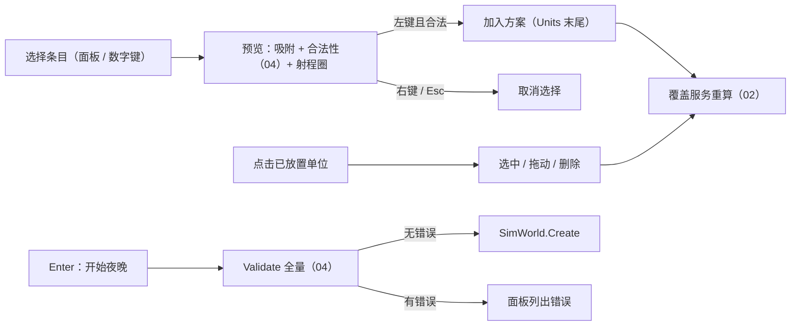

# 06 Godot 灰盒客户端

> 本文件规定 `game/`（Godot 4 .NET）灰盒客户端：项目结构、模拟驱动、坐标映射、相机、部署界面、时间控制、航迹显示、占位素材、调试可视化。
> **客户端只显示和发命令**：一切模拟规则在 `sim/`。客户端不得复制任何规则（探测、合法性、交战……），需要时调用 `sim/` 提供的函数。
> 本文件中的名字就是最终代码中的名字。与 `00_core.md`–`05_campaign_economy.md` 的跨模块接口已在第 8.3 节统一收口；本规格已与 GDD / 数值表 / WBS 同步收口，进入实现前无需再次停下询问（C-T1-12）。
> 结构说明：本文件按 README 的固定 9 节编写，其中第 2 节"状态"改写为"场景与节点结构"，第 3 节"每帧流程"。

---

## 0. 范围与依据

### 0.1 覆盖范围

| 主题 | 本文件章节 | 对应 WBS |
|---|---|---|
| `game/` 项目结构、`project.godot`、`.csproj`、命名空间、Godot 3 → 4 对照 | 0.5、2.1 – 2.3 | WS04-001 |
| 主场景、模拟驱动节点、累加器、快照插值、事件分发 | 2.4、3.0、3.3 – 3.7 | WS04-001 |
| 坐标映射（米 ↔ 世界像素 ↔ 屏幕像素） | 3.1 | WS04-001、WS04-002 |
| 相机：平移、对数缩放（400 km – 1 km）、边界 | 3.2 | WS04-002 |
| 部署界面：选单位、放置、射程圈、探测覆盖（含盲区）、合法性、生成部署方案 | 3.9 | WS04-003 |
| 时间控制：暂停、变速、动态变速（无目标 8×、弹道导弹自适应慢放 ≥ 6 现实秒、二选一硬暂停 + 8 现实秒倒计时 / 硬核 1/60×） | 3.5、3.10 | WS04-004 |
| 航迹显示：三级质量线型、预测航线 | 3.8 | WS04-005 |
| 占位素材：几何图形 + 简化军事符号、调色板 | 3.8、1.6 | WS03-004 |
| 调试可视化：视线、盲区、AI 决策原因、暴露度、交战日志（一个快捷键） | 3.11 | WS06-009 |
| 性能预算 | 3.14 | WS04-001 |

**不在本文件范围**：实景层（WBS 03.A 的倾斜俯视精灵、光照，WS04-011 / WS03）、覆盖层完整开关与热力图（WS04-006，M2）、规则编辑器（WS04-007）、正式的二选一弹窗（WS04-008，本文件只做占位面板）、战后复盘（WS04-009）、白天界面与战役（WS04-010、WS05，由 05 的 `CampaignController` 驱动）、回放播放（WS06-008）。

### 0.2 依据

- [AGENTS.md](../../AGENTS.md) 第 3 节（Godot 4 API、模拟层独立、数据驱动、本地化键）
- [WBS](../开发任务分解_WBS_v1.md)：WS04-001 – 005、WS06-009、WS03-004；03.A（4 像素/米、调色、三级航迹线型）；01.C（`SimWorld` 对外接口）
- [GDD](../游戏设计文档_GDD_v1.md)：5.2（指挥点、二选一暂停 / 慢放）、8.1（航迹三级、低空盲区）、11.2（1 游戏秒 ≈ 真实 1 分钟；动态变速 8× / 自适应弹道慢放；硬核模式关闭手动暂停与自动二选一）、15（UI / UX：航迹显示、覆盖层、键鼠、色盲友好）、16.1（指挥层风格）、16.4（模拟与显示分离、性能目标）、17（敏感内容）、19.1（指挥层风格决策）
- `data/rules/conventions.json`（`gameSecToWorldSec`）、`data/rules/tracks.json`（`qualities[].display`）、`data/loc/zh.json`、`data/levels/test_01/*`

### 0.3 依赖

| 规格 | 使用的内容（只读 / 只调用） |
|---|---|
| 00 | `SimWorld`（`Create / Step / Enqueue / DrainEvents / Snapshot / ComputeStateHash / Tick / TimeSec / StepSec / DurationTicks / IsFinished / Result`）、`SimConfig`（含 `AutoChoicePrompts`、`CaptureDebug`，P30–P31）、`DeploymentPlan`、`PlacedUnit`、`UnitSettings`、`SimSnapshot`（含 `GlobalView`、`DebugView`、`ThreatView`，2.7 / P44–P46 / B-T2-21）、事件 / 命令总表（4.2、4.3）、`DataLoader`、`FileSystemDataSource`、`DataLoadException`、`SimSetupException`、`SimRandom.NightSeed`（P23 / P43 / B-T2-07）、`Vec2`、`SimTime`。**对 00 的接口只读不改**。 |
| 01 | `ThreatView`（2.4）、`GlobalView` 追加字段（`PendingSpawnCount`、`SpawnedThreatCount`、`AllWavesSpawned`）、`TerrainModel`（2.5，公开构造函数与 `BuildHorizonProfile` / `HorizonProfile` 720 方位桶径向累积最大遮挡斜率包络，C-T2-01）、事件 100–104 |
| 02 | `TrackView`（`Tag` 字段，A-2-01 / B-T1-23）、四类我方单位视图追加字段（2.9）、`CoverageQuery.ComputeGrid`（02 §3.8，A-2-16 / C-T1-12）、事件 200–210（`205 EmitterSwitched` 含 `RadarDestroyed / Suspended`，A-2-12；`207 EwDiverted` / `208 EwLinkCut` 含 `SourceId`，A-3-07 / A-4-04）、`UnitSettings` 字段（1.11）、`SensorDef` / `EwUnitDef` 的距离字段 |
| 03 | `FireUnitView`、`InterceptorView`、`SupportAssetView`、`StructureView`、`GridNodeView` 的快照字段（2.1 – 2.7）、事件 300–317（`309 PlayerUnitDamaged` 与 `310 PlayerUnitDestroyed` 含 `PlayerUnitCategory Category`、`310` 含 `Vec2 Pos`，A-2-05 / A-3-05 / B-T1-24）、`AirDefenseUnitDef` / `WeaponDef` 的距离字段 |
| 04 | `DeploymentValidator.Validate` / `CheckPlacement` 与 `DeploymentError(Code, Index, UnitDefId, Detail)`（04 §3.5.1，A-2-15 / B-T1-17）、`ChoiceRequestView`、`GlobalView` 追加字段（`CommandPoints`、`CommandPointsInitial`、`EnemyKnownTargets`、`HeldWaveCount`）、事件 400–408（含 `408 EnemyGroupsReleased`）、`AnswerChoice` 命令 |
| 05 | 战役与多夜流程由 05 的 `CampaignController` 驱动（含 `Day` / `Review` 阶段的 `WatchAutoNight(true)` 主动观看或消耗 1 次重打次数从 `PreAutoNightSnapshot` 手打覆盖自动结算夜，B-T3-07）；灰盒客户端单夜独立运行，战役 UI 由 WS04-010 / WS05 接入 |

### 0.4 已作的关键选择与文档同步声明

> **文档同步免责声明（C-T1-12）**：本规格已与 GDD、数值表、WBS 及 `00_core.md`–`05_campaign_economy.md`、`DECISIONS.md` 同步收口；实现者直接按本规格编码，进入实现前无需再次停下询问。
> **跨平台浮点确定性（C-T1-04）**：`Client.Core` 与测试中**严禁使用 `Math.Hypot`**（或自写 hypot），所有欧氏距离统一使用 `Math.Sqrt(dx * dx + dy * dy)` 或平方距离 `dx * dx + dy * dy` 比较。

| # | 选择 | 理由 |
|---|---|---|
| C1 | **两套画面坐标**：①"世界像素"（4 像素/米，y 向下）供 `Camera2D` 下的栅格层（高程底图、覆盖纹理，将来的实景层精灵）；②"屏幕像素"供指挥层符号，由纯 C# 的 `MapCamera` 直接把米投影到屏幕，绘制在 `CanvasLayer` 中 | 指挥层符号、线宽、文字必须**屏幕恒定大小**；在 `Camera2D` 下绘制会随缩放变粗变细。`Camera2D` 的参数由 `MapCamera` 单向推导，两者永远一致 |
| C2 | **纯逻辑放进独立类库** `Nightwatch.Client.Core`（`net8.0`，不引用 Godot），用 `dotnet test` 测试；Godot 节点只做输入、绘制、调用 | 坐标映射、累加器、变速状态机、插值、部署方案、覆盖合成都可在命令行测试，不需要启动引擎 |
| C3 | 1× 播放速度 = 每现实秒 `conventions.gameSecToWorldSec` 个世界秒（= 60 步）；每帧最多 `MaxStepsPerFrame` 步；超出的整步**丢弃**（不追赶） | GDD 11.2："1 游戏秒 ≈ 真实 1 分钟"；丢弃可避免掉帧后的"死亡螺旋" |
| C4 | 插值：在"本帧计划的最后一步之前"与"之后"的两个快照之间按累加器小数部分线性插值；本帧未执行完计划步数时不插值 | 只需在每帧额外读取一次快照；1× 时两次读取是同一个缓存实例，零额外开销 |
| C5 | 动态变速**只用玩家可见的信息**（航迹、拦截弹、二选一、预警事件），不读敌方真值 | 用真值决定快进会泄露"雷达外还有没有目标" |
| C6 | 部署合法性**只由 04 的 `DeploymentValidator` 判定**（`Validate` / `CheckPlacement`，A-2-15）；探测覆盖 / 盲区**只由 02 §3.8 的 `CoverageQuery.ComputeGrid` 计算**（复用 01 的 720 方位桶径向累积最大遮挡斜率包络 `HorizonProfile`，与模拟可见性函数完全同源，C-T1-12 / C-T2-01） | AGENTS.md：客户端不实现规则，且覆盖预览与实际探测零偏差 |
| C7 | 灰盒占位素材用 `_Draw` 矢量绘制（几何图形 + 简化北约式框形），不用纹理 | 分辨率无关、无资产管线、文本化便于 AI 修改；正式符号（milsymbol SVG）由 WS03-005 替换 |
| C8 | 正常界面**不渲染** `SimSnapshot.Threats`（真值），只在调试叠加层打开时渲染（00 §2.7 / B-T2-21） | 战争迷雾 |
| C9 | **二选一硬暂停 + 8 现实秒倒计时与弹道自适应慢放（C-T3-01）**：收到 `ChoiceRequested` 时，叙事 / 普通难度切换为**硬暂停**（`0×`，暂停调用 `SimWorld.Step()`），UI 弹窗走 **8.0 现实秒**（`unscaledDeltaTime`）倒计时，超时自动提交 `DefaultOption` 并恢复弹窗前倍速；硬核难度不硬暂停，强制切为 `1/60×` 慢放（1 现实秒 = 1 世界秒），同样给 8.0 现实秒（= 8 世界秒）反应窗口。弹道导弹触发慢放时采用**自适应慢放速率** $\text{rate} = \min(\text{baseSlowMoRate},\; T_{\text{remWorldSec}} / 6.0)$（折算游戏倍率时除以 `GameSecToWorldSec`，下限 `1/60×`），确保玩家至少拥有 **6.0 现实秒**操作窗口 | 解决原 `0.5×`（30 世界秒/现实秒）下二选一与弹道末段仅约 1 现实秒、无法反应式操作的问题（C-T3-01） |

### 0.5 Godot 3 → Godot 4 易错写法对照（C#，**左列一律禁止**）

| 禁止（Godot 3 / 旧写法） | 必须使用（Godot 4 .NET） | 备注 |
|---|---|---|
| `KinematicBody2D` | `CharacterBody2D` | 本项目灰盒不需要物理体 |
| `yield(obj, "signal")` / GDScript `yield` | `await ToSignal(obj, SignalName.X)` | |
| `export var x`、GDScript `onready var` | C# `[Export]` 属性；在 `_Ready()` 中 `GetNode<T>()` 赋值 | |
| `Connect("pressed", this, "OnPressed")` | `button.Pressed += OnPressed;` 或 `Connect(Button.SignalName.Pressed, Callable.From(OnPressed))` | 自定义信号：`[Signal] public delegate void XxxEventHandler(...)`，委托名必须以 `EventHandler` 结尾 |
| `Update()`（重绘） | `QueueRedraw()` | |
| `_Process(float delta)` | `public override void _Process(double delta)` | `_PhysicsProcess` 同理 |
| `Godot.Object` | `GodotObject` | |
| `Spatial` / `Position2D` / `YSort` | `Node3D` / `Marker2D` / `Node2D.YSortEnabled` | |
| `Camera2D.Current = true` | `camera.MakeCurrent()` 或 `Enabled = true` | |
| `Camera2D.Zoom = (2, 2)` 表示**拉远** | Godot 4 中 `Zoom = (2, 2)` 表示**放大（拉近）** | 语义相反，3.2.1 的公式按 Godot 4 |
| `RectPosition` / `RectSize`（Control） | `Position` / `Size` | |
| `GetTree().ChangeScene("res://x.tscn")` | `GetTree().ChangeSceneToFile("res://x.tscn")` | |
| `PackedScene.Instance()` | `Instantiate<T>()` | |
| `OS.WindowSize` / `OS.GetTicksMsec()` | `DisplayServer.WindowGetSize()` / `Time.GetTicksMsec()` | |
| `Engine.EditorHint` / `tool` | `Engine.IsEditorHint()` / `[Tool]` | |
| `File` / `Directory` | `FileAccess` / `DirAccess` | 读 `data/` 用 `System.IO`（sim 的 `FileSystemDataSource`） |
| `new ImageTexture(); tex.CreateFromImage(img)` | `ImageTexture.CreateFromImage(img)`（静态） | 更新内容用 `tex.Update(img)`（尺寸格式不变时） |
| `Image.Lock()` / `Unlock()` | 删除（Godot 4 不需要） | |
| `Image.Create(w, h, false, fmt)`（实例方法） | `Image.CreateEmpty(w, h, false, fmt)` 或 `Image.CreateFromData(...)`（静态） | |
| `PoolVector2Array` | `Vector2[]`（C#） | |
| `ButtonList.WheelUp` / `KeyList.A` | `MouseButton.WheelUp` / `Key.A` | |
| `VisualServer` | `RenderingServer` | |
| `Tween` 节点 | `CreateTween()` | |
| `JSON.Parse` | 客户端配置用 `System.Text.Json`；数据只经 sim 的 `DataLoader` | |
| `Godot.Collections.Dictionary` 存逻辑状态 | 纯 C# 集合（逻辑在 `Client.Core`） | |

---

## 1. 数据输入

### 1.1 关卡数据（`LevelData`，经 `DataLoader.LoadLevel`）

| 来源 | 字段 | 单位（加载后） | 客户端用途 |
|---|---|---|---|
| `level.json` | `Meta.Id`、`Meta.NameKey`、`Meta.Map.WidthM / HeightM` | m | 标题、坐标映射（`MapHeightM`）、相机内容范围 |
| `level.json` | `Meta.AvailableUnits[]`（`UnitId, Count`） | — | 部署面板条目与剩余数（**仅显示**，合法性由 04 判定） |
| `level.json` | `Meta.CommandPointsPerNight` | — | 时间条旁显示（夜间以 `GlobalView.CommandPoints / CommandPointsInitial` 为准，04） |
| `Heightmap` | `WidthPx, HeightPx, MetersPerPixel, MinElevationM, MaxElevationM, ElevationM` | m | 高程底图纹理（3.8.1）、覆盖网格的格子大小下限（3.9.6） |
| `waves.json` | `Waves.EntryPoints[]`（`Id, NameKey, Pos`） | m | 进入点标记（B-T2-138）、相机内容范围 |
| `waves.json` | `Waves.Nights[]`（`Night, DurationSec, Waves[].Groups[].Route.Waypoints`） | 世界秒 / m | 时长显示；航点只用于相机内容范围（**不显示**航线，避免泄露敌方路线，B-T2-138） |
| `map/layers.json` | `Layers.Rivers / Roads / Bridges / Urban / Forests / Borders / RestrictedZones` | m | 底图矢量层（3.8.2） |
| `map/structures.json` | `Structures[]`（`Id, NameKey, Type, Pos, RadiusM, Hp`） | m | 保护目标符号（静态部分） |
| `map/grid.json` | `Grid.Nodes / Links` | m | 电网线（细线） |
| `map/deploy.json` | `Deploy.Zones / Forbidden / AlternatePositions` | m | 部署阶段显示；备用阵地吸附（3.9.3） |
| — | `DataHash` | — | 调试抬头显示前 12 个字符 |

### 1.2 全局目录（`LevelData.Catalog`）

| 类型 | 字段 | 用途 |
|---|---|---|
| `ConventionsDef` | `GameSecToWorldSec` | 1× 播放速度的步频（3.4）；时钟显示"游戏秒" |
| `GameCatalog` | `GetPlayerUnitCategory(unitId)` | 选择符号形状（3.8.4） |
| `AirDefenseUnitDef` | `NameKey`、`WeaponIds`、`FireControlRadar?.RangeM`、`SelfAcquisitionRangeM`（00 §1.6.6 / 02 §1.4，P15） | 名称、射程圈 |
| `WeaponDef` | `NameKey`、`RangeM`、`RangeByTagM` | 射程圈（每个武器一圈；按标签的射程画点线圈） |
| `SensorDef` | `NameKey`、`DetectionRangeM`（`null` = 覆盖型）、`Coverage` | 探测圈 |
| `EwUnitDef` | `NameKey`、`RadiusM` | 电子战作用圈 |
| `DeceptionUnitDef` | `NameKey` | 名称（无圈） |
| `MunitionDef` / `PlatformDef` | `NameKey` | 仅调试叠加层显示真值名称 |

### 1.3 本地化（`data/loc/zh.json`）

- 客户端自带 `LocTable`（`Client.Core`）：读 `data/loc/zh.json`（平面键值对象），`Tr(key)` 返回文本；键不存在返回 `"⟦" + key + "⟧"`（醒目、不崩溃），并把缺失键记入 `LocTable.MissingKeys`（`SortedSet<string>`，序数比较）。
- 界面中出现的所有文字都用本地化键；**本文件新增的键**列在 8.2-E（已决 B-T2-140，由后续数据任务写入 `data/loc/zh.json`）。
- 带参数的文本用 `{0}`、`{1}` 占位，`string.Format(CultureInfo.InvariantCulture, Tr(key), args)`。

### 1.4 客户端配置 `game/config/client_config.json` → `ClientConfig`

客户端自身的显示 / 操作参数（**不是**游戏规则数值，不进入模拟；已决 B-T2-127）。由 `ClientConfigLoader`（`System.Text.Json`，`PropertyNameCaseInsensitive = false`、属性名 camelCase、`UnmappedMemberHandling = Disallow`）加载；缺字段 → 用下表默认值；未知字段或类型错误 → 启动报错（错误屏，3.0.3）。

| JSON 字段 | C# 属性 | 类型 | 单位 | 默认值 | 依据 |
|---|---|---|---|---|---|
| `worldPxPerM` | `WorldPxPerM` | `double` | 像素/米 | `4` | WBS 03.A |
| `minSpanM` | `MinSpanM` | `double` | m（视口宽度） | `1000` | WS04-002"1 km"（B-T2-132） |
| `maxSpanM` | `MaxSpanM` | `double` | m | `400000` | WS04-002"400 km"（B-T2-132） |
| `fitPaddingFactor` | `FitPaddingFactor` | `double` | — | `1.1` | B-T2-132 |
| `zoomStepFactor` | `ZoomStepFactor` | `double` | 每格滚轮的跨度倍数 | `1.25` | 实现细节 |
| `zoomSmoothingSec` | `ZoomSmoothingSec` | `double` | 现实秒（指数平滑时间常数） | `0.08` | 实现细节 |
| `panSpeedSpanPerSec` | `PanSpeedSpanPerSec` | `double` | 视口宽度 / 现实秒 | `0.75` | 实现细节 |
| `snapRadiusPx` | `SnapRadiusPx` | `double` | 屏幕像素 | `12` | 实现细节 |
| `pickRadiusPx` | `PickRadiusPx` | `double` | 屏幕像素 | `10` | 实现细节 |
| `maxStepsPerFrame` | `MaxStepsPerFrame` | `int` | 步 | `32` | 3.4 |
| `maxRealDeltaSec` | `MaxRealDeltaSec` | `double` | 现实秒 | `0.25` | 3.4 |
| `stepTimeBudgetMs` | `StepTimeBudgetMs` | `double` | 毫秒 | `10` | 3.14 |
| `userSpeeds` | `UserSpeeds` | `double[]` | 播放倍率 | `[1, 2, 4]` | B-T2-128（原 Q2） |
| `fastForwardRate` | `FastForwardRate` | `double` | 倍率 | `8` | GDD 11.2 |
| `ballisticSlowRate` | `BallisticSlowRate` | `double` | 倍率 | `0.5` | 基础弹道慢放倍率 `baseSlowMoRate`（GDD 11.2 / C-T3-01） |
| `ballisticMinRealWindowSec` | `BallisticMinRealWindowSec` | `double` | 现实秒 | `6.0` | 弹道自适应慢放保证的最少现实秒窗口（C-T3-01） |
| `choiceSlowRate` | `ChoiceSlowRate` | `double` | 倍率 | `1.0 / 60.0` | 硬核模式下二选一极慢速倍率 `1/60×`（1 现实秒 = 1 世界秒；叙事/普通难度为硬暂停 `0×`，C-T3-01） |
| `choiceTimeoutRealSec` | `ChoiceTimeoutRealSec` | `double` | 现实秒 | `8.0` | 二选一弹窗现实秒倒计时（`unscaledDeltaTime`，C-T3-01） |
| `fastForwardEnterDelaySec` | `FastForwardEnterDelaySec` | `double` | 世界秒 | `60` | B-T2-130（原 Q4） |
| `ballisticHoldSec` | `BallisticHoldSec` | `double` | 世界秒 | `120` | B-T2-131（原 Q5） |
| `autoFastForwardDefault` | `AutoFastForwardDefault` | `bool` | — | `true` | GDD 11.2 |
| `interpolationMaxJumpM` | `InterpolationMaxJumpM` | `double` | m（一步内位移超过即不插值） | `10000` | 实现细节 |
| `predictionHorizonSec` | `PredictionHorizonSec` | `double` | 世界秒 | `300` | B-T2-134（原 Q9） |
| `minErrorCirclePx` | `MinErrorCirclePx` | `double` | 屏幕像素 | `8` | 实现细节 |
| `minVagueAreaPx` | `MinVagueAreaPx` | `double` | 屏幕像素 | `10` | 实现细节 |
| `arrowMinSpeedMps` | `ArrowMinSpeedMps` | `double` | m/s | `0.5` | 实现细节 |
| `staleTrackSec` | `StaleTrackSec` | `double` | 世界秒 | `60` | 3.8.5 |
| `coverageMaxCellsPerSide` | `CoverageMaxCellsPerSide` | `int` | 格 | `1024` | 3.9.6 |
| `coverageAltitudesM` | `CoverageAltitudesM` | `double[]` | m（AGL） | `[50, 500, 3000]` | B-T2-133（原 Q8） |
| `audioCueMinIntervalSec` | `AudioCueMinIntervalSec` | `double` | 现实秒 | `0.25` | 3.12 |
| `engagementLogCapacity` | `EngagementLogCapacity` | `int` | 条 | `500` | 3.11 |
| `notificationLifetimeSec` | `NotificationLifetimeSec` | `double` | 现实秒 | `6` | 3.10 |
| `maxNotifications` | `MaxNotifications` | `int` | 条 | `6` | 3.10 |
| `fxMaxCount` | `FxMaxCount` | `int` | 个 | `256` | 3.8.8 |
| `defaultRunSeed` | `DefaultRunSeed` | `ulong` | — | `1` | B-T2-07（原 Q10） |

校验（任一不满足 → 启动报错，消息 `client_config.json: <字段> 取值非法`）：`WorldPxPerM > 0`；`0 < MinSpanM < MaxSpanM`；`FitPaddingFactor ≥ 1`；`ZoomStepFactor > 1`；`ZoomSmoothingSec ≥ 0`；`MaxStepsPerFrame ≥ 1`；`MaxRealDeltaSec > 0`；`UserSpeeds` 非空、全部 `> 0` 且严格升序；`FastForwardRate`、`BallisticSlowRate`、`BallisticMinRealWindowSec`、`ChoiceSlowRate`、`ChoiceTimeoutRealSec > 0`；`CoverageAltitudesM` 非空、全部 `≥ 0`；`CoverageMaxCellsPerSide ≥ 16`；容量类 `≥ 1`。

单元测试使用手写的 `ClientConfig` 实例（7.0 的 `CfgT`），**不读这个文件**。

### 1.5 命令行参数（`OS.GetCmdlineUserArgs()`，即 `--` 之后的参数）

| 参数 | 含义 | 缺省 |
|---|---|---|
| `--level <id>` | 关卡 ID | `test_01` |
| `--seed <n>` | 本夜种子，十进制或 `0x` 十六进制（`ulong`），**直接**传给 `SimWorld.Create`（与 `tools/simrun --seed` 一致，00 §3.1.5） | `SimRandom.NightSeed(DefaultRunSeed, levelId, nightIndex)`（非战役传 `nightIndex = 1`，战役传 `flow` 序号 + 1，B-T2-07） |
| `--data <path>` | `data/` 目录的绝对路径 | 1.7 的查找结果 |
| `--plan <path>` | 预载部署方案（`DeploymentPlan` 的 JSON，格式同回放文件 `config.deployment`，00 3.9.1） | 空方案 |
| `--hardcore` | 硬核模式：禁止手动暂停、设置 `SimConfig.AutoChoicePrompts = false`（仅保留剧情二选一，B-T2-11），且二选一期间不进入硬暂停而切为 `1/60×` 慢放（B-T1-18、C-T3-01） | 关 |
| `--smoke <name>` | 烟雾测试模式（7.3） | 关 |

解析由 `CommandLineArgs.Parse(string[])`（`Client.Core`）完成：未知参数、缺值、种子格式错误 → 抛 `ArgumentException`（消息含参数名），启动报错。

### 1.6 占位调色板 `game/assets/placeholder/palette.json` → `Palette`

WS03-004 的产出。每项为 `"#RRGGBB"` 或 `"#RRGGBBAA"`。Godot 侧用 `Color.FromHtml`。缺项 → 启动报错。

| 键 | 默认值 | 用途 |
|---|---|---|
| `background` | `#0B1014` | 清屏色（`RenderingServer.SetDefaultClearColor`） |
| `terrainLow` / `terrainHigh` | `#10181D` / `#2E3B44` | 高程底图两端 |
| `water` | `#1E3A4C` | 河流 |
| `road` | `#3A4650` | 道路 |
| `urban` | `#26303ACC` | 城区填充 |
| `forest` | `#15241C99` | 森林填充 |
| `border` | `#5A6670` | 边界、前线虚线 |
| `restricted` | `#B0A04066` | 约束区 |
| `grid` | `#4A5A3A` | 电网线 / 节点 |
| `friendly` / `friendlyLight` | `#6EC8FF` / `#CFEFFF` | 我方符号 / 文字（WBS 03.A：我方蓝 / 青白） |
| `hostile` / `hostileLight` | `#FF6B3D` / `#FFB08A` | 敌方航迹 / 文字（WBS 03.A：敌方红橙） |
| `neutral` | `#C8CCD0` | 保护目标 |
| `decoy` | `#8A8F94` | 已甄别为诱饵的航迹 |
| `coverageVisible` | `#3FA9D629` | 覆盖纹理"可探测" |
| `coverageBlind` | `#D0503A38` | 覆盖纹理"射程内盲区" |
| `deployValid` / `deployInvalid` | `#59D18A` / `#FF4D4D` | 放置预览 |
| `ew` | `#A070FF` | 电子战圈（WBS 03.A：电子战紫色） |
| `debugTruth` / `debugLos` / `debugText` | `#FF3355` / `#7CFF7C80` / `#E8E8E8` | 调试叠加层 |

色盲友好（GDD 15.10）：敌我除颜色（橙 / 蓝，常见色盲可区分的一对）外**还靠形状区分**（菱形 / 矩形）；航迹质量**靠线型区分**（3.8.5），不只靠颜色。

### 1.7 `data/` 目录定位（`DataRootLocator.Find`，`Client.Core`）

1. 有 `--data` → 使用它；该目录下不存在 `rules/conventions.json` → 报错 `--data 指向的目录不是 data/：<path>`。
2. 否则从 `ProjectSettings.GlobalizePath("res://")`（即 `game/` 的绝对路径）开始，逐级向上查找含 `AGENTS.md` 的目录 `R`，返回 `R/data`（与 00 0.5 测试定位仓库根的方式一致）；到达文件系统根仍未找到 → 报错 `找不到仓库根（含 AGENTS.md 的目录）；请用 --data 指定`。
3. 导出版本（WS06-010）把 `data/` 复制到可执行文件同级目录（`OS.GetExecutablePath()` 同级，已决 B-T1-20），灰盒开发阶段按第 1–2 步定位。

`Find(string startDir, string? dataArg, Func<string, bool> fileExists)` 以委托访问文件系统，便于单元测试（T-06-39）。

---

## 2. 场景与节点结构

### 2.1 目录与命名空间

```
game/
├─ project.godot                    2.2
├─ Nightwatch.Game.csproj           Godot 项目（程序集 Nightwatch.Game，命名空间根 Nightwatch.Game）
├─ icon.svg
├─ config/client_config.json        1.4
├─ app/                             Nightwatch.Game.App：Main.tscn、Main.cs、InputSetup.cs、ErrorScreen.tscn/.cs、ResultPanel.tscn/.cs
├─ sim_bridge/                      Nightwatch.Game.SimBridge：SimDriverNode.cs、SimWorldFacade.cs、CoverageService.cs
├─ map/                             Nightwatch.Game.Map：TerrainBackdrop.cs、MapVectorLayer.cs、Painter.cs（_Draw 辅助）
├─ ui/camera/                       Nightwatch.Game.Ui.Camera：CameraController.cs
├─ ui/deploy/                       Nightwatch.Game.Ui.Deploy：DeployPanel.tscn/.cs、DeployController.cs、CoverageLayer.cs、coverage.gdshader
├─ ui/time/                         Nightwatch.Game.Ui.Time：TimeControlBar.tscn/.cs
├─ ui/tracks/                       Nightwatch.Game.Ui.Tracks：CommandLayer.cs、TrackPainter.cs、UnitPainter.cs、FxLayer.cs
├─ ui/hud/                          Nightwatch.Game.Ui.Hud：NotificationFeed.cs、ChoicePlaceholder.tscn/.cs、SelectionInfo.cs
├─ audio/                           Nightwatch.Game.Audio：AudioCuePlayer.cs
├─ debug/                           Nightwatch.Game.Debug：DebugOverlay.tscn/.cs、DebugLayer.cs、EngagementLogPanel.cs
│  └─ smoke/                        Nightwatch.Game.Debug.Smoke：SmokeRunner.cs、run_smoke.sh、test01_plan.json
├─ assets/placeholder/              WS03-004：palette.json、README.md（说明"代码绘制、无纹理"）
├─ core/                            纯 C# 类库（含 .gdignore）
│  ├─ Nightwatch.Client.Core.csproj 程序集 / 命名空间根 Nightwatch.Client.Core
│  ├─ Config/     ClientConfig.cs、ClientConfigLoader.cs、Palette.cs、CommandLineArgs.cs、DataRootLocator.cs、LocTable.cs
│  ├─ Mapping/    MapProjection.cs、ScreenPoint.cs、WorldPxPoint.cs
│  ├─ Camera/     MapCamera.cs
│  ├─ Timing/     StepAccumulator.cs、TimeController.cs、TimeMode.cs、ClockFormat.cs
│  ├─ Driving/    ISimWorldFacade.cs、SimDriver.cs、FrameStats.cs
│  ├─ Events/     SimEventRouter.cs、RingBuffer.cs、AudioCueRules.cs、EventText.cs
│  ├─ Rendering/  SnapshotInterpolator.cs、RenderFrame.cs、TrackStyleRules.cs、SymbolGeometry.cs、RangeRings.cs
│  ├─ Deploy/     DeployPlanBuilder.cs、IPlacementValidator.cs、PlacementPreview.cs、PaletteEntry.cs
│  └─ Coverage/   CoverageGridPlanner.cs、CoverageComposer.cs
└─ tests/                           xUnit（含 .gdignore）
   └─ Nightwatch.Client.Tests.csproj 命名空间根 Nightwatch.Client.Tests
```

- `core/` 与 `tests/` 各放一个空文件 `.gdignore`（Godot 编辑器不扫描、不导入其中的文件，也避免其 `bin/` `obj/` 被导入）。
- Godot 节点脚本类名 = 文件名（Godot 4 C# 要求脚本类名与文件名一致且为 `partial`）。
- `Client.Core` **不得**引用任何 Godot 程序集（T-06-40 检查，同 00 0.5 的三道检查）。

### 2.2 `project.godot` 关键设置

```ini
config_version=5

[application]
config/name="Nightwatch"
run/main_scene="res://app/Main.tscn"
config/features=PackedStringArray("4.3", "C#", "GL Compatibility")
boot_splash/show_image=false
run/max_fps=0
run/low_processor_mode=false

[display]
window/size/viewport_width=1920
window/size/viewport_height=1080
window/size/mode=0
window/stretch/mode="disabled"
window/vsync/vsync_mode=1
window/dpi/allow_hidpi=true

[dotnet]
project/assembly_name="Nightwatch.Game"

[rendering]
renderer/rendering_method="gl_compatibility"
renderer/rendering_method.mobile="gl_compatibility"
textures/canvas_textures/default_texture_filter=0
```

- `config/features` 中的 `"4.3"` 写**实际使用的引擎主次版本**；锁定最低 4.3 .NET 版（已决 B-T2-136），渲染后端固定 `gl_compatibility`（已决 B-T1-19）。
- `stretch/mode="disabled"`：视口像素 = 窗口像素，`MapCamera` 的视口尺寸直接取 `GetViewport().GetVisibleRect().Size`（灰盒接受当前 HiDPI 行为，界面缩放在 WS04-012 处理，已决 B-T1-21）。
- `default_texture_filter=0`（Nearest）：覆盖纹理按格子显示；高程底图单独设为 Linear（3.8.1）。
- **输入映射不写进 `project.godot`**：由 `InputSetup.EnsureActions()` 在启动时按 2.6 表用 `InputMap.AddAction` / `InputMap.ActionAddEvent` 注册（已存在的动作不重复添加）。理由：表格是唯一来源，手写 `InputEvent` 序列化易错。

### 2.3 项目文件

`game/Nightwatch.Game.csproj`（文件名必须与 `dotnet/project/assembly_name` 一致）：

```xml
<Project Sdk="Godot.NET.Sdk/4.3.0">                     <!-- 版本号 = 实际引擎版本（Q15） -->
  <PropertyGroup>
    <TargetFramework>net8.0</TargetFramework>
    <EnableDynamicLoading>true</EnableDynamicLoading>
    <AssemblyName>Nightwatch.Game</AssemblyName>
    <RootNamespace>Nightwatch.Game</RootNamespace>
    <LangVersion>12.0</LangVersion>
    <Nullable>enable</Nullable>
  </PropertyGroup>
  <ItemGroup>
    <Compile Remove="core/**" />                       <!-- 否则 Godot SDK 会把 core/、tests/ 的 .cs 也编进来，类型重复 -->
    <Compile Remove="tests/**" />
    <ProjectReference Include="core/Nightwatch.Client.Core.csproj" />
    <ProjectReference Include="../sim/Sim.csproj" />
  </ItemGroup>
</Project>
```

`game/core/Nightwatch.Client.Core.csproj`：`Microsoft.NET.Sdk`；`net8.0`；`AssemblyName` / `RootNamespace` = `Nightwatch.Client.Core`；`LangVersion 12.0`；`Nullable enable`；`ImplicitUsings disable`；`TreatWarningsAsErrors true`；`InvariantGlobalization true`；唯一引用 `<ProjectReference Include="../../sim/Sim.csproj" />`；`<InternalsVisibleTo Include="Nightwatch.Client.Tests" />`。**不得**有 `PackageReference`（`System.Text.Json` 来自基础类库）。

`game/tests/Nightwatch.Client.Tests.csproj`：`net8.0`、`IsPackable=false`；包 `Microsoft.NET.Test.Sdk`、`xunit`（2.x）、`xunit.runner.visualstudio`；`<ProjectReference Include="../core/Nightwatch.Client.Core.csproj" />`。

命令：`dotnet test game/tests`（纯逻辑）；`game/debug/smoke/run_smoke.sh`（Godot 无头烟雾测试，7.3）。`.gitignore` 已忽略 `bin/`、`obj/`、`.godot/`（AGENTS.md 第 7 节）。

### 2.4 主场景节点树（`res://app/Main.tscn`）

```
Main (Node, Main.cs)                                   阶段状态机、帧流程 3.0、命令行
├─ SimDriverNode (Node, SimDriverNode.cs)              持有 SimDriver（Core），测量单步耗时
├─ CoverageService (Node, CoverageService.cs)          后台计算覆盖网格（3.9.6）
├─ AudioCuePlayer (Node, AudioCuePlayer.cs)            3.12
├─ World (Node2D)                                      世界像素坐标（4 px/m）
│  ├─ Camera2D (Camera2D)                              参数由 MapCamera 推导（3.2.6），不由用户直接操作
│  ├─ TerrainBackdrop (Sprite2D, TerrainBackdrop.cs)   高程底图，z_index 0
│  └─ CoverageLayer (Sprite2D, CoverageLayer.cs)       覆盖纹理 + coverage.gdshader，z_index 1
├─ MapLayer (CanvasLayer, layer = 1)
│  └─ MapVectorLayer (Node2D, MapVectorLayer.cs)       屏幕坐标：河流、道路、城区、边界、电网、部署区
├─ CommandCanvas (CanvasLayer, layer = 2)
│  ├─ CommandLayer (Node2D, CommandLayer.cs)           屏幕坐标：保护目标、我方单位、航迹、拦截弹、支援、射程圈、放置预览
│  └─ FxLayer (Node2D, FxLayer.cs)                     屏幕坐标：拦截 / 落地标记
├─ DebugCanvas (CanvasLayer, layer = 3, visible = false)
│  └─ DebugLayer (Node2D, DebugLayer.cs)               屏幕坐标：真值、视线、盲区、暴露度、决策原因
└─ Ui (CanvasLayer, layer = 10)
   ├─ TimeControlBar (PanelContainer, 顶部居中)
   ├─ DeployPanel (PanelContainer, 左侧；仅部署阶段可见)
   ├─ SelectionInfo (PanelContainer, 右下)
   ├─ NotificationFeed (VBoxContainer, 右上)
   ├─ ChoicePlaceholder (PanelContainer, 居中；默认隐藏)
   ├─ DebugOverlay (Control, 全屏，默认隐藏：抬头文字、交战日志、决策日志、子层勾选框)
   ├─ ResultPanel (PanelContainer, 居中；默认隐藏)
   └─ ErrorScreen (PanelContainer, 全屏；默认隐藏)
```

- 屏幕坐标层（`MapLayer`、`CommandCanvas`、`DebugCanvas`）是 `CanvasLayer`，**不受 `Camera2D` 影响**；其中节点的 `_Draw()` 直接使用 `MapCamera.WorldToScreen` 的结果。
- `Ui` 中的控件用 `MouseFilter` 拦截点击；地图点击由 `Main._UnhandledInput` 处理（控件已消费的事件不会到达）。

### 2.5 客户端状态（`Main` 持有；纯逻辑对象均在 `Client.Core`）

> "写 / 读"列：`Main` = 主节点；`Drv` = `SimDriver`；`Dep` = 部署控制器；`Cam` = 相机控制器；`UI` = 界面控件；`Dbg` = 调试层。

#### 2.5.1 会话

| 字段 | C# 类型 | 初值 | 写 | 读 |
|---|---|---|---|---|
| `Phase` | `ClientPhase { Boot = 0, Deploy = 1, Night = 2, Result = 3, Error = 4 }` | `Boot` | Main | 全部 |
| `Config` | `ClientConfig` | 1.4 加载 | Main | 全部 |
| `Palette` | `Palette` | 1.6 加载 | Main | 绘制层 |
| `Loc` | `LocTable` | 1.3 加载 | Main | UI |
| `Args` | `CommandLineArgs` | 1.5 | Main | Main |
| `Level` | `LevelData?` | 加载成功后 | Main | 全部 |
| `Terrain` | `TerrainModel?` | `new TerrainModel(Level.Heightmap, Level.Catalog.Rules.Terrain)`（01 2.5） | Main | CoverageService |
| `Projection` | `MapProjection` | 3.1 | Main | 全部绘制 |
| `Camera` | `MapCamera` | 3.2.5 初始取景 | Cam | 全部绘制 |
| `Plan` | `DeployPlanBuilder` | 空方案或 `--plan` | Dep | Dep、Main |
| `Seed` | `ulong` | 1.5 | Main | Main、Dbg |
| `World` | `SimWorld?` | 开始夜晚时创建 | Main | Drv、Dbg |
| `Driver` | `SimDriver?` | 与 `World` 同时创建 | Main | 全部 |
| `Time` | `TimeController?` | 与 `World` 同时创建 | Drv、UI | UI、Drv |
| `EntityToPlanIndex` | `int[]`（按实体 ID 升序的映射表，见 3.9.8） | 开始夜晚后第一次读快照时建立 | Main | CoverageService、SelectionInfo |
| `DebugVisible` | `bool` | `false` | Main | Dbg |
| `DebugLayers` | `DebugLayerFlags`（`[Flags]`：`Truth = 1, Los = 2, Blind = 4, Exposure = 8, Reasons = 16, Log = 32`） | 全部置位 | UI | Dbg |
| `CoverageAltIndex` | `int` | `0` | Main | CoverageService |
| `ShowAllRanges` | `bool` | `false` | Main | CommandLayer |
| `SelectedEntityId` | `int` | `0`（夜间选中的我方单位） | Main | SelectionInfo |

#### 2.5.2 `SimDriver<TSnap>`（Core，3.3；客户端中 `TSnap = SimSnapshot`）

构造函数：`SimDriver(ISimWorldFacade<TSnap> world, TimeController time, SimEventRouter router, double gameSecToWorldSec, int maxStepsPerFrame, double maxRealDeltaSec)`。

| 字段 | C# 类型 | 初值 | 说明 |
|---|---|---|---|
| `World` | `ISimWorldFacade<TSnap>` | 构造参数 | 3.3.1 |
| `Accumulator` | `StepAccumulator` | `new StepAccumulator(maxRealDeltaSec)` | 3.4 |
| `Time` | `TimeController` | 构造参数 | 3.5 |
| `Router` | `SimEventRouter` | 构造参数 | 3.6 |
| `GameSecToWorldSec` | `double` | 构造参数（`Level.Catalog.Conventions.GameSecToWorldSec`） | 3.4 |
| `MaxStepsPerFrame` | `int` | 构造参数（`Config.MaxStepsPerFrame`） | |
| `Prev` | `TSnap?` | `null` | 插值起点（3.3.2） |
| `Cur` | `TSnap` | 创建后 `World.Snapshot`（Tick 0） | 插值终点 |
| `InterpolationValid` | `bool` | `false` | `Prev` 可用于插值 |
| `Fault` | `Exception?` | `null` | `Step()` 抛出的异常；非 null 后不再推进 |
| `LastFrame` | `FrameStats` | 全 0 | `StepsPlanned, StepsExecuted, RateDropped, BudgetStopped` |

#### 2.5.3 `StepAccumulator`（Core，3.4）

| 字段 | C# 类型 | 初值 | 说明 |
|---|---|---|---|
| `Acc` | `double` | `0` | 未执行的步数（含小数）；每帧 `Commit` 后满足 `0 ≤ Acc < 1` |
| `DroppedSteps` | `long` | `0` | 因上限 / 时间预算丢弃的整步累计（调试显示） |
| `MaxRealDeltaSec` | `double` | `Config.MaxRealDeltaSec` | |
| `Alpha` | `double`（只读） | — | `= Math.Clamp(Acc, 0, 1)` |

#### 2.5.4 `TimeController`（Core，3.5）

| 字段 | C# 类型 | 初值 | 说明 |
|---|---|---|---|
| `Mode` | `TimeMode { Finished = 0, Paused = 1, ChoiceSlow = 2, BallisticSlow = 3, FastForward = 4, Normal = 5 }` | `Normal` | 每次输入后重算 |
| `Rate` | `double`（只读） | `UserSpeeds[0]` | 当前播放倍率（1 = 每现实秒 1 游戏秒 = 60 世界秒） |
| `UserSpeedIndex` | `int` | `0` | `UserSpeeds` 下标 |
| `ManualPaused` | `bool` | `false` | |
| `AllowManualPause` | `bool` | `!Args.Hardcore` | 叙事/普通模式为 `true`，硬核模式为 `false` |
| `AutoFastForward` | `bool` | `Config.AutoFastForwardDefault` | |
| `LockedRate` | `double?` | `null` | **仅烟雾测试**：非 null 时除 `Finished` 外一律使用该倍率 |
| `Finished` | `bool` | `false` | 收到 `NightEnded` |
| `PendingChoiceIds` | `SortedSet<int>` | 空 | 未回答的二选一（按 `ChoiceId` 升序） |
| `PendingChoiceTimers` | `SortedDictionary<int, ChoiceTimerState>` | 空 | `ChoiceTimerState(double RemainingRealSec, int DefaultOption)`；初值 `Config.ChoiceTimeoutRealSec`（8.0 现实秒，C-T3-01） |
| `IdleSinceTick` | `int?` | `null` | 连续空闲的起始步 |
| `BallisticUntilTick` | `int` | `-1` | 弹道慢放持续到此步（不含） |
| `EffectiveBallisticSlowRate` | `double` | `Config.BallisticSlowRate` | 当前自适应弹道慢放倍率（C-T3-01，3.5.3） |
| `BallisticAlarmPending` | `bool` | `false` | 收到弹道预警后置 true；界面报警后由界面调用 `ClearBallisticAlarm()` 清除（3.10.2） |
| `CurrentTick` | `int` | `0` | 最近一次输入的世界步 |
| `FfEnterDelayTicks` | `int` | `SimTime.SecToTicksCeil(FastForwardEnterDelaySec, StepSec)` | |
| `BallisticHoldTicks` | `int` | `SimTime.SecToTicksCeil(BallisticHoldSec, StepSec)` | |

#### 2.5.5 `MapCamera`（Core，3.2）

| 字段 | C# 类型 | 初值 | 说明 |
|---|---|---|---|
| `CenterM` | `Vec2` | 内容范围中心 | 视口中心对应的地图点 |
| `SpanM` | `double` | `EffectiveMaxSpanM` | 当前视口**宽度**对应的米数 |
| `TargetSpanM` | `double` | `= SpanM` | 平滑缩放的目标 |
| `ViewportW` / `ViewportH` | `double` | 视口像素 | `SetViewport` 更新 |
| `ContentMin` / `ContentMax` | `Vec2` | 3.2.5 | 内容范围（相机中心不得离开） |
| `EffectiveMaxSpanM` | `double`（只读） | 3.2.5 | |
| `ScreenPxPerM` | `double`（只读） | `ViewportW / SpanM` | 记作 `s` |
| `Version` | `int` | `0` | 任何参数变化时加一；`MapVectorLayer` 据此决定是否重绘 |

#### 2.5.6 `DeployPlanBuilder`（Core，3.9）

| 字段 | C# 类型 | 初值 | 说明 |
|---|---|---|---|
| `Entries` | `IReadOnlyList<PaletteEntry>` | `Meta.AvailableUnits` 数据顺序 | `PaletteEntry(string UnitDefId, string NameKey, int Count, PlayerUnitCategory Category)` |
| `Units` | `List<PlacedUnit>` | 空或 `--plan` | 放置顺序 = 部署方案顺序（决定实体 ID，00 3.2） |
| `SelectedEntryIndex` | `int` | `-1` | 部署面板选中的条目（放置模式） |
| `SelectedUnitIndex` | `int` | `-1` | 地图上选中的已放置单位 |
| `DraggingUnitIndex` | `int` | `-1` | 正在拖动的已放置单位 |
| `Version` | `int` | `0` | `Units` 变化时加一；覆盖服务据此重算 |

#### 2.5.7 覆盖服务（Godot 侧 `CoverageService`，组合逻辑在 Core）

| 字段 | C# 类型 | 初值 | 说明 |
|---|---|---|---|
| `Grid` | `CoverageGridSpec` | 3.9.6 | 每关一次 |
| `Cache` | `Dictionary<CoverageKey, byte[]>`（只查找，不遍历） | 空 | `CoverageKey(string UnitDefId, double X, double Y, double TargetAglM, string NightAidsKey)` |
| `Generation` | `int` | `0` | 每次请求重算加一；过期结果丢弃 |
| `Texture` | `ImageTexture?` | `null` | `Image.Format.Rg8`，尺寸 `Cols × Rows` |
| `Busy` | `bool` | `false` | 有后台任务未完成 |

### 2.6 输入动作（`InputSetup.EnsureActions()` 注册）

| 动作名 | 默认绑定 | 阶段 | 效果 |
|---|---|---|---|
| `cam_pan_up` / `cam_pan_down` / `cam_pan_left` / `cam_pan_right` | `W` `↑` / `S` `↓` / `A` `←` / `D` `→` | 全部 | 键盘平移（3.2.3） |
| `cam_zoom_in` / `cam_zoom_out` | `E`、`=`、滚轮上 / `Q`、`-`、滚轮下 | 全部 | 一格缩放（3.2.2）；滚轮以光标为中心，键盘以视口中心 |
| `cam_drag` | 鼠标中键（按住） | 全部 | 拖动平移（3.2.4） |
| `cam_reset` | `Home` | 全部 | 回到初始取景（3.2.5） |
| `time_pause` | `Space` | 夜晚 | 切换手动暂停（硬核模式无效） |
| `time_speed_1` / `_2` / `_3` | `1` / `2` / `3` | 夜晚 | `UserSpeedIndex = 0 / 1 / 2`（超出 `UserSpeeds` 长度时夹到末项） |
| `time_faster` / `time_slower` | `]` / `[` | 夜晚 | `UserSpeedIndex ± 1`（夹在合法范围） |
| `time_toggle_auto_ff` | `F` | 夜晚 | 切换自动快进 |
| `deploy_pick_1` … `deploy_pick_9` | `1` … `9` | 部署 | 选中第 n 个部署条目（不存在则无效） |
| `deploy_place` | 鼠标左键 | 部署 | 放置 / 选中 / 开始拖动（3.9.4） |
| `deploy_cancel` | `Esc`、鼠标右键 | 部署 | 取消选择（3.9.4） |
| `deploy_delete` | `Delete`、`Backspace` | 部署 | 删除选中的已放置单位 |
| `deploy_start_night` | `Enter` | 部署 | 开始夜晚（3.9.7） |
| `overlay_ranges` | `R` | 全部 | 切换"显示所有单位射程圈" |
| `overlay_coverage_alt` | `C` | 全部 | 覆盖参考高度循环（`CoverageAltIndex = (i + 1) % Count`） |
| `select_unit` | 鼠标左键 | 夜晚 | 选中我方单位（`PickRadiusPx`），显示 `SelectionInfo` |
| `debug_toggle` | `F3` | 全部 | 调试叠加层总开关（WS06-009"一个快捷键"） |
| `debug_hash` | `F4` | 夜晚 | 计算并打印 `ComputeStateHash()`（调试抬头 + `GD.Print`） |

同一按键在不同阶段的含义不同（`1`–`3`）：`Main` 只在对应阶段处理对应动作，其余忽略。

### 2.7 绘制层次与重绘时机

| 层 | 坐标 | 重绘时机 |
|---|---|---|
| `TerrainBackdrop` | 世界像素（`Camera2D`） | 关卡加载时生成一次纹理，此后不重绘 |
| `CoverageLayer` | 世界像素 | 覆盖纹理更新时 `Texture` 替换 / `Update` |
| `MapVectorLayer` | 屏幕 | `Camera.Version` 或 `Phase` 变化时 `QueueRedraw()` |
| `CommandLayer`、`FxLayer` | 屏幕 | 每帧 `QueueRedraw()` |
| `DebugLayer` | 屏幕 | `DebugVisible` 时每帧 `QueueRedraw()` |
| `Ui` 控件 | 屏幕 | 每帧刷新文字（时间条、抬头）；其余按事件 |

---

## 3. 每帧流程

### 3.0 主循环

#### 3.0.1 启动（`Main._Ready()`，按顺序；任一步失败 → 3.0.3）

1. `Args = CommandLineArgs.Parse(OS.GetCmdlineUserArgs())`。
2. 读 `res://config/client_config.json`（`ProjectSettings.GlobalizePath` 后用 `System.IO.File.ReadAllText`）→ `Config`；读 `res://assets/placeholder/palette.json` → `Palette`。
3. `dataRoot = DataRootLocator.Find(...)`（1.7）；`Loc = LocTable.Load(dataRoot + "/loc/zh.json")`。
4. `Level = DataLoader.LoadLevel(new FileSystemDataSource(dataRoot), Args.Level ?? "test_01")`（在主线程同步执行；`test_01` 加载时间远小于 1 秒。大地图的异步加载留给 M3）。
5. `Terrain = new TerrainModel(Level.Heightmap, Level.Catalog.Rules.Terrain)`；`Projection = new MapProjection(Config.WorldPxPerM, Level.Meta.Map.HeightM)`。
6. `Camera`：`SetViewport(视口宽, 视口高)`、`SetContent(...)`（3.2.5）、`ResetView()`；订阅 `GetViewport().SizeChanged`（→ `Camera.SetViewport`）。
7. `TerrainBackdrop.Build(Level.Heightmap, Palette, Projection)`（3.8.1）；`CoverageService.Init(Level, Terrain, Config)`（3.9.6）。
8. `Plan = DeployPlanBuilder.FromLevel(Level, new Sim04PlacementValidator(Level))`（3.9.2；`Entries` 取 `Meta.AvailableUnits` 数据顺序，名称键与类别查目录；`alternates` = `Deploy.AlternatePositions`）；`Args.Plan != null` → `Plan.LoadFrom(path)`（逐条 `TryAdd`；任一条被拒 → 启动报错并列出原因）。
9. `InputSetup.EnsureActions()`；`RenderingServer.SetDefaultClearColor(Palette.Background)`。
10. `Phase = Deploy`；`Args.Smoke != null` → 实例化 `SmokeRunner` 作为 `Main` 的子节点（7.3）。

#### 3.0.2 每帧（`Main._Process(double delta)`，顺序固定）

Godot 在调用 `_Process` 之前已分发本帧输入（`_UnhandledInput`，3.2 / 3.9）。

```
1. realDelta = SmokeRunner?.FixedDeltaSec ?? delta              # 烟雾测试固定 1/60 秒
2. CameraController.Tick(realDelta)                             # 3.2.3 键盘平移 + 3.2.2 平滑缩放 + 3.2.6 同步 Camera2D
3. if Phase == Night:
       SimDriverNode.Advance(realDelta)                         # 3.3
       if Driver.Fault != null: EnterError(Driver.Fault)        # 3.0.3
       elif World.IsFinished: EnterResult()                     # 3.13
4. if Phase ∈ {Night, Result}:
       Frame = SnapshotInterpolator.Build(Driver.Prev, Driver.Cur, Driver.Accumulator.Alpha,
                                          Driver.InterpolationValid, Config.InterpolationMaxJumpM,
                                          includeTruth: DebugVisible)                                   # 3.7
5. CoverageService.Poll()                                       # 取回后台结果并更新纹理（3.9.6）
6. CommandLayer.QueueRedraw(); FxLayer.QueueRedraw()
   if DebugVisible: DebugLayer.QueueRedraw()
   if Camera.Version != lastDrawnCameraVersion or Phase 改变: MapVectorLayer.QueueRedraw()
7. Ui 刷新：TimeControlBar（3.10）、NotificationFeed 老化（3.10.3）、DebugOverlay 抬头（3.11）
```

#### 3.0.3 错误处理

| 情况 | 处理 |
|---|---|
| 启动任一步抛异常（含 `DataLoadException`、配置校验） | `Phase = Error`；`ErrorScreen` 显示异常消息（`DataLoadException` 逐行列出 `Errors`）；`GD.PushError` 同样内容；烟雾测试模式下 `GetTree().Quit(2)` |
| `SimWorld.Create` 抛 `SimSetupException` 或 04 的校验失败 | 留在 `Deploy`，`DeployPanel` 显示错误列表（3.9.7） |
| `Step()` 抛异常 | `Driver.Fault = e`，停止推进；`Phase = Error`，显示 `e.ToString()`；烟雾测试 `Quit(1)` |
| 事件订阅者抛异常 | 由 `SimEventRouter` 捕获（3.6），不中断推进 |

### 3.1 坐标映射（`MapProjection`，Core）

记 `k = WorldPxPerM`（= 4），`H = MapHeightM`（`Level.Meta.Map.HeightM`）。

**米 → 世界像素**（Godot 2D，y 向下，原点 = 地图**西北角**；与高程图像素 `(0,0)` 为西北角一致）：

```
WorldPx.X = P.X × k
WorldPx.Y = (H − P.Y) × k
```

**世界像素 → 米**：`P.X = WorldPx.X / k`，`P.Y = H − WorldPx.Y / k`。

- 地图外的点（进入点、航点）照常映射（可为负）。
- 高度 `AltM` 在指挥层（正俯视）中**不参与平面映射**，只作为标签文字（3.8.5）。
- **方位角 → Godot 旋转角**：00 0.4.5 的方位角 `b`（正北顺时针）对应 Godot `Node2D.Rotation`（自 +x 轴顺时针，因为 y 向下）`= b − π/2`。
- **速度向量 → 屏幕方向**：`(vx, vy)`（米/秒，y 向北）→ 屏幕方向 `(vx, −vy)`（再归一化）。
- 类型：`readonly record struct WorldPxPoint(double X, double Y)`、`readonly record struct ScreenPoint(double X, double Y)`；Godot 侧转换 `new Vector2((float)p.X, (float)p.Y)` **只在绘制调用处**进行（Core 中全用 `double`）。
- 精度说明：400 km 地图的世界像素最大 1.6 × 10⁶，`float` 的最小间隔约 0.125 像素（3 cm），对栅格层足够；指挥层用屏幕坐标，不受此影响。

### 3.2 相机（`MapCamera`，Core；`CameraController`，Godot）

记视口宽高 `W`、`Hv`（像素），中心 `C = CenterM`，跨度 `S = SpanM`，`s = W / S`（屏幕像素/米）。

#### 3.2.1 投影

```
WorldToScreen(P) = ( (P.X − C.X) × s + W/2 ,  (C.Y − P.Y) × s + Hv/2 )
ScreenToWorld(Q) = ( C.X + (Q.X − W/2) / s ,  C.Y − (Q.Y − Hv/2) / s )
```

`Camera2D` 同步（3.2.6）：`Zoom = (s / k, s / k)`（Godot 4 中 Zoom > 1 为放大），`Position = MapProjection.ToWorldPx(C)`，`AnchorMode = DragCenter`，`PositionSmoothingEnabled = false`，`IgnoreRotation = true`。

#### 3.2.2 对数缩放

- 缩放量在**对数空间**操作：一格滚轮 / 一次按键 `TargetSpanM = Clamp(TargetSpanM × f^(±1), MinSpanM, EffectiveMaxSpanM)`，`f = ZoomStepFactor`；放大（拉近）用 `÷ f`，缩小用 `× f`。
- **以光标为锚点**（滚轮）：缩放前取 `Pw = ScreenToWorld(Q)`；设新跨度 `S'`、`s' = W / S'` 后：
  ```
  C'.X = Pw.X − (Q.X − W/2) / s'
  C'.Y = Pw.Y + (Q.Y − Hv/2) / s'
  ```
  然后对 `C'` 做 3.2.5 的中心夹取。键盘缩放的锚点为视口中心（`Q = (W/2, Hv/2)` ⇒ `C' = C`）。
- **平滑**：每帧 `Tick(dt)` 中，若 `ZoomSmoothingSec == 0` → `SpanM = TargetSpanM`；否则
  ```
  a  = 1 − exp(−dt / ZoomSmoothingSec)
  ln S ← ln S + (ln TargetSpanM − ln S) × a
  若 |ln TargetSpanM − ln S| < 1e-4：S = TargetSpanM
  ```
  平滑过程中锚点保持：每帧用"上一帧的锚点世界坐标 `Pw` 与锚点屏幕坐标 `Q`"按上式重算 `C`。锚点在发起缩放时记录（`AnchorScreen`、`AnchorWorld`），`SpanM` 到达目标后清除；新的缩放输入覆盖旧锚点。
- **对数刻度显示**（时间条旁的缩放指示条）：`t = (ln S − ln MinSpanM) / (ln MaxSpanM − ln MinSpanM)` ∈ [0, 1]；比例尺文字取 `S`：`S ≥ 10000` 显示 `"{S/1000:0} km"`，`1000 ≤ S < 10000` 显示 `"{S/1000:0.0} km"`，否则 `"{S:0} m"`。

#### 3.2.3 键盘平移

方向向量 `d = (右 − 左, 上 − 下)`（按下为 1，未按为 0；"上"是地图北）；`|d| > 0` 时归一化；
`C ← C + d̂ × PanSpeedSpanPerSec × S × dt`，然后中心夹取。平移速度与跨度成正比 ⇒ 屏幕上的移动速度恒定。

#### 3.2.4 拖动平移

按住 `cam_drag` 时，每个 `InputEventMouseMotion` 的屏幕位移 `(Δx, Δy)`：`C.X ← C.X − Δx / s`，`C.Y ← C.Y + Δy / s`（地图跟随鼠标），然后中心夹取。拖动中**取消**平滑缩放的锚点（`SpanM` 继续向目标平滑，但以视口中心为锚）。

#### 3.2.5 内容范围、边界与初始取景

- **内容范围** `[ContentMin, ContentMax]` = 以下点集的轴对齐包围盒：地图矩形 `(0,0)–(WidthM, HeightM)`、全部 `EntryPoints[].Pos`、全部夜晚全部波次中 `Route.Waypoints` 的点（只参与范围计算，不显示）。
- **取景跨度** `FitSpanM = max(ContentW, ContentH × W / Hv) × FitPaddingFactor`。
- `EffectiveMaxSpanM = Clamp(FitSpanM, MinSpanM, MaxSpanM)`（小地图不能缩到 400 km；巨型地图最大 400 km）。
- **中心夹取**：`C.X = Clamp(C.X, ContentMin.X, ContentMax.X)`，`C.Y = Clamp(C.Y, ContentMin.Y, ContentMax.Y)`（相机中心不离开内容范围）。
- **跨度夹取**：`SpanM`、`TargetSpanM` ∈ `[MinSpanM, EffectiveMaxSpanM]`。视口尺寸变化时重算 `EffectiveMaxSpanM` 并重新夹取。
- `ResetView()`：`C = (ContentMin + ContentMax) / 2`，`SpanM = TargetSpanM = EffectiveMaxSpanM`。
- 每次 `C`、`S`、视口改变 → `Version++`。

#### 3.2.6 `CameraController.Tick(dt)`（Godot）

1. 读 `Input.IsActionPressed` 得到平移方向 → `Camera.Pan(d, dt)`。
2. `Camera.Tick(dt)`（平滑缩放）。
3. 若 `Camera.Version` 变化：`Camera2D.Zoom`、`Camera2D.Position` 按 3.2.1 同步。

`_UnhandledInput` 中：滚轮 → `Camera.ZoomAt(Q, ±1)`；中键按下 / 松开切换拖动；鼠标移动且拖动中 → `Camera.Drag(Δ)`；`cam_reset` → `ResetView()`。

### 3.3 模拟驱动（`SimDriver`，Core；`SimDriverNode`，Godot）

#### 3.3.1 世界门面

```csharp
namespace Nightwatch.Client.Core.Driving;
public interface ISimWorldFacade<TSnap> where TSnap : class
{
    int Tick { get; }  double StepSec { get; }  int DurationTicks { get; }  bool IsFinished { get; }
    TSnap Snapshot { get; }
    void Step();
    IReadOnlyList<SimEvent> DrainEvents();
    SimCommand Enqueue(SimCommand command);
    ulong ComputeStateHash();
    FrameCounts CountsOf(TSnap snapshot);      // 变速状态机需要的场内计数与弹道剩余窗口（3.5.3）
}
public readonly record struct FrameCounts(int Tracks, int Interceptors, bool AnyBallisticTrack, double? MinBallisticRemWorldSec = null);
public sealed class SimDriver<TSnap> where TSnap : class { /* 3.3.2 */ }

// 正式实现：SimWorldFacade : ISimWorldFacade<SimSnapshot>，包装 SimWorld，逐成员转发；
//   CountsOf(s) = new FrameCounts(s.Tracks.Count, s.Interceptors.Count,
//       s.Tracks.Any(t => t.Tag is TargetTag.BM or TargetTag.HBM), EstimateMinBallisticRemWorldSec(s))
//   （TrackView.Tag，02 2.9；Tag 为 null 的航迹不算弹道；EstimateMinBallisticRemWorldSec 按弹道航迹距最近存活保护目标的
//     平面距离 Math.Sqrt(dx*dx + dy*dy) / |VelMps| 估算最短剩余窗口，无弹道航迹或无法估算时返回 null）
// 客户端使用 SimDriver<SimSnapshot>；单元测试使用 SimDriver<FakeSnap> + FakeWorld（7.0），无需构造 SimSnapshot
```

#### 3.3.2 `Advance(double realDeltaSec, Func<bool> budgetExceeded)`

```
if Fault != null or World.IsFinished:
    LastFrame = (0, 0, false, false); return

# 先推进二选一现实秒倒计时（unscaledDeltaTime，C-T3-01）；若超时则自动入队默认选项并解除硬暂停
foreach (choiceId, defaultOpt) in Time.TickChoiceTimers(realDeltaSec):
    Enqueue(new AnswerChoice { ChoiceId = choiceId, Option = defaultOpt })

rate0 = Time.Rate
stepsPerRealSec = rate0 × GameSecToWorldSec / World.StepSec          # 1× = 60 步/现实秒
n = Accumulator.Plan(realDeltaSec, stepsPerRealSec, MaxStepsPerFrame) # 3.4
k = 0; rateDropped = false; budgetStopped = false; capturedPrev = null

for i in 0 .. n−1:
    if World.IsFinished: break
    if i == n − 1: capturedPrev = World.Snapshot                     # 计划的最后一步之前的状态
    try: World.Step()
    catch e: Fault = e; break
    k += 1
    events = World.DrainEvents()                                      # 每步取一次，保证变速及时
    Router.Dispatch(events)                                           # 3.6（界面订阅者）
    Time.OnStepEvents(events, World.Tick)                             # 3.5
    if Time.Rate < rate0: rateDropped = true; break                   # 降速：立即停止本帧剩余步
    if i < n − 1 and budgetExceeded(): budgetStopped = true; break    # 超出单帧时间预算

Accumulator.Commit(k, rateDropped)                                    # 3.4
if k > 0:
    Cur = World.Snapshot
    Prev = capturedPrev
    InterpolationValid = (capturedPrev != null) and (Fault == null)
c = World.CountsOf(Cur)
Time.OnFrameEnd(World.Tick, c.Tracks, c.Interceptors, c.AnyBallisticTrack, c.MinBallisticRemWorldSec)   # 3.5.3
LastFrame = (n, k, rateDropped, budgetStopped)
```

- `capturedPrev` 只有在循环到达计划的最后一步时才非 null；本帧提前退出（降速、预算、夜晚结束、异常）则**本帧不插值**，直接显示 `Cur`。
- `k == 0`（例如 0.5× 时的奇数帧、暂停）：`Prev`、`Cur`、`InterpolationValid` 保持上一帧的值，`Alpha` 增大 ⇒ 画面继续在同一对快照间平滑移动。
- 构造时：`Cur = World.Snapshot`（Tick 0）、`Prev = null`、`InterpolationValid = false`；随后立即 `Router.Dispatch(World.DrainEvents())`（取到 `NightStarted`，00 5 #22）。
- `SimDriverNode.Advance(realDelta)`：`sw = Stopwatch.StartNew()`；`budgetExceeded = () => sw.Elapsed.TotalMilliseconds > Config.StepTimeBudgetMs`（烟雾测试模式恒返回 `false`）；调用 `Driver.Advance`；记录 `StepWallMsEma = 0.9 × 旧值 + 0.1 × (sw.ms / max(k, 1))` 供调试抬头。`Stopwatch` 只在 `game/` 中使用（`sim/` 禁用，00 6.2）。
- **线程**：`SimWorld` 的全部调用都在主线程（00 3.6）。

#### 3.3.3 发命令

`Driver.Enqueue(SimCommand cmd)` → `World.Enqueue(cmd with { EffectiveTick = 0 })`（00 3.4.1：规范化为"下一步生效"）。若 `cmd is AnswerChoice ac`，同时调用 `Time.OnChoiceAnswered(ac.ChoiceId)`，立即从 `PendingChoiceIds` 移除该二选一并重算 `Rate`（使叙事模式下因 `ChoiceSlow` 处于 `Rate == 0` 硬暂停的世界在下一帧恢复推进并结算 `AnswerChoice`，避免死锁）。结果通过 `CommandApplied` / `CommandRejected` 事件反馈（3.6）。灰盒只发 `AnswerChoice`（3.10.4）；其余夜间命令属于 WS04-007 / 008。

### 3.4 步数累加器（`StepAccumulator`，Core）

```
int Plan(double realDeltaSec, double stepsPerRealSec, int maxSteps):
    dt  = Math.Clamp(realDeltaSec, 0, MaxRealDeltaSec)        # 负值视为 0；卡顿超过 0.25 s 的部分直接放弃
    Acc = Acc + dt × stepsPerRealSec
    n   = (int)Math.Floor(Acc + 1e-9)                          # 容忍浮点误差（0.9999999999999999 → 1）
    return Math.Min(n, maxSteps)

void Commit(int executed, bool rateDropped):
    Acc = Acc − executed
    if rateDropped: Acc = 0; return                            # 降速：清零，不计入丢弃
    if Acc ≥ 1 − 1e-9:                                         # 上限 / 预算导致的积压：丢弃整步
        whole = (int)Math.Floor(Acc + 1e-9)
        DroppedSteps += whole
        Acc = Acc − whole
    if Acc < 0: Acc = 0

double Alpha => Math.Clamp(Acc, 0, 1)
```

- 1×：`stepsPerRealSec = 1 × 60 / 1 = 60`，60 FPS 时每帧 1 步；8×：480 步/秒，每帧 8 步；0.5×：30 步/秒，隔帧 1 步。
- 暂停：`Rate = 0` ⇒ `stepsPerRealSec = 0` ⇒ `Acc` 不变、`Alpha` 冻结（画面停在原插值位置）。
- 丢弃意味着掉帧时**模拟时间比现实时间慢**（不追赶）；调试抬头显示 `DroppedSteps`，时间条在本帧有丢弃时显示"⚠ 落后"（`ui.time.lagging`）。

### 3.5 时间控制状态机（`TimeController`，Core）

#### 3.5.1 模式判定（每次输入后调用 `Recompute()`，按优先级取第一个成立的）

| 优先级 | 条件 | `Mode` | `Rate` |
|---|---|---|---|
| 1 | `Finished` | `Finished` | `0` |
| 2 | `LockedRate != null` | `Normal` | `LockedRate` |
| 3 | `ManualPaused` | `Paused` | `0` |
| 4 | `PendingChoiceIds.Count > 0` | `ChoiceSlow` | `AllowManualPause ? 0.0 : ChoiceSlowRate` |
| 5 | `CurrentTick < BallisticUntilTick` | `BallisticSlow` | `Math.Min(UserSpeed, EffectiveBallisticSlowRate)` |
| 6 | `AutoFastForward` 且 `IdleSinceTick != null` 且 `CurrentTick − IdleSinceTick ≥ FfEnterDelayTicks` | `FastForward` | `Math.Max(UserSpeed, FastForwardRate)` |
| 7 | 其他 | `Normal` | `UserSpeed` |

`UserSpeed = UserSpeeds[UserSpeedIndex]`。

**C-T3-01 二选一与弹道慢放规则**：
- **二选一（`ChoiceSlow`）**：
  - **叙事 / 普通模式**（`AllowManualPause == true`）：弹出二选一时切换为**硬暂停**（`Rate = 0.0`，`SimWorld.Step()` 暂停调用），同时在客户端以真实时间（`unscaledDeltaTime`）启动 `ChoiceTimeoutRealSec`（默认 `8.0` 现实秒）倒计时；玩家点击选项或 8.0 现实秒超时自动提交 `DefaultOption` 后，立即调用 `OnChoiceAnswered(choiceId)` 退出 `ChoiceSlow` 并恢复原倍速。
  - **硬核模式**（`AllowManualPause == false`，关闭手动暂停）：不硬暂停，强制慢放至 `ChoiceSlowRate`（默认 `1/60×`，即 1 现实秒 = 1 世界秒），同样给足 `8.0` 现实秒（= 8 世界秒）反应窗口，超时自动提交 `DefaultOption`。
- **高超音速 / 弹道慢放（`BallisticSlow`）**：
  - 采用**动态自适应慢放倍率**（C-T3-01）：当已知场内弹道 / 高超音速航迹的最短剩余窗口 $T_{\text{remWorldSec}}$ 时，
    $$\text{EffectiveBallisticSlowRate} = \text{Clamp}\!\left(\frac{T_{\text{remWorldSec}}}{\text{GameSecToWorldSec} \times \text{BallisticMinRealWindowSec}},\; \frac{1}{\text{GameSecToWorldSec}},\; \text{BallisticSlowRate}\right)$$
    确保玩家至少拥有 `BallisticMinRealWindowSec`（`6.0` 现实秒）的反应窗口（例如锆石 $T_{\text{rem}} = 12\,\text{s} \Rightarrow 12/360 = 1/30\times$，匕首 $T_{\text{rem}} = 22\,\text{s} \Rightarrow 22/360 \approx 0.0611\times$，伊斯坎德尔 $T_{\text{rem}} = 35\,\text{s} \Rightarrow 35/360 \approx 0.0972\times$）。当 $T_{\text{remWorldSec}}$ 未知（`null`，如仅有发射预警尚未建轨或处于命中后的保持期）时，`EffectiveBallisticSlowRate = BallisticSlowRate`（默认 `0.5×`）。

#### 3.5.2 `OnStepEvents(IReadOnlyList<SimEvent> events, int tick)`

`CurrentTick = tick`；按 `Seq` 顺序处理：

| 事件 | 处理 |
|---|---|
| `TrackCreated` | `IdleSinceTick = null`（出现新航迹：立即退出快进） |
| `InterceptorLaunched` | `IdleSinceTick = null` |
| `EarlyWarning` 且 `Ballistic == true` | `BallisticUntilTick = max(BallisticUntilTick, tick + BallisticHoldTicks, SecToTicksCeil(ExpectedAtSec, StepSec) + BallisticHoldTicks)`；设 `BallisticAlarmPending = true`（供界面报警，3.10.2） |
| `ChoiceRequested` | `PendingChoiceIds.Add(ChoiceId)`；`PendingChoiceTimers[ChoiceId] = new ChoiceTimerState(Config.ChoiceTimeoutRealSec, DefaultOption)`；`IdleSinceTick = null` |
| `ChoiceResolved` | `PendingChoiceIds.Remove(ChoiceId)`；`PendingChoiceTimers.Remove(ChoiceId)` |
| `NightEnded` | `Finished = true` |
| 其他 | 无 |

最后 `Recompute()`。

#### 3.5.3 `OnFrameEnd(int tick, int trackCount, int interceptorCount, bool anyBallisticTrack, double? minBallisticRemWorldSec = null)`

```
CurrentTick = tick
idleNow = (trackCount == 0) and (interceptorCount == 0) and (PendingChoiceIds.Count == 0)
if not idleNow:        IdleSinceTick = null
elif IdleSinceTick == null: IdleSinceTick = tick
if anyBallisticTrack:
    BallisticUntilTick = max(BallisticUntilTick, tick + BallisticHoldTicks)
    if minBallisticRemWorldSec != null:
        rawRate = minBallisticRemWorldSec.Value / (GameSecToWorldSec × Config.BallisticMinRealWindowSec)
        EffectiveBallisticSlowRate = Math.Clamp(rawRate, 1.0 / GameSecToWorldSec, Config.BallisticSlowRate)
    else:
        EffectiveBallisticSlowRate = Config.BallisticSlowRate
else:
    EffectiveBallisticSlowRate = Config.BallisticSlowRate
Recompute()
```

- 空闲判定只看**玩家可见**的航迹与拦截弹（C5）。未被探测的来袭目标不阻止快进——这是战争迷雾的正常结果；国家预警（`EarlyWarning`）不创建航迹（02 3.2.8 第 3 条），因此预警本身不退出快进（Q4）。
- 弹道慢放持续到"最后一次看到弹道航迹 / 预期到达时刻之后 `BallisticHoldSec`"。

#### 3.5.4 玩家操作与二选一计时

| 方法 | 效果 | 返回 |
|---|---|---|
| `TogglePause()` | `Finished` 或 `!AllowManualPause` → 不变；否则 `ManualPaused = !ManualPaused` | 是否生效（`bool`） |
| `SetUserSpeedIndex(int i)` | `UserSpeedIndex = Clamp(i, 0, UserSpeeds.Length − 1)` | — |
| `ToggleAutoFastForward()` | `AutoFastForward = !AutoFastForward` | — |
| `SetLockedRate(double? r)` | 仅烟雾测试；`r ≤ 0` 抛 `ArgumentOutOfRangeException` | — |
| `OnChoiceAnswered(int choiceId)` | `PendingChoiceIds.Remove(choiceId)`；`PendingChoiceTimers.Remove(choiceId)`；`Recompute()` | 是否原在集合中（`bool`） |
| `TickChoiceTimers(double realDeltaSec)` | 若 `PendingChoiceIds.Count > 0` 且 `!ManualPaused` 且 `!Finished`：对队首 `id = PendingChoiceIds.Min` 扣减 `Math.Max(0, realDeltaSec)`；若 `RemainingRealSec ≤ 0`，调用 `OnChoiceAnswered(id)` 并返回 `[(id, DefaultOption)]`，否则返回空列表 | 超时自动提交项 `IReadOnlyList<(int ChoiceId, int DefaultOption)>` |

每个改变状态的方法末尾调用 `Recompute()`。

### 3.6 事件分发（`SimEventRouter`，Core）

```csharp
public sealed class SimEventRouter
{
    public void Subscribe(SimEventType type, Action<SimEvent> handler);   // 同一类型可多个，按订阅顺序调用
    public void SubscribeAll(Action<SimEvent> handler);                    // 所有类型（调试日志用），在按类型的订阅者之后调用
    public void Dispatch(IReadOnlyList<SimEvent> events);                  // 按列表顺序（= Seq 升序）
    public RingBuffer<string> Errors { get; }                              // 订阅者异常：$"{e.Type}#{e.Seq}: {ex.GetType().Name}: {ex.Message}"，容量 50
    public Action<Exception>? OnHandlerError { get; set; }                 // Godot 侧设为 GD.PushError
}
```

- 对每个事件：先调用该类型的全部订阅者，再调用 `SubscribeAll` 的订阅者；**任一订阅者抛异常**：捕获、记入 `Errors`、调用 `OnHandlerError`，继续调用下一个订阅者和下一个事件。
- 订阅只在开始夜晚时进行一次（3.9.7），夜间不增删订阅。

**订阅表**（界面订阅者；`TimeController` 不经路由，由 `SimDriver` 直接调用，3.3.2）：

| 事件（值） | 订阅者 | 处理 |
|---|---|---|
| `NightStarted`(0) | NotificationFeed | `ui.notify.night_started`（参数：夜晚序号） |
| `NightEnded`(1) | NotificationFeed、AudioCuePlayer | 通知；音效 `night_end` |
| `CommandRejected`(3) | NotificationFeed | `ui.notify.command_rejected`（参数：`ui.reject.<Reason>`） |
| `WaveStarted`(100) | DebugOverlay（决策日志） | `AiTags` 写入决策日志（3.11） |
| `EarlyWarning`(200) | NotificationFeed、AudioCuePlayer | `Ballistic` → `ui.notify.early_warning_ballistic` + 音效 `alert_ballistic`；否则 `ui.notify.early_warning` + `alert_generic`；参数：方位（`BearingRad` → 度，取整）与 8 方位文字（3.10.3） |
| `TrackCreated`(201) | AudioCuePlayer | 音效 `track_new` |
| `ArmThreatDetected`(206) | NotificationFeed、AudioCuePlayer | `ui.notify.arm_incoming`（参数：目标单位名称）；音效 `alert_arm` |
| `EmitterSwitched`(205) | DebugOverlay | 决策日志（`Cause`） |
| `ExposureThresholdCrossed`(209) | NotificationFeed（仅 `Rising`） | `ui.notify.exposure_high`（参数：单位名称、阈值） |
| `InterceptorLaunched`(300) | AudioCuePlayer、DebugOverlay | 音效 `launch`；交战日志 |
| `GunFired`(301) | DebugOverlay | 交战日志 |
| `InterceptResolved`(302) | FxLayer、DebugOverlay | 标记（3.8.8）；交战日志 |
| `InterceptorExpired`(303) | DebugOverlay | 交战日志 |
| `EngagementHeld`(304) | DebugOverlay | 交战日志 + 单位头顶原因标签（3.11） |
| `AmmoDepleted`(305) | NotificationFeed、DebugOverlay | `ui.notify.ammo_depleted`（参数：单位名称、武器名称） |
| `ThreatImpacted`(306) | FxLayer、DebugOverlay | 标记；交战日志 |
| `StructureDamaged`(307) | DebugOverlay | 交战日志 |
| `StructureDestroyed`(308) | NotificationFeed、AudioCuePlayer | `ui.notify.structure_destroyed`（参数：保护目标名称）；音效 `structure_lost` |
| `PlayerUnitDestroyed`(310) | NotificationFeed、AudioCuePlayer、CoverageService | `ui.notify.unit_destroyed`；音效 `unit_lost`；夜间覆盖重算（3.9.8） |
| `DebrisFell`(311) | FxLayer | 标记 |
| `AirRaidAlertChanged`(313) | NotificationFeed、AudioCuePlayer | `ui.notify.alert_on` / `alert_off`；音效 `siren_on` / `siren_off` |
| `SupportArrived`(316) / `SupportRefused`(315) | NotificationFeed | `ui.notify.support_arrived` / `support_refused` |
| `KnownTargetAdded`(400) / `KnownTargetRemoved`(401) | DebugOverlay | 决策日志（04 的 `Reason`） |
| `ChoiceRequested`(402) / `ChoiceResolved`(403) | ChoicePlaceholder | 显示 / 关闭（3.10.4） |
| `UnitDeployStateChanged`(405) | CoverageService | `To == Deployed` 时夜间覆盖重算（3.9.8） |
| `DialogueShown`(407) | NotificationFeed | `Tr(DialogueKey)` |
| `EnemyGroupsReleased`(408) | DebugOverlay | 决策日志（`WaveId, GroupIds, Reason`，04 4.1 / B-T2-06） |
| 全部 | DebugOverlay（`SubscribeAll`） | 计数（抬头显示每类事件累计数） |

单位 / 武器 / 保护目标名称：从 `Driver.Cur` 中按实体 ID 查视图（二分查找，视图数组按 ID 升序）得到 `DefId`，再查目录 `NameKey`；查不到（已删除）→ 用上一个快照 `Driver.Prev`；仍查不到 → `"#" + id`。

### 3.7 快照插值（`SnapshotInterpolator`，Core）

```csharp
public static RenderFrame Build(SimSnapshot? prev, SimSnapshot cur, double alpha, bool valid, double maxJumpM, bool includeTruth);
```

- 对以下视图数组**逐类**插值：`Tracks`、`Interceptors`、`SupportAssets`、`FireUnits`、`Sensors`、`EwUnits`、`DeceptionUnits`；`includeTruth == true`（= `DebugVisible`）时再加 `Threats`，否则 `RenderFrame.ThreatPos` 为空数组、`RenderFrame.Truth` 为 `null`（正常界面拿不到真值，C8）。`Structures`、`GridNodes` 静止，不插值。
- 两个数组都按 ID 升序（00 2.7）⇒ 双指针合并，O(n)。核心函数（`Build` 对每类视图各调用一次；单元测试直接测它，无需构造 `SimSnapshot`）：

```csharp
public static (Vec2[] Pos, double[] AltM) InterpolateList<T>(IReadOnlyList<T>? prev, IReadOnlyList<T> cur,
    Func<T, int> id, Func<T, Vec2> pos, Func<T, double> alt, double alpha, bool valid, double maxJumpM);
// 无 AltM 的视图传 _ => 0.0
```

算法：

```
j = 0
for i in 0 .. cur.Count−1:
    c = cur[i]
    while prev != null and j < prev.Count and prev[j].Id < c.Id: j += 1
    if valid and prev != null and j < prev.Count and prev[j].Id == c.Id
       and (c.Pos − prev[j].Pos).LengthSquared() ≤ maxJumpM²:
        a = Math.Clamp(alpha, 0, 1)
        Pos[i]  = prev[j].Pos + (c.Pos − prev[j].Pos) × a
        AltM[i] = prev[j].AltM + (c.AltM − prev[j].AltM) × a      # 无 AltM 的视图跳过
    else:
        Pos[i] = c.Pos; AltM[i] = c.AltM
```

- 只在 `prev` 中存在的实体（本步被删除）**不显示**；只在 `cur` 中存在的（本步新建）显示在 `cur` 位置。
- 其余字段（质量、误差圈、速度、弹药……）一律取 `cur`。
- `RenderFrame` 的数组下标与 `cur` 对应数组一致：`RenderFrame.TrackPos[i]` 对应 `cur.Tracks[i]`，以此类推。
- `RenderFrame.TimeSec = valid ? prev.TimeSec + (cur.TimeSec − prev.TimeSec) × a : cur.TimeSec`（时钟显示用）。

### 3.8 绘制（占位素材，WS03-004）

#### 3.8.1 高程底图（`TerrainBackdrop`）

- 生成 `Image.CreateEmpty(WidthPx, HeightPx, false, Image.Format.Rgb8)`；像素 `(col, row)` 的高程 `e = ElevationM[row × WidthPx + col]`（第 0 行 = 北），`v = (Max − Min) > 0 ? (e − MinElevationM) / (MaxElevationM − MinElevationM) : 0`，`v` 夹到 [0, 1]，颜色 = `terrainLow.Lerp(terrainHigh, v)`。
- `Texture = ImageTexture.CreateFromImage(img)`；`Sprite2D.Centered = false`，`Position = (0, 0)`（= 西北角的世界像素），`Scale = (MetersPerPixel × k, MetersPerPixel × k)`，`TextureFilter = Linear`。

#### 3.8.2 底图矢量层（`MapVectorLayer`，屏幕坐标）

绘制顺序（先画的在下）：城区（`DrawColoredPolygon`，`urban`）→ 森林（`forest`）→ 约束区（填充 `restricted` + 1 px 轮廓）→ 河流（`DrawPolyline`，宽度 `max(1, WidthM × s)` 像素，`water`）→ 道路（宽度 `Highway 2 / Main 1.5 / Local 1` 像素，`road`）→ 桥梁（2 px，`neutral` α 0.6）→ 边界（`Oblast` 1 px 实线、`National` 2 px 实线、`Frontline` 2 px 虚线 8/6，`border`）→ 电网连线（1 px，`grid`）与节点（4 × 4 px 方块）→ 进入点（敌方色空心三角，边长 10 px，旁边文字 `Tr(NameKey)`）。

部署阶段追加：部署区轮廓（`deployValid` 1.5 px 虚线 10/6）、禁止区（`deployInvalid` α 0.20 填充 + 1 px 轮廓）、备用阵地（半径 6 px 圆；`Surveyed` 实心、否则空心；`friendlyLight`）。

多边形三角化失败（`Geometry2D.TriangulatePolygon(points).Length == 0`）→ 只画轮廓，并在第一次失败时 `GD.PushWarning`（含图层 ID）。点数 < 3 的多边形跳过。

**裁剪**：多边形 / 折线的屏幕包围盒与视口（四周外扩 64 px）不相交 → 跳过。

#### 3.8.3 符号几何（`SymbolGeometry`，Core；尺寸为屏幕像素，`r = 8`）

| 符号 | 几何（以屏幕位置为原点） | 依据 |
|---|---|---|
| 敌方空中航迹框 | 菱形：`(0, −r)`、`(r, 0)`、`(0, r)`、`(−r, 0)` | 北约式"敌方 = 菱形"简化 |
| 我方地面单位框 | 矩形：`(−1.5r, −r)` – `(1.5r, r)` | 北约式"友方 = 矩形"简化 |
| 欺骗单位框 | 同上矩形，但用虚线（4/3） | 北约"假目标"用虚线框 |
| 保护目标 | 正方形 `(−r, −r)` – `(r, r)`，`neutral` | 中立色 |
| 拦截弹 | 三角形：尖端 `(0, −4)`，底 `(−3, 3)`、`(3, 3)`（尖端朝屏幕上方 = 北）；朝向 = 从当前位置指向拦截点的方向 `d = InterceptPos − Pos`（`InterceptorView` 没有速度字段，03 2.5），旋转角 `θ = Math.Atan2(d.X, d.Y)`（= `d` 的方位角 `b`；对"尖端朝上"的图形，Godot 旋转角恰为 `b`；对"朝 +x"的图形才是 3.1 的 `b − π/2`）；顶点变换 `(x, y) → (x cosθ − y sinθ, x sinθ + y cosθ)`；`|d| < 1 m` 时 `θ = 0` | — |
| 支援资产（战斗机编队等） | 我方色"倒 V"：`(−6, 3)`、`(0, −5)`、`(6, 3)` | — |

框内字形（我方单位，按 `PlayerUnitCategory`）：`Fire` = 半圆弧（中心 `(0, 3)`，半径 `0.8r`，上半圆，防空"穹顶"）；`Sensor` = 字母 `R`；`Ew` = 字母 `EW`；`Deception` = 字母 `D`。保护目标框内字母按 `StructureType`：`PowerPlant P`、`Substation S`、`CommandPost C`、`Factory F`、`Residential H`、`Port O`、`Shipyard Y`、`WaterPlant W`、`Hospital +`、`Shelter U`、`AirbaseRunway A`、`AirbaseHangar A`、`RepairPlant M`、`Bridge B`。

虚线圆：`SymbolGeometry.DashedCircle(center, radiusPx, dashPx, gapPx)` 返回线段端点列表：分段数 `m = max(8, ceil(2π × radiusPx / (dashPx + gapPx)))`，第 `i` 段从角度 `θi = 2π × i / m` 到 `θi + 2π × dashPx / (dashPx + gapPx) / m`；每段画直线（足够平滑）。

#### 3.8.4 我方单位与保护目标（`UnitPainter`，屏幕坐标）

- 位置 = `RenderFrame` 插值位置；颜色 `friendly`；文字 `friendlyLight`。
- `DeployState != Deployed`：框和字形透明度 50%，框右上角小字 `Packing P / Packed K / Moving M / Deploying D`。
- `EmitterOn == true`（02 2.9）：框上方画两段同心弧（半径 `1.2r`、`1.6r`，角度 `−120°` 到 `−60°`），表示"正在辐射"。
- `SuspendedUntilSec > TimeSec`（03 2.1，重伤暂停）：框加一条对角斜线。
- 选中的单位：框外 2 px 亮边（`friendlyLight`）。
- 保护目标：`neutral` 正方形 + 字母；下方 HP 条（宽 `2r`、高 3 px，填充比例 `Hp / MaxHp`）；`Hp == 0`：框改为虚线、字母变灰，HP 条为空（**不画火焰、伤亡等画面**，GDD 17.1）；`Powered == false`：框右上角小字 `⌁`（断电）。

#### 3.8.5 航迹（`TrackPainter`，WS04-005；规则在 Core 的 `TrackStyleRules.For(TrackView, ...)`）

| 质量 | 图标 | 区域 / 误差圈 | 方向 / 预测航线 | 依据 |
|---|---|---|---|---|
| `Vague`（模糊） | 无图标 | 填充圆（`hostile` α 0.20），半径 `max(ErrorRadiusM × s, MinVagueAreaPx)` | 箭头：从中心沿速度方向，长 28 px，箭头翼 6 px；`|VelMps| < ArrowMinSpeedMps` 时不画；**无预测航线** | `tracks.json` `display: area_and_arrow`；GDD 15.1 |
| `Approximate`（大致） | 菱形**空心**（1.5 px） | 虚线误差圈（1 px，划 6 / 隙 4），半径 `max(ErrorRadiusM × s, MinErrorCirclePx)` | 虚线预测线（1 px，划 6 / 隙 4） | `icon_and_error_circle`；WBS 03.A"大致 = 虚线误差圈" |
| `Precise`（精确） | 菱形**实心** | 无 | 实线预测线（1.5 px） | `precise_icon`；WBS 03.A"精确 = 实线航线" |

- **预测航线**：直线外推，终点 `Pos + VelMps × PredictionHorizonSec`；`|VelMps| < ArrowMinSpeedMps` → 不画。颜色 `hostile` α 0.7。（弹道落点椭圆与倒计时属 WS03-005 / M2。）
- **已甄别诱饵**（`DecoyIdentified == true`）：颜色改为 `decoy`，图标一律空心，菱形内写 `D`，**不画预测航线**；误差圈 / 区域按质量照常。
- **数据陈旧**：`TimeSec − LastObservedAtSec > StaleTrackSec` → 整体透明度 50%（02：外推期间的航迹）。
- **标签**（`Approximate`、`Precise`）：图标右侧 `hostileLight` 文字 `TagText + " " + Math.Round(AltM / 1000, 1, MidpointRounding.AwayFromZero).ToString("0.0", CultureInfo.InvariantCulture)`（高度以 km 显示）；`TagText = Tag?.ToString() ?? "?"`。`Vague` 无标签。
- 多个航迹的绘制顺序 = ID 升序（新航迹在上）。
- **不显示**：`ThreatId`、真值（C8）。

#### 3.8.6 拦截弹与支援

- 拦截弹：三角形（3.8.3），`friendly`；尾迹 = 客户端为每个拦截弹 ID 保留最近 8 个插值位置（环形缓冲，`Dictionary<int, RingBuffer<Vec2>>` 只查找；每帧以 `cur.Interceptors` 为准删除已不存在的 ID），画渐隐折线（α 从 0.6 到 0）。
- 拦截点：`Precise` 航迹被瞄准时（`InterceptorView.InterceptPos`，03 2.5）画 4 px 小十字（`friendlyLight` α 0.6），帮助玩家理解"在哪里拦截"。
- 支援资产：倒 V 符号在 `Pos`；`State == Active` 时以 `CenterPos` 为圆心、`RadiusM × s` 为半径画 1 px 虚线圈（`friendly` α 0.5）；`Exclusive == true` 时圈内加 α 0.08 填充。

#### 3.8.7 射程圈与探测圈（`RangeRings.For(unitDefId, catalog)`，Core）

返回 `IReadOnlyList<RangeRing(double RadiusM, RingStyle Style, string LabelKey)>`，按以下顺序：

1. `AirDefenseUnitDef`：每个 `WeaponIds` 中的武器 → `RangeM`，`Solid`，标签 `WeaponDef.NameKey`；该武器 `RangeByTagM` 的每一项（按 `TargetTag` 升序）→ `Dotted`，标签 `"ui.range.by_tag"`（参数：标签名）；`FireControlRadar != null` → `FireControlRadar.RangeM`，`DashDot`，标签 `ui.range.fire_control`；`SelfAcquisitionRangeM != null` → `Dashed`，标签 `ui.range.self_acquisition`。
2. `SensorDef`：`DetectionRangeM != null` → `Dashed`，标签 `ui.range.detection`；`DetectionRangeM == null`（覆盖型）→ 无圈。
3. `EwUnitDef`：`RadiusM != null` → `Solid`，颜色 `ew`，标签 `ui.range.ew`。
4. `DeceptionUnitDef`：无圈。

半径相同的多个圈只画一次（取列表中第一个的样式）。显示时机：放置预览（3.9.3）、选中的单位、`ShowAllRanges == true` 时全部我方单位。圈半径 `RadiusM × s` < 2 px 不画。

#### 3.8.8 瞬时标记（`FxLayer`）

| 事件 | 标记 | 寿命（现实秒） |
|---|---|---|
| `InterceptResolved`，`Hit == true` | `Pos` 处 `friendlyLight` 圆环，半径 0 → 16 px 线性扩大，α 1 → 0 | 0.6 |
| `InterceptResolved`，`Hit == false` | `Pos` 处 `decoy` 色空心圆环 10 px，α 1 → 0 | 0.6 |
| `ThreatImpacted` | `Pos` 处 `hostile` 圆环 12 px + 中心 × 字（6 px），α 1 → 0 | 1.2 |
| `DebrisFell` | `Pos` 处 3 个 `neutral` 小点（2 px，偏移 `(±4, 0)`、`(0, 4)`），α 1 → 0 | 1.0 |

- 寿命按**现实时间**计（暂停时也会淡出）；同时存在的标记超过 `FxMaxCount` → 删除最早的。
- 标记是中性的几何提示，**不做**爆炸、烟火、伤亡奖励式表现（GDD 17.1）。

#### 3.8.9 裁剪

屏幕坐标在视口外扩 64 px 的矩形之外的符号不绘制（射程圈、误差圈按圆的包围盒判断；预测线按线段包围盒判断）。

### 3.9 部署（WS04-003）

#### 3.9.1 流程概览



#### 3.9.2 合法性校验适配

```csharp
namespace Nightwatch.Client.Core.Deploy;
public interface IPlacementValidator
{
    // candidate 放入 plan 后（replaceIndex = −1：追加；否则替换该下标），与 candidate 相关的第一个错误；合法返回 null
    PlacementError? Check(DeploymentPlan plan, int replaceIndex, PlacedUnit candidate);
    IReadOnlyList<PlacementError> ValidateAll(DeploymentPlan plan);
}
public sealed record PlacementError(string Code, int UnitIndex, string Detail);
// 正式实现 Sim04PlacementValidator：转发到 04 §3.5.1 的 Nightwatch.Sim.EnemyAi.DeploymentValidator（8.3 D-04-1），
//   把 04 的 DeploymentError(string Code, int Index, string? UnitDefId, string Detail) 转换为 PlacementError(e.Code, e.Index, e.Detail)
// 测试：FakeValidator（7.0）
```

客户端**不自己判断**任何部署规则（区域、禁止区、数量、设置合法性）。显示文字：`Tr("ui.deploy.error." + Code)`；该键不存在时显示 `Detail`（04 §3.5.1 的 `D_*` 错误码见 8.2-E 与 8.3 D-04-1）。

#### 3.9.3 放置预览（每帧，`SelectedEntryIndex ≥ 0` 时）

```
cursorM = Camera.ScreenToWorld(鼠标屏幕位置)
(pos, altId) = Snap(cursorM)
candidate = new PlacedUnit { UnitDefId = Entries[SelectedEntryIndex].UnitDefId, Pos = pos,
                             AlternatePositionId = altId, Settings = new UnitSettings() }
若 (UnitDefId, pos) 与上一帧相同：复用上一帧的结果；否则 error = Validator.Check(Build(), −1, candidate)
绘制：符号 α 0.6；射程圈（3.8.7）；颜色 error == null ? deployValid : deployInvalid；
      error != null 时在光标右下 16 px 处显示错误文字
```

**吸附** `Snap(cursorM)`：`rM = SnapRadiusPx / s`；在 `Deploy.AlternatePositions` 中找 `|alt.Pos − cursorM|² ≤ rM²` 且距离最小者（距离相等取数据下标小者）；找到 → `(alt.Pos, alt.Id)`，否则 `(cursorM, null)`。

`new UnitSettings()`：全部字段为 `null` ⇒ 由模拟按 02 1.11 / 03 2.3 的缺省值处理（规则编辑在 WS04-007）。

#### 3.9.4 鼠标与键盘操作（部署阶段，`_UnhandledInput`）

| 输入 | 条件 | 效果 |
|---|---|---|
| 面板条目点击 / `deploy_pick_n` | 条目存在 | `SelectedEntryIndex = n − 1`；`SelectedUnitIndex = −1`。`Remaining(entry) ≤ 0` 时面板条目置灰且不可选（**仅显示**，最终仍以 04 为准） |
| 左键按下 | `SelectedEntryIndex ≥ 0` | `Plan.TryAdd(candidate)`：`Check` 返回 null → 追加到 `Units` 末尾、`Version++`；否则不变并播放 `deploy_invalid` 音效。放置后保持选择（可连续放置），`Remaining` 变为 0 时自动 `SelectedEntryIndex = −1` |
| 左键按下 | 未选条目，光标 `PickRadiusPx` 内有已放置单位 | 选中最近者（距离相等取下标大者，即最后绘制、位于上层者）：`SelectedUnitIndex = i`；开始拖动：`DraggingUnitIndex = i` |
| 鼠标移动 | `DraggingUnitIndex ≥ 0` | 预览：候选 = 原条目改 `Pos` / `AlternatePositionId`（吸附），`Check(Build(), i, candidate)` |
| 左键松开 | `DraggingUnitIndex ≥ 0` | 合法 → `Units[i] = candidate`（**下标不变**）、`Version++`；不合法 → 保持原位；`DraggingUnitIndex = −1` |
| `deploy_delete` | `SelectedUnitIndex ≥ 0` | `Units.RemoveAt(i)`（后面的单位下标减一）、`SelectedUnitIndex = −1`、`Version++` |
| `deploy_cancel` | — | 依次：拖动中 → 取消拖动（单位回原位）；否则 `SelectedEntryIndex = −1`、`SelectedUnitIndex = −1` |
| `deploy_start_night` | — | 3.9.7 |

`Remaining(entry) = entry.Count − Units 中 UnitDefId == entry.UnitDefId 的数量`（仅显示）。

#### 3.9.5 部署面板（`DeployPanel`）

- 条目按 `Entries` 顺序：`"{n}. {Tr(NameKey)}  ×{Remaining}"`，左侧小符号（3.8.3，按类别）。
- 下方：已放置单位列表（`Units` 顺序），点击即选中；"开始夜晚"按钮（= `deploy_start_night`）；错误列表区（3.9.7）。
- 顶部：关卡名 `Tr(Meta.NameKey)`、种子（调试打开时）。

#### 3.9.6 探测覆盖与盲区（覆盖纹理）

**网格规格**（`CoverageGridPlanner.Plan(level, cfg)`，每关一次）：

```
cell = max(Heightmap.MetersPerPixel, max(WidthM, HeightM) / CoverageMaxCellsPerSide)
Cols = ceil(WidthM / cell);  Rows = ceil(HeightM / cell)
Grid = CoverageGridSpec(MinX = 0, MaxY = HeightM, CellM = cell, Cols, Rows)
格 (col, row) 的中心 = (MinX + (col + 0.5) × cell,  MaxY − (row + 0.5) × cell)      # 第 0 行 = 北
```

**单个单位**：调用 `02_sensing_tracks_ew_emission.md` §3.8 的覆盖查询（8.3 D-02-1）：

```
byte[]? g = CoverageQuery.ComputeGrid(level, terrain, nightIndex: 1, unit: placedUnit,
                                      targetAglM: CoverageAltitudesM[CoverageAltIndex], grid: Grid)
# 每格：0 = 名义距离外；1 = 名义距离内但在该高度不可探测（低空倍率 / 视线遮挡 = 盲区）；2 = 可探测（A-2-16）
# 返回 null：该单位没有探测能力（电子战、欺骗、无火控无自主捕获的火力单元）
```

> **C-T1-12 / C-T2-01 地形包络与三态兼容说明**：`02 §3.8` 的 `CoverageQuery.ComputeGrid` 内部调用 `terrain.BuildHorizon(sensorPos, sensorAntH)`（01 的 720-bin 径向最大遮挡仰角包络 `HorizonProfile`，每传感器只建一次，约 1.2 ms），随后对全部格做 $O(1)$ 查表（`terrain.HasLineOfSight(profile, targetPos, targetMsl)`），单单位 `200 × 200` 格计算耗时 `≤ 2 ms`（远低于 16.6 ms 帧预算）。若 `02 §3.8` 实现仅返回二值 `0 / 1`（`1 = 覆盖`）而未区分 `1 = 盲区 / 2 = 可探测`（见 `APPLY_LOG.md` 留给后续项），`CoverageComposer` 在检测到输入网格最大值为 `1` 且不含 `2` 时将 `1` 提升为 `2`（可探测），以保证覆盖层正常渲染。

**合成**（`CoverageComposer.Compose(IReadOnlyList<byte[]?> grids, int cellCount)`）：跳过 `null` 网格，逐格取最大值（`2 > 1 > 0`：任一单位可探测即可探测；否则任一单位"盲区"即盲区）。输出纹理字节（`Image.Format.Rg8`，每格 2 字节）：`R = (v == 2) ? 255 : 0`，`G = (v == 1) ? 255 : 0`。

**纹理放置**：`CoverageLayer`（`Sprite2D`）`Centered = false`，`Position = MapProjection.ToWorldPx(MinX, MaxY)`，`Scale = (cell × k, cell × k)`，`TextureFilter = Nearest`；`coverage.gdshader`（`shader_type canvas_item;`）：`R > 0.5` → `coverageVisible`；否则 `G > 0.5` → `coverageBlind` 并叠加 45° 斜线（`mod(FRAGCOORD.x + FRAGCOORD.y, 8.0) < 2.0` 时 α × 2）；否则透明。

**异步与缓存**（`CoverageService`）：

1. 触发：`Plan.Version` 变化、`CoverageAltIndex` 变化（部署阶段）；夜间见 3.9.8。
2. `Generation++`；对每个需要覆盖的单位计算 `CoverageKey(UnitDefId, Pos.X, Pos.Y, TargetAglM, NightAidsKey)`（`NightAidsKey = string.Join(",", Settings.NightAids ?? [])`）；缓存命中直接用，否则对缺失者启动一个 `Task.Run`（**只在 `game/` 中使用 Task**；`LevelData`、`TerrainModel` 不可变，可跨线程只读；因 720-bin 包络已将单单位耗时压至 `≤ 5 ms`，主线程同步计算亦不卡顿，保留 `Task.Run` 以应对多单位批量重算）。
3. 后台任务按 `Units` 顺序依次计算缺失网格，再合成纹理字节，连同 `Generation` 返回。
4. `Poll()`（主线程每帧）：结果的 `Generation` 等于当前值 → 写缓存、生成 / 更新 `ImageTexture`；否则丢弃（只把网格写入缓存）。
5. 放置预览（ghost）**不计算**覆盖，只画距离圈（避免鼠标移动时反复计算）。
6. 缓存大小上限 64 项；超过时清空整个缓存（简单、确定）。

参考高度切换：`overlay_coverage_alt` 循环 `CoverageAltitudesM`；时间条旁显示当前参考高度 `ui.coverage.alt`（参数：米）。

#### 3.9.7 开始夜晚

```
errors = Validator.ValidateAll(Plan.Build())
if errors.Count > 0: 面板显示全部错误（每条 "单位 n：<文字>"），保持 Deploy；return
config = new SimConfig { NightIndex = 1, Deployment = Plan.Build(),
                         AutoChoicePrompts = !Args.Hardcore, CaptureDebug = true }   # 00 2.6；硬核模式默认关闭自动二选一（B-T2-11）
seed   = Args.Seed ?? SimRandom.NightSeed(Config.DefaultRunSeed, Level.Id, 1)
try: World = SimWorld.Create(Level, config, seed)
catch SimSetupException e: 面板显示 e.Message 的每一行；return
Time   = new TimeController(Config, World.StepSec, allowManualPause: !Args.Hardcore)
Router = new SimEventRouter(); 按 3.6 订阅表订阅
Driver = new SimDriver<SimSnapshot>(new SimWorldFacade(World), Time, Router,
                                   Level.Catalog.Conventions.GameSecToWorldSec, Config.MaxStepsPerFrame, Config.MaxRealDeltaSec)
Phase  = Night；DeployPanel 隐藏；Plan 保留（用于"重新部署"）
```

`Plan.Build()` = `new DeploymentPlan(Units.ToArray())`（顺序 = `Units` 顺序）。

#### 3.9.8 夜间覆盖

- 实体 ID → 方案下标：00 3.2 第 7 步按方案顺序创建我方单位，ID 连续递增，且在 `Initialize`（自动单位）之前。开始夜晚后第一次读快照时：收集 `Cur` 中四类我方单位视图的 ID，升序排列，取前 `Units.Count` 个，依次对应方案下标 0, 1, …；若任一对应项的 `DefId != Units[i].UnitDefId` → 映射作废（`EntityToPlanIndex = []`），`GD.PushWarning`，夜间覆盖改为使用 `new UnitSettings()`。
- 重算触发：`UnitDeployStateChanged { To = Deployed }`、`PlayerUnitDestroyed`；单位列表取 `Cur` 中仍存在的我方单位（按 ID 升序），`PlacedUnit` 由视图 `DefId`、`Pos` 与映射到的方案 `Settings` 构成。
- 夜间覆盖**不考虑**雷达开关机、断电、暂停（灰盒简化，Q13）。

### 3.10 时间控制界面与通知（WS04-004）

#### 3.10.1 时间条（`TimeControlBar`，顶部居中）

| 元素 | 内容 |
|---|---|
| 暂停按钮 | `⏸` / `▶`（= `time_pause`）；硬核模式隐藏 |
| 速度按钮 | 每个 `UserSpeeds` 一个：`"{v:0.##}×"`，当前项高亮 |
| 自动快进开关 | `ui.time.auto_ff`（= `time_toggle_auto_ff`） |
| 模式标签 | `Tr("ui.time.mode." + Mode)` + 实际倍率（`Rate == 0` 且 `Mode == ChoiceSlow` 时显示剩余决策时间 `"{RemainingRealSec:0.0}s"`，否则 `"{Rate:0.##}×"`）；`FastForward` 时附 `»`，`BallisticSlow` 时文字用 `hostile` 色 |
| 时钟 | `"{Tr(ui.time.night, NightIndex)}  T+{ClockFormat(RenderFrame.TimeSec)} / {ClockFormat(DurationTicks × StepSec)}"` |
| 进度条 | `Tick / DurationTicks` |
| 指挥点 | `"{Cur.Global.CommandPoints} / {Cur.Global.CommandPointsInitial}"`（`04 §2.6` / P45） |
| 落后提示 | 本帧 `DroppedSteps` 增加时显示 `ui.time.lagging` 1 现实秒 |

`ClockFormat(sec)`：`t = (int)Math.Floor(sec + 1e-9)`，输出 `"{t/3600:00}:{t%3600/60:00}:{t%60:00}"`（世界时间，即真实世界的时分秒；8 小时夜晚 = `08:00:00`）。

#### 3.10.2 弹道报警

`TimeController.BallisticAlarmPending == true` 时：播放 `alert_ballistic`（若 3.6 的 `EarlyWarning` 订阅本帧已播放则不重复），时间条闪烁 `hostile` 色 3 次（每次 0.25 现实秒），然后清除该标记。

#### 3.10.3 通知栏（`NotificationFeed`）

- 新通知插入顶部，最多 `MaxNotifications` 条（超出删除最旧），每条显示 `NotificationLifetimeSec` 现实秒后淡出删除。
- 方位文字：`deg = (int)Math.Round(BearingRad × 180 / π, MidpointRounding.AwayFromZero) % 360`；8 方位 `ui.dir.n / ne / e / se / s / sw / w / nw`，下标 `((deg + 22) / 45) % 8`（整数除法）。

#### 3.10.4 二选一占位面板（`ChoicePlaceholder`）

正式弹窗属 WS04-008；灰盒实现完整走通 C-T3-01 的二选一交互与超时协议：

- `ChoiceRequested { ChoiceId, ChoiceKey, DeadlineTick, DefaultOption }` → 显示标题 `Tr(ChoiceKey)`、两个按钮 `Tr(ChoiceKey + ".opt_a")` / `Tr(ChoiceKey + ".opt_b")`（按 `04 §3.7` 约定；若本地化表中不存在 `.opt_a` / `.opt_b` 则回退尝试 `.opt0` / `.opt1`）、默认项加 `Tr("ui.choice.default")` 后缀、现实秒倒计时 `"{RemainingRealSec:0.0}s"`（来自 `Time.PendingChoiceTimers[ChoiceId]`，初值 `Config.ChoiceTimeoutRealSec = 8.0` 现实秒，C-T3-01）。
- 点击按钮 → `Driver.Enqueue(new AnswerChoice { ChoiceId = id, Option = 0 或 1 })`（内部同步调用 `Time.OnChoiceAnswered(id)` 解除 `ChoiceSlow` 硬暂停 / 慢放，3.3.3），面板立即切换至下一条待决请求或隐藏。
- 超时自动提交：若 8.0 现实秒内未点击，`SimDriver.Advance` 开头的 `Time.TickChoiceTimers(realDeltaSec)` 自动入队 `AnswerChoice { ChoiceId = id, Option = DefaultOption }` 并解除 `ChoiceSlow`（3.3.2 / 3.5.4）。
- `ChoiceResolved` → 确保对应请求已关闭（幂等）；多个请求同时存在时按 `ChoiceId` 升序排队显示。

### 3.11 调试可视化（WS06-009，`F3` 一键开关）

`debug_toggle` 切换 `DebugVisible`，同时设置 `DebugCanvas.Visible` 与 `DebugOverlay.Visible`。叠加层中的勾选框控制 `DebugLayers` 子层（缺省全开）。

| 子层 | 内容 | 数据来源 |
|---|---|---|
| 抬头（恒显示） | `Tick`、`T+时钟`、`Mode`、`Rate`、本帧计划 / 执行步数、`DroppedSteps`、`StepWallMsEma`、FPS（`Engine.GetFramesPerSecond()`）、各类实体数、事件累计数、`Seed`（`0x` + 16 位大写十六进制）、`DataHash` 前 12 字符、最近一次 `F4` 的状态哈希 | `Driver`、`Cur`、路由计数 |
| `Truth` | 敌方真值：`debugTruth` 色 × 字（5 px）+ 文字 `"#{Id} {Tr(def.NameKey)} {AltM:0}m"`。不画真值与航迹之间的连线（`TrackView` 不含 `ThreatId`，02 2.9） | `Cur.Threats`（插值） |
| `Los` | 本步每条探测：从来源单位到目标真值位置画 `debugLos` 细线（02 内部基于 01 的 720-bin 径向地平线包络 `HorizonProfile` 判定视线，C-T1-12） | `SimSnapshot.Debug.Detections`（00 2.7，需 `SimConfig.CaptureDebug = true`） |
| `Blind` | 本步**未被任何探测覆盖**的真值目标：外加 `debugTruth` 空心圆（10 px）并标 `未探测`；覆盖纹理的盲区通道加倍不透明 | `Cur.Threats` 与 `Debug.Detections` 的 `ThreatId` 集合之差（显示用集合运算，不是规则） |
| `Exposure` | 每个我方单位旁：`"E {Exposure:0.0} / {ExposurePeak:0.0}"`；`EmitterOn` 时加 `RAD`；`FcMode` 非 `Off` 时加其名称 | 我方单位视图（02 2.9） |
| `Reasons` | 单位头顶最近一条 `EngagementHeld.Reason`（3 现实秒后消失）；右侧"决策日志"（最近 50 条）：`WaveStarted.AiTags`、`EmitterSwitched.Cause`、`KnownTargetAdded / Removed.Reason`、`EnemyGroupsReleased(WaveId, GroupIds, Reason)`、`EngagementHeld` | 事件（3.6） |
| `Log` | 交战日志（环形缓冲 `EngagementLogCapacity` 条，最新在上）：事件 300–311 按 `EventText.Format(e, names)` 格式化，例 `"[T+01:23:45] FU#6 发射 nasams_aim120 → TR#12"` | 事件（3.6） |

- 打开调试层时 `SimConfig.CaptureDebug` 必须在 `SimWorld.Create` 时已为 `true` 才有 `Los` / `Blind` 数据：灰盒**总是**以 `CaptureDebug = true` 创建世界（它不影响状态与哈希，00 2.6；T-06-45 验证）。`Debug == null` 时这两个子层显示 `ui.debug.no_capture`。
- `F4`：`hash = World.ComputeStateHash()`，抬头显示 `"0x" + hash.ToString("X16", CultureInfo.InvariantCulture)`，并 `GD.Print`。
- 调试层**不发任何命令**、不修改模拟。

### 3.12 音效占位（`AudioCuePlayer`；规则 `AudioCueRules`，Core）

- 提示音 ID 与频率（启动时用代码生成 `AudioStreamWav`：16 位单声道 22050 Hz，正弦波 0.15 秒，首尾 10 ms 线性淡入淡出）：`alert_ballistic 880 Hz ×3 次`、`alert_arm 660 Hz ×2`、`alert_generic 520 Hz`、`track_new 440 Hz`、`launch 300 Hz`、`structure_lost 196 Hz（0.4 秒）`、`unit_lost 220 Hz（0.3 秒）`、`siren_on 600→900 Hz 扫频 0.6 秒`、`siren_off 900→600 Hz`、`night_end 392 Hz`、`deploy_invalid 150 Hz`。
- 节流：`AudioCueRules.ShouldPlay(cueId, nowRealSec)`：同一提示音距上次播放 `< AudioCueMinIntervalSec` → 不播放；否则记录时间并播放。`nowRealSec` 由调用方传入（Godot 侧 `Time.GetTicksMsec() / 1000.0`），便于测试。
- 声音只是提示，不对"命中""击落"等做奖励式音效（GDD 17.1）。正式音效属 WS08。

### 3.13 夜晚结束与结果面板

- `World.IsFinished` 后：`Phase = Result`；`ResultPanel` 显示 `World.Result` 的 `Outcome`（`ui.result.outcome.<Outcome>`）、`EndReason`（`ui.result.reason.<EndReason>`）、`EndTimeSec`（`ClockFormat`）、`FinalStateHash`，以及 `NightResult` 用 `System.Text.Json`（缩进、枚举字符串）序列化的全文（可滚动；灰盒以此代替正式复盘，WS04-009）。
- 按钮：`ui.result.redeploy`（回到 `Deploy`，保留 `Plan`，释放 `World` / `Driver`）、`ui.result.rerun`（同方案同种子立即重开：直接执行 3.9.7）、`ui.result.quit`（`GetTree().Quit(0)`）。
- 多夜关卡的"下一夜"（需要 `CarryIn` 与战役控制器 `CampaignController`，见 `05_campaign_economy.md`；含 `WatchAutoNight(true)` 自动夜的逐帧播放入口，B-T3-07）不在 M1 灰盒范围：`Meta.Nights > 1` 时 `ResultPanel` 显示 `ui.result.multi_night_unsupported`。

### 3.14 性能预算（灰盒，目标 60 FPS）

**参考机**：开发用 Mac（Apple Silicon）、1920 × 1080 窗口（Q19）。

| 项 | 每帧预算 | 说明 |
|---|---|---|
| 模拟推进 | ≤ `StepTimeBudgetMs`（10 ms） | 单步目标 `≤ 2 ms/step`（常规规模，C-T2-02）；单帧累计超出 10 ms 即停止本帧剩余步（3.3.2），积压整步丢弃 |
| 快照（每帧最多 2 次构建）+ 插值 | ≤ 1.5 ms | 1× 时只构建 1 次 |
| 绘制（`_Draw` 提交） | ≤ 3 ms | 指挥层 + 底图矢量层；静态矢量层只在相机变化时重绘 |
| 界面刷新 | ≤ 1 ms | |
| 余量 | ≈ 1 ms | |

**实体数上限**（灰盒验收按此规模；终章规模由 WS03-014 / M6 优化）：

| 类别 | 上限（同时存活） |
|---|---|
| 航迹 `Tracks` | 1000 |
| 敌方真值 `Threats`（调试层） | 1000 |
| 拦截弹 `Interceptors` | 300 |
| 我方单位（四类合计） | 100 |
| 保护目标 | 100 |
| 瞬时标记 | `FxMaxCount`（256） |

- 指挥层绘制复杂度 O(实体数)；每个航迹最多 1 个图标 + 1 个圈（≤ 64 段）+ 1 条线。
- 覆盖网格计算：得益于 01 的 720-bin 径向最大遮挡仰角包络（`HorizonProfile`，C-T1-12 / C-T2-01），单个单位（`test_01`，200 × 200 格）计算耗时 `≤ 5 ms`（其中包络构建约 1.2 ms、网格 $O(1)$ 查表约 0.5 ms），即使在主线程同步执行亦满足帧预算；`CoverageService` 仍通过后台线程 `Task.Run` + 缓存（3.9.6）异步合成多单位覆盖，完全不阻塞主线程。
- 性能测量：`--smoke perf`（7.3 T-06-48）只打印统计，不判失败（CI 机器差异大）。

---

## 4. 事件与命令

### 4.1 消费的事件

客户端消费的事件及处理者见 3.6 订阅表与 3.5.2（`TimeController`）。字段一律按 `00_core.md` §4.2、`01_world_terrain_waves.md` §4.1、`02_sensing_tracks_ew_emission.md` §4.1、`03_engagement_weapons_power.md` §4.2、`04_enemy_ai_commands.md` §4.1 的定稿使用。

客户端依赖的**事件字段**汇总（缺任一项会导致对应显示缺失）：

| 事件 | 使用的字段 | 规格 |
|---|---|---|
| `NightStarted` | `NightIndex` | 00 |
| `NightEnded` | （仅类型） | 00 |
| `CommandRejected` | `CommandType, Reason` | 00 |
| `WaveStarted` | `WaveId, AiTags` | 01 |
| `EarlyWarning` | `ExpectedAtSec, BearingRad, Ballistic` | 02 |
| `TrackCreated` | （仅类型） | 02 |
| `EmitterSwitched` | `UnitId, On, Cause` | 02 |
| `ArmThreatDetected` | `TargetUnitId` | 02 |
| `ExposureThresholdCrossed` | `UnitId, Threshold, Rising` | 02 |
| `InterceptorLaunched` | `FireUnitId, WeaponId, InterceptorId, TrackId` | 03 |
| `GunFired` | `FireUnitId, WeaponId, TrackId` | 03 |
| `InterceptResolved` | `Hit, Pos, WeaponId, FireUnitId` | 03 |
| `InterceptorExpired` | `InterceptorId, Cause` | 03 |
| `EngagementHeld` | `FireUnitId, WeaponId, TrackId, Reason` | 03 |
| `AmmoDepleted` | `FireUnitId, WeaponId` | 03 |
| `ThreatImpacted` | `Pos, DefId` | 03 |
| `StructureDamaged` / `StructureDestroyed` | `StructureId, HpBefore, HpAfter` / `StructureId` | 03 |
| `PlayerUnitDestroyed` | `UnitId, DefId, Category, SourceThreatId, Pos` | 03（P14） |
| `DebrisFell` | `Pos` | 03 |
| `AirRaidAlertChanged` | `On` | 03 |
| `SupportArrived` / `SupportRefused` | `SupportAssetId` / `SupportDefId, Reason` | 03 |
| `KnownTargetAdded` / `KnownTargetRemoved` | `UnitId, Reason` | 04 |
| `ChoiceRequested` / `ChoiceResolved` | `ChoiceId, ChoiceKey, DeadlineTick, DefaultOption` / `ChoiceId` | 04 |
| `UnitDeployStateChanged` | `UnitId, To` | 04 |
| `DialogueShown` | `DialogueKey` | 04 |
| `EnemyGroupsReleased` | `WaveId, GroupIds, Reason` | 04（B-T2-06） |

客户端依赖的**快照字段**：

| 视图 | 使用的字段 | 规格 |
|---|---|---|
| `SimSnapshot` | `Tick, TimeSec, NightIndex, DurationTicks, IsFinished` | 00 2.7 |
| `ThreatView`（仅调试） | `Id, DefId, Pos, AltM` | 01 2.4 |
| `TrackView` | `Id, Pos, AltM, Quality, Tag, VelMps, ErrorRadiusM, LastObservedAtSec, DecoyIdentified` | 02 2.9 |
| `FireUnitView` / `SensorUnitView` / `EwUnitView` / `DeceptionUnitView` | `Id, DefId, Pos, DeployState, EmitterOn, FcMode, Exposure, ExposurePeak, SuspendedUntilSec` | 00 2.4、02 2.9、03 2.1 |
| `InterceptorView` | `Id, Pos, AltM, InterceptPos, TargetTrackId` | 03 2.5 |
| `SupportAssetView` | `Id, DefId, Pos, State, CenterPos, RadiusM, Exclusive` | 03 2.6 |
| `StructureView` | `Id, DefId, Pos, Type, MaxHp, Hp, Powered` | 03 2.7 |
| `GridNodeView` | `Id, Pos, Powered` | 03 2.7 |
| `ChoiceRequestView` | 灰盒不读（用事件） | 04 2.6 |
| `GlobalView` | `CommandPoints, CommandPointsInitial`（04 2.6）、`AlertOn`（03 2.7） | 00 2.7 / 03 / 04（P45） |
| `SimSnapshot.Debug` | `Detections[]`（`DetectionDebugView`） | 00 2.7（P46 / 8.2-A） |

### 4.2 发出的命令与输入

| 何时 | 调用 | 字段 | 生效 |
|---|---|---|---|
| 开始夜晚 | `SimWorld.Create(Level, SimConfig { NightIndex = 1, Deployment, AutoChoicePrompts = !Args.Hardcore, CaptureDebug = true }, seed)` | `DeploymentPlan.Units[]`：`UnitDefId, Pos, AlternatePositionId, Settings = new UnitSettings()` | 创建时（00 3.2 第 7 步） |
| 二选一占位面板点击或 8.0 现实秒超时 | `Enqueue(new AnswerChoice { ChoiceId, Option })` + `Time.OnChoiceAnswered(ChoiceId)` | `EffectiveTick = 0` ⇒ 下一步（超时自动提交 `DefaultOption`，C-T3-01） | 00 3.4.1 / 04 3.7 |

灰盒不发其他命令。客户端**不产生**模拟事件；客户端内部的界面通知不进入模拟、不参与哈希、不进入回放。

---

## 5. 边界情况

| # | 情况 | 处理 |
|---|---|---|
| 1 | 帧间隔 `delta` 为负或 0 | `Plan` 把负值夹为 0；返回 0 步 |
| 2 | 帧间隔很大（窗口拖动、断点调试，例如 5 秒） | 夹到 `MaxRealDeltaSec`（0.25 s）；再按 `MaxStepsPerFrame` 截断；积压整步丢弃（3.4） |
| 3 | 1× 但 FPS 只有 30 | 每帧 2 步；插值在"倒数第二步后"与"最后一步后"之间进行（`capturedPrev` 在 `i == n − 1` 时读取） |
| 4 | 高刷新率（144 Hz）、1× | 每帧约 0.42 步；多数帧 0 步，`Alpha` 递增，画面平滑 |
| 5 | 本帧执行到一半降速（新航迹出现、弹道预警、二选一弹出） | 立即停止，`Acc = 0`，本帧不插值（3.3.2） |
| 6 | 单帧时间预算耗尽 | 停止，剩余整步丢弃（计入 `DroppedSteps`），本帧不插值 |
| 7 | `Step()` 抛异常 | `Fault`，停止推进，进入错误屏；已取得的快照仍可显示在错误屏背后 |
| 8 | 事件订阅者抛异常 | 路由捕获并记录，继续（3.6） |
| 9 | 同一帧内夜晚结束 | `NightEnded` 已分发；循环在下一次迭代检测 `IsFinished` 或因 `Rate` 降为 0 退出；`Phase = Result` |
| 10 | 夜晚已结束后仍调用 `Advance` | 直接返回 0 步（3.3.2 第一行） |
| 11 | 暂停时缩放 / 平移相机、打开调试层 | 正常工作（相机与模拟无关）；`Alpha` 冻结，画面不动 |
| 12 | 硬核模式按 `Space` | `TogglePause` 返回 false，暂停按钮隐藏；无提示音 |
| 13 | 二选一与弹道预警同时出现 | `ChoiceSlow` 优先（3.5.1 优先级 4 < 5；叙事模式 `Rate = 0.0` 硬暂停，硬核模式 `Rate = 1/60`）；二选一点击或 8.0 现实秒超时结束后若弹道仍有效 → `BallisticSlow` |
| 14 | 用户速度 4× 且弹道慢放 | `Rate = min(4, EffectiveBallisticSlowRate)`（未知剩余窗口或长窗口时 `= 0.5`；短窗口如锆石 12s 时自适应降为 `12 / 360 = 1/30`，C-T3-01） |
| 15 | 用户速度 4× 且空闲快进 | `Rate = max(4, 8) = 8` |
| 16 | 用户速度高于快进倍率（配置成 `[1, 16]`） | 快进模式 `Rate = max(16, 8) = 16`（快进不会让速度变慢） |
| 17 | 航迹存在但全部是已甄别诱饵 | 仍算"有航迹"，不快进（诱饵也在飞，玩家需要看到） |
| 18 | 快照中某实体在 `prev` 有、`cur` 无 | 不显示（已删除）；名称查询回退到 `prev`（3.6 末段） |
| 19 | 一步内位移 > `InterpolationMaxJumpM`（例如电子战改航后的重新定位、子弹药生成在母弹位置） | 不插值，直接显示 `cur` 位置 |
| 20 | 新建实体的第一帧 | 只在 `cur` 中 ⇒ 显示在 `cur` 位置 |
| 21 | 航迹速度为零（悬停、误报航迹） | 不画箭头 / 预测线 |
| 22 | `ErrorRadiusM × s` 小于最小像素 | 用 `MinErrorCirclePx` / `MinVagueAreaPx` |
| 23 | 光标距两个备用阵地等距 | 取数据下标小者（3.9.3） |
| 24 | 拖动已放置单位到非法位置后松开 | 回到原位，方案不变 |
| 25 | 删除方案中间的单位 | 后续单位下标减一；部署方案顺序改变 ⇒ 开始夜晚后的实体 ID 随之改变（这是预期的：ID 由方案顺序决定，00 3.2） |
| 26 | 04 的 `Check` 与 `ValidateAll` 结果不一致（预览合法但全量校验报错） | 以 `ValidateAll` 为准，开始夜晚失败并列出错误 |
| 27 | `Remaining` 为 0 但 04 仍接受（规则允许超额） | 面板置灰仅为提示；数字键选择已置灰的条目无效；客户端不额外拒绝已放置的单位 |
| 28 | 覆盖计算尚未完成就再次修改方案 | `Generation` 递增，旧结果到达后只写缓存不显示 |
| 29 | 覆盖查询返回 `null`（无探测能力的单位） | 该单位不参与合成 |
| 30 | 地图很大，`max(W, H) / CoverageMaxCellsPerSide` > 高程图像素尺寸 | 格子按前者放大（3.9.6），纹理不超过 1024 × 1024 |
| 31 | 夜间实体 ID → 方案下标映射校验失败 | 映射作废，夜间覆盖用缺省设置（3.9.8） |
| 32 | 视口尺寸变为 0（窗口最小化） | `MapCamera.SetViewport` 忽略宽或高 ≤ 0 的值，保留旧值；`Version` 不变 |
| 33 | 视口变化使 `EffectiveMaxSpanM` 变小 | 重新夹取 `SpanM`、`TargetSpanM` |
| 34 | 滚轮事件落在界面控件上 | 控件消费，不缩放地图（`_UnhandledInput` 收不到） |
| 35 | 本地化键缺失 | 显示 `⟦key⟧`，记录到 `MissingKeys`；调试抬头显示缺失数 |
| 36 | `--plan` 中某单位被 04 拒绝 | 启动报错并列出被拒单位与原因（不静默丢弃） |
| 37 | 多夜关卡 | 只能玩第 1 夜；结果面板提示不支持（3.13） |
| 38 | `SimSnapshot.Debug == null`（世界未开启采集） | 调试层 `Los` / `Blind` 显示 `ui.debug.no_capture`，其余子层正常 |
| 39 | 拦截弹 ID 消失 | 删除其尾迹缓冲 |
| 40 | `EarlyWarning.ExpectedAtSec` 早于当前时刻（剧情追加波次零提前量） | `BallisticUntilTick` 取 `tick + BallisticHoldTicks` 与预期项中较大者，仍至少持续 `BallisticHoldSec` |
| 41 | 二选一弹出后玩家 8.0 现实秒未点击（C-T3-01） | `Time.TickChoiceTimers(realDeltaSec)` 倒计时归零，自动入队 `AnswerChoice { ChoiceId, Option = DefaultOption }` 并调用 `OnChoiceAnswered(ChoiceId)` 解除硬暂停 / 慢放，同帧后续 `Step()` 即结算该选择 |

---

## 6. 不变量

运行时断言（`Client.Core` 中用 `Debug.Assert`；单元测试直接断言）：

1. **客户端不修改模拟**：除 `SimWorld.Create`、`Step()`（只在 `SimDriver.Advance` 中）、`Enqueue()`（只在 `SimDriver.Enqueue` 中）外，客户端不调用任何会改变 `SimState` 的方法；客户端代码不引用 `SimWorld.State`（`internal`，编译期即保证）。
2. **同输入同结果**：客户端驱动的世界，与"同一 `LevelData`、`SimConfig`、种子、同一命令序列、同样步数"的无画面世界，状态哈希逐步相等（T-06-42）。读快照、`DrainEvents`、`CaptureDebug` 不改变哈希（00 6.1 #8；T-06-45）。
3. `StepAccumulator`：每次 `Commit` 之后 `0 ≤ Acc < 1`；`DroppedSteps` 单调不减；`Plan` 的返回值 ∈ `[0, maxSteps]`。
4. `SimDriver`：每帧 `StepsExecuted ≤ StepsPlanned ≤ MaxStepsPerFrame`；`World.Tick` 单调不减；`InterpolationValid ⇒ Prev != null 且 Prev.Tick == Cur.Tick − 1`。
5. `TimeController`：`Mode == Finished ⇔ Finished`；`Rate == 0 ⇔ Mode ∈ {Finished, Paused} 或 (Mode == ChoiceSlow 且 AllowManualPause)`；其余情况 `Rate > 0`；硬核模式（`!AllowManualPause`）下 `Mode == ChoiceSlow ⇒ Rate == ChoiceSlowRate`（`1/60`）；`BallisticSlow ⇒ Rate ≤ EffectiveBallisticSlowRate ≤ BallisticSlowRate` 且 `EffectiveBallisticSlowRate ≥ 1 / GameSecToWorldSec`；`FastForward ⇒ Rate ≥ FastForwardRate`；`!AllowManualPause ⇒ !ManualPaused`（C-T3-01）。
6. `MapCamera`：`MinSpanM ≤ SpanM ≤ EffectiveMaxSpanM`（`TargetSpanM` 同）；`ContentMin ≤ CenterM ≤ ContentMax`（逐分量）；`WorldToScreen(ScreenToWorld(q)) == q`（容差 1e-9 × 视口尺寸）。
7. `MapProjection`：`FromWorldPx(ToWorldPx(p)) == p`（容差 1e-9 m）。
8. 正常界面（`DebugVisible == false`）拿不到真值：`SnapshotInterpolator.Build(..., includeTruth: false)` 返回的 `RenderFrame.ThreatPos` 为空、`Truth == null`；`CommandLayer` / `MapVectorLayer` / `FxLayer` 只接收 `RenderFrame` 与 `SimSnapshot` 中非真值的数组（代码审查：这三个类中不得出现 `.Threats` 与 `.Debug`；T-06-45 验证前者）。
9. `DeployPlanBuilder.Units` 中的每一项都曾被 `IPlacementValidator.Check` 接受（或来自 `--plan` 且被接受）；客户端没有任何绕过校验写入 `Units` 的路径。
10. 覆盖纹理尺寸 = `Cols × Rows`，且 `Cols, Rows ≤ CoverageMaxCellsPerSide`。
11. `Client.Core` 程序集不引用任何以 `Godot` 开头的程序集（T-06-40）。
12. `Client.Core` 与 `game/` 距离计算一律使用 `Vec2.DistanceTo` / `Length()` 或 `Math.Sqrt(dx * dx + dy * dy)`，禁止调用 `Math.Hypot`（.NET 8 不存在该 API，C-T1-04）。

---

## 7. 测试用例

> 预期数值由 [`tools/spec_calc/06/calc_06.py`](../../tools/spec_calc/06/calc_06.py) 计算（与第 3 节公式一一对应；按 C-T1-04 不使用 `math.hypot`）。
> 7.1 – 7.2 为纯 C# 单元测试（`game/tests`，`dotnet test game/tests`），不启动引擎、不读正式数据；7.3 为 Godot 无头烟雾测试（读正式 `test_01`，只断言结构与一致性，不断言平衡数值）。
> 浮点比较：写"精确"的用 `==`（同一 IEEE 运算序列）；其余容差 `1e-9`（相对或绝对，见各条）。

### 7.0 夹具

- **`CfgT`**：`new ClientConfig()`，全部取 1.4 表的默认值（各测试另行注明的覆盖除外）。
- **投影**：`MapProjection(worldPxPerM: 4, mapHeightM: 2000)`。
- **相机 `CamT`**：视口 `1000 × 500`；内容范围 `(0, 0) – (3000, 2000)`；`MinSpanM 1000`、`MaxSpanM 400000`、`FitPaddingFactor 1.1`、`ZoomStepFactor 1.25`、`ZoomSmoothingSec 0`（除 T-06-07）；测试开始时直接设置 `CenterM = (1500, 1000)`、`SpanM = TargetSpanM = 3000`（`s = 1/3`），除非另有说明。注意内容范围决定 `EffectiveMaxSpanM = max(3000, 2000 × 1000/500) × 1.1 = 4400`。
- **`FakeSnap`**：`sealed record FakeSnap(int Tick)`。
- **`FakeWorld : ISimWorldFacade<FakeSnap>`**：`StepSec = 1`；`DurationTicks`（构造参数）；`Tick` 从 0 开始，`Step()` 使 `Tick += 1` 并记录 `"Step"`；`Snapshot` 返回当前 Tick 的 `FakeSnap`（同一 Tick 内返回同一实例，第一次读取时记录 `$"Snap@{Tick}"`）；`DrainEvents()` 返回脚本 `EventsAt[Tick]`（无则空列表，同一 Tick 只返回一次）；`ThrowAtTick`（`Step()` 使 Tick 变为该值时抛 `InvalidOperationException("boom")`，Tick 不变）；`IsFinished` = `Tick ≥ DurationTicks` 或已返回过 `NightEnded`；`CountsOf` 返回脚本 `Counts`（缺省 `(1, 0, false, null)`，即"有 1 条航迹、不空闲、无弹道航迹"）；`Log` 为调用记录列表。
- **`FakeValidator : IPlacementValidator`**：`Check`：`candidate.Pos.X < 0` → `PlacementError("E_TEST_OUT", replaceIndex < 0 ? plan.Units.Count : replaceIndex, "out")`；否则 null。`ValidateAll`：返回构造时给定的列表（缺省空）。
- **手写部署数据 `MiniDeploy`**（`DeployPlanBuilder` 的主构造函数为 `DeployPlanBuilder(IReadOnlyList<PaletteEntry> entries, IReadOnlyList<AlternatePositionDef> alternates, IPlacementValidator validator)`；客户端用静态工厂 `DeployPlanBuilder.FromLevel(LevelData level, IPlacementValidator validator)` 从关卡数据构造。测试只用主构造函数，不需要 `LevelData`）：
  - `entries = [ PaletteEntry("u_fire", "unit.u_fire.name", 2, Fire), PaletteEntry("u_radar", "unit.u_radar.name", 1, Sensor) ]`。
  - `alternates = [ new AlternatePositionDef("alt_a", (500, 500), Surveyed: true), new AlternatePositionDef("alt_b", (540, 500), Surveyed: false) ]`。
- 事件对象直接用对象初始化器构造，例如 `new TrackCreated { TrackId = 1, Quality = TrackQuality.Vague }`、`new EarlyWarning { WaveId = "w", EntryId = "e", ExpectedAtSec = 150, BearingRad = 0, Ballistic = true }`、`new ChoiceRequested { ChoiceId = 7, ChoiceKey = "c", DeadlineTick = 999, DefaultOption = 0 }`（`Tick`、`Seq` 按需填）。

### 7.1 坐标与相机（WS04-001、002）

**T-06-01 米 ↔ 世界像素**（`k = 4`，`H = 2000`）

| 输入 `P`（m） | `ToWorldPx` | `FromWorldPx(ToWorldPx(P))` |
|---|---|---|
| `(0, 0)` | `(0, 8000)` | `(0, 0)` |
| `(3000, 2000)` | `(12000, 0)` | `(3000, 2000)` |
| `(1250.5, 100.25)` | `(5002, 7599)` | `(1250.5, 100.25)` |
| `(−500, 2500)`（地图外） | `(−2000, −2000)` | `(−500, 2500)` |

全部精确相等。

**T-06-02 方位角、速度方向、拦截弹朝向**
- `BearingToRotation(b)`：`0 → −1.5707963267948966`；`π/2 → 0.0`；`π → 1.5707963267948966`；`3π/2（4.71238898038469）→ 3.141592653589793`。
- `VelocityToScreenDir((10, 0)) == (1, 0)`；`((0, 10)) == (0, −1)`；`((0, 0)) == (0, 0)`。
- `SymbolGeometry.InterceptorRotation(pos: (0,0), interceptPos: (10, 0)) == 1.5707963267948966`；旋转后的尖端 `(0, −4) → (4.0, −2.449e-16)`（容差 1e-12）；`interceptPos = (−3, −3)` → `−2.356194490192345`；`interceptPos = (0.5, 0)`（`|d| < 1`）→ `0`。

**T-06-03 投影**（`CamT`，`C = (1500, 1000)`，`S = 3000`）
- `ScreenPxPerM == 0.3333333333333333`。
- `WorldToScreen((1500, 1000)) == (500, 250)`；`WorldToScreen((0, 0)) == (0, 583.3333333333333)`；`WorldToScreen((3000, 2000)) == (1000, −83.33333333333331)`（容差 1e-9）。
- `ScreenToWorld((0, 0)) == (0, 1750)`；`ScreenToWorld((1000, 500)) == (3000, 250)`。
- `Camera2DZoom == 0.08333333333333333`（`= s / 4`）；`Camera2DPositionWorldPx == (6000, 4000)`。

**T-06-04 以光标为锚点缩放**（`ZoomSmoothingSec = 0`）
- 光标 `Q = (750, 125)`，放大一格：`SpanM == 2400`，`CenterM == (1650, 1075)`；且 `WorldToScreen((2250, 1375)) == (750, 125)`（锚点不动；容差 1e-9）。
- 从初始状态缩小一格：`SpanM == 3750`，`CenterM == (1312.5, 906.25)`。
- 键盘缩放（锚点 = 视口中心）放大一格：`SpanM == 2400`，`CenterM == (1500, 1000)`。

**T-06-05 内容范围、取景与夹取**
- 内容 = 地图 `(0,0)–(3000,2000)` ∪ 进入点 `(−500, 2500)` ⇒ `ContentMin = (−500, 0)`、`ContentMax = (3000, 2500)`；`FitSpanM == 5500`（`max(3500, 2500 × 2) × 1.1`）；`EffectiveMaxSpanM == 5500`；`ResetView()` 后 `CenterM == (1250, 1250)`、`SpanM == 5500`。
- 在上述相机中 `SpanM = 5000` 时缩小一格 → `6250` 被夹为 `5500`；`SpanM = 1100` 时放大一格 → `880` 被夹为 `1000`。
- 设置 `CenterM = (−1000, 3000)` → 夹取后 `(−500, 2500)`。
- 巨型内容 `(0,0)–(500000, 300000)`、视口 1000 × 500：`FitSpanM == 660000`，`EffectiveMaxSpanM == 400000`。
- 微型内容 `(0,0)–(400, 300)`：`FitSpanM == 660`，`EffectiveMaxSpanM == 1000`。

**T-06-06 对数指示与比例尺文字**
- `t(1000) == 0.0`；`t(400000) == 1.0`；`t(20000) == 0.49999999999999983`（容差 1e-12）；`t(3000) == 0.1833628956710422`（容差 1e-12）。
- 内容足够大（`EffectiveMaxSpanM = 400000`）时，从 400000 起连续放大，第 27 格后 `SpanM == 1000`，第 26 格后 `SpanM > 1000`。
- `ScaleText(400000) == "400 km"`；`ScaleText(20000) == "20 km"`；`ScaleText(3000) == "3.0 km"`；`ScaleText(1000) == "1.0 km"`；`ScaleText(500) == "500 m"`（格式用 `CultureInfo.InvariantCulture`）。

**T-06-07 平滑缩放**（`ZoomSmoothingSec = 0.08`，每帧 `dt = 1/60`，键盘放大一格：`TargetSpanM = 2400`）
- `a == 0.18806365384936496`（容差 1e-12）。
- 第 1、2、3 帧后 `SpanM` = `2876.709473648694`、`2780.3422530909265`、`2704.477880162913`（相对容差 1e-9）。
- 第 38 帧后 `SpanM == 2400`（精确，吸附），第 37 帧后 `SpanM != 2400`；全程 `CenterM == (1500, 1000)`。

**T-06-08 键盘平移**（`PanSpeedSpanPerSec = 0.75`，`S = 3000`，`dt = 0.5`）
- 只按"右"：`CenterM == (2625, 1000)`。
- 同时按"右"和"上"：`CenterM == (2295.4951288348657, 1795.495128834866)`（容差 1e-9）。
- 同时按"左"和"右"：`CenterM` 不变，`Version` 不变。

**T-06-09 拖动平移**（`s = 1/3`）：鼠标位移 `(+30, −20)` 像素 → `CenterM == (1410, 940)`。

**T-06-10 视口变化**（内容 `(0,0)–(3000,2000)`）
- 视口 `1000 × 500`：`EffectiveMaxSpanM == 4400`；`ResetView()` 后 `SpanM == 4400`。
- 视口改为 `500 × 500`：`EffectiveMaxSpanM == 3300.0000000000005`；`SpanM` 被夹为 `3300.0000000000005`；`Version` 增加。
- `SetViewport(0, 500)`：忽略，`ViewportW` 仍为 500，`Version` 不变。

### 7.2 驱动、变速、显示、部署（WS04-001、003、004、005，WS06-009）

**T-06-11 累加器 1×**（`stepsPerRealSec = 60`，`maxSteps = 32`）
- `dt = 1/60` 连续 3 帧：每帧 `Plan` 返回 1；每次 `Commit(1, false)` 后 `Acc == 0.0`。
- `dt = 0.01` 连续 5 帧：返回 `0, 1, 0, 1, 1`；`Commit` 后 `Acc` 依次 `0.6, 0.19999999999999996, 0.7999999999999999, 0.3999999999999999, 0.0`（第 5 帧 `Acc` 在 `Plan` 中为 `0.9999999999999999`，靠 `+1e-9` 得到 1 步，`Commit` 后的负微小值被夹为 0）；`DroppedSteps == 0`。

**T-06-12 累加器 0.5×**（`stepsPerRealSec = 30`）：`dt = 1/60` 连续 4 帧 → `0, 1, 0, 1`；`Alpha`（`Commit` 后）`0.5, 0.0, 0.5, 0.0`。

**T-06-13 累加器 8× 与上限**（`stepsPerRealSec = 480`）
- `dt = 1/60` → 8 步，`Acc == 0`，`DroppedSteps == 0`。
- 新实例 `dt = 0.1` → `Plan` 返回 32；`Commit(32, false)` 后 `Acc == 0`、`DroppedSteps == 16`。
- 新实例 `dt = 1.0` → 被夹为 0.25 → 120 → 返回 32；`Commit(32, false)` 后 `DroppedSteps == 88`。

**T-06-14 时间预算截断**：`stepsPerRealSec = 480`，`dt = 1/60 + 0.001` → `Plan` 返回 8（`Acc = 8.48`）；`Commit(5, false)` → `DroppedSteps == 3`，`Acc == 0.48`（容差 1e-9）。

**T-06-15 降速、暂停、负值**
- `stepsPerRealSec = 480`、`dt = 1/60` → 8；`Commit(3, rateDropped: true)` → `Acc == 0`、`DroppedSteps == 0`。
- `stepsPerRealSec = 60`、`dt = 0.01` → `Commit(0)` 后 `Acc == 0.6`；再 `Plan(0.5, 0)`（暂停）→ 0，`Commit(0)` 后 `Acc == 0.6`、`Alpha == 0.6`。
- `Plan(−0.3, 60)` → 0，`Acc == 0`。

**T-06-16 变速：初始与用户速度**（`CfgT`，`stepSec = 1`，`allowManualPause = true`）
- 新建：`Mode == Normal`，`Rate == 1`，`FfEnterDelayTicks == 60`，`BallisticHoldTicks == 120`。
- `SetUserSpeedIndex(2)` → `Rate == 4`；`SetUserSpeedIndex(9)` → 夹为 2，`Rate == 4`；`SetUserSpeedIndex(−1)` → 0，`Rate == 1`。

**T-06-17 变速：空闲快进**
1. `OnFrameEnd(10, 0, 0, false)` → `IdleSinceTick == 10`，`Mode == Normal`。
2. `OnFrameEnd(69, 0, 0, false)` → `69 − 10 = 59 < 60`，`Normal`。
3. `OnFrameEnd(70, 0, 0, false)` → `FastForward`，`Rate == 8`。
4. `SetUserSpeedIndex(2)` → `Rate == 8`（`max(4, 8)`）。
5. `OnStepEvents([TrackCreated{TrackId=1}], 71)` → `IdleSinceTick == null`，`Mode == Normal`，`Rate == 4`。
6. `OnFrameEnd(72, 1, 0, false)` → 仍 `Normal`（有航迹）；`OnFrameEnd(80, 0, 0, false)` → `IdleSinceTick == 80`，`Normal`。
7. 另一实例：`OnFrameEnd(0, 0, 0, false)`、`OnFrameEnd(60, 0, 0, false)` → `FastForward`；`OnStepEvents([InterceptorLaunched{…}], 61)` → `Normal`。

**T-06-18 变速：弹道预警**
1. `OnStepEvents([EarlyWarning{ExpectedAtSec = 150, Ballistic = true}], 100)` → `BallisticUntilTick == 270`（`max(100+120, 150+120)`），`Mode == BallisticSlow`，`Rate == 0.5`，`BallisticAlarmPending == true`。
2. `SetUserSpeedIndex(2)` → `Rate == 0.5`。
3. `OnFrameEnd(269, 0, 0, false)` → 仍 `BallisticSlow`；`OnFrameEnd(270, 0, 0, false)` → 退出：此时 `IdleSinceTick == 269`（第 3 步第一次调用时设置），`270 − 269 = 1 < 60` ⇒ `Normal`，`Rate == 4`。
4. `EarlyWarning{Ballistic = false}` 不改变 `BallisticUntilTick`。
5. `ExpectedAtSec = 10`（早于当前）在 tick 100 到达 → `BallisticUntilTick == 220`。
6. `ClearBallisticAlarm()` 后 `BallisticAlarmPending == false`，模式不变。

**T-06-19 变速：弹道航迹延长与动态自适应慢放（C-T3-01）**
1. 新实例；`OnFrameEnd(300, 1, 0, anyBallisticTrack: true)` → `BallisticUntilTick == 420`、`Mode == BallisticSlow`、`Rate == 0.5`（`minBallisticRemWorldSec == null` 时取 `BallisticSlowRate`）；`OnFrameEnd(400, 1, 0, true)` → `520`；`OnFrameEnd(519, 0, 0, false)` → `BallisticSlow`；`OnFrameEnd(520, 0, 0, false)` → `Normal`。
2. 动态自适应慢放倍率 $\text{Clamp}(T_{\text{remWorldSec}} / 360,\; 1/60,\; 0.5)$（确保至少 6.0 现实秒反应窗口）：
   - 锆石级窗口 `OnFrameEnd(300, 1, 0, true, minBallisticRemWorldSec: 12.0)` → `Rate == 1.0 / 30.0`（`0.03333333333333333`，容差 1e-12）。
   - 匕首级窗口 `OnFrameEnd(301, 1, 0, true, minBallisticRemWorldSec: 22.0)` → `Rate == 11.0 / 180.0`（`0.06111111111111111`，容差 1e-12）。
   - 伊斯坎德尔级窗口 `OnFrameEnd(302, 1, 0, true, minBallisticRemWorldSec: 35.0)` → `Rate == 7.0 / 72.0`（`0.09722222222222222`，容差 1e-12）。
   - 极短窗口下限夹取 `OnFrameEnd(303, 1, 0, true, minBallisticRemWorldSec: 3.0)` → `Rate == 1.0 / 60.0`（`0.016666666666666666`，容差 1e-12）。
   - 充裕窗口上限夹取 `OnFrameEnd(304, 1, 0, true, minBallisticRemWorldSec: 240.0)` → `Rate == 0.5`。

**T-06-20 变速：二选一（叙事模式硬暂停 + 8.0 现实秒超时，C-T3-01）**
1. `OnStepEvents([ChoiceRequested{ChoiceId = 7, DefaultOption = 1}], 10)`（`allowManualPause == true`）→ `Mode == ChoiceSlow`，`Rate == 0.0`（硬暂停），`PendingChoiceTimers[7].RemainingRealSec == 8.0`。
2. 再 `EarlyWarning{Ballistic = true, ExpectedAtSec = 10}`（tick 11）→ 仍 `ChoiceSlow`、`Rate == 0.0`（优先级 4 先于 5）。
3. 玩家点击或收到 `OnStepEvents([ChoiceResolved{ChoiceId = 7}], 12)` → 切换为 `BallisticSlow`（`BallisticUntilTick == 131`，`Rate == 0.5`）。
4. 8.0 现实秒超时自动提交：`OnStepEvents([ChoiceRequested{ChoiceId = 8, DefaultOption = 1}], 20)` → `ChoiceSlow`、`Rate == 0.0`；调用 `TickChoiceTimers(5.0)` 返回空列表，`RemainingRealSec == 3.0`；再调用 `TickChoiceTimers(3.0)` 返回 `[(8, 1)]`，自动移除 `8` 并立即恢复 `Mode == BallisticSlow`、`Rate == 0.5`。
5. `ChoiceResolved{ChoiceId = 99}`（未知 ID）→ 无变化、不抛异常。
6. 空闲判定：`PendingChoiceIds` 非空时 `OnFrameEnd(t, 0, 0, false)` 不设置 `IdleSinceTick`。

**T-06-21 变速：暂停、硬核二选一慢放、结束（C-T3-01）**
- `TogglePause()` 返回 true，`Mode == Paused`，`Rate == 0`；在 `ChoiceSlow` 条件下仍为 `Paused`（且 `ManualPaused == true` 时 `TickChoiceTimers` 不扣减倒计时）；再 `TogglePause()` → 回到原模式。
- `allowManualPause = false`（硬核模式）：`TogglePause()` 返回 false，`ManualPaused == false`，`Mode == Normal`；当收到 `OnStepEvents([ChoiceRequested{ChoiceId = 7, DefaultOption = 0}], 10)` 时，不硬暂停，`Mode == ChoiceSlow`、`Rate == ChoiceSlowRate == 1.0 / 60.0`（`0.016666666666666666`，即 1 现实秒 = 1 世界秒）；调用 `TickChoiceTimers(8.0)` 后返回 `[(7, 0)]` 并恢复 `Mode == Normal`、`Rate == 1.0`。
- `OnStepEvents([NightEnded{…}], 50)` → `Finished`，`Rate == 0`；之后 `TogglePause()` 返回 false；`SetUserSpeedIndex(1)` 后仍 `Finished`。

**T-06-22 变速：关闭自动快进、锁定倍率**
- `ToggleAutoFastForward()`（变为 false）后 `OnFrameEnd(0,…)`、`OnFrameEnd(1000, 0, 0, false)` → `Normal`。
- `SetLockedRate(8)` → `Mode == Normal`，`Rate == 8`；此时 `EarlyWarning{Ballistic = true}` 后 `Rate` 仍为 8；`TogglePause()` 后仍为 8（锁定优先于暂停）；`NightEnded` 后 `Rate == 0`。`SetLockedRate(0)` 抛 `ArgumentOutOfRangeException`。

**T-06-23 驱动器：步数、快照捕获、插值有效性**（`FakeWorld(DurationTicks: 1000)`、`TimeController(CfgT)` 且 `ToggleAutoFastForward()` 关闭快进、`budgetExceeded = () => false`）
- 构造后：`Cur.Tick == 0`，`Prev == null`，`InterpolationValid == false`，`Log == ["Snap@0"]`。
- `Advance(1/60)`：`LastFrame == (1, 1, false, false)`；`Log` 追加 `["Step", "Snap@1"]`（`Snap@0` 已缓存，不再记录）；`Prev.Tick == 0`，`Cur.Tick == 1`，`InterpolationValid == true`，`Alpha == 0`。
- 新实例，`Advance(1/30)`（30 FPS，`n = 2`）：`Log` 追加 `["Step", "Snap@1", "Step", "Snap@2"]`；`Prev.Tick == 1`，`Cur.Tick == 2`。
- 新实例，`Advance(0.01)`：`LastFrame == (0, 0, false, false)`，`Cur.Tick == 0`，`Alpha == 0.6`；再 `Advance(0.01)`：1 步，`Prev.Tick == 0`，`Cur.Tick == 1`，`Alpha ≈ 0.2`（容差 1e-9）。

**T-06-24 驱动器：中途降速**（同上设置，`SetUserSpeedIndex(2)`（4×），`EventsAt[3] = [EarlyWarning{Ballistic = true, ExpectedAtSec = 3}]`）
- `Advance(1/30)`：`stepsPerRealSec = 240`，计划 8 步；执行到 Tick 3 后降速：`LastFrame == (8, 3, true, false)`；`World.Tick == 3`；`Accumulator.Acc == 0`；`InterpolationValid == false`，`Prev == null`；`Cur.Tick == 3`；`Time.Mode == BallisticSlow`。
- 再 `Advance(1/60)`：`Rate = 0.5` ⇒ 30 步/秒 ⇒ 0 步；`Alpha == 0.5`。

**T-06-25 驱动器：异常、夜晚结束、时间预算**
- `ThrowAtTick = 2`，1×，`Advance(1/20)`（计划 3）：执行 1 步后第 2 步抛出 ⇒ `Fault.Message == "boom"`，`LastFrame.StepsExecuted == 1`，`Cur.Tick == 1`，`InterpolationValid == false`，`Accumulator.DroppedSteps == 2`；再 `Advance(1/60)` → `LastFrame == (0, 0, false, false)`，`World.Tick == 1`。
- `EventsAt[2] = [NightEnded{…}]`，1×，`Advance(1/20)`：执行 2 步（第 2 步后 `Rate` 降为 0 ⇒ `rateDropped`）；`Time.Mode == Finished`；再 `Advance(1)` → 0 步。
- 4×，`budgetExceeded = () => true`，`Advance(1/30)`（计划 8）：执行 1 步后停止 ⇒ `LastFrame == (8, 1, false, true)`，`DroppedSteps == 7`，`Acc == 0`，`InterpolationValid == false`。
- 路由：每步的 `DrainEvents()` 结果都经过 `Router.Dispatch`（以 `SubscribeAll` 计数验证：上一条中 `NightEnded` 被计数 1 次）。

**T-06-26 插值 `InterpolateList`**（测试结构 `record struct V(int Id, Vec2 Pos, double AltM)`，`maxJumpM = 10000`）
- `prev = [V(5, (0,0), 100)]`，`cur = [V(5, (100, 50), 200)]`，`alpha = 0.25`，`valid = true` → `Pos[0] == (25, 12.5)`，`AltM[0] == 125`。`alpha = 0.4` → `AltM[0] == 140`。
- `alpha = 1.7` → 夹为 1 → `Pos[0] == (100, 50)`；`alpha = −0.5` → `(0, 0)`。
- `valid = false` → `Pos[0] == (100, 50)`。`prev = null` → 同上。
- `prev = [V(1,…), V(5, (0,0), 0), V(9,…)]`，`cur = [V(3, (7,7), 0), V(5, (100,0), 0), V(12, (1,1), 0)]`，`alpha = 0.5` → `Pos == [(7,7), (50,0), (1,1)]`（ID 3、12 只在 `cur`：用 `cur`；ID 1、9 只在 `prev`：不出现）。
- 位移超限：`prev (0,0)`、`cur (10001, 0)`、`alpha = 0.5` → `(10001, 0)`；`cur (10000, 0)`（恰等于上限）→ `(5000, 0)`。
- 时钟：`prev.TimeSec = 9`、`cur.TimeSec = 10`、`alpha = 0.25`、有效 → `RenderTimeSec == 9.25`。

**T-06-27 航迹样式 `TrackStyleRules`**（`s = 1/3`，`CfgT`）

| 输入 | 预期 |
|---|---|
| `Vague`，`ErrorRadiusM 3000`，`VelMps (50, 0)` | `Icon None`、`Area Filled` 半径 `1000` px、`Arrow true`、`ErrorCircle None`、`Prediction None`、`Label null` |
| `Vague`，`ErrorRadiusM 15` | 区域半径 `10` px（下限） |
| `Vague`，`VelMps (0.3, 0.3)`（`|v| = 0.424 < 0.5`） | `Arrow false` |
| `Approximate`，`ErrorRadiusM 600`，`Pos (1000,1000)`，`VelMps (50, 0)`，`Tag UAV`，`AltM 1500` | `Icon Outline`、`ErrorCircle Dashed` 半径 `200` px、`Prediction Dashed` 终点 `(16000, 1000)` m、`Label "UAV 1.5"` |
| `Approximate`，`ErrorRadiusM 6` | 误差圈半径 `8` px（下限） |
| `Precise`，`Tag null`，`AltM 50`，`VelMps (50, 0)` | `Icon Filled`、`ErrorCircle None`、`Prediction Solid`、`Label "? 0.1"`（`0.05` 按 `0.0` 格式化，`AwayFromZero` 舍入为 `0.1`；实现必须用 `Math.Round(AltM / 1000, 1, MidpointRounding.AwayFromZero)` 再格式化） |
| `Precise`，`DecoyIdentified true` | `Color Decoy`、`Icon Outline`、`InnerGlyph "D"`、`Prediction None` |
| 任意，`TimeSec − LastObservedAtSec = 61`（> 60） | `Alpha 0.5`；`= 60` → `Alpha 1.0` |

**T-06-28 符号几何**
- 菱形（`r = 8`，原点 `(100, 50)`）：顶点 `[(100, 42), (108, 50), (100, 58), (92, 50)]`。我方矩形：`(88, 42) – (112, 58)`。
- `DashedCircle((100, 50), 20, 6, 4)`：段数 `m == 13`；第 0 段起点 `(120, 50)`，终点 `(119.16491658218332, 55.718913567973786)`；第 1 段起点 `(117.70912051306419, 59.29446344087537)`（容差 1e-9）。`radius = 1`：`m == 8`（下限）。

**T-06-29 射程圈 `RangeRings`**（手写目录）
- 火力单元 `f1`：武器 `w1 { RangeM 6000, RangeByTagM { BM: 3000, UAV: 6000 } }`、`w2 { RangeM 2000 }`；`FireControlRadar { RangeM 7500 }`；`SelfAcquisitionRangeM null` → `[ (6000, Solid, weapon.w1.name), (3000, Dotted, ui.range.by_tag), (2000, Solid, weapon.w2.name), (7500, DashDot, ui.range.fire_control) ]`（`RangeByTagM.UAV = 6000` 与已有圈同半径，去重；`BM` 先于 `UAV` 按 `TargetTag` 升序）。
- 探测单位 `r1 { DetectionRangeM 20000 }` → `[ (20000, Dashed, ui.range.detection) ]`；覆盖型 `r2 { DetectionRangeM null }` → `[]`。
- 电子战单位 `e1 { RadiusM 5000 }` → `[ (5000, Solid(ew), ui.range.ew) ]`；欺骗单位 → `[]`。

**T-06-30 吸附**（`MiniDeploy`，`s = 1/3`，`SnapRadiusPx = 12` ⇒ `rM = 36`）
- 光标 `(520, 510)`：到 `alt_a` 距离 `22.360679774997898` m（`7.45` px）、到 `alt_b` `22.360679774997898` m（相等）→ 取下标小者 `alt_a`：`(500, 500)`、`"alt_a"`。
- 光标 `(545, 500)`：`alt_b`（5 m）→ `(540, 500)`、`"alt_b"`。
- 光标 `(600, 500)`：最近 `alt_b` 60 m > 36 m → `(600, 500)`、`null`。

**T-06-31 放置与剩余数**（`FakeValidator`）
1. 初始：`Remaining(u_fire) == 2`、`Remaining(u_radar) == 1`。
2. 选中条目 0，`TryAdd` 于 `(1000, 1000)` → true；`Units.Count == 1`；`Version == 1`；`Remaining(u_fire) == 1`；`SelectedEntryIndex == 0`。
3. `TryAdd` 于 `(−5, 0)` → false，`PreviewError.Code == "E_TEST_OUT"`；`Units.Count == 1`；`Version == 1`。
4. `TryAdd` 于 `(2000, 1000)` → true；`Remaining(u_fire) == 0` ⇒ `SelectedEntryIndex == −1`；`CanSelectEntry(0) == false`。
5. 每个 `Units[i].Settings` 都等于 `new UnitSettings()`（全部字段 null）。

**T-06-32 移动、删除、生成方案**
- 方案 `[A u_fire (1000,1000), B u_radar (1500,1500), C u_fire (2000,1000)]`（`FakeValidator` 全部接受）。
- `TryMove(1, (1600, 1500))` → true；`Units[1].Pos == (1600, 1500)`；顺序仍为 `A, B, C`。
- `TryMove(1, (−1, 0))` → false；`Units[1].Pos == (1600, 1500)`；`FakeValidator` 收到的 `replaceIndex == 1`。
- `Remove(0)` → `[B, C]`；`Build().Units` 的 `UnitDefId` 序列 `["u_radar", "u_fire"]`。
- `ValidateAll` 返回 `[PlacementError("E_X", 0, "x")]` 时 `Plan.ValidateAll()`（转发 `IPlacementValidator.ValidateAll(Build())`）返回该 1 条，3.9.7 据此不开始夜晚。

**T-06-33 拾取**（`s = 1/3`，`PickRadiusPx = 10` ⇒ 30 m）：单位 0 在 `(1000, 1000)`、单位 1 在 `(1040, 1000)`、单位 2 在 `(1000, 1000)`（与 0 重合）。光标 `(1000, 1000)` → 拾取 2（等距取下标大者）；光标 `(1035, 1000)` → 1；光标 `(1100, 1000)` → `−1`。

**T-06-34 覆盖网格规格**
- 地图 `3000 × 2000`、`MetersPerPixel 100`、`CoverageMaxCellsPerSide 1024` → `CellM == 100`、`Cols == 30`、`Rows == 20`；格 `(0, 0)` 中心 `(50, 1950)`，格 `(29, 19)` 中心 `(2950, 50)`；纹理 `Position == (0, 0)`（世界像素）、`Scale == 400`。
- 地图 `400000 × 300000`、`MetersPerPixel 30` → `CellM == 390.625`、`Cols == 1024`、`Rows == 768`。

**T-06-35 覆盖合成**：`A = [2, 1, 0, 0]`、`B = [0, 2, 1, 0]`、`C = null`（跳过）→ 合成 `[2, 2, 1, 0]` → `Rg8` 字节 `[255,0, 255,0, 0,255, 0,0]`。只有 `null` → 全 0；空列表 → 全 0。

**T-06-36 事件路由**
- 订阅：`Subscribe(TrackCreated, h1)`、`Subscribe(TrackCreated, h2)`、`SubscribeAll(hAll)`。分发 `[TrackCreated(Seq 1), TrackLost(Seq 2)]` → 调用记录 `["h1:1", "h2:1", "hAll:1", "hAll:2"]`。
- `h1` 抛 `InvalidOperationException("x")` → 记录仍含 `h2:1`、`hAll:1`、`hAll:2`；`Errors` 恰 1 条，等于 `"TrackCreated#1: InvalidOperationException: x"`；`OnHandlerError` 被调用 1 次。

**T-06-37 音效节流**（`AudioCueMinIntervalSec = 0.25`）：`ShouldPlay("launch", 0.0) == true`、`("launch", 0.1) == false`、`("launch", 0.3) == true`、`("track_new", 0.31) == true`（不同提示音互不影响）、`("launch", 0.5499) == false`、`("launch", 0.55) == true`。

**T-06-38 环形缓冲、时钟、方位文字**
- `RingBuffer<int>(3)`：依次加入 1…5 → 枚举（最新在前）`[5, 4, 3]`；`Count == 3`。
- `ClockFormat`：`0 → "00:00:00"`；`12345 → "03:25:45"`；`28800 → "08:00:00"`；`86399 → "23:59:59"`。
- 方位文字（`BearingRad` → 度 → 8 方位）：`0 → (0, n)`；`π/2 → (90, e)`；`3.9 → (223, sw)`；`6.2 → (355, n)`；`22° → n`；`23° → ne`；`337° → nw`；`338° → n`。

**T-06-39 配置、命令行、本地化、数据目录**
- `ClientConfigLoader.Parse("{}")` == `new ClientConfig()`（全部默认值）；`{"userSpeeds": [2, 1]}` → 抛异常，消息含 `userSpeeds`；`{"worldPxPerM": 4, "foo": 1}` → 抛异常（未知字段）；`{"minSpanM": 500000}` → 抛异常（`MinSpanM ≥ MaxSpanM`）。
- `CommandLineArgs.Parse(["--level", "l07", "--seed", "0x10", "--hardcore"])` → `Level == "l07"`、`Seed == 16UL`、`Hardcore == true`、`Smoke == null`；`["--seed", "42"]` → `42UL`；`["--seed", "abc"]`、`["--level"]`、`["--bogus"]` → `ArgumentException`。
- `LocTable`（内容 `{"a.b": "甲{0}"}`）：`Tr("a.b", 3) == "甲3"`；`Tr("x.y") == "⟦x.y⟧"`，`MissingKeys` 含 `"x.y"`。
- `DataRootLocator.Find(startDir: "/r/game", dataArg: null, fileExists: p => p == "/r/AGENTS.md")` → `"/r/data"`；`fileExists` 恒 false → 抛异常，消息含 `AGENTS.md`；`dataArg = "/d"` 且 `fileExists("/d/rules/conventions.json") == true` → `"/d"`；为 false → 抛异常。

**T-06-40 架构：`Client.Core` 不引用 Godot**
同 00 0.5 的三道检查，对象换成 `Nightwatch.Client.Core`：`typeof(MapCamera).Assembly.GetReferencedAssemblies()` 中无 `Godot*`；扫描 `game/core/**/*.cs` 不出现 `^\s*using\s+Godot\b` 或 `\bGodot\.`；`game/core/Nightwatch.Client.Core.csproj` 的 `PackageReference` 数为 0、`ProjectReference` 只有 `../../sim/Sim.csproj`。

### 7.3 Godot 无头烟雾测试（`game/debug/smoke/`）

**运行方式**：

```bash
"$GODOT" --headless --path game --quit-after 6000 -- --smoke <name> [--plan res://debug/smoke/test01_plan.json]
```

- `SmokeRunner`（`Main` 的子节点）：`FixedDeltaSec = 1.0 / 60`（不依赖引擎帧时间，3.0.2 第 1 步）；`budgetExceeded` 恒 false；按帧号执行脚本动作（通过与键盘相同的 `Main.HandleAction(string action)` 入口，或构造 `InputEventAction` 后 `Input.ParseInputEvent`）；断言失败打印 `SMOKE FAIL <name>: <原因>` 并 `GetTree().Quit(1)`；全部通过打印 `SMOKE PASS <name>` 并 `Quit(0)`；`--quit-after` 只是防挂死的保险（超过即视为失败，退出码非 0 由脚本判定为未打印 PASS）。
- `run_smoke.sh`：依次运行 T-06-41 – 47，任一退出码非 0 或输出中无 `SMOKE PASS` 即整体失败。
- `test01_plan.json`（00 3.9.1 `config.deployment` 格式）：`units = [ {unitDefId: "mobile_fire_team", pos: [4000, 4000]}, {unitDefId: "nasams", pos: [14000, 14000]}, {unitDefId: "soviet_mid_range_radar", pos: [6000, 16000]} ]`（位于 `zone_all` 内、禁止区外；若 04 定稿后的规则拒绝这些位置，按 04 调整坐标，不改测试意图）。
- 视口：无头模式下按 `project.godot` 的 `1920 × 1080`。

**T-06-41 `boot`**：启动后第 5 帧断言：`Phase == Deploy`；部署面板条目数 `6`，剩余数依次 `[4, 1, 1, 1, 6, 3]`（`test_01` 的 `availableUnits`）；`Camera.ContentMin == (−6000, 0)`、`ContentMax == (26000, 20000)`；`Camera.SpanM == 39111.11111111112`（容差 1e-6）、`CenterM == (10000, 10000)`；`Router` 尚未创建；`LocTable.MissingKeys` 中不含任何 `unit.` 开头的键。

**T-06-42 `parity`**（`--plan`）：`SmokeRunner` 在第 1 帧调用 `Main.HandleAction("deploy_start_night")`，随即 `Time.SetLockedRate(8)`；此后每次 `Advance(1/60)` 执行 8 步。夜晚开始后第 300 次 `Advance` 结束时断言：`World.Tick == 2400`；`hashClient = World.ComputeStateHash()`。然后在同一进程中用同一 `LevelData`、相同 `SimConfig`（含 `CaptureDebug = true`）、相同种子新建世界 `W2`，`Step()` 2400 次（每步 `DrainEvents()` 计数），断言 `W2.ComputeStateHash() == hashClient`，且两个世界累计取出的事件总数相等。（第 1 波在 1800 世界秒生成，因此对比区间包含敌方生成、探测与交战。）

**T-06-43 `pause`**（`--plan`）：夜晚开始、默认 1×、`ToggleAutoFastForward()` 关闭快进；`FixedDeltaSec = 1/60` ⇒ 每次 `Advance` 恰好 1 步，且每次 `Commit` 后 `Acc == 0`。
1. 夜晚开始后第 10 次 `Advance` 结束时：`World.Tick == 10`，`Alpha == 0`；调用 `HandleAction("time_pause")`。
2. 随后 60 次 `Advance`：每次结束时 `World.Tick == 10`、`Alpha == 0`、`Time.Mode == Paused`。
3. 调用 `HandleAction("time_pause")`；随后 10 次 `Advance` 后 `World.Tick == 20`，`Time.Mode == Normal`。

**T-06-44 `night_end`**（`--plan`）：开始夜晚时 `SimConfig` 额外设置 `DurationTicksOverride = 600`、`EndWhenClear = false`（烟雾测试专用入口 `Main.StartNight(SimConfig overrides)`）；`SetLockedRate(8)`。第 75 次 `Advance` 后断言：`World.IsFinished`、`World.Result.EndTick == 600`、`Phase == Result`、`ResultPanel.Visible`；第 74 次后 `IsFinished == false`。

**T-06-45 `debug`**（`--plan`）：夜晚开始、`SetLockedRate(8)`，推进 300 帧（2400 步，此时场上应有敌方目标）。断言：
1. `DebugVisible == false` 时：`Driver.Cur.Threats.Count > 0` 且 `Frame.ThreatPos.Length == 0`、`Frame.Truth == null`（不变量 8）。
2. 执行 `debug_toggle` → `DebugCanvas.Visible && DebugOverlay.Visible`；下一帧 `Frame.ThreatPos.Length == Driver.Cur.Threats.Count`；`Driver.Cur.Debug != null`。
3. 再执行 `debug_toggle` → 两者均不可见。
4. 全程 `Router.Errors.Count == 0`、`Driver.Fault == null`。
5. `CaptureDebug` 不影响状态：另建两个世界（`CaptureDebug = true / false`，其余相同），各 `Step()` 2400 次并每步读取 `Snapshot`，哈希相等。

**T-06-46 `camera`**：部署阶段，在视口中心 `(960, 540)` 注入 4 次 `InputEventMouseButton { ButtonIndex = WheelUp, Pressed = true }`；推进 60 帧（平滑完成）；断言 `Camera.SpanM == 16019.911111111114`（容差 1e-6）、`CenterM == (10000, 10000)`（中心锚点，容差 1e-6）；`Camera2D.Zoom.X == (float)(1920 / 16019.911111111114 / 4)`（容差 1e-6）。

**T-06-47 `coverage`**（`--plan`）：部署阶段，等待 `CoverageService.Busy == false`（最多 600 帧，超时失败）。断言：`CoverageService.Texture` 尺寸 `200 × 200`（`test_01`：`max(100, 20000/1024 = 19.53) = 100` m/格）；雷达所在格（`col = floor(6000/100) = 60`，`row = floor((20000 − 16000)/100) = 40`）的 `R == 255`（雷达自身位置可探测——若 02 的规则使该格不可探测，改为断言纹理中至少一个格 `R == 255`）。切换 `overlay_coverage_alt` 后 `Generation` 增加，再次等待完成后纹理尺寸不变。

**T-06-48 `perf`**（不判失败）：`--plan`，`SetLockedRate(8)`，推进 1800 帧；每 60 帧打印 `FPS`、`StepWallMsEma`、`DroppedSteps`、实体数；结束时 `Quit(0)`。供人工观察与 WS09 记录。

---

## 8. 已决问题与跨规格契约

### 8.1 问题决议表（Q1–Q21，已全部决断）

| # | 问题 | 背景 | 决议（备查） |
|---|---|---|---|
| Q1 | 客户端显示参数（含 GDD 给出的 8× / 0.5×）放在哪里 | AGENTS.md 要求"单位、武器、敌人、关卡、波次"的参数进 `data/`；变速倍率是 GDD 11.2 的设计值，但不进入模拟 | **已决（2026-10-17）**：放 `game/config/client_config.json`（1.4）；不影响模拟结果、不参与哈希 —— 依据 `B-T2-135` |
| Q2 | 玩家可选的手动速度档 | GDD 只给出自动快进 8×、慢放 0.5× 与暂停 | **已决（2026-10-17）**：采用 `[1, 2, 4]`（1× = 1 游戏秒/现实秒 = 60 世界秒/现实秒） —— 依据 `B-T2-136` |
| Q3 | 二选一时的慢放倍率与超时 | GDD 5.2 / 15.4；弹道慢放或高倍速下按世界秒计时会导致反应窗口过短或过长 | **已决（2026-10-17）**：叙事/普通模式（`AllowManualPause == true`）下弹出二选一时切换为**硬暂停**（`Rate = 0.0`），并附带 `8.0` 现实秒（`unscaledDeltaTime`）倒计时，超时自动提交 `DefaultOption` 并立即恢复弹窗前倍速；硬核模式（`AllowManualPause == false`）下不硬暂停，强制慢放至 `ChoiceSlowRate = 1/60×`（1 现实秒 = 1 世界秒），同样给足 `8.0` 现实秒反应窗口 —— 依据 `C-T3-01` / `B-T2-137` |
| Q4 | "无来袭目标"的判定与进入快进的延迟 | GDD 11.2；用真值会泄露信息 | **已决（2026-10-17）**：只看玩家可见信息（无航迹、无在飞拦截弹、无未回答二选一），连续 `60` 世界秒（1× 下 1 现实秒）后进入 `8×` 快进；国家预警本身不阻止快进 —— 依据 `B-T2-138` |
| Q5 | 弹道慢放的触发、持续与自适应倍率 | GDD 11.2；高超音速导弹（锆石 12s、匕首 22s）在固定 0.5× 下仅 0.4–0.7 现实秒反应时间 | **已决（2026-10-17）**：触发为 `EarlyWarning.Ballistic == true` 或场上有 `Tag ∈ {BM, HBM}` 航迹，持续到 `max(预警步, 预期到达步, 最后看到弹道航迹步) + 120` 世界秒；倍率采用**动态自适应慢放倍率** $\text{rate} = \text{Clamp}(T_{\text{remWorldSec}} / (60 \times 6.0),\; 1/60,\; 0.5)$，确保玩家至少拥有 `6.0` 现实秒反应窗口 —— 依据 `C-T3-01` / `B-T2-139` |
| Q6 | 缩放范围"400 km 到 1 km"的含义；与实景层 4 像素/米的关系 | WS04-002 vs WBS 03.A | **已决（2026-10-17）**：指**视口宽度**对应的地面距离；灰盒只有指挥层，按 `[1000, 400000]` m 实施，WS04-011 实景层阶段再放宽下限 —— 依据 `B-T2-140` |
| Q7 | 小地图是否允许缩到 400 km | `test_01` 只有 20 km | **已决（2026-10-17）**：不允许，`EffectiveMaxSpanM = Clamp(FitSpanM, MinSpanM, MaxSpanM)`，`FitPaddingFactor = 1.1` —— 依据 `B-T2-141` |
| Q8 | 探测覆盖 / 盲区按哪个目标高度显示 | GDD 8.1"低空盲区"；同一雷达对不同高度覆盖不同 | **已决（2026-10-17）**：三档参考高度 `[50, 500, 3000]` m（AGL），缺省 `50` m，`C` 键循环 —— 依据 `B-T2-142` |
| Q9 | 预测航线画多长 | GDD 15.1"显示预测航线"，未给长度 | **已决（2026-10-17）**：直线外推 `300` 世界秒（5 游戏秒）；弹道落点椭圆属 M2 —— 依据 `B-T2-143` |
| Q10 | 客户端缺省种子 | 00 3.1.5：战役层生成 `runSeed`；灰盒没有战役 | **已决（2026-10-17）**：命令行 `--seed` 优先（支持十进制与 `0x` 十六进制）；否则 `SimRandom.NightSeed(DefaultRunSeed, Level.Id, 1)` —— 依据 `B-T2-144` / `B-T2-07` |
| Q11 | 放置预览需要"单个单位"的合法性检查 | 逐帧单候选增量校验 | **已决（2026-10-17）**：`04 §3.5.1` 已提供 `DeploymentValidator.CheckPlacement(level, plan, replaceIndex, candidate)`，客户端通过 `Sim04PlacementValidator` 转发 —— 依据 `B-T2-145` / `04 §3.5.1` |
| Q12 | 硬核模式（关闭手动暂停）从哪里开启 | GDD 11.2；设置菜单属 WS04-012 | **已决（2026-10-17）**：灰盒用命令行 `--hardcore` 开启（关闭手动暂停，且 `SimConfig.AutoChoicePrompts = !Args.Hardcore`）；正式开关由 WS04-012 / 05 决定 —— 依据 `B-T2-146` / `B-T2-11` |
| Q13 | 夜间覆盖层是否反映雷达开关机、断电、暂停 | 02 的探测只在 `SensorActive` 时生效 | **已决（2026-10-17）**：灰盒不反映（只按部署位置的静态覆盖）；WS04-006 再加动态开机覆盖选项 —— 依据 `B-T2-147` |
| Q14 | 渲染后端 | 2D 灰盒；macOS 上 Forward+ 依赖 Metal / MoltenVK | **已决（2026-10-17）**：采用 `gl_compatibility` —— 依据 `B-T1-19` |
| Q15 | 锁定的 Godot 版本 | `tools/doctor` 检查版本 | **已决（2026-10-17）**：最低 Godot 4.3 .NET 版，`Godot.NET.Sdk` 版本号与引擎完全一致 —— 依据 `B-T1-20` |
| Q16 | 导出版本中 `data/` 放在哪里 | 1.7 覆盖开发与导出环境 | **已决（2026-10-17）**：导出时把 `data/` 复制到可执行文件旁（`OS.GetExecutablePath()` 同级），`DataRootLocator` 已纳入该查找步骤（1.7） —— 依据 `B-T1-21` |
| Q17 | HiDPI 与界面缩放 | Retina 屏上界面尺寸 | **已决（2026-10-17）**：灰盒保持 `stretch/mode = disabled` + `allow_hidpi = true`，UI 缩放留给 WS04-012 —— 依据 `B-T2-148` |
| Q18 | 二选一的选项文本键格式 | `ChoiceRequested.ChoiceKey` 对应的选项键 | **已决（2026-10-17）**：按 `04 §3.7` 定稿采用 `<ChoiceKey>.opt_a` / `<ChoiceKey>.opt_b`（兼容回退 `.opt0` / `.opt1`） —— 依据 `B-T2-149` / `04 §3.7` |
| Q19 | 性能预算的参考机 | WBS 要求 60 FPS | **已决（2026-10-17）**：开发用 Apple Silicon Mac、1920 × 1080 窗口；常规模拟单步 `≤ 2 ms/step`（C-T2-02），单单位覆盖网格因 720-bin 地平线包络降至 `≤ 5 ms`（C-T1-12） —— 依据 `B-T2-150` / `C-T2-02` / `C-T1-12` |
| Q20 | 进入点是否在地图上标出 | 进入点是关卡数据；预警会给出方位 | **已决（2026-10-17）**：标出（空心三角 + 名称）；航点与航线不显示 —— 依据 `B-T2-151` |
| Q21 | 瞬时标记（拦截 / 落地）在暂停时是否继续淡出 | 实现细节与观感 | **已决（2026-10-17）**：按现实时间（`unscaledDeltaTime`）淡出，暂停时也淡出 —— 依据 `B-T2-152` |

### 8.2 已登记到 00_core 的跨规格条目（已全部合入 `00_core.md`）

**A. `SimConfig` 与快照（`00_core.md` §2.6、§2.7，P46 / B-T2-11）**

| 表 | 字段 / 类型 | 类型 / 规则 |
|---|---|---|
| `SimConfig` | `CaptureDebug` | `bool`，缺省 `false`；`[JsonIgnore]`（不进回放文件）。**不参与状态哈希、不影响任何系统的行为**：只决定快照构建时是否复制调试数据（T-06-45 验证） |
| `SimConfig` | `AutoChoicePrompts` | `bool`，缺省 `true`；硬核模式传 `false`（04 §3.7 不自动发起系统二选一，B-T2-11） |
| `SimSnapshot` | `Debug` | `DebugView?`；`CaptureDebug == false` 时为 `null` |
| 类型 | `DebugView` | `sealed class DebugView { IReadOnlyList<DetectionDebugView> Detections; }` |
| 类型 | `DetectionDebugView` | `readonly record struct DetectionDebugView(int SourceId, DetectionSource Source, int ThreatId, int PhantomKey, TrackQuality Quality)`；构建快照时从 `SensingState.Detections`（02 2.7，本步临时缓冲，按其列表顺序）逐项复制 |

**B. 快照视图字段确认（`00_core.md` §2.7，P45）**

| 视图 | 字段 | 来源 |
|---|---|---|
| `FireUnitView` / `SensorUnitView` / `EwUnitView` / `DeceptionUnitView` | `DeployState`（00 2.4 公共字段）、`SuspendedUntilSec`（03 2.1） | 00 / 03 |
| `GlobalView` | `CommandPoints`、`CommandPointsInitial`（04 2.6）、`AlertOn`（03 2.7） | 00 2.7 / 03 / 04 |
| `SimSnapshot` | `NightIndex`（00 2.7） | 00 |

**C. 事件字段（`00_core.md` §4.2，P14 / B-T2-06）**：
- `310 PlayerUnitDestroyed(int UnitId, string DefId, PlayerUnitCategory Category, int SourceThreatId, Vec2 Pos)` 已包含 `Category` 与 `Pos`（P14）。
- `408 EnemyGroupsReleased(string WaveId, IReadOnlyList<string> GroupIds, HoldReleaseReason Reason)` 已合入 00 §4.2 与 04 §4.1（B-T2-06）。

**D. 子流、命令、拒绝原因**：无新增（均已由 `00_core.md` 定稿收录）。

**E. 本地化键**（写入 `data/loc/zh.json`；中文为源语言，以下给出标准文本）

| 键 | 建议文本 |
|---|---|
| `ui.time.mode.Finished` / `Paused` / `ChoiceSlow` / `BallisticSlow` / `FastForward` / `Normal` | 已结束 / 暂停 / 决策暂停 / 弹道慢放 / 快进 / 正常 |
| `ui.time.auto_ff` | 自动快进 |
| `ui.time.night` | 第 {0} 夜 |
| `ui.time.lagging` | ⚠ 模拟落后 |
| `ui.coverage.alt` | 覆盖参考高度 {0} m |
| `ui.dir.n` / `ne` / `e` / `se` / `s` / `sw` / `w` / `nw` | 北 / 东北 / 东 / 东南 / 南 / 西南 / 西 / 西北 |
| `ui.notify.night_started` | 第 {0} 夜开始 |
| `ui.notify.early_warning` | 预警：{1}方向（{0}°）有来袭 |
| `ui.notify.early_warning_ballistic` | ⚠ 弹道导弹发射预警：{1}方向（{0}°） |
| `ui.notify.arm_incoming` | 反辐射导弹接近 {0} |
| `ui.notify.exposure_high` | {0} 暴露度超过 {1} |
| `ui.notify.ammo_depleted` | {0} 的 {1} 弹药耗尽 |
| `ui.notify.structure_destroyed` | {0} 失去功能 |
| `ui.notify.unit_destroyed` | {0} 失去联系 |
| `ui.notify.alert_on` / `alert_off` | 空袭警报拉响 / 空袭警报解除 |
| `ui.notify.support_arrived` / `support_refused` | 外部支援到位 / 外部支援请求被拒绝 |
| `ui.notify.command_rejected` | 命令未执行：{0} |
| `ui.reject.UnknownEntity` … `ui.reject.NotImplemented`、`ui.reject.NoSortiesLeft`、`ui.reject.InRiskZone`、`ui.reject.AirbaseUnavailable` | 目标不存在 / 类型不符 / 当前状态不允许 / 参数非法 / 本关不可用 / 指挥点不足 / 尚未实现 / 无剩余架次 / 处于风险区 / 机场不可用 |
| `ui.range.by_tag` / `fire_control` / `self_acquisition` / `detection` / `ew` | 对 {0} 射程 / 火控雷达 / 自主捕获 / 探测距离 / 电子战作用半径 |
| `ui.deploy.start` / `ui.deploy.placed` / `ui.deploy.unit_error` | 开始夜晚 / 已部署 / 单位 {0}：{1} |
| `ui.result.outcome.Survived` / `Defeated` | 守住了 / 防线失守 |
| `ui.result.reason.DurationElapsed` / `AllClear` / `DefeatCondition` | 夜晚结束 / 空袭结束 / 达到失败条件 |
| `ui.result.redeploy` / `rerun` / `quit` / `multi_night_unsupported` | 重新部署 / 同种子重开 / 退出 / 灰盒暂不支持多夜关卡的后续夜晚 |
| `ui.debug.no_capture` | 本夜未开启调试采集 |
| `ui.debug.layer.truth` / `los` / `blind` / `exposure` / `reasons` / `log` | 真值 / 视线 / 盲区 / 暴露度 / 决策原因 / 交战日志 |
| `ui.choice.default` | （默认） |
| `ui.error.title` | 出错了 |
| `ui.deploy.error.D_NULL_PLAN` … `D_INVALID_SETTINGS` | 对应 `04 §3.5.1` 的 14 个 `D_*` 部署错误码本地化文本（缺失时回退显示 `DeploymentError.Detail`） |

措辞遵守 GDD 17：保护目标被毁写"失去功能"、我方单位被毁写"失去联系"，不写伤亡。

**F. AGENTS.md 第 5 节常用命令**（留给后续统一更新）：建议追加 `dotnet test game/tests`（客户端纯逻辑测试）与 `game/debug/smoke/run_smoke.sh`（Godot 无头烟雾测试）。

### 8.3 跨规格依赖接口（已与 01 / 02 / 04 对齐定稿）

**D-04-1 部署合法性**（`04_enemy_ai_commands.md` §3.5.1；`00_core.md` §3.2 第 7 步）

```csharp
namespace Nightwatch.Sim.EnemyAi;
public readonly record struct DeploymentError(string Code, int Index, string? UnitDefId, string Detail);
public static class DeploymentValidator
{
    // 全量校验（00 3.2 第 7 步）
    public static IReadOnlyList<DeploymentError> Validate(LevelData level, DeploymentPlan plan, CarryInState? carryIn = null);
    // 单个候选：把 candidate 放入 plan（replaceIndex = −1 追加；否则替换该下标）后，返回与 candidate 相关的第一个错误；合法返回 null
    public static DeploymentError? CheckPlacement(LevelData level, DeploymentPlan plan, int replaceIndex,
                                                  PlacedUnit candidate, CarryInState? carryIn = null);
}
```

要求：纯函数、可在主线程每帧调用（`test_01` 规模 ≤ 0.2 ms）；`CheckPlacement` 与 `Validate` 对同一方案结论一致（5 #26）。客户端 `Sim04PlacementValidator` 将 `DeploymentError(Code, Index, UnitDefId, Detail)` 映射为 `PlacementError(Code, Index, Detail)`。

**D-02-1 探测覆盖网格**（`02_sensing_tracks_ew_emission.md` §3.8；内部使用 `01_world_terrain_waves.md` §3.3 的 720-bin `HorizonProfile`）

```csharp
namespace Nightwatch.Sim.Sensing;
public readonly record struct CoverageGridSpec(double MinX, double MaxY, double CellM, int Cols, int Rows);   // 第 0 行 = 北（MaxY 一侧）
public static class CoverageQuery
{
    // 每格（行主序，row × Cols + col）：0 = 名义距离外；1 = 名义距离内但在 targetAglM 高度不可探测（盲区）；2 = 可探测（A-2-16）
    // 无探测能力的单位返回 null
    public static byte[]? ComputeGrid(LevelData level, TerrainModel terrain, int nightIndex, PlacedUnit unit,
                                      double targetAglM, CoverageGridSpec grid);
}
```

语义（02 §3.8 / C-T1-12 / C-T2-01）：对单传感器先调用 `terrain.BuildHorizon(sensorPos, sensorAntH)` 构建一次 720-bin 径向最大遮挡仰角包络（`HorizonProfile`），再对 `Rows × Cols` 格以格中心和 `targetAglM` 做 $O(1)$ 地平线查表与有效探测距离判定；线程安全（只读 `LevelData` / `TerrainModel`），单单位 `200 × 200` 格耗时 `≤ 5 ms`。

**D-04-2 二选一与指挥点显示**（`04_enemy_ai_commands.md` §2.6 / §3.7）：`ChoiceRequested(ChoiceId, ChoiceKey, DeadlineTick, DefaultOption)`；选项文本键格式 `<ChoiceKey>.opt_a` / `<ChoiceKey>.opt_b`；`GlobalView.CommandPoints` / `CommandPointsInitial`；`UnitDeployStateChanged.To`。

**D-01-1 地形**（`01_world_terrain_waves.md` §2.5 / §3.3，已定稿）：`TerrainModel` 公开构造函数与线程安全的只读查询（含 `BuildHorizon` 与 `HasLineOfSight`）。客户端只把它传给 D-02-1，不直接做视线计算。

### 8.4 与其他规格的边界

| # | 涉及 | 问题 | 本文件的处理 / 决议 |
|---|---|---|---|
| B1 | 02 / 03 | 航迹类型字段名 | 已统一为 `TrackView.Tag`（P08 / 02 §2.9） |
| B2 | 02 / 01 | 覆盖网格归属 | 归 02（`CoverageQuery.ComputeGrid`，02 §3.8），内部调用 01 的 720-bin `HorizonProfile`（C-T1-12 / C-T2-01） |
| B3 | 02 / 03 | `PlayerUnitDestroyed.Pos` | 已合入 `00 §4.2` 与 `03 §4.2`（P14） |
| B4 | 04 | `DeploymentValidator` 命名空间与 `CheckPlacement` | 已在 `04 §3.5.1`（`Nightwatch.Sim.EnemyAi.DeploymentValidator`）定稿提供（P44 / A-2-15） |
| B5 | 04 | 夜间 `DeployUnit` 是否允许 | 04 §3.2 已支持预置预备队 `DeployUnit`；灰盒不发夜间部署命令，面板交互由 WS04-008 实现 |
| B6 | 00 | `SimSnapshot` 含真值与 `DebugView` | 已在 `00 §2.6 / §2.7` 定稿（P46）；正常界面不渲染，`RenderFrame` 在非调试时不计算真值（C8、不变量 8） |
| B7 | 00 | 事件缓冲上限 | 客户端每步 `DrainEvents`，不会触发 00 的单步 10,000 事件上限 |
| B8 | 03 | `InterceptorView` 没有速度 | 朝向用"指向拦截点"（`InterceptPos − Pos`）计算，不需要 03 增加字段 |
| B9 | 05 | 多夜关卡的下一夜（`CarryIn`）、战役控制器与自动夜 | 战役流程由 `05` 的 `CampaignController`（含 `WatchAutoNight(true)`，B-T3-07）负责；灰盒单夜运行器在结果面板提示（3.13） |
| B10 | WS04-006 / 008 / 009 | 覆盖层完整开关、正式二选一弹窗、战后复盘 | 本文件只做灰盒所需的最小版本（覆盖纹理 + 射程圈、带 8.0 现实秒超时自动提交的占位二选一面板、结果 JSON 全文） |
| B11 | WS06-008 | 回放的记录与播放 | 客户端不写回放文件；`SimWorld` 已记录命令日志（00 3.4.1），WS06-008 实现保存 |
