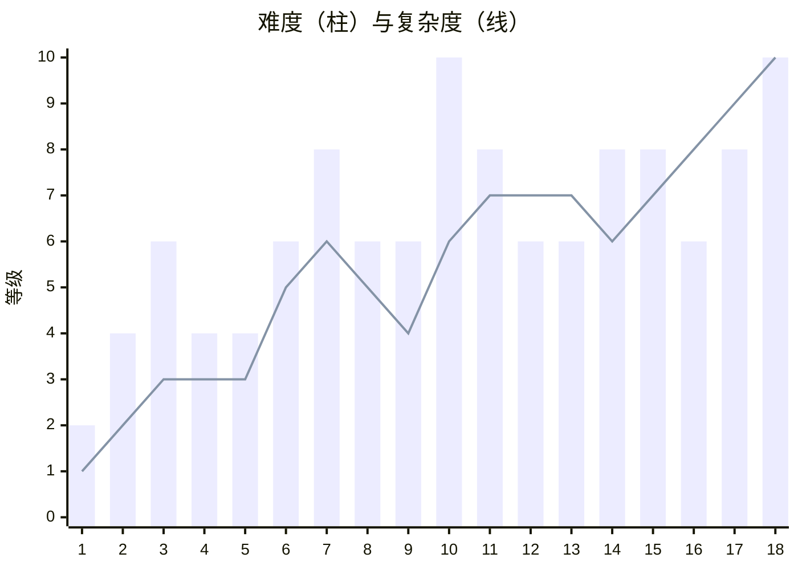

# 战役关卡设计 v1

> [!NOTE]
> 设计原则
> 1. **一关一个地点**：选那一阶段最有代表性的城市或村镇。
> 2. **时间顺序严格跟真实战争走**，但**难度不单调递增**：大关之后放"喘息关"，并穿插玩法完全不同的特殊关（护送、伏击、撤离、补给线）。
> 3. **复杂度分 4 个维度**逐步打开：①玩家亲手操作的系统数量 ②敌方威胁种类 ③经济/弹药压力 ④地图规模与额外规则。
> 4. 关卡目标始终是**保护**（城市、电网、补给线、撤离通道），伤亡只体现为失败条件和评分扣分，不做成画面奖励。

> 2026-10-15：按 WS10-002 / 003 审核结果修订（敏感内容虚构化、时间与敌人名单按公开资料调整，第 16–18 关时间段与 GDD 同步）。依据见 `docs/history/` 各关资料包第 7 节。

---

## 总览

| # | 章节 | 地点 | 时间 | 关卡类型 | 难度 | 复杂度 | 一句话卖点 |
|---|---|---|---|---|---|---|---|
| 1 | 序章 | **基辅 · 霍斯托梅尔** | 2022.02.24 | 爽快序章 | ★☆☆☆☆ | 1 | 单兵导弹打直升机机群，其余全部自动 |
| 2 | 闪击 | **沃兹涅先斯克**（小镇） | 2022.03.02 | 小镇防御 | ★★☆☆☆ | 2 | 只有民兵、ZU‑23 和几具单兵导弹 |
| 3 | 消耗 | **米科拉伊夫** | 2022.07 | 城市防御 | ★★★☆☆ | 3 | S‑300 对地打击，预警只有几十秒 |
| 4 | 消耗 | **哈尔科夫州 · 巴拉克利亚→库皮扬斯克** | 2022.09 | 移动护送 | ★★☆☆☆ | 3 | 防空跟着反攻部队往前推 |
| 5 | 黑暗之冬 | **切尔卡瑟州 · 第聂伯河畔村庄** | 2022.10 | 夜间走廊 | ★★☆☆☆ | 3 | 机动火力组 + 探照灯，玩家首次迎战 Shahed |
| 6 | 黑暗之冬 | **敖德萨** | 2022.12 | 电网防御 | ★★★☆☆ | 5 | 海上来袭；IRIS‑T / NASAMS 首次可用 |
| 7 | 盾与矛 | **基辅 · 匕首之夜** | 2023.05.16 | Boss 战 | ★★★★☆ | 6 | Patriot 第一次对决匕首 |
| 8 | 盾与矛 | **扎波罗热州 · 罗博季内方向** | 2023.06–08 | 移动护送 | ★★★☆☆ | 5 | Ka‑52 和 Lancet 追着装甲纵队打 |
| 9 | 盾与矛 | **赫尔松方向** | 2023.12.22 | 伏击特殊关 | ★★★☆☆ | 4 | 把 Patriot 偷偷前推，打 Su‑34（据报道） |
| 10 | 饱和 | **阿夫迪伊夫卡** | 2024.02 | 撤离关（守不住） | ★★★★★ | 6 | 滑翔炸弹压城，目标是撑到撤离 |
| 11 | 饱和 | **哈尔科夫** | 2024.05 | 城市防御 | ★★★★☆ | 7 | 离边境 30 km，滑翔炸弹 + 弹道导弹 |
| 12 | 饱和 | **西部某空军基地（虚构）** | 2024.08 | 基地防御 | ★★★☆☆ | 7 | F‑16 首次可操作 |
| 13 | 榛树 | **第聂伯罗** | 2024.11 | 城市防御 + 事件 | ★★★☆☆ | 7 | 弹道导弹主场；Oreshnik 剧情事件 |
| 14 | 榛树 | **波克罗夫斯克补给线** | 2025.03 | 补给线 | ★★★★☆ | 6 | 光纤 FPV 不怕电子战，保护公路 |
| 15 | 无人机海 | **卢茨克（沃伦州）** | 2025.07.09 | 后方城市 | ★★★★☆ | 7 | 防空稀薄的后方城市，迎来全国 728 架无人机之夜 |
| 16 | 无人机海 | **扎波罗热** | 2025.10 – 12 | 城市防御 | ★★★☆☆ | 8 | 滑翔炸弹常态化打击市区；Geran‑3 几乎跑赢拦截机 |
| 17 | 喷气时代 | **利沃夫** | 2025.12 – 2026.01.11 | 城市防御 + 事件 | ★★★★☆ | 9 | Oreshnik 打西部；Geran‑5 登场 |
| 18 | 终章 | **基辅** | 2026.03 – 05.24 | 24 小时终局 | ★★★★★ | 10 | 白天无人机 + 夜间导弹 + Oreshnik 疏散事件 |

> 柱状图（难度 ×2 显示）在 7、10、15、18 处达到峰值，每个峰值后面都跟一个喘息关或玩法不同的关卡。复杂度整体上升，但特殊关（4、9、14）会故意把系统数量降下来，只聚焦一种新机制。

---

## 关卡详情

### 第 1 关 · 基辅 · 霍斯托梅尔（序章）
- **时间**：2022.02.24 上午（直升机约 11:00 抵达机场；清晨只有导弹打击）
- **背景**：开战首日，俄军数十架 Mi‑8 运输直升机在 Ka‑52 护航下沿第聂伯河低空突袭霍斯托梅尔机场，想打开通往基辅的空中通道。
- **玩家操作**：只控制 **3–4 个单兵导弹小组**（泛指单兵防空导弹，不限定型号）。点击直升机即可发射，自动装填，慢动作镜头。
- **AI 自动**：S‑300 和 Buk 自动处理来袭的口径、伊斯坎德尔（玩家只看到天空中的拦截画面；背景演出，不对应具体拦截记载）；MiG‑29 自动巡逻。
- **敌人**：Mi‑8 运输机群、Ka‑52、少量 Mi‑24、少量 Su‑25；背景里的巡航导弹由 AI 处理。
- **胜利**：拖住空降突击，直到反击部队抵达（倒计时 8 分钟；部队番号虚构）。
- **设计目的**：5–10 分钟内给玩家"满天直升机被打下来"的爽感，同时用画面告诉玩家：远程防空、战斗机这些都存在，后面会交给你。
- **教学**：选目标 → 发射 → 转移位置（Ka‑52 会反击原地不动的小组）。

### 第 2 关 · 沃兹涅先斯克（小镇）
- **时间**：2022.03.02–03
- **背景**：南布格河畔的小镇，俄军想从赫尔松方向绕道去米科拉伊夫和南乌克兰核电站。守军以本地国土防卫队和民兵为主，炸掉城内小河上的桥、伏击直升机降落场。
- **玩家操作**：2 门 ZU‑23‑2、3 个单兵导弹小组、1 个侦察哨（装备为游戏化配置 ≈）。**所有东西都要自己操作**，但数量很少。
- **敌人**：Ka‑52 / Mi‑24 火力支援、Mi‑8 机降、Orlan‑10 侦察 ≈、Su‑25 ≈。
- **新机制**：**炸桥**（关卡开局一次性技能，炸的是城内小河上的桥，改变敌方地面路线）；**Orlan 标记**——Orlan 存活时，敌方炮火会精准落在你的阵地上。
- **胜利**：坚守 3 个波次，击退机降。
- **设计目的**："从小地方开始"——资源极少，教会玩家优先级判断：先打侦察机还是先打直升机？

### 第 3 关 · 米科拉伊夫
- **时间**：2022.07
- **背景**：南方前线城市，几乎每天遭到 S‑300 改对地打击和"龙卷风""飓风"火箭炮轰击。
- **玩家操作**：Buk‑M1 ×1、S‑300PS ×1（导弹耗尽不补）、高炮 ×3、单兵导弹 ×4。
- **敌人**：S‑300 对地导弹（极快，预警很短）、龙卷风火箭弹、飓风火箭弹、Kh‑59、Orlan。
- **新机制**：**预警时间**——不同方向、不同武器的来袭预警时长不一样；**防空导弹库存**首次出现，打完就没有。
- **胜利**：保护港口、造船厂、水厂。简报写作"保护剩余的供水设施"（城市当时确实供水中断，但原因是输水管道在俄占区被破坏，而不是水厂遭空袭）。
- **设计目的**：第一次让玩家感受到"有些东西拦不住，只能分散部署、减少损失"。

### 第 4 关 · 哈尔科夫州反攻（移动护送）
- **时间**：2022.09.06–10
- **背景**：哈尔科夫闪电反攻，乌军数日推进数十公里，收复巴拉克利亚、库皮扬斯克、伊久姆。
- **玩家操作**：**Gepard ×2**（首次出现；随反攻纵队作战是游戏化安排，不写成史实首战）、Strela‑10 ×1、单兵导弹车载小组。所有单位都能行进间射击。
- **敌人**：仓促出动的 Ka‑52 / Mi‑28、Su‑25、Orlan 侦察。
- **新机制**：**卷轴地图**——地图随推进向前滚动；玩家要在"跟上部队"和"停下展开打更远目标"之间取舍。
- **Shahed 预告**：通过无线电消息或残骸画面预告 Shahed（史实首次确认使用是 2022.09.13，就在哈尔科夫州）。
- **胜利**：纵队抵达奥斯基尔河，损失不超过 30%。
- **设计目的**：难度回落、节奏变快的喘息关；引入"移动速度 / 展开时间"这组数值。

### 第 5 关 · 切尔卡瑟州 · 第聂伯河畔村庄（夜间走廊）
- **时间**：2022.10 夜间
- **背景**：Shahed 开始大规模来袭，它们常沿第聂伯河谷低空飞向基辅和中部电网（航线为分析性说法，游戏化处理 ≈）。本地机动火力组（正规军分队）在志愿者协助下巡守沿途：皮卡、机枪、探照灯。
- **玩家操作**：**机动火力组 ×6**、探照灯、声学哨点（简化版）。
- **敌人**：Shahed‑136（玩家首次交战）、零星的 Kh‑101。
- **新机制**：**夜战视野**——不打探照灯就看不见目标；Shahed 发动机声音可以作为方向提示；**走廊防御**——你守的不是城市，而是 Shahed 飞往变电站的路线。
- **胜利**：拦下 75% 的 Shahed，保住变电站。
- **设计目的**：小规模、氛围感很强的关卡，让玩家认识战争中最主要的敌人。

### 第 6 关 · 敖德萨（电网防御）
- **时间**：2022.12
- **背景**：系统性能源打击期间，敖德萨从海上方向遭到口径导弹和 Shahed 攻击，一度大面积停电。
- **玩家操作**：**IRIS‑T SLM ×1 或 NASAMS ×1**（二选一，体现援助到货）、Buk ×1、Gepard ×1、机动火力组 ×4、电子战站 ×1。
- **敌人**：口径（海上方向）、Shahed（海上方向绕行；游戏化处理 ≈）、Kh‑101、Oniks（克里米亚方向）≈、Kh‑31P 反辐射导弹（配合辐射策略）、Kh‑22（不以谢尔希伊夫卡事件为原型）。
- **新机制**：**电网值**——变电站和电厂被打掉会降低全城电力，电力不足时雷达效能下降（真实的连锁反应）；**经济压力**——首次出现"西方导弹很贵、补给有限"。
- **胜利**：电网保持在 40% 以上，撑过 3 个夜晚。

### 第 7 关 · 基辅 · 匕首之夜（Boss 战）
- **时间**：2023.05.16 凌晨
- **背景**：俄军一夜之间发射 6 枚匕首、9 枚口径、3 枚伊斯坎德尔，外加无人机，重点打击 Patriot 阵地。据乌方称全部拦截（俄方否认），Patriot 部件受损（≈，公开报道只说"两个部件受损"）。
- **玩家操作**：**Patriot ×1**（首次出现）、IRIS‑T、NASAMS、Gepard、火力组，全部手动。
- **敌人**：先来无人机和巡航导弹消耗弹药，最后几枚匕首同时从不同方向扑向 Patriot 阵地。
- **新机制**：**雷达暴露**——Patriot 开机后位置暴露，敌方会集中火力打它；**弹药分配**——PAC‑3 只有十几发，必须留给匕首。
- **胜利**：Patriot 阵地存活 + 首都关键设施完好。
- **设计目的**：第一个 Boss 关，检验前 6 关学到的所有东西。

### 第 8 关 · 扎波罗热州 · 罗博季内方向（护送）
- **时间**：2023.06–08（罗博季内于 2023.08.23 被收复）
- **背景**：南方反攻期间，乌军纵队在雷区中推进，俄军 Ka‑52 用远程反坦克导弹在防区外打击，Lancet 专门猎杀装甲车和火炮。
- **玩家操作**：Gepard、Stormer HVM、Avenger、电子战车。
- **敌人**：**Ka‑52（远程反坦克导弹，射程超过你的近程防空）**、**Lancet（大量出现；2022 年起已在使用，不是新武器）**、Orlan、少量 UMPK 滑翔炸弹。
- **新机制**：**防区外威胁**——Ka‑52 在你射程外开火，必须前推防空或让工兵加快排雷；**Lancet 专打车辆**，电子战可以干扰它。
- **胜利**：纵队推进到指定区域。结局如实呈现：只推进了几公里。评分看的是"减少了多少损失"，不是"打赢了"。

### 第 9 关 · 赫尔松方向 · Patriot 伏击（特殊关）
- **时间**：2023.12.22
- **背景**：据报道，乌军把一套 Patriot 秘密前推到前线附近（未经官方证实），一天内击落 3 架正在投放滑翔炸弹的 Su‑34（据乌方称）。
- **玩家操作**：**只有 1 套 Patriot 和 1 套近程掩护**。
- **新机制**：**伪装与时机**——Patriot 关机隐蔽，等 Su‑34 进入投弹航线后开机射击；开机后必须在 X 分钟内撤收转移，否则会被伊斯坎德尔和 Lancet 找到。
- **胜利**：击落 ≥ 2 架 Su‑34，并且 Patriot 安全撤离。
- **设计目的**：短小精悍的高风险高回报关卡，同时为下一关"滑翔炸弹为什么这么难对付"做铺垫。

### 第 10 关 · 阿夫迪伊夫卡（撤离关）
- **时间**：2024.02
- **背景**：俄军每天投放数十枚滑翔炸弹（包括 FAB‑1500 ≈），城市防御工事被逐步摧毁，乌军最终于 2024.02.17 撤出。
- **玩家操作**：近程防空、电子战、单兵导弹；**没有远程防空**——Su‑34 在你射程之外投弹。
- **敌人**：**FAB‑500/1500 UMPK 滑翔炸弹（大规模；FAB‑1500 ≈）**、FPV、Lancet、Su‑25。
- **新机制**：**守不住的关卡**——目标是保护撤离通道，撑到部队撤出；电子战可以让滑翔炸弹偏离目标，但本关效果设弱（相关公开报道集中在 2025 年，2025 年起的关卡再加强）。
- **胜利**：撤离通道保持畅通，按撤出的部队比例评分。
- **设计目的**：情绪最低点，也是难度峰值。让玩家明白：没有远程防空和战斗机，滑翔炸弹几乎无解。

### 第 11 关 · 哈尔科夫
- **时间**：2024.05
- **背景**：俄军发起沃夫昌斯克攻势，哈尔科夫市遭到 UMPB D‑30 滑翔炸弹、S‑300、伊斯坎德尔、KN‑23 的密集打击。城市离边境仅约 30 km。城市的发电能力在 2024 年 3 月已被打光，此时守的是变电站和输电设施。
- **玩家操作**：Patriot（限量）、IRIS‑T、NASAMS、Skynex、火力组、电子战。
- **敌人**：D‑30 滑翔炸弹、KN‑23、伊斯坎德尔‑M、S‑300 对地、Shahed、**早期诱饵 ≈**（Gerbera 2024.07 下旬才出现，本关不用）。
- **新机制**：**超短预警**——边境附近发射的导弹几乎没有预警；**诱饵**混在 Shahed 里消耗你的弹药。
- **胜利**：保护变电站和输电设施、地铁站避难所和工厂。

### 第 12 关 · 西部某空军基地（虚构）
- **时间**：2024.08.26
- **背景**：F‑16 投入使用，空军基地成为俄军重点目标。当天是当时最大规模的空袭之一，F‑16 首次实战拦截。基地名称和位置均为虚构，不对应真实的 F‑16 驻地。
- **玩家操作**：**F‑16 ×2（首次可操作）**、Patriot / SAMP/T、NASAMS、近程防空。
- **敌人**：Kh‑101、口径、匕首、Kh‑69、Kh‑59、KN‑23 / 伊斯坎德尔、Tu‑22M3 发射的导弹、Kh‑31P 反辐射导弹 ≈、Shahed、Gerbera。
- **新机制**：**空中单位**——战斗机要起飞、巡逻、返航、补给，跑道受损后无法起降；**保护跑道和机库**。
- **胜利**：基地仍可运作，F‑16 无损失。飞行员角色虚构，不重现真实的坠机事件。

### 第 13 关 · 第聂伯罗
- **时间**：2024.11
- **背景**：工业重镇，经常遭到导弹袭击（型号多数未公开）。2024.11.21，Oreshnik 首次实战；关卡中被打击的工厂为虚构的"第聂伯河机械厂"。
- **玩家操作**：完整防空阵容，Patriot 数量有限。
- **敌人**：弹道导弹（统写，不区分伊斯坎德尔‑M / KN‑23）、Kh‑101、Shahed（带热像摄像头的版本推迟到 2025.06 之后的关卡）。
- **新机制**：**Oreshnik 剧情事件**——中途触发，无法拦截；玩家只能提前把人员和设备疏散到地下。疏散会降低防空效能，形成取舍。
- **胜利**：保护工厂关键车间。
- **设计目的**：难度适中，靠剧情事件制造压迫感，而不是靠堆数量。

### 第 14 关 · 波克罗夫斯克补给线
- **时间**：2025.03
- **背景**：波克罗夫斯克方向处于相对僵持期，前线后方的补给线承受持续消耗：公路进入"无人机杀伤区"（纵深 ≈）。光纤 FPV 不受电子战影响；玩家可以在道路两侧架起防无人机网（玩法设定）。
- **玩家操作**：**拦截无人机班组**（首次大量使用）、机枪组、电子战、防无人机网（建造）。
- **敌人**：光纤 FPV、普通 FPV、Molniya 固定翼、Lancet、Orlan、少量滑翔炸弹。
- **新机制**：**建造防护网**；**光纤免疫电子战**，只能靠拦截无人机和火力；守的是一条路，而不是一个点。
- **胜利**：一定比例的补给车辆通过。
- **设计目的**：完全不同的"微观"关卡，远程防空在这里几乎没用。

### 第 15 关 · 卢茨克（后方城市）
- **时间**：2025.07.09
- **背景**：当晚俄军在全国发射 728 架无人机（另有 13 枚导弹），创下纪录，其中一部分飞向卢茨克，卢茨克成为当夜的重点目标之一。后方城市的防空远不如基辅密集。关卡里的来袭数量为游戏化放大。
- **玩家操作**：少量中程防空、大量拦截无人机、F‑16（带 APKWS 火箭）、火力组。
- **敌人**：大规模 Geran‑2（加大战斗部 / AI 制导版本）、Gerbera 诱饵、少量巡航导弹。
- **新机制**：**波兰边境**——地图西侧是北约领空，不能让无人机越界，也不能向越界方向开火；**海量目标**考验自动化设置（可以给单位设定交战规则）。
- **胜利**：保护机场和变电站，越界无人机为 0。

### 第 16 关 · 扎波罗热
- **时间**：2025.10 – 12
- **背景**：滑翔炸弹已常态化打击扎波罗热市区（普通 KAB 从 2024.09 起就能打到市区），UMPB‑5R 喷气滑翔弹又把威胁扩展到更深的后方；Geran‑3 喷气无人机开始小批量使用；Shahed 装上后视摄像头，学会躲避拦截机。
- **玩家操作**：Skyranger 35（首次；试验性部署 ≈，交付时间未公开确认）、拦截无人机、IRIS‑T、Patriot（限量）、电子战。
- **敌人**：UMPB‑5R、**Geran‑3（拦截无人机极难追上：命中概率很低但不为 0；2025.11.30 已有拦截无人机击落 Geran‑3 的记录）**、会规避的 Geran‑2、KN‑23。
- **新机制**：**敌方反制升级**——同一种敌人有了新"技能"，玩家之前的最优解失效，需要调整配置。
- **胜利**：保护工业区和电网。
- **设计目的**：大关之间的过渡关，主要教新机制。

### 第 17 关 · 利沃夫
- **时间**：2025.12 – 2026.01.11
- **背景**：2026.01.08，Oreshnik 第二次实战，打击利沃夫——这是利沃夫州首次遭到弹道导弹袭击。三天后，Geran‑5 首次投入使用（首次使用地点未公开，不写作在利沃夫）。关卡中被打击的航空修理厂使用虚构名称"西部航空修理厂"，地图位置虚构。
- **玩家操作**：几乎完整的西方防空阵容 + 冬季条件。
- **敌人**：**Geran‑5（新敌人，速度接近巡航导弹）**、Kh‑101、伊斯坎德尔（2026.01.08 之后才出现）、Oreshnik 事件。
- **新机制**：**冬季**——低温降低电子设备效能，电网压力更大；Geran‑5 只有中程防空和战斗机能稳定拦截。
- **胜利**：保护航空修理厂和城市供暖。

### 第 18 关 · 基辅（终章）
- **时间**：2026.03 – 05.24
- **背景**：战争中规模最大的混合打击之一：约 600 架无人机、90 枚导弹、2 枚 Oreshnik（两枚都不在基辅市区：一枚落在比拉采尔克瓦，一枚落在俄控顿涅茨克州）。此前（2026.05.13–14）俄军已开始采用"白天无人机消耗 + 夜间导弹齐射"的新战术。
- **玩家操作**：全部系统手动可控，包括喷气式拦截无人机原型（2026.09 击落 Geran‑5 的那种，作为"最后的解锁"彩蛋提前加入，或改为通关后奖励）。
- **敌人**：所有敌人类型。
- **结构**：**24 小时三阶段**——白天无人机持续消耗 → 黄昏补给窗口（选择补哪些弹药）→ 夜间导弹 + Oreshnik 事件（一发落在地图外的卫星城，触发疏散事件；基辅市区内不落弹；画面只表现远处夜空中的多个光点）。
- **胜利**：撑过 24 小时，首都关键设施保持运作。
- **设计目的**：首尾呼应——第 1 关在基辅一切都是自动的；最后一关在基辅一切都由你亲手掌控。

---

## 系统解锁节奏

| 关卡 | 首次可操作 |
|---|---|
| 1 | 单兵导弹 |
| 2 | 牵引高炮、侦察哨、炸桥 |
| 3 | Buk、S‑300（库存制） |
| 4 | Gepard、Strela‑10 |
| 5 | 机动火力组、探照灯、声学哨 |
| 6 | IRIS‑T / NASAMS、电子战、电网系统 |
| 7 | Patriot |
| 8 | Stormer、Avenger |
| 9 | 伪装 / 开关机 |
| 10 | GNSS 欺骗（打滑翔炸弹） |
| 11 | Skynex、SAMP/T |
| 12 | F‑16、空中单位系统 |
| 14 | 拦截无人机、防护网 |
| 15 | 交战规则自动化、F‑16 + APKWS |
| 16 | Skyranger 35 |
| 18 | 喷气式拦截无人机 |

## 关卡类型分布

| 类型 | 关卡 |
|---|---|
| 城市防御（标准） | 3、6、11、13、15、16、17 |
| Boss / 大规模 | 7、18 |
| 移动护送 | 4、8 |
| 特殊小关 | 2（小镇）、5（夜间走廊）、9（伏击） |
| 撤离（守不住） | 10 |
| 基地防御 | 12 |
| 补给线 | 14 |
| 爽快序章 | 1 |
