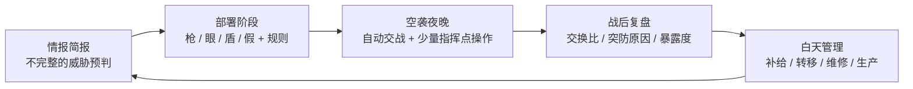
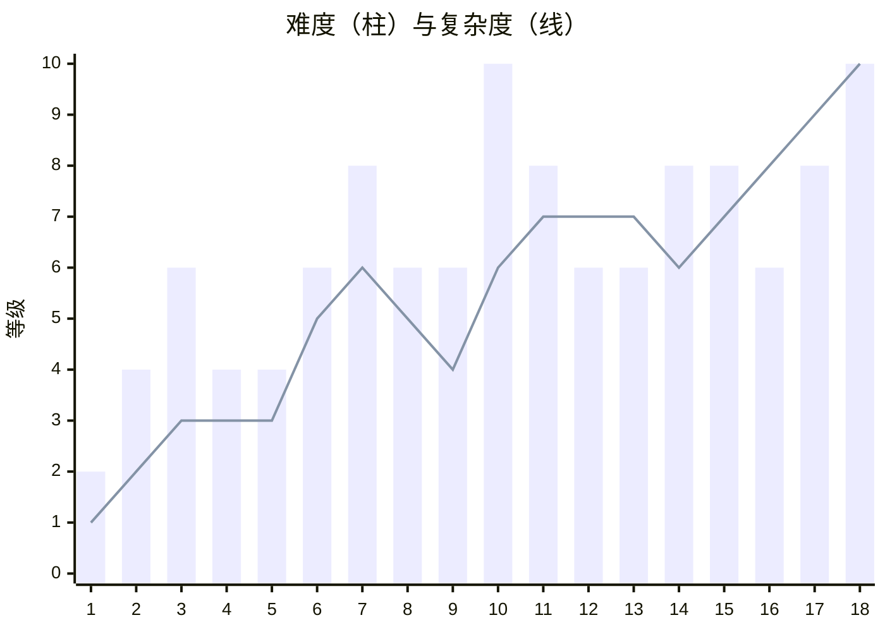

# 游戏设计文档（GDD）v1.4

**暂定名**：《守夜》（*Nightwatch*）
**类型**：硬核军事塔防 / 策略，带轻度模拟经营
**题材**：俄乌战争中的乌克兰防空作战（2022.02 – 2026.05）
**平台**：Steam（Windows + macOS）
**引擎**：Godot 4（.NET 版）+ C#
**开发方式**：个人开发 + AI 辅助
**文档状态**：v1.4，整合截至 2026.10.18 的全部设计讨论与 D2b 技术规格同步

> [!IMPORTANT]
> **配套文档**
> - [开发任务分解_WBS_v1.md](开发任务分解_WBS_v1.md)（v1.1）：面向 AI 与开发者的执行文档（任务、验收标准、人工参与标记）
> - [技术规格书](spec/)（00–07）：模拟层、数据 Schema、关卡 / 战役、UI / 视图层与工具链的精确数学与接口契约
> - [俄乌战争塔防_武器投入时间表.md](俄乌战争塔防_武器投入时间表.md)：武器首次投入时间（历史依据）
> - [塔防数值表_v1.md](塔防数值表_v1.md)（v1.3）：所有单位的数值与规则参数
> - [战役关卡设计_v1.md](战役关卡设计_v1.md)：各关历史背景的详细描述
>
> 若与本 GDD 冲突，**以本 GDD 为准**（例如第 12 关已改为"保护机场"，战斗机不再由玩家直接操作）。

**版本记录**
| 版本 | 日期 | 内容 |
|---|---|---|
| v1.0 | 2026.10.13 | 初稿：整合玩法、人物、关卡、经济、生产、时间结构、跨关影响 |
| v1.1 | 2026.10.13 | 新增第 16 章"美术、音频与技术架构"；确定平台与引擎；所有武器一周目可用；里程碑加入技术与美术任务；新增决策记录 |
| v1.2 | 2026.10.14 | 新增 18.3 工作分解摘要；新增配套文档《开发任务分解 WBS》 |
| v1.3 | 2026.10.15 | 按 WS10-002 / 003 审核修订 12.1 总表与 12.2 关卡卡片（敏感内容虚构化、时间与敌人名单按公开资料调整）；19.1 新增对应决策 |
| v1.4 | 2026.10.18 | 按 D2b 技术规格与 D4-①b 可玩性调参同步：明确 Orlan 侦察升档全图生效（不叠加）、诱饵配合开机机制（20 km 内诱饵先开机 2 游戏秒，诱饵在场时暴露速率 ×0.25，按预警开机有指示时 ×0.70）、电子战友军无人机减益（×0.6 不累乘）、电网无向图连通性与断电惩罚（×0.5）、动态变速档位（8× / 4× / 1× / 0.25× / 0.2×）、第 9 关 Patriot 前推伏击轻装配置（2 具发射架）、第 16 关起拦截无人机对喷气目标 10% 基础命中率、城区拦截碎片轻伤不损毁整栋民房且诱饵无碎片伤害、宏观综合交换比与单武器高射低打质询分离 |
---

## 目录

1. 项目概述
2. 核心体验与设计支柱
3. 玩家身份与指挥权限
4. 人物与叙事
5. 核心循环
6. 单位体系
7. 敌方体系与 AI
8. 核心系统详解
9. 经济系统
10. 生产与经营（后期关卡）
11. 时间结构
12. 战役与关卡
13. 跨关卡影响
14. 难度与可选模式
15. UI / UX 要点
16. 美术、音频与技术架构
17. 内容与敏感性准则
18. 开发范围与里程碑
19. 决策记录与待定问题
附录：术语表

---

## 1. 项目概述

### 1.1 一句话介绍
> 你是乌克兰的防空指挥官。在信息不完整、资源永远不够的情况下，提前部署防空网，迎接一夜又一夜的空袭，决定保护什么、放弃什么。

### 1.2 关键特征
- **真实时间线**：18 个关卡，从 2022.02.24 的基辅到 2026.05 的基辅，武器按真实投入时间出现。
- **一关一城**：每关守护一个有代表性的城市、村镇、补给线或基地。
- **以部署为核心**：大部分决策在空袭前完成，空袭中只有少量关键操作。
- **双主角**：空军防空军官与陆军防空军官两条线交替推进。
- **硬核但可读**：反防空压制、电子战、探测网、交换比、暴露度都是核心机制，但用清晰的界面和战后复盘让玩家看懂。
- **后期经营**：本地拦截无人机生产与研发，在空袭中维持生产。
- **写实 2.5D**：夜战为主的实景层，加上防空指挥台风格的指挥层。

### 1.3 目标玩家
- 喜欢《陷阵之志》《This War of Mine》《Frozen Synapse》《DEFCON》，以及硬核军事模拟的玩家
- 对现代战争、防空和无人机战争感兴趣的玩家

### 1.4 平台与规模
- **Steam：Windows + macOS**，键鼠操作；不适配 Steam Deck 与手柄
- 战役总时长约 **10–11 小时**
- 后续可选：DLC（例如乌克兰反击内容）、自定义 / 无尽模式

---

## 2. 核心体验与设计支柱

### 2.1 核心体验
> **在不确定中取舍。**

### 2.2 四大设计支柱

| 支柱 | 本质问题 | 对应玩点 |
|---|---|---|
| **A. 空间规划** | 防空摆在哪里？ | 根据射程和保护目标规划位置；布设探测网；把拦截点外推到城外；护送关中伴随部队 |
| **B. 价值取舍** | 用什么打什么？保护谁、放弃谁？ | 按建筑与单位价值分配防空；按威胁类型匹配武器；追求效费比；开火纪律（放行试探性无人机） |
| **C. 动态适应** | 情况变了怎么调整？ | 根据每天不确定的情报调整部署；根据损伤和弹药消耗调配；根据预警航线临时调动机动单位；应对敌人学习 |
| **D. 生存与欺骗** | 怎样不被猎杀？ | 防空自身会被反辐射导弹、Lancet、伊斯坎德尔猎杀；雷达开关机与转移；假目标；甄别敌方诱饵 |

### 2.3 辅助系统
空袭警报的代价 · 空域协调 · 基础设施连锁 · 人员疲劳 · 天气与昼夜 · 交战规则约束 · 上级与民意压力

### 2.4 关卡变体
护送关 · 撤离关 · 伏击关 · 补给线关 · 基地防御关 · 经营关

### 2.5 设计原则
1. **玩家扮演制定规则的指挥官，而不是按开关的操作员。**
2. **没有万能解**：敌人会适应玩家的固定打法，电子战会随时间衰减，昂贵武器会被交换比惩罚。
3. **有些东西拦不住**：弹道导弹、Oreshnik、远距离投放的滑翔炸弹，迫使玩家学会分散、隐蔽和接受损失。
4. **透明**：每个失败都能在战后复盘里找到原因。

---

## 3. 玩家身份与指挥权限

### 3.1 现实依据
乌克兰的防空力量分属多个体系：空军（防空导弹兵、雷达兵、航空兵）、陆军野战防空、国土防卫部队、国民警卫队、海军陆战队、无人系统部队，以及地方政府、志愿者和企业。空袭期间，某一地区的防空作战由**空军地区空中指挥部**统一协调。玩家的身份即以此为原型，并适度放大职责范围。

### 3.2 指挥权限四级

| 权限 | 对象（示例） | 玩家能做什么 |
|---|---|---|
| **直接指挥** | 主角本部队 | 部署、转移、设定所有规则 |
| **作战控制** | 配属的陆军 Gepard、空军拦截无人机班组 | 可部署、设规则，但**有归还期限** |
| **协调** | 国民警卫队、国土防卫部队、企业分队、海军陆战队 | 只能在**指定区域**活动；可请求调整，不能调走 |
| **外部支援** | 战斗机、国家级导航欺骗、邻近扇区覆盖 | 只能呼叫 |

### 3.3 信息来源（不可控）
国家预警网、盟国情报：只提供预警和大致方向。

---

## 4. 人物与叙事

### 4.1 可操作主角

| | **A：城市之盾** | **B：前线之眼** |
|---|---|---|
| 体系 | 空军防空导弹兵 | 陆军（全程留在陆军） |
| 年龄 | 40 多岁 | 20 多岁 |
| 呼号 | "老头"（Дід） | "黄蜂"（Оса） |
| 出身 | 职业军官，苏制 S‑300 出身，曾在哈尔科夫空军大学任教 | A 当年的学员，后退伍；2022 年动员重新入伍 |
| 成长线 | S‑300 营长 → 出国受训改装 Patriot → 旅副旅长 / 地区防空指挥所 → 首都防空扇区指挥官 | 单兵导弹手 → 旅属防空连连长 → 旅属拦截无人机分队 → 负伤后转后方，负责拦截无人机训练与生产 |
| 象征 | 旧体系的坚守者：苏制导弹越打越少，接受新装备 | 新战争的适应者：战争向无人机转变 |
| 关卡风格 | 大城市、远程系统、Boss 战、经营 | 小地方、机动、护送、撤离、补给线 |
| 主要武器 | S‑300、Buk、S‑200、Patriot、SAMP/T、IRIS‑T、NASAMS、Hawk 等；警戒雷达网 | 单兵导弹、Gepard、Osa、Strela、Stormer、Avenger、陆军 Buk；拦截无人机；本地传感器 |
| 空情 | 直接控制区域雷达网 | 空军空情经转发，有延迟，精度最高为"大致" |

**军衔与职务演进**

| 时期 | A | B |
|---|---|---|
| 2022 | 中校，防空导弹营营长（S‑300） | 中士，单兵导弹组组长 |
| 2022 下半年 | 同上 | 少尉（战场任命），旅属防空连连长 |
| 2023 | 中校，Patriot 营营长 | 中尉，同上 |
| 2024 | 上校，防空导弹旅副旅长 / 地区防空指挥所值班指挥员 | 上尉 |
| 2025 | 同上 | 上尉，旅属拦截无人机分队指挥官 |
| 2025 末–2026 | 上校，首都防空扇区指挥官 | 少校，地区拦截无人机训练与生产负责人 |

> 早期 B 以中士身份统领小镇防空，剧情解释为"战争初期一片混乱，谁会用就由谁带队"。

### 4.2 固定配角

| 配角 | 体系 | 作用 | 出场 |
|---|---|---|---|
| 空中指挥部值班指挥员 | 空军上级 | A 的上级；下达保护优先级、审批增援；信任度的人格化 | 简报、质询事件 |
| 战斗机飞行员 | 空军航空兵 | 战斗机呼叫的"声音"；从 MiG‑29 改装 F‑16 | 呼叫无线电；第 12 关当面出场 |
| 国民警卫队连长 | 内务部 | 坚守电站，只听自己上级，与 A 有摩擦 | 协调权限单位的代表 |
| 火力组志愿者 | 国土防卫 / 民间 | B 家乡的邻居，后成为城市火力组骨干 | 第 5、15、18 关 |
| 无人机工程师 | 民间 → 无人系统部队 | 拦截无人机研发与生产；研发系统的人格化 | 第 14 关起 |
| 市长 / 地方军事管理局负责人 | 地方政府 | 代表民意，希望保护居民区；提供城市资源 | 民意压力事件 |

配角跨越两条线：例如工程师先在 B 的前线结识 B，随后被 B 带到后方，最后在终章为 A 的城市供应拦截无人机。

### 4.3 两条线的互动
| 形式 | 例子 |
|---|---|
| 关卡间通信 / 信件 | 简短对话，交代近况、推进剧情 |
| 观念冲突 | A 信任昂贵导弹与正规程序，B 信任便宜灵活的无人机；终章融合 |
| 资源争夺 | A 是否把一套机动防空调给 B 的前线 |
| 人情 | 帮过对方后，可在之后的关卡中呼叫对方的支援 |
| 跨线影响 | B 第 15 关的产量影响 A 第 16 关的拦截无人机 |

### 4.4 叙事基调
克制、写实，聚焦于指挥决策和人的坚持。不渲染伤亡，不美化战争。每关结束后可查看"历史上发生了什么"。

---

## 5. 核心循环

### 5.1 关卡内循环



| 阶段 | 决策占比 | 内容 |
|---|---|---|
| **情报简报** | — | 国家预警与情报："侦察到图‑95 起飞""黑海 2 艘载舰出港"；可能不准确 |
| **部署** | 约 70% | 放置单位，设定交战规则、辐射策略、触发规则、空域划分、保护优先级 |
| **空袭** | 约 20% | 观看自己的部署接受检验；每夜 3–6 个**指挥点**用于关键操作 |
| **复盘** | 约 10% | 每个突防目标的原因、交换比、暴露度变化、跨关影响预告 |
| **白天管理** | — | 补给窗口（运力有限）、阵地转移（时间槽）、维修、申请增援；经营关卡中加入生产 |

### 5.2 空袭中可用的指挥点操作
- 切换交战规则（例如 PAC‑3 只打弹道导弹 / 放开交战）
- 扇区紧急静默 / 强制开机
- 调动机动单位（火力组、拦截无人机班组）
- 呼叫外部支援（战斗机等）
- 紧急转移一个单位（仅限展开时间按分钟计的系统）
- 拉响 / 解除空袭警报

关键时刻以**慢放 + 二选一**的形式呈现，例如：
> ⚠ 反辐射导弹接近 Buk‑2 阵地，同时 3 枚巡航导弹正进入其扇区
> **[静默]** 保住雷达，放过巡航导弹　｜　**[坚持]** 拦截巡航导弹，雷达可能被毁

### 5.3 战役循环
关卡 → 战后结算（信任度、奖励卡、王牌班组、库存、敌情档案、人情）→ 两条线交替 → 下一关

---

## 6. 单位体系

> 全部数值见[数值表](塔防数值表_v1.md)。

```
玩家可部署
├─ 火力（枪）：单兵导弹、高炮、火力组、Gepard/Skynex/Skyranger、近程导弹、
│              中程导弹（Buk/IRIS-T/NASAMS/Hawk）、远程（S-300/SAMP/T/Patriot/S-200）、
│              拦截无人机、喷气拦截无人机
├─ 探测（眼）：警戒雷达、补盲雷达、声学哨、观察哨、无线电侦测器（民众上报自动生效）
├─ 电子战（盾）：区域导航干扰站、导航欺骗站、反无人机干扰站、单兵反无人机枪、车载防护罩
└─ 欺骗（假）：诱饵辐射源、旧雷达牺牲开机、假发射车、备用阵地

外部支援（呼叫）：战斗机（巡逻 / 定向拦截 / 猎杀无人机）、国家级导航欺骗、邻州火力组、邻近扇区覆盖
信息来源（不可控）：国家预警网、盟国情报
```

### 6.1 目标标签
`UAV` 慢速无人机 · `JET_UAV` 喷气无人机 · `DECOY` 诱饵 · `CM` 亚音速巡航导弹 · `SCM` 超音速巡航导弹 · `BM` 弹道导弹 · `HBM` 高超音速 · `GB` 滑翔炸弹 · `HELI` 直升机 · `AC_LOW` 低空飞机 · `AC_HIGH` 中高空飞机

### 6.2 每个单位的通用属性
射程 / 射高 · 可拦截标签 · 单发拦截概率 · 弹仓与补给 · 展开 / 撤收 / 移动速度 · 是否行进间射击 · 辐射类型与暴露速度 · 价格（用于交换比） · 指挥权限 · 首次可用关卡

---

## 7. 敌方体系与 AI

### 7.1 敌方单位
导弹（巡航、超音速、弹道、高超音速）、滑翔炸弹、一次性攻击无人机（Shahed / Geran 全系列、Gerbera 诱饵）、侦察无人机、FPV / Lancet、有人驾驶飞机与直升机。详见时间表与数值表。

### 7.2 伤害、精度与目标价值（游戏化抽象）
- **伤害等级 1–10**、**溅射（格）**、**精度档 A–D**，不使用真实杀伤半径或圆概率误差。
- 精度受电子战（降档）和侦察标记（战场上有任意存活的 Orlan 等侦察无人机时，**全图敌方远程火力精度升 1 档，多架不叠加**）影响。

### 7.3 波次结构
一夜典型顺序：侦察 → 诱饵与 Shahed 消耗 → 反辐射导弹压制 → 巡航导弹主力 → 弹道导弹收尾。
2026.05 起（第 18 关）：**白天无人机持续消耗 + 夜间导弹齐射**。

### 7.4 敌方 AI 行为
| 行为 | 说明 |
|---|---|
| **试探** | 先放一小批无人机，记录哪里有防空开火，随后用导弹打这些位置 |
| **压制** | 用反辐射导弹逼玩家关机，主力趁机突防；即使没打中也算成功 |
| **猎杀** | 暴露度 ≥ 70 的单位进入"已知目标清单"，次夜遭定点打击 |
| **绕行** | 巡航导弹沿河谷、低空盲区飞行；A‑50 存活时更会绕开防空圈 |
| **饱和** | 在同一时刻从多方向集中到达 |
| **适应（跨关）** | 针对玩家的主要打法调整（见 13.4） |

### 7.5 敌方技术演进（按真实时间线）
Shahed 抗干扰天线（2022 末）→ 俄产化、黑色涂装（2023）→ Gerbera 诱饵（2024）→ 光纤 FPV（2024）→ 大战斗部、AI 视觉制导（2025）→ 后视摄像头、能规避拦截机（2025 秋）→ Geran‑3（2025）→ Geran‑5（2026.01）、Geran‑4（2026.05）。

---

## 8. 核心系统详解

### 8.1 探测与航迹质量
- 三层探测：**国家层**（地图外，只给预警）· **区域层**（警戒 / 补盲雷达）· **本地层**（声学、观察哨、无线电侦测、民众上报）。
- 航迹质量三级：**模糊**（只能调动、拉警报）· **大致**（可引导战斗机、机动单位，为火控提供指示，可甄别诱饵）· **精确**（可发射导弹）。
- **核心联动**：大致以上的航迹覆盖可以让防空系统的火控雷达**只在最后时刻开机**，暴露度大幅降低。警戒雷达因此是敌方的高价值目标。
- 地形和地平线形成低空盲区；补盲雷达和本地传感器负责填补。

### 8.2 辐射策略与反防空压制
- **战前预设为主（约 80%）+ 空袭中手动例外（约 20%）**。
- 辐射策略：常开 / 按预警开机 / 间歇开机 / 静默待机 / 诱饵配合（交战前优先唤醒 **20 km 内**的诱饵辐射源先开机 **2 游戏秒 / 120 世界秒**，再开启本机火控雷达，使反辐射导弹优先锁定诱饵）。
- 触发规则：反辐射导弹来袭时的处置、开火后是否转移、主雷达被毁时由谁接替。
- **暴露度**（0–100）：开机、开火上升（按单位辐射速率，有预警指示时按预警开机另有 ×0.70 暴露折减，诱饵在场开机时诱饵配合另有 ×0.25 暴露折减），静默、转移下降；暴露度 ≥ 70 招致当夜或次夜的定点打击。
- 关机越早，躲过反辐射导弹的概率越高；拖到最后效果有限。
- 引入节奏：第 3 关（开 / 关、暴露度）→ 第 6 关（策略预设、网络静默）→ 第 7 关（首次完整考验）→ 第 9 关（整关围绕静默与突然开机）→ 第 11 关起（敌方试探、先压制后突击）。

### 8.3 电子战
- **不摧毁目标，只降低精度或切断控制**：把打向电厂的 Shahed 引到空地上。
- 类别：区域导航干扰、导航欺骗（可设诱导点）、反无人机干扰、单兵反无人机枪、车载防护罩、国家级导航欺骗（外部支援）。
- **效能随时间衰减**（敌方适应）：2022 年 100% → 2026 年导航干扰约 35%；光纤 FPV 完全免疫。研发可部分恢复。
- **副作用**：干扰己方拦截无人机（当拦截目标或拦截无人机位于友方开机电子战覆盖区内且未设置电子战安全走廊时，单发拦截概率 **×0.6，多站覆盖不重复累乘**）、影响城市韧性、自身暴露。
- 只描述游戏效果，不涉及真实频段和技术参数。

### 8.4 拦截地点与碎片
城区上空拦截会产生碎片伤害（轻度碎片仅造成擦伤而不直接摧毁整栋民房，诱饵被击落不产生爆炸碎片）；城外拦截无伤害。评分单列"城区上空拦截比例"，推动玩家外推防线。

### 8.5 基础设施与电网
- 保护目标按**权重**排列（由上级下达，例如电厂 > 指挥所 > 工厂 > 居民区）。
- **电网拓扑**：电厂与变电站构成无向供电图。变电站或电厂被毁会让无路径连通至存活电源的下游节点断电；依赖市电的雷达与电子战站断电后效能下降（探测距离 / 干扰概率 **×0.5**），工厂断电则停产。
- 玩家需要识别**关键节点**。

### 8.6 空袭警报
- 拉响警报：居民进入避难所（失败条件风险下降），但工厂停工、城市资源停止积累。
- 不拉或拉晚：风险自负。
- **警报疲劳**：频繁拉响会降低民众响应度。
- 第 6 关引入（与电网系统同步），经营关卡中权重最大。

### 8.7 人员与王牌班组
- 班组连续作战会疲劳（连续 3 夜以上效能 ×0.85），需要轮换。
- 每条主角线有 **3–5 个有名字的王牌班组**，跨关卡保留经验和特长，可能永久阵亡。
- 飞手（拦截无人机操作员）是生产系统中的瓶颈资源。

### 8.8 天气与昼夜
| 条件 | 影响 |
|---|---|
| 夜间 | 观察哨距离 ×0.3（探照灯恢复至 ×0.7，热像恢复至 ×1.0）；火力组依赖探照灯 |
| 低云 / 雾 | 光学瞄准受限；Shahed 更难目视 |
| 冬季 | 设备效能下降；电网压力增大（供暖） |
| 月夜 / 晴夜 | 目视距离提升 |

### 8.9 战斗机：三种模式
| 模式 | 规则 |
|---|---|
| **无战斗机** | 前线（俄军远程防空与空空导弹威胁）或早期飞机太少 |
| **场外呼叫** | 消耗指挥点，有响应延迟，每夜额度有限，大空袭夜可能被拒绝；前线风险区内不可呼叫 |
| **机场在地图内** | 机场是保护目标；跑道受损则无法起飞，机库受损则额度永久下降；响应延迟最短 |
| （变体）支撑设施在地图内 | 例如航空修理厂：受损会降低后续关卡的战斗机额度 |

呼叫类型：区域巡逻 / 定向拦截 / 猎杀无人机（2025 起）。到位后由 AI 按规则交战。
**空域协调**：战斗机所在区域，地面防空默认"限制交战"，玩家可划设"战斗机专区"。

### 8.10 交战规则约束
- 边境附近：碎片和无人机不得进入邻国（第 15 关波兰边境）
- 核电站周边：限制交战
- 早期民航走廊等特殊区域

### 8.11 上级与民意
- 市长希望保护居民区，上级要求优先保护军工；民众希望看到防空，军事上需要隐蔽。
- 以两难事件呈现，影响信任度与城市资源。

---

## 9. 经济系统

### 9.1 原则
**不使用金钱。** 城市防空指挥官不采购武器；贵的东西靠上级分配和申请，便宜的东西靠自己。

### 9.2 三种资源

| 资源 | 来源 | 用途 |
|---|---|---|
| **配额**（装备 + 弹药） | 每关开局分配；关卡内的补给窗口 | 主力防空系统与西方导弹 |
| **指挥部信任度**（A、B 各自独立） | 战绩、交换比、完成上级目标 | 申请增援（临时调来一套 NASAMS、加急补 PAC‑3、邻近扇区覆盖等） |
| **城市资源**（地方预算 + 志愿者） | 每关按时间积累；警报会暂停积累 | 只能获取低端装备：火力组、机枪、探照灯、声学哨、维修队、拦截无人机（2025 前）；每类有上限 |

另有**指挥点**（每夜 3–6 点），只在空袭中使用。

### 9.3 交换比
> 宏观综合交换比 = 被拦截目标的潜在损失（敌弹造价 × 保卫目标权重加成） ÷ 拦截弹价格

- 用便宜武器打便宜目标、拦截高威胁弹道/超音速导弹 → 宏观交换比与信任度上升
- 单武器高射低打（如用单发 ≥ 0.80 M$ 的 PAC‑3 打 Shahed）→ 按直接造价比触发"指挥部质询"并扣减信任度
- 让高威胁目标突防，但昂贵弹药仍有剩余 → 同样扣分

### 9.4 补给窗口
白天或两波之间，后勤运力有限，需要选择：补 PAC‑3 还是 IRIS‑T？先修雷达还是先补弹药？

### 9.5 防止死亡螺旋
- 每关有保底配额，信任度有下限
- 连续失败触发"上级紧急支援"
- 城市资源只能买低端装备，并设有上限

### 9.6 历史事件强制改变配额
- 2023.04 之前无论信任度多高都申请不到 Patriot
- 2026 伊朗战争期间 PAC‑3 补给减半
- 苏制导弹全国库存只减不增

### 9.7 各阶段经济重点
| 阶段 | 重点 |
|---|---|
| 第 1 关 | 无经济系统 |
| 第 2–5 关（2022） | 城市资源 + 苏制库存，"缺什么都得自己想办法" |
| 第 6–13 关（2022 末–2024） | 配额 + 信任度为核心，交换比压力最大 |
| 第 14–18 关（2025–2026） | 本地生产让城市层面重新变得重要，便宜手段与昂贵系统配合 |

---

## 10. 生产与经营（后期关卡）

### 10.1 引入节奏
| 关卡 | 内容 | 新增压力 |
|---|---|---|
| 13 第聂伯罗（铺垫） | 不开放生产，但工厂车间是保护目标 | 认识到工厂是敌方目标 |
| 14 波克罗夫斯克（简化版） | 1 个野战作坊：补给车运来零件 → 组装拦截无人机 → 当关投入 | 补给线守不住就停工；单一生产链 |
| 15 卢茨克（正式引入） | 城市生产网络 + 飞手训练 | **集中 vs 分散**；产量决定能否扛住纪录之夜 |
| 16 扎波罗热 | 喷气滑翔弹打到市区 | **转入地下**；研发追赶 Geran‑3 和会规避的 Shahed |
| 17 利沃夫 | 冬季 | **电力分配**：生产、雷达、居民供暖三者争电 |
| 18 基辅 | 完整经济 | 敌方白天也来袭，**白天的安全生产时间消失** |

### 10.2 生产链（保持简单）
```
零部件（补给 / 进口） → 组装车间 → 成品库存 → 部署
                           ↑
飞手训练学校 ──────────────┘（没有飞手，无人机飞不起来）
```
- 零部件抽象为一种资源；随机事件例如"关键零件断供，产量 −40%"。
- **飞手是真正的瓶颈**：训练需要时间，老飞手阵亡代价很大。

### 10.3 设施类型
| 类型 | 产量 | 暴露度 | 建造 | 弱点 |
|---|---|---|---|---|
| 分散小作坊 | 低 | 很低 | 快、便宜 | 管理繁琐 |
| 集中工厂 | 高 | 高 | 中 | 一次打击即可清零 |
| 地下车间（第 16 关起） | 中 | 极低 | 慢、昂贵 | 占用大量资源和时间 |

**暴露度随产量上升**；被敌方发现后，下一波会专门派弹道导弹和 Geran 打击。生产设施本身就是诱饵和弱点，经营与塔防在此合一。

### 10.4 研发：与敌人的军备竞赛
| 敌方升级 | 研发应对 |
|---|---|
| Shahed 后视摄像头、会规避（2025 秋） | 拦截机 AI 末端制导 |
| Geran‑3 喷气无人机 | 高速拦截机 / 预判拦截 |
| Geran‑5（2026.01） | 喷气式拦截无人机（终章必定以试验原型出现；研发进度只影响数量） |
| 电子战效能衰减 | 电子战升级（部分恢复） |

研发的目的是**夺回被敌人废掉的最优解**，而不是单纯提升数值。

### 10.5 产出去向
- **自用**：今晚多拦几架
- **上交前线 / 其他城市**：信任度大幅上升，可换取 Patriot 增援或 PAC‑3 补给；也是 A、B 两线之间的资源流动

### 10.6 分寸
- 每个白天的经营阶段 2–3 分钟，可开启自动管理
- 设施保持虚构和抽象，不对应真实工厂的位置或名称，生产细节只停留在"零件 → 组装"的层面
- 暴露度机制形成自然上限，防止堆工厂碾压

---

## 11. 时间结构

### 11.1 真实时间尺度（设计依据，公开资料的数量级）
| 事件 | 时长 |
|---|---|
| 弹道导弹 / 匕首从发射到命中 | 几分钟 |
| 边境城市遭 S‑300 对地打击 | 1 分钟以内 |
| 巡航导弹飞行 | 1–3 小时 |
| Shahed 飞行 | 数小时 |
| 一次大规模空袭 | 一整夜，6–10 小时 |
| 防空系统部署 | 机动到位：数小时至数天；展开：几分钟至约 1 小时；完全融入防空网：数小时至数天 |
| 大规模空袭间隔 | 2022–23 年：1–2 周；2025 年起：无人机几乎每晚 |

### 11.2 时间比例
- 夜战：**1 游戏秒 = 60 世界秒（真实 1 分钟）**，一整夜约 6–10 分钟
- **动态变速**：无来袭目标时自动快进（8×，或有慢速目标在途但未进射程时 4×）；常规交战 1×；探测到弹道导弹 / 高超音速导弹发射时自动减速（0.25×，即 15 世界秒 / 真实秒）并报警；弹出关键时刻二选一决策卡时进一步减速（0.2×，即 12 世界秒 / 真实秒）；可手动暂停（硬核模式可关闭）
- 白天：单一管理界面，跳过的天数用文字交代

### 11.3 部署时间在游戏中的体现
| 现实阶段 | 游戏机制 |
|---|---|
| 机动到位 | 申请的增援在**第 N 天**到达 |
| 展开 / 撤收 | 按数值表的游戏秒计算；白天转移消耗时间槽 |
| 完全融入 | 关卡开始前的部署无惩罚；转移到**新阵地**首夜效能 −30%；转移到**预先勘察的备用阵地**无惩罚 |

### 11.4 四种时间结构
| 结构 | 历史跨度 | 游玩方式 |
|---|---|---|
| **A 单场战斗** | 几小时 | 一场连续战斗 |
| **B 决定性一夜** | 1 夜 / 24 小时 | 部署 + 一个长夜 |
| **C 关键夜晚组合** | 2–6 周 | 3–5 个夜晚 + 白天管理 |
| **D 持续压力** | 几天到几周 | 不分昼夜，按"第 X 天"推进，压缩比更高 |
| **E 经营战役**（第 14 关起） | 3–10 周 | 日历：每天简短经营回合；**普通夜晚自动结算**，关键夜晚亲自指挥 |

### 11.5 自动结算
- 普通夜晚根据当前部署进行模拟，只生成战报（产量损失、弹药消耗、暴露度变化）。
- 自动结算**略逊于**亲自指挥；玩家随时可以选择"亲自观看这一夜"（少量奖励：指挥点或信任度）。
- 情报会提前数天预警"大空袭即将来临"，形成"经营积累 → 迎接大考"的节奏。

### 11.6 时长控制旋钮（按优先级）
1. 夜晚 / 波次数量
2. 时间压缩比
3. 动态变速
4. 白天管理阶段的时间或操作上限
5. （经营关）自动结算夜晚与亲自指挥夜晚的比例

---

## 12. 战役与关卡

### 12.1 总表

| # | 地点 | 时间 | 主角 | 类型 | 时间结构 | 战斗机 | 难度 | 目标时长 |
|---|---|---|---|---|---|---|---|---|
| 1 | 基辅·霍斯托梅尔 | 2022.02.24 | B 操作，A 出场 | 爽快序章 | A | 场外，AI 自动（不可呼叫） | ★ | 8 分钟 |
| 2 | 沃兹涅先斯克 | 2022.03.02–03 | B | 小镇防御 | D（2 天） | 无 | ★★ | 15 分钟 |
| 3 | 米科拉伊夫 | 2022.07 | A | 城市防御 | C（约 4 周，3 夜） | 无 | ★★★ | 25 分钟 |
| 4 | 哈尔科夫州反攻 | 2022.09.06–10 | B | 移动护送 | D（5 天） | 无 | ★★ | 20 分钟 |
| 5 | 切尔卡瑟州·第聂伯河畔村庄 | 2022.10 | B | 夜间走廊 | D（约 2 周，4 个短夜） | 无 | ★★ | 20 分钟 |
| 6 | 敖德萨 | 2022.12 | A | 电网防御 | C（约 3 周，3 夜） | 场外呼叫（MiG‑29，额度低） | ★★★ | 30 分钟 |
| 7 | 基辅·匕首之夜 | 2023.05.16 | A | Boss 战 | B | 场外呼叫 | ★★★★ | 25 分钟 |
| 8 | 扎波罗热州·罗博季内方向 | 2023.06–08 | B | 移动护送 | D（约 1 周） | 无 | ★★★ | 25 分钟 |
| 9 | 赫尔松方向 | 2023.12.22 | A | 伏击特殊关 | A | 无 | ★★★ | 12 分钟 |
| 10 | 阿夫迪伊夫卡 | 2024.02 | B | 撤离关 | D（约 2 周） | 无 | ★★★★★ | 35 分钟 |
| 11 | 哈尔科夫 | 2024.05 | A | 城市防御 | C（约 4 周，4 夜） | 场外，几乎总是不可用 | ★★★★ | 35 分钟 |
| 12 | 西部某空军基地（虚构） | 2024.08.26 | A | 基地防御 | B | **机场在地图内** | ★★★ | 25 分钟 |
| 13 | 第聂伯罗 | 2024.11 | A | 城市防御 + 事件 | C（约 3 周，3 夜） | 场外呼叫 | ★★★ | 30 分钟 |
| 14 | 波克罗夫斯克补给线 | 2025.03 | B | 补给线 + 简化生产 | E（约 3 周，2 关键夜） | 无 | ★★★★ | 35 分钟 |
| 15 | 卢茨克 | 2025.06 – 07.09 | B | 后方城市 + 生产 | E（约 6 周，3 关键夜） | 场外呼叫（F‑16 + APKWS） | ★★★★ | 50 分钟 |
| 16 | 扎波罗热 | 2025.10 – 12 | A | 城市防御 + 生产 | E（约 8 周，4 关键夜） | 场外呼叫 | ★★★ | 60 分钟 |
| 17 | 利沃夫 | 2025.12 – 2026.01.11 | B | 城市防御 + 生产 + 事件 | E（约 6 周，3 关键夜） | 场外呼叫 + **航空修理厂（虚构）在地图内** | ★★★★ | 55 分钟 |
| 18 | 基辅 | 2026.03 – 05.24 | **A + B** | 终章 | E（约 10 周）+ 24 小时终局 | 场外呼叫，额度最高但会被抢占 | ★★★★★ | 80–90 分钟 |

两位主角各 8 关；序章与终章同时出场。战役总时长约 10–11 小时。



### 12.2 关卡卡片

#### 第 1 关 · 基辅·霍斯托梅尔（序章）
- **操作**：B 指挥 3–4 个单兵导弹小组，点击即射、自动装填、慢动作镜头
- **自动**：S‑300 / Buk（就是 A 的营，通过无线电第一次交集）处理巡航和弹道导弹；MiG‑29 自动巡逻
- **敌人**：Mi‑8 机群、Ka‑52、少量 Mi‑24、Su‑25
- **胜利**：拖住空降突击直到反击部队抵达（8 分钟；番号虚构）
- **教学**：选目标 → 发射 → 转移（Ka‑52 会反击原地不动的小组）

#### 第 2 关 · 沃兹涅先斯克
- **操作**：2 门 ZU‑23、3 个单兵导弹组、1 个观察哨；全部手动但数量极少（装备为游戏化配置 ≈）
- **新机制**：炸桥（城内小河上的桥，一次性技能）；Orlan 标记会提升敌方炮火精度
- **胜利**：坚守 3 个阶段，击退机降

#### 第 3 关 · 米科拉伊夫
- **操作**：Buk ×1、S‑300PS ×1（库存制）、警戒雷达、高炮、单兵导弹
- **敌人**：S‑300 对地（几乎无预警）、龙卷风、飓风、Kh‑59、Orlan
- **新机制**：预警时间；苏制导弹库存；雷达开 / 关与暴露度；民众上报；备用阵地
- **胜利**：保护港口、造船厂、水厂（简报写作"保护剩余的供水设施"）

#### 第 4 关 · 哈尔科夫州反攻
- **操作**：Gepard ×2（首次；随反攻纵队作战为游戏化安排）、Strela‑10、车载单兵导弹组；可行进间射击
- **新机制**：卷轴地图；"跟上部队"与"停下展开"的取舍；反无人机干扰站
- **预告**：Shahed 预告（无线电消息或残骸画面）；史实首次确认使用是 2022.09.13，就在哈尔科夫州
- **胜利**：纵队抵达奥斯基尔河，损失不超过 30%
- **跨关**：缴获装备 → 第 8 关特殊单位

#### 第 5 关 · 第聂伯河畔村庄
- **剧情**：B 伤后回乡休养，在家乡协助本地机动火力组（正规军分队），并组织志愿者
- **操作**：机动火力组 ×6、探照灯、声学哨
- **敌人**：Shahed‑136（玩家首次交战）、零星 Kh‑101
- **新机制**：夜战视野；走廊防御（守的是 Shahed 飞往变电站的路线；沿河谷的航线为游戏化处理）
- **胜利**：拦截 75%，保住变电站
- **跨关**：火力组志愿者存活 → 第 15、18 关加成

#### 第 6 关 · 敖德萨
- **操作**：IRIS‑T SLM 或 NASAMS（二选一）、Buk、Gepard（配属）、火力组、导航干扰站、西方警戒雷达
- **敌人**：口径与 Shahed（从海上方向来；Shahed 的海上方向为游戏化处理）、Kh‑101、Oniks ≈、Kh‑31P 反辐射导弹（配合辐射策略）、Kh‑22（不以谢尔希伊夫卡事件为原型）
- **新机制**：电网值与拓扑；交换比与信任度；辐射策略预设；空袭警报；海军陆战队（协调权限）；战斗机呼叫
- **胜利**：电网保持 40% 以上，撑过 3 夜

#### 第 7 关 · 基辅·匕首之夜
- **剧情**：A 刚完成 Patriot 训练回国
- **操作**：Patriot ×1（首次）、IRIS‑T、NASAMS、Gepard、补盲雷达、诱饵辐射源
- **敌人**：无人机和巡航导弹先消耗，最后几枚匕首从多方向扑向 Patriot 阵地
- **新机制**：PAC‑3 弹药分配；敌方首次专门压制 Patriot
- **胜利**：Patriot 阵地存活，首都关键设施完好
- **跨关**：表现 → 援助信心

#### 第 8 关 · 罗博季内方向
- **操作**：Gepard、Stormer、Avenger、车载防护罩、单兵反无人机枪、无线电侦测器
- **敌人**：Ka‑52（在近程防空射程外开火）、Lancet（大量出现）、Orlan、少量滑翔炸弹
- **新机制**：防区外威胁；Lancet 专打车辆
- **胜利**：纵队推进到指定区域。如实呈现只推进了几公里，评分看"减少了多少损失"

#### 第 9 关 · 赫尔松方向·Patriot 伏击
- **操作**：Patriot ×1（前推伏击轻装配置，仅带 2 具发射架，通过关卡配置 `launcherOverrides` 覆盖）+ 近程掩护
- **新机制**：静默隐蔽 → Su‑34 进入投弹航线后开机 → 限时撤收
- **胜利**：击落 ≥ 2 架 Su‑34，Patriot 安全撤离
- **跨关**：解锁条令"前推伏击"；Patriot 若损失，后续 Patriot 配额减少

#### 第 10 关 · 阿夫迪伊夫卡（撤离关）
- **操作**：近程防空、电子战（导航欺骗首次）、单兵导弹；**没有远程防空**
- **敌人**：FAB‑500 / 1500 ≈ 滑翔炸弹（大规模）、FPV、Lancet、Su‑25
- **新机制**：守不住的关卡；保护撤离通道；国家级导航欺骗（外部支援；本关电子战对滑翔炸弹的效果设弱，2025 年起的关卡再加强）
- **胜利**：按撤出部队比例评分
- **跨关**：撤出比例 → 第 14 关的王牌班组与老兵

#### 第 11 关 · 哈尔科夫
- **剧情**：A 毕业和任教的城市
- **操作**：Patriot（限量）、IRIS‑T、NASAMS、Skynex、SAMP/T、火力组、电子战
- **敌人**：D‑30 滑翔炸弹、KN‑23、伊斯坎德尔‑M、S‑300 对地、Shahed、早期诱饵 ≈（Gerbera 2024.07 下旬才出现，本关不用）
- **新机制**：超短预警；诱饵甄别；敌方开始试探与"先压制后突击"；邻近扇区覆盖
- **胜利**：保护变电站和输电设施、地铁避难所、工厂

#### 第 12 关 · 西部某空军基地（虚构）
- **背景**：2024.08.26 全国大空袭；基地名称与位置虚构，不对应真实的 F‑16 驻地
- **操作**：Patriot / SAMP/T、NASAMS、近程防空；战斗机从本基地起飞（仍由空军调配）
- **敌人**：Kh‑101、口径、匕首、Kh‑69、Kh‑59、KN‑23 / 伊斯坎德尔、Tu‑22M3 发射的导弹、Kh‑31P ≈、Shahed、Gerbera
- **新机制**：机场在地图内；跑道、机库是保护目标；战斗机飞行员（虚构角色）当面出场；不重现真实的坠机事件
- **胜利**：基地持续运作
- **跨关**：跑道与机库状态 → 第 13、15、16 关的战斗机额度

#### 第 13 关 · 第聂伯罗
- **操作**：完整防空阵容，Patriot 有限
- **敌人**：弹道导弹（统写，不区分伊斯坎德尔‑M / KN‑23）、Kh‑101、Shahed（带热像的 Shahed 推迟到 2025.06 之后的关卡）
- **新机制**：**Oreshnik 剧情事件**（不可拦截，只能提前疏散人员和设备到地下，疏散会降低防空效能）；工厂车间作为生产系统的铺垫
- **胜利**：保护工厂关键车间（工厂为虚构的"第聂伯河机械厂"）

#### 第 14 关 · 波克罗夫斯克补给线
- **背景**：2025.03 波克罗夫斯克方向处于相对僵持期，叙事表现为僵持期补给线的持续消耗
- **操作**：拦截无人机班组（首次大量使用）、机枪组、反无人机干扰、防无人机网（建造）、野战作坊
- **敌人**：光纤 FPV、普通 FPV、Molniya、Lancet、Orlan、少量滑翔炸弹
- **新机制**：光纤免疫电子战；守一条路；简化生产链（补给车 = 原材料）
- **胜利**：一定比例的补给车通过
- **跨关**：作坊存活 → 第 15 关开局即有生产线和一批拦截无人机

#### 第 15 关 · 卢茨克
- **剧情**：B 被调往后方组织生产，无人机工程师随行
- **操作**：少量中程防空、大量拦截无人机、火力组、生产网络、飞手训练
- **敌人**：大规模 Geran‑2（大战斗部 / AI 制导）、Gerbera、少量巡航导弹
- **新机制**：集中 vs 分散；交战规则自动化；**波兰边境**约束（越界无人机为 0）；产出上交换信任度
- **结构**：约 6 周经营，终点为 2025.07.09 的纪录之夜（简报写"全国 728 架，其中一部分飞向卢茨克"；关卡里的数量为游戏化放大）
- **胜利**：保护机场与变电站，越界为 0

#### 第 16 关 · 扎波罗热
- **背景**：滑翔炸弹常态化打击市区
- **操作**：Skyranger 35（首次，试验性部署 ≈）、拦截无人机、IRIS‑T、Patriot（限量）、电子战、系留气球传感器（可选）
- **敌人**：UMPB‑5R 喷气滑翔弹、Geran‑3（2025.11 起拦截无人机对 `JET_UAV` 解锁 10% 基础命中率，研发"高速拦截机"后提升至 25%）、会规避的 Geran‑2、KN‑23
- **新机制**：敌方反制升级让旧最优解失效；地下车间；研发
- **胜利**：保护工业区与电网

#### 第 17 关 · 利沃夫
- **操作**：几乎完整的西方防空阵容，冬季
- **敌人**：Geran‑5（结尾登场；不写作"在利沃夫首次出现"）、Kh‑101、伊斯坎德尔（2026.01.08 之后才出现）、Oreshnik 事件（打击航空修理厂）
- **新机制**：冬季；电力三方分配；航空修理厂在地图内（使用虚构名称"西部航空修理厂"，地图位置虚构）
- **胜利**：保护航空修理厂和城市供暖
- **跨关**：修理厂状态 → 第 18 关战斗机额度

#### 第 18 关 · 基辅（终章）
- **操作**：A 负责防空网，B 负责拦截无人机与生产；全部系统手动可控
- **结构**：约 10 周经营积累 → **24 小时终局**：白天无人机持续消耗 → 黄昏补给窗口 → 夜间导弹 + Oreshnik 事件（一发落在地图外的卫星城，触发疏散事件；基辅市区内不落弹；画面只表现远处夜空中的多个光点）
- **敌人**：全部类型
- **特殊**：喷气式拦截无人机**试验原型必定出现**（历史上首次击落 Geran‑5 是 2026.09，此处为试验性部署）。第 16–17 关的研发与试验设施状态只影响数量：保住 → 6 架，未保住 → 2 架
- **胜利**：撑过 24 小时，首都关键设施保持运作
- **首尾呼应**：第 1 关在基辅一切自动；最后一关在基辅一切由你亲手掌控

### 12.3 系统解锁节奏
| 关卡 | 首次可用 |
|---|---|
| 1 | 单兵导弹 |
| 2 | 牵引高炮、观察哨、炸桥 |
| 3 | Buk、S‑300（库存制）、警戒雷达、开关机与暴露度、备用阵地、民众上报 |
| 4 | Gepard、Strela‑10、反无人机干扰站 |
| 5 | 机动火力组、探照灯、声学哨 |
| 6 | IRIS‑T / NASAMS、西方警戒雷达、导航干扰站、辐射策略、电网、警报、交换比与信任度、战斗机呼叫、假发射车 |
| 7 | Patriot、补盲雷达、诱饵辐射源 |
| 8 | Stormer、Avenger、车载防护罩、单兵反无人机枪、无线电侦测器 |
| 9 | 伏击（静默 → 开机 → 撤收） |
| 10 | 导航欺骗站、国家级导航欺骗 |
| 11 | Skynex、SAMP/T、邻近扇区覆盖、诱饵甄别 |
| 12 | 机场在地图内 |
| 13 | Oreshnik 事件、疏散 |
| 14 | 拦截无人机、防护网、简化生产 |
| 15 | 完整生产、飞手训练、交战规则自动化、战斗机猎杀无人机 |
| 16 | Skyranger 35、地下车间、研发、系留气球 |
| 17 | 冬季电力分配 |
| 18 | 喷气式拦截无人机（必定出现，数量受前置条件影响） |

> **原则：所有武器在一周目都能用到。** 跨关条件只影响武器的**到达时间（最多提前一关）、数量和状态**，不决定武器是否存在。第 4 关的缴获装备也遵守这一点：第 8 关至少保证 1 套，护送表现只决定它是完好还是受损、有没有备用弹药。

---

## 13. 跨关卡影响

### 13.1 原则
**转换，而不是携带。** 不把部队直接带进下一关；把结果转换成与规模无关的东西。

### 13.2 规则
1. 资源影响幅度 **±10–20%**，有保底
2. A、B 两线的信任度**分开计算**，只在设计好的节点互相影响
3. 奖励优先以**选择**形式发放（3 选 1 奖励卡）
4. 历史锚点不可改变（阿夫迪伊夫卡失守、Oreshnik 落下），玩家只影响损失程度与代价
5. 每关结束显示"**战役影响**"清单

### 13.3 影响类型

| 类型 | 带过去的东西 | 示例 |
|---|---|---|
| 信任度 / 奖励卡 | 下一关资源 ±10–20% 或 3 选 1 奖励 | "额外一批 IRIS‑T 导弹" / "Gepard 配属延长" / "备用阵地 ×3" |
| 设施存续 | 新武器**最多提前一关**，限量原型；设施被毁则推迟 | 第 14 关作坊 → 第 15 关开局生产线 |
| 王牌班组 | 3–5 个有名字的班组 | 可能永久阵亡 |
| 苏制导弹库存 | A 线共享递减库存（有保底） | 第 3 关浪费 → 第 6、11 关紧张 |
| 敌情档案 | 回收残骸 → 新型号识别更快、诱饵甄别更准 | 第 16 关回收 Geran‑3 → 第 17 关更快识别 Geran‑5 |
| 敌人适应 | 敌方针对玩家的主要打法调整 | 见 13.4 |
| 援助信心 | 西方弹药补给略增 | 第 7 关表现 → 第 9、11 关 PAC‑3 |
| 缴获装备 | 特殊单位 | 第 4 关 → 第 8 关 |
| 人情 | 可呼叫的跨线支援 | A 调防空给 B → 之后可呼叫 B 的拦截无人机班组 |
| 城市记忆 | 重访城市的城市资源加成 | 基辅（1 → 7 → 18）、哈尔科夫（4 → 11）、扎波罗热方向（8 → 16） |
| 战术条令 | 指挥官能力 | 第 9 关 → "前推伏击"；第 5 关 → "火力组联网" |

### 13.4 敌人适应示例
| 玩家的主要打法 | 敌方调整 |
|---|---|
| 大量依靠机枪火力组 | Shahed **飞得更高**，躲开机枪射程（2024–25 年真实变化） |
| 过度依赖拦截无人机 | 提前出现装后视摄像头、会规避的 Shahed |
| 同一阵地长期使用 | 该位置被列入优先打击 |
| 总是一遇威胁就关机 | 敌方增加"先压制、后突击"的波次 |
| 电子战覆盖密集 | 增加抗干扰型与弹道导弹比例 |

### 13.5 设计节点总览
| 来源关卡 | 结果 | 影响关卡 |
|---|---|---|
| 3 | 苏制导弹消耗 | 6、11 |
| 4 | 缴获装备 | 8 |
| 5 | 火力组志愿者存活 | 15、18 |
| 7 | Patriot 首战表现 | 9、11 |
| 9 | 伏击成败 | 条令；后续 Patriot 配额 |
| 10 | 撤出比例 | 14（王牌班组） |
| 12 | 跑道与机库 | 13、15、16（战斗机额度） |
| 14 | 野战作坊存活 | 15（开局生产线） |
| 15 | 产出上交 | 16（A 线拦截无人机） |
| 16 | 地下车间与研发 | 17（高速拦截机提前） |
| 16–17 | 研发 + 试验设施 | 18（喷气拦截无人机） |
| 17 | 航空修理厂 | 18（战斗机额度） |
| 全程 | 残骸回收 | 敌情档案 |

---

## 14. 难度与可选模式

| 模式 | 内容 |
|---|---|
| **叙事** | 关闭负面跨关影响；提供推荐部署；空袭中可无限暂停 |
| **普通** | 提供推荐辐射策略；关键时刻弹出二选一提示 |
| **硬核** | 无推荐策略；提示更少；暴露度累积更快；不可暂停 |
| **自定义 / 无尽**（通关后） | 自选城市、时期与威胁组合 |

---

## 15. UI / UX 要点

1. **航迹显示**：模糊 = 区域 + 箭头；大致 = 图标 + 误差圈；精确 = 精确图标。来袭目标显示预测航线。
2. **覆盖层**：射程圈、探测覆盖（含低空盲区）、电子战半径、空域划分、暴露度热力图，可分别开关。
3. **警报音效**：不同威胁对应不同音效（Shahed、巡航导弹、弹道导弹、Oreshnik）。
4. **动态变速与慢放**：弹道导弹发射、二选一决策时自动慢放。
5. **战后复盘**：
   - 每个突防目标的轨迹回放与原因（未探测 / 弹药耗尽 / 静默中 / 诱饵消耗 / 电子战失效）
   - 交换比统计
   - 各单位暴露度曲线
   - "城区上空拦截比例"
   - 跨关影响预告
6. **历史对照**：每关结束可查看"历史上发生了什么"。
7. **规则编辑器**：每个单位的交战规则、辐射策略、触发规则可视化编辑，并支持模板保存。
8. **双层呈现**：实景层与指挥层一键切换（见 16.1），也可以在实景层上叠加部分指挥信息。
9. **键鼠操作**：以鼠标为主，常用操作有快捷键（切换图层、暂停 / 变速、选择单位组、调出规则编辑器）。不要求手柄支持。
10. **可读性**：UI 支持缩放；色盲友好配色（敌我、航迹质量不只靠颜色区分，同时用形状和线型）。

---

## 16. 美术、音频与技术架构

### 16.1 美术方向：写实 2.5D，双层呈现

| 层 | 风格 | 作用 |
|---|---|---|
| **实景层** | 接近卫星视角的倾斜俯视（约 20–30°，随缩放变化，见 19.1）；城市、地形、车辆为预渲染精灵图；夜间灯火管制、探照灯光柱、曳光弹、拦截尾迹、爆炸光 | 氛围、真实感与情绪 |
| **指挥层** | 防空指挥台风格：深色底图、北约标准军事符号、航迹线、误差圈、射程圈、暴露度热力图 | 硬核信息与决策 |

**视觉原则**
- **夜战为主**：大部分画面由光源和粒子构成，这是 2.5D 的强项，也是本作的视觉标志。
- **克制的色彩**：实景层偏冷、低饱和；只有灯光、火光和拦截尾迹使用高亮度，引导视线。
- **高度表现**：用阴影偏移、高度标签和航迹线型区分低空和高空目标；弹道导弹从画面外高速落下。
- **逻辑保留高程**：画面是 2.5D，但模拟层使用高程数据计算雷达盲区、河谷航线等。
- **城市可辨认但艺术化**：参考 OpenStreetMap 的街区布局（按其许可协议署名），保留河流、桥梁、标志性区域的轮廓，不完全照搬。
- **装备准确**：核心单位必须对照参考照片校正外形，硬核玩家会注意细节。

**参考作品**：《破门而入》（写实俯视）、《DEFCON》《Command: Modern Operations》（指挥台信息呈现）。

### 16.2 美术资产管线

```
参考照片 → AI 生成 3D 底模 → Blender 中修正细节 → 统一相机 / 光照脚本化批量渲染 → 精灵图（多方向、日 / 夜、法线贴图）→ Godot
```

| 资产类型 | 主要方法 | 可用工具（以当前条款为准） |
|---|---|---|
| 车辆、发射车、雷达 | 3D 底模 + Blender 修正 + 预渲染（8–16 方向，附法线贴图以支持 2D 动态光照） | Meshy、Tripo、Rodin，开源 Hunyuan3D、TRELLIS；Blender |
| 建筑与城市 | 模块化 3D 建筑预渲染 + 地图布局 | Blender；OpenStreetMap |
| 地形与地面 | 纹理拼接 + 高程数据 | Copernicus / SRTM 高程；Poly Haven 纹理；Stable Diffusion / ComfyUI |
| 导弹、无人机 | 小精灵 + 尾迹粒子（画面上主要看尾迹和光点） | Blender |
| 爆炸、烟雾、火光 | 流体模拟导出序列帧 | EmberGen |
| 指挥层符号 | 北约标准军事符号生成 SVG | milsymbol（开源库） |
| 人物肖像、过场插画、概念图 | AI 生成 + 人工修改，统一风格 | Stable Diffusion / ComfyUI（可训练风格模型）、Scenario、Midjourney、Adobe Firefly |
| UI | 矢量、代码绘制为主 | Godot 主题系统 + 着色器 |

**预渲染规范（M0 确定）**：固定相机角度与焦距、统一光照方向、统一比例尺（每格像素数）、命名规则，全部写成 Blender Python 脚本，保证新资产可以一键批量渲染。

### 16.3 音频方向

| 类型 | 方向 | 来源 |
|---|---|---|
| **警报与预警音** | 每种威胁有独特、易辨认的提示音；城市空袭警报 | 自制 / 音效库；原型可用 AI 生成 |
| **无线电通话** | 指挥所、班组、飞行员之间的简短通话，带无线电质感 | 原型用 AI 语音；正式版请母语配音演员（乌克兰语为主，可选中文 / 英文字幕或配音） |
| **战斗音效** | 远处爆炸、高炮连射、导弹发射，强调距离感 | 音效库 + 处理 |
| **环境音** | 夜晚城市的寂静、风、远处狗叫、发电机声，与空袭的嘈杂形成对比 | 录音素材 / 音效库 |
| **音乐** | 克制、低沉，部署阶段用氛围音乐，空袭中以音效为主，关键时刻才进入音乐 | 待定（委托作曲 / 授权曲库 / AI 生成） |

### 16.4 技术架构

**引擎**：Godot 4（.NET 版）+ C#
**平台**：Steam，Windows + macOS

```
仓库结构
├─ sim/          纯 C# 类库，不引用任何 Godot 代码
│                探测、航迹、交战、暴露度、电子战、伤害、波次、敌方 AI、经济、生产、自动结算
├─ sim.tests/    单元测试（命令行运行）
├─ tools/        命令行工具：批量模拟与平衡统计、数据校验、Blender 批量渲染脚本
├─ data/         JSON：单位、武器、敌人、关卡、波次、战役（由数值表转换，可读可改）
├─ game/         Godot 4 项目：渲染、输入、UI、音频、Steam 接入
└─ docs/         设计文档、AI 协作说明
```

**关键设计**
| 要点 | 说明 |
|---|---|
| **模拟与显示分离** | `sim/` 只处理数据和规则；`game/` 每帧读取模拟状态并绘制。模拟层可以脱离引擎运行 |
| **固定步长、确定性** | 模拟按固定时间步推进，使用固定随机种子。相同输入必定得到相同结果，便于回放、调试和测试 |
| **无画面运行** | 自动结算、战后回放、平衡统计都直接调用模拟层，速度远快于实时 |
| **数据驱动** | 所有单位、武器、关卡都在 `data/` 中定义；改数值不需要改代码 |
| **回放记录** | 记录玩家输入和随机种子即可完整重放一夜战斗，用于战后复盘 |
| **性能目标** | 终章峰值约数千个实体（600 无人机 + 90 导弹 + 拦截弹 + 碎片）；模拟层用紧凑的数据结构，目标 60 FPS |
| **存档** | 战役状态序列化为 JSON |
| **Steam 接入** | 成就、云存档；使用 GodotSteam 或 Steamworks.NET |
| **macOS 发行** | 需要苹果开发者账号进行签名与公证 |

### 16.5 为什么选择 Godot（而不是 Unity）

| 考虑因素 | 结论 |
|---|---|
| 平台 | 只上 Steam 的 Windows + macOS，Unity 的主机支持优势不再重要 |
| AI 辅助开发 | Godot 的场景、资源、着色器都是简洁的文本文件，AI 可以直接读写；Unity 的 VFX Graph、Shader Graph 是节点编辑器，目前的 AI（包括能操作电脑的 AI）还无法可靠地操作 |
| 画面 | 2.5D 画面主要取决于美术管线（与引擎无关）和 2D 光照、粒子、后期泛光，Godot 4 均已具备 |
| 成本与风险 | 免费开源，无收入分成；模拟层独立，将来如需换引擎，只需重写显示层 |
| 已知风险 | AI 有时会混用 Godot 3 的旧接口 → 统一使用 C#，并在 AI 协作说明中明确"Godot 4 API" |

### 16.6 AI 辅助开发规范

1. **一切尽量文本化**：代码、数据、场景、着色器、渲染脚本都放进 git。
2. **AI 协作说明文件**：在仓库根目录写明项目结构、编码规范、引擎版本（Godot 4 .NET）、禁止事项（例如模拟层不得引用 Godot）。
3. **测试先行**：模拟层的每个规则都配单元测试，AI 修改后在命令行运行测试自动验证。
4. **数值改动可追踪**：平衡调整只改 `data/`，配合批量模拟工具输出前后对比。
5. **美术资产半自动化**：AI 生成底模和概念，人工把关外形准确性与风格统一。

---

## 17. 内容与敏感性准则

1. **玩法目标始终是保护**：伤亡只作为失败条件和评分扣分，不做成画面奖励。
2. **真实伤亡事件谨慎处理**：例如克列缅丘格购物中心、Okhmatdyt 儿童医院等，只在历史对照中以克制的文字提及，不做成关卡内容。
3. **人物与部队虚构**：主角与配角均为虚构人物，不影射真实军人；部队番号虚构或只写到"某防空导弹旅"一级。
4. **生产设施虚构**：不对应真实工厂的位置和名称。
5. **数值抽象**：伤害、溅射、精度、拦截概率均为游戏化数值；电子战只描述效果，不涉及真实技术参数。
6. **发行合规**：提前了解各平台和地区对真实战争题材的审核政策。
7. **AI 内容声明**：按 Steam 要求，在商店页面说明使用了哪些 AI 生成内容；核心资产经过人工修改。
8. **名称与商标**：真实武器名称在游戏中很常见，但部分名称可能涉及商标，发行前需要确认是否需要调整或加注说明。

---

## 18. 开发范围与里程碑

### 18.1 垂直切片（MVP）建议 6 关
| 关卡 | 覆盖的核心内容 |
|---|---|
| 1 基辅序章 | 基础操作、爽快感 |
| 2 沃兹涅先斯克 | 资源极少的优先级判断 |
| 5 第聂伯河村庄 | Shahed、夜战、走廊防御 |
| 7 匕首之夜 | 完整防空网、辐射策略、Boss |
| 10 阿夫迪伊夫卡 | 撤离关、滑翔炸弹、电子战 |
| 18 基辅终章（简化，不含经营） | 全系统综合 |

### 18.2 里程碑
| 阶段 | 设计 / 玩法 | 技术 | 美术 / 音频 |
|---|---|---|---|
| **M0 环境与管线** | — | 安装 .NET SDK、Godot 4 .NET 版、Blender；建立仓库结构与 AI 协作说明文件；数值表转为 JSON | 风格概念图（实景层 + 指挥层）；确定预渲染相机与光照规范 |
| **M1 原型** | 单张地图；3 种防空 + 3 种敌人；探测与航迹质量；暴露度 | 模拟核心（固定步长、确定性）+ 单元测试；指挥层显示（占位图形） | 占位素材 |
| **M2 核心系统** | 辐射策略、电子战、交换比与信任度、战后复盘、动态变速 | 回放记录、无画面批量模拟、平衡工具 | 首批预渲染单位；夜间光照与粒子样例 |
| **M3 垂直切片** | 上述 6 关；双主角序章与叙事框架 | 关卡数据格式、存档、Steam 接入 | 实景层完整样例城市（基辅）；警报与无线电音效 |
| **M4 战役扩展** | 18 关全部；跨关影响 | 战役状态、跨关结算 | 全部城市与单位 |
| **M5 经营系统** | 生产、研发、自动结算 | 日历与自动结算 | 生产设施素材 |
| **M6 打磨与发行** | 难度模式、无尽模式 | macOS 签名与公证、性能优化 | 本地化、配音、AI 内容声明、合规审核 |

### 18.3 工作分解（摘要）

> 详细任务（约 120 项，每项含输出、验收、依赖、阶段和人工参与标记）见 **[开发任务分解_WBS_v1.md](开发任务分解_WBS_v1.md)**。AI 编码助手开始任何任务前，应先阅读该文档第 0 章的全局约束。

人工参与标记：🟢 AI 主导 · 🟡 AI + 人工审核 · 🔴 人工主导（需要大量人工参与）

| 编号 | 工作块 | 内容 | 主要阶段 | 人工参与 |
|---|---|---|---|---|
| WS01 | 模拟核心 | 探测、航迹、交战、拦截、暴露度、辐射策略、电子战、伤害、电网、敌方 AI、外部支援、结算 | M1–M2 | 🟢（敌方 AI 手感 🟡） |
| WS02 | 关卡与地图 | 数据格式、地图导入、航线模板、18 关数据与可玩性设计 | M1–M4 | 🟡 / 🔴 |
| WS03 | 美术与特效 | 风格定调、预渲染管线、单位与城市、夜间光照与特效、肖像 | M0、M2–M4 | 🔴 |
| WS04 | 界面与交互 | 部署、时间控制、航迹与覆盖层、规则编辑器、复盘、菜单、教学 | M1–M3 | 🟡 |
| WS05 | 战役与经济 | 战役状态、经济、多夜流程、跨关影响、存档、生产、研发、自动结算 | M3–M5 | 🟢 / 🟡（数值 🔴） |
| WS06 | 工具与基础设施 | 仓库、AI 协作说明、数据转换与校验、批量模拟、回放、调试可视化、自动构建 | M0–M2 | 🟢 |
| WS07 | 叙事与内容 | 人物、简报、台词、历史对照、教学文本、本地化 | M3–M4 | 🟡 / 🔴 |
| WS08 | 音频 | 事件表、音频系统、警报设计、音效、配音、音乐 | M2–M6 | 🔴 |
| WS09 | 平衡与测试 | 平衡目标、自动报告、退化策略检测、灰盒验证、试玩、回归与兼容性测试 | M2–M6 | 🔴 |
| WS10 | 历史考据 | 时间表核对、关卡资料包、外观参考、敏感内容审查 | M0–M4 | 🟡 |
| WS11 | 发行与运营 | Steam 与苹果账号、商店页、Demo、预告片、成就、社区、法务 | M3–M6 | 🔴 |

**需要大量人工参与的重点**：灰盒玩法验证（M1 末，决定项目方向）、美术风格与装备外形校正、关卡可玩性与难度曲线、平衡调校、特效与音频的质感、叙事基调与敏感内容措辞、界面易用性、外部试玩、账号与法务。

**推进顺序**：工具（WS06）→ 模拟核心（WS01）→ 灰盒界面（WS04）+ 测试地图（WS02）→ **灰盒玩法验证** → 美术 / 音频 / 叙事 → 战役与经济 → 平衡 → 发行。

---

## 19. 决策记录与待定问题

### 19.1 已定决策
| 日期 | 决策 |
|---|---|
| 2026.10.13 | **保留非标准关卡**：撤离关（10）、补给线关（14）、护送关（4、8）、伏击关（9） |
| 2026.10.13 | **暂不加入乌克兰反击机制**；"蛛网行动"等反击内容列为 **DLC 候选** |
| 2026.10.13 | **美术采用 2.5D**，不做全 3D（理由：塔防流畅性、开发复杂度、美术表现力） |
| 2026.10.13 | **所有武器一周目都能用到**；跨关条件只影响到达时间、数量和状态（见 12.3） |
| 2026.10.13 | **平台**：Steam，Windows + macOS；**不适配 Steam Deck**，以键鼠操作为主 |
| 2026.10.13 | **引擎**：Godot 4（.NET 版）+ C#；模拟核心为独立的纯 C# 库（理由见 16.5） |
| 2026.10.13 | **美术管线**：3D 模型 → Blender 预渲染 → 精灵图；AI 工具用于底模、概念图、纹理和原型素材（见 16.2） |
| 2026.10.13 | **开发方式**：个人开发 + AI 辅助，所有工作尽量以文本和代码形式完成 |
| 2026.10.15 | **实景层视角**：倾斜俯视约 20–30°，随缩放变化（拉远接近正俯视、便于与指挥层衔接；拉近变倾斜、表现氛围）；低角度近景风格只用于过场、简报插画和商店页（WS03-001） |
| 2026.10.15 | **指挥层风格**：以经典深色指挥台为骨架（深色底图、北约符号、三级航迹线型），吸收暴露度热力图、群目标箭头流、弹道导弹落点椭圆与倒计时、电子战区紫色斜线（WS03-001） |
| 2026.10.15 | **按 WS10-002 / 003 审核修订关卡与敏感内容**：①敏感内容：第 12 关基地改为虚构的"西部某空军基地"（保留 2024.08.26 全国大空袭为背景），删去"真实损失 1 架 F‑16"的结局对应，飞行员虚构、不重现坠机；第 13 关工厂、第 17 关航空修理厂改用虚构名称和虚构位置；第 1 关不写真实番号；第 6 关加入 Kh‑22 但不以谢尔希伊夫卡事件为原型；武器投入时间表中的技术参数只作内部参考。②关卡：第 8 关时间改为 2023.06–08；第 11 关以早期诱饵代替 Gerbera、保护目标改为变电站和输电设施；第 13 关导弹统写为"弹道导弹"、热像 Shahed 推迟到 2025.06 之后；第 14 关保留 2025.03，叙事改为僵持期的补给消耗；第 17 关伊斯坎德尔在 2026.01.08 之后才出现；第 18 关 Oreshnik 改为一发落在地图外的卫星城（疏散事件），基辅市区内不落弹；各关敌人名单按资料包补全（Mi‑24、飓风、Kh‑31P、Kh‑69 等），未经证实的说法在简报中写"据报道 / 据乌方称"或加 ≈。③美术：S‑300 做 PS + PT、IRIS‑T 做 SLM、Patriot 以美式外观为主；`fighter` 不拆数据 ID，按关卡时期切换 F‑16 / Mirage 2000 / MiG‑29 外观；不画 Z / V 与乌军识别标记。④数据：Skynex 改为车载（60 km/h），Aspide 显示名改为 Skyguard‑Aspide。依据见 `docs/history/`、`docs/reference_list/` |
| 2026.10.18 | **D2b 技术规格与审阅决议同步**：建立 `docs/spec/`（00–07）作为模拟层与数据层的精确数学契约；`SimWorld.Step()` 固定 12 子步骤顺序（`AdvanceTime` → `ApplyPendingCommands` → `UpdateLifecycle` → `SpawnWaves` → `UpdateEnemyAi` → `MoveEntities` → `UpdateSensorsAndTracks` → `UpdateRadiationAndExposure` → `UpdateElectronicWarfare` → `PlanAndFireEngagements` → `ResolveInterceptionsAndImpacts` → `CheckEndConditions`）；统一动态变速档位（8× / 4× / 1× / 0.25× / 0.2×）、Orlan 全图升档不叠加、诱饵配合 20 km 先开机 2 游戏秒、电子战对友方拦截无人机 ×0.6 不累乘、电网无向图连通性与断电 ×0.5 惩罚、2025.11 起拦截无人机对 `JET_UAV` 解锁 10% 基础命中率、第 9 关 Patriot 轻装 2 具发射架关卡覆盖，并将模拟层硬编码规则全部抽离为 `data/rules/` 下 19 个 JSON 配置文件 |
| 2026.10.18 | **D4-①b 纸上推演可玩性与数值调参（T-01..T-09、H-07、H-10）**：①高层防空反应时间细化（S‑300 `0.08`、SAMP/T 与 PAC‑2 `0.05`、PAC‑3 `0.033` 游戏秒）并支持落地前子步二分拦截求解，使高超音速目标交战窗口可操作（T-01）；②伤害等级 1 级（轻度碎片擦伤）与 2 级拆分，1 级不直接摧毁整栋民房且不扣防空效能，诱饵（`DECOY`）被击落不产生爆炸碎片（T-02、T-03）；③宏观综合交换比（含高威胁目标潜在损失权重加成）与单武器高射低打质询（按直接造价比、仅针对单发 ≥ 0.80 M$ 的昂贵拦截弹）分离（T-04）；④按预警开机（有指示时暴露速率 ×0.70）与诱饵配合（诱饵在场开机时暴露速率 ×0.25）拉开梯度（T-05）；⑤电子战与国家级导航欺骗落点偏移改为 `[0, max + extra]` 实心圆盘均匀采样，超出 D 档每档追加 `+1000 m` 偏移（T-06）；⑥目视观察哨基础探测距离调为 5 km，探照灯将夜间距离从 ×0.3 恢复至 ×0.7、热像仪恢复至 ×1.0（T-07）；⑦低端枪炮补齐对 `CM` 的低效拦截标签，Patriot 补齐 `AC_LOW`，S‑200 补齐 `AC_LOW` 并设每夜限额 2 发（T-08）；⑧战役自动结算拦截率折减调为 `0.95`（T-09）；⑨西方 3D 雷达 `fastUpdate` 接入诱饵甄别 `+0.15/s` 加成（H-07），试探波观察半径收集要求火控开机或暴露度 ≥ 15（H-10） |

### 19.2 待定问题
1. 暂定名《守夜》是否采用
2. 数值表中标 ≈ 的条目是否需要进一步考据
3. 多语言（中文、英语、乌克兰语）范围与配音方案
4. ~~实景层的具体视角（正俯视还是倾斜俯视；倾斜角度），待概念图确认~~ → 已定，见 19.1（2026.10.15）
5. 音乐来源（委托作曲 / 授权曲库 / AI 生成）

---

## 附录：术语表

| 术语 | 含义 |
|---|---|
| 枪 / 眼 / 盾 / 假 | 火力 / 探测 / 电子战 / 欺骗四类可部署单位 |
| 航迹质量 | 模糊 / 大致 / 精确 |
| 暴露度 | 单位被敌方定位的程度（0–100） |
| 辐射策略 | 雷达开关机的预设规则 |
| 火控指示 | 由警戒雷达提供目标信息，让火控雷达缩短开机时间 |
| 指挥点 | 每夜空袭中可使用的少量手动操作次数 |
| 配额 | 上级分配的装备与弹药 |
| 信任度 | 指挥部对玩家的信任，用于申请增援 |
| 城市资源 | 地方预算与志愿者，只能获取低端装备 |
| 交换比 | 被拦截目标的潜在损失 ÷ 拦截弹价格 |
| 备用阵地 | 预先勘察的阵地，转移快、无首夜惩罚 |
| 王牌班组 | 跨关保留的有名字的班组 |
| 敌情档案 | 回收残骸积累的情报，提升识别能力 |
| 自动结算 | 经营关卡中普通夜晚按部署模拟，只出战报 |
| 实景层 / 指挥层 | 写实 2.5D 画面 / 防空指挥台风格的信息画面，可一键切换 |
| 预渲染 | 在 Blender 中把 3D 模型按固定相机与光照渲染成精灵图 |
| 模拟层 | 独立于引擎的纯 C# 规则核心（`sim/`），可无画面运行 |
| 确定性模拟 | 固定步长 + 固定随机种子，相同输入必得相同结果 |
